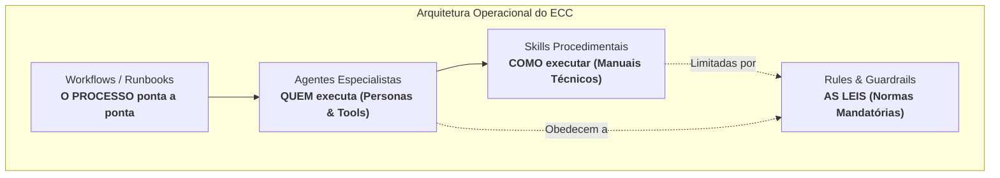
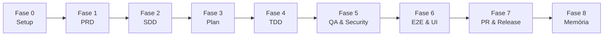

# ECC - Everything Claude Code

> **Esteira e Framework de Engenharia de Software Orientado a Agentes de IA**  
> Compatível com ecossistemas multi-harness: **Antigravity, Claude Code, Cursor, Codex, OpenCode, Gemini e Zed**.

---

## 📌 Visão Geral

O **ECC (*Everything Claude Code*)** é uma infraestrutura operacional, metodológica e de governança para desenvolvimento de software assistido por agentes de inteligência artificial.

Seu princípio fundamental é:
> *"Otimize a janela de contexto. Persista todo o resto."*

Em vez de depender de prompts improvisados (*vibe coding*), o ECC estabelece uma **linha de montagem disciplinada e determinística**:
$$\text{Onboarding} \longrightarrow \text{Discovery (PRD)} \longrightarrow \text{Design (SDD)} \longrightarrow \text{Plano Técnico} \longrightarrow \text{TDD} \longrightarrow \text{Verificação Adversarial} \longrightarrow \text{E2E} \longrightarrow \text{Release} \longrightarrow \text{Memória}$$

Para um aprofundamento na arquitetura do ECC e comparação detalhada com metodologias como Spec-Driven (BMAD, SpecKit) e Frameworks Multi-Agentes (CrewAI, LangGraph), consulte:
* 📘 [**ecc.md**](ecc.md) — Fundamentos, arquitetura do ECC, AgentShield, Unified Memory e comparativo de mercado.

---

## 🏛️ Os Quatro Pilares do Repositório

O repositório é estruturado em torno de quatro guias mestres que conectam pessoas, processos, procedimentos e regras:



| Pilar | Documento Mestre | O que Contém | Quantidade |
| :--- | :--- | :--- | :---: |
| 🤖 **Agentes** | [**`agents.md`**](agents.md) | Catálogo e arquitetura dos subagentes especialistas, orquestração e regras de acionamento imediato. | **69 agentes** |
| 🧠 **Skills** | [**`skills.md`**](skills.md) | Manuais procedimentais de engenharia (TDD, ADRs, modelagem de tipos, testes E2E, memória unificada). | **48 skills** |
| ⚡ **Workflows** | [**`workflows.md`**](workflows.md) | Roteiros operacionais ponta a ponta (*slash commands*) com portões de qualidade e critérios de parada (*stop conditions*). | **Comandos & Runbooks** |
| 🛡️ **Rules** | [**`rules.md`**](rules.md) | Camada normativa mandatória: Leis Universais (`common-*.md`) e convenções idiomáticas por linguagem/stack. | **121 regras** |

---

## 🚀 Pipeline de Engenharia SDLC (Fases 0 a 8)

A esteira de engenharia do ECC decompõe o ciclo de vida de desenvolvimento de software em **9 fases estruturadas**:



### Matriz das Fases da Esteira

| Fase | Título & Foco | Guia Técnico (Markdown) | Apresentação (PPTX) | Skills & Guias Aprofundados |
| :---: | :--- | :---: | :---: | :--- |
| **Geral** | **Pipeline Completa de Desenvolvimento** | [**`pipeline.md`**](markdown/pipeline.md) | [**`Pipeline.pptx`**](presentations/Pipeline.pptx) | Visão geral da esteira SDLC multi-harness |
| **0** | **Onboarding & Setup**<br>Mapeamento de stack, calibração de contexto e linters | [**`Fase 0`**](markdown/Fase%200%20-%20Onboarding%20%26%20Setup.md) | [**`Fase 0.pptx`**](presentations/Fase%200.pptx) | `project-init`, `codebase-onboarding`, `agent-sort` |
| **1** | **Concepção, Discovery & Decisões de Produto**<br>Validação de hipóteses, PRD Lean e resolução de trade-offs | [**`Fase 1`**](markdown/Fase%201%20-%20Concep%C3%A7%C3%A3o,%20Discovery%20&%20Decis%C3%B5es%20de%20Produto.md) | [**`Fase 1.pptx`**](presentations/Fase%201.pptx) | [deepresearch](skills/1.%20Brainstorming/deepresearch.md), [product-lens](skills/2.%20PRD/product-lens.md), [council](skills/2.%20PRD/council.md), [council-multi-model](skills/2.%20PRD/council-multi-model.md), [plan-prd](skills/2.%20PRD/plan-prd.md) |
| **2** | **Especificação Comportamental (SDD) & Design**<br>Contratos executáveis, ADRs e invariantes de tipos | [**`Fase 2`**](markdown/Fase%202%20-%20Especifica%C3%A7%C3%A3o%20Comportamental%20(SDD)%20&%20Design.md) | [**`Fase 2.pptx`**](presentations/Fase%202.pptx) | [intent-driven-development](skills/3.%20SDD/intent-driven-development.md), [architecture-decision-records](skills/3.%20SDD/architecture-decision-records.md), [spec-miner](skills/3.%20SDD/spec-miner.md), [type-design-analyzer](skills/3.%20SDD/type-design-analyzer.md) |
| **3** | **Planejamento Técnico de Implementação**<br>Planos atômicos, análise de riscos e revisão visual | [**`Fase 3`**](markdown/Fase%203%20-%20Planejamento%20T%C3%A9cnico%20de%20Implementa%C3%A7%C3%A3o.md) | [**`Fase 3.pptx`**](presentations/Fase%203.pptx) | `planner`, `prp-plan`, `plan-canvas` |
| **4** | **Implementação Guiada por Testes (TDD)**<br>Red-Green-Refactor, revisores por stack e cura cirúrgica | [**`Fase 4`**](markdown/Fase%204%20-%20Implementa%C3%A7%C3%A3o%20Guiada%20por%20Testes%20(TDD).md) | [**`Fase 4.pptx`**](presentations/Fase%204.pptx) | [tdd-workflow](skills/4.%20TDD/tdd-workflow.md), [ai-regression-testing](skills/4.%20TDD/ai-regression-testing.md), [eval-harness](skills/4.%20TDD/eval-harness.md), [e2e-testing](skills/4.%20TDD/e2e-testing.md) |
| **5** | **Qualidade, Segurança & Verificação Adversarial**<br>6 portões mecânicos, OWASP e verificação dupla | [**`Fase 5`**](markdown/Fase%205%20-%20Qualidade,%20Seguran%C3%A7a%20&%20Verifica%C3%A7%C3%A3o%20Adversarial.md) | [**`Fase 5.pptx`**](presentations/Fase%205.pptx) | [verification-loop](skills/6.%20Quality%20and%20Security/verification-loop.md), [delivery-gate](skills/6.%20Quality%20and%20Security/delivery-gate.md), [santa-method](skills/6.%20Quality%20and%20Security/santa-method.md), [security-reviewer](skills/6.%20Quality%20and%20Security/security-reviewer.md), [plankton-code-quality](skills/6.%20Quality%20and%20Security/plankton-code-quality.md) |
| **6** | **Testes Ponta a Ponta (E2E) & Auditoria de UI**<br>Playwright, regressão visual, Core Web Vitals e a11y | [**`Fase 6`**](markdown/Fase%206%20-%20Testes%20Ponta%20a%20Ponta%20(E2E)%20&%20Auditoria%20de%20UI.md) | [**`Fase 6.pptx`**](presentations/Fase%206.pptx) | [browser-qa](skills/5.%20UI/browser-qa.md), [click-path-audit](skills/5.%20UI/click-path-audit.md), `a11y-architect` |
| **7** | **Publicação, Pull Request & Produção**<br>Auditoria pré-lançamento, Git limpo e templates de PR | [**`Fase 7`**](markdown/Fase%207%20-%20Publica%C3%A7%C3%A3o,%20Pull%20Request%20&%20Produ%C3%A7%C3%A3o.md) | [**`Fase 7.pptx`**](presentations/Fase%207.pptx) | [git-workflow](skills/7.%20PR/git-workflow.md), [production-audit](skills/7.%20PR/production-audit.md), `pr-test-analyzer` |
| **8** | **Governança, Memória Contínua & Aprendizado**<br>Memória de sessão, extração de instintos e CODEMAPS | [**`Fase 8`**](markdown/Fase%208%20-%20Governan%C3%A7a,%20Mem%C3%B3ria%20Cont%C3%ADnua%20&%20Aprendizado.md) | [**`Fase 8.pptx`**](presentations/Fase%208.pptx) | `unified-memory`, `ck`, `continuous-learning-v2`, `living-docs-governance` |

---

## 📚 Guias Práticos Aprofundados de Skills (`skills/`)

O repositório disponibiliza **22 guias de implementação prática** organizados pelas fases da esteira na pasta [`skills/`](skills/):

```text
skills/
├── 1. Brainstorming/
│   └── deepresearch.md                      # Pesquisa e levantamento de estado da arte
├── 2. PRD/
│   ├── council.md                           # Conselho deliberativo de 4 vozes para trade-offs
│   ├── council-multi-model.md               # Crítica adversarial multi-modelo (Codex)
│   ├── plan-prd.md                          # Elaboração de PRDs estruturados
│   └── product-lens.md                      # Diagnósticos de produto estilo YC e ICE
├── 3. SDD/
│   ├── architecture-decision-records.md     # Governança de ADRs
│   ├── intent-driven-development.md         # Critérios de aceitação observáveis (AC-xxx)
│   ├── spec-miner.md                        # Mineração de especificações do código legado
│   └── type-design-analyzer.md              # Modelagem de tipos para estados válidos
├── 4. TDD/
│   ├── ai-regression-testing.md             # Blindagem contra alucinações e pontos cegos
│   ├── e2e-testing.md                       # Arquitetura e padrões para testes Playwright
│   ├── eval-harness.md                      # Avaliação orientada a evals (pass@k)
│   └── tdd-workflow.md                      # Ciclo Red-Green-Refactor estrito (≥ 80% cov)
├── 5. UI/
│   ├── browser-qa.md                        # Auditoria post-deploy de interface, a11y e CWV
│   └── click-path-audit.md                  # Rastreamento de transições e integridade de estado
├── 6. Quality and Security/
│   ├── delivery-gate.md                     # Portão mecânico para bloquear saídas prematuras
│   ├── plankton-code-quality.md             # Verificação de qualidade de código em write-time
│   ├── santa-method.md                      # Auditoria cruzada dupla independente
│   ├── security-reviewer.md                 # Detecção proativa OWASP Top 10 e vazamentos
│   └── verification-loop.md                 # Os 6 portões determinísticos de verificação
└── 7. PR/
    ├── git-workflow.md                      # Estratégias de branch, rebase e histórico limpo
    └── production-audit.md                  # Auditoria local de prontidão para produção
```

---

## 📊 Apresentações Executivas e de Treinamento (`presentations/`)

Para reuniões de arquitetura, alinhamento técnico e capacitação de equipes de engenharia, o repositório inclui **10 apresentações prontas em formato PowerPoint (`.pptx`)**:

* 📑 [**`Pipeline.pptx`**](presentations/Pipeline.pptx) — Apresentação completa da esteira de engenharia do ECC.
* 📑 [**`Fase 0.pptx`**](presentations/Fase%200.pptx) a [**`Fase 8.pptx`**](presentations/Fase%208.pptx) — Apresentação dedicada para cada fase individual da pipeline.

---

## 🛠️ Estrutura Completa do Repositório

```text
.
├── README.md                                          # Visão geral, catálogo central e mapa da esteira
├── ecc.md                                             # Guia arquitetural do ECC, conceitos e comparativo
├── agents.md                                          # Catálogo completo e governança dos 69 agentes
├── skills.md                                          # Catálogo das 48 skills e manuais procedimentais
├── workflows.md                                       # Guia de workflows, slash commands e runbooks
├── rules.md                                           # Guia das 121 regras (universais e por stack)
├── markdown/                                          # Documentação técnica detalhada das fases da pipeline
│   ├── pipeline.md                                    # Especificação completa da esteira SDLC
│   ├── Fase 0 - Onboarding & Setup.md
│   ├── Fase 1 - Concepção, Discovery & Decisões de Produto.md
│   ├── Fase 2 - Especificação Comportamental (SDD) & Design.md
│   ├── Fase 3 - Planejamento Técnico de Implementação.md
│   ├── Fase 4 - Implementação Guiada por Testes (TDD).md
│   ├── Fase 5 - Qualidade, Segurança & Verificação Adversarial.md
│   ├── Fase 6 - Testes Ponta a Ponta (E2E) & Auditoria de UI.md
│   ├── Fase 7 - Publicação, Pull Request & Produção.md
│   └── Fase 8 - Governança, Memória Contínua & Aprendizado.md
├── presentations/                                     # Apresentações executivas (.pptx)
│   ├── Pipeline.pptx
│   └── Fase 0.pptx ... Fase 8.pptx
├── skills/                                            # Guias práticos aprofundados das Fases 1 a 7
│   ├── 1. Brainstorming/
│   ├── 2. PRD/
│   ├── 3. SDD/
│   ├── 4. TDD/
│   ├── 5. UI/
│   ├── 6. Quality and Security/
│   └── 7. PR/
└── .agents/                                           # Definições instaladas e ativas no repositório
    ├── agents/                                        # 69 personas e subagentes (.md)
    ├── rules/                                         # 121 regras operacionais (.md)
    ├── skills/                                        # 48 skills estruturadas (SKILL.md)
    ├── workflows/                                     # Comandos de barra e pipelines executáveis
    └── ecc-install-state.json                         # Metadados e estado do ECC
```

---

## 🚦 Como Utilizar no seu Dia a Dia

1. **Para planejar uma nova funcionalidade:**
   Consulte os runbooks em [`workflows.md`](workflows.md) (ex.: `/plan` ou `/feature-dev`) e ative o agente [`planner`](agents.md) com a skill [`intent-driven-development`](skills/3.%20SDD/intent-driven-development.md).
2. **Para implementar código:**
   Siga a regra inegociável de TDD descrita em [`rules.md`](rules.md) e no guia [`tdd-workflow.md`](skills/4.%20TDD/tdd-workflow.md), assegurando cobertura $\ge 80\%$.
3. **Para validar qualidade e segurança antes de abrir o PR:**
   Execute a verificação em 6 etapas de [`verification-loop.md`](skills/6.%20Quality%20and%20Security/verification-loop.md) e passe pelo [`delivery-gate.md`](skills/6.%20Quality%20and%20Security/delivery-gate.md).
4. **Para abrir o Pull Request:**
   Utilize o workflow padronizado em [`git-workflow.md`](skills/7.%20PR/git-workflow.md) e audite o código com [`production-audit.md`](skills/7.%20PR/production-audit.md).

---

## 📄 Licença

Este repositório é distribuído sob a licença [MIT](https://opensource.org/licenses/MIT).
