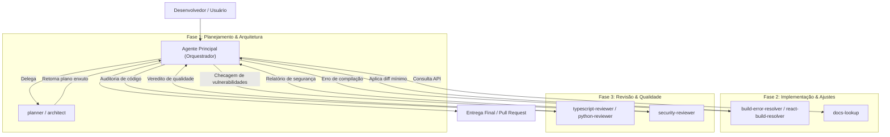
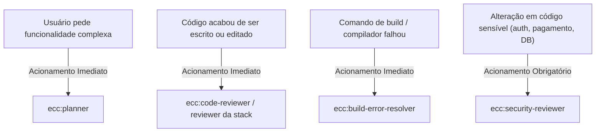

# Catálogo e Arquitetura de Agentes Especialistas do ECC

O **ECC (*Everything Claude Code*)** adota uma arquitetura de múltiplos agentes especializados (*multi-agent architecture*). Em vez de delegar todas as atividades de engenharia de software a um único modelo generalista sobrecarregado de instruções e contexto, o ECC divide o trabalho entre **subagentes com responsabilidades restritas, ferramentas delimitadas e personas técnicas rigorosas**.

Este documento apresenta a fundamentação dessa arquitetura, o fluxo de colaboração e o catálogo completo dos **69 agentes** instalados no repositório em [`.agents/agents/`](file:///home/willycornelissen/Desktop/Dablio/ecc/.agents/agents/).

---

## 1. Por que Subagentes Especializados?

O desenvolvimento assistido por IA em projetos corporativos enfrenta desafios recorrentes:
1. **Poluição de Contexto (*Context Bloat*)**: Misturar discussões de arquitetura, pilhas de logs de erro de compilação e centenas de linhas de código em um único prompt degrada a capacidade de raciocínio do modelo.
2. **Deriva Comportamental (*Instruction Drift*)**: Instruções genéricas como *"seja cuidadoso com segurança, formate os commits e otimize performance"* tendem a ser ignoradas quando a tarefa fica complexa.
3. **Custos e Desempenho**: Tarefas mecânicas (como corrigir um erro de linter ou buscar documentação) não necessitam de modelos pesados, podendo ser delegadas a modelos mais rápidos e econômicos.

### O Modelo de Orquestração do ECC



---

## 2. Catálogo Completo dos Agentes

Os 69 agentes estão agrupados em 8 domínios funcionais:

---

### 2.1. Arquitetura, Planejamento e Exploração

Agentes com visão macro, responsáveis por mapear sistemas e estruturar o plano de ação antes da escrita de código:

| Agente | Arquivo de Definição | Função Principal |
| :--- | :--- | :--- |
| **`planner`** | [`planner.md`](file:///home/willycornelissen/Desktop/Dablio/ecc/.agents/agents/planner.md) | Decompõe demandas complexas e grandes refatorações em planos acionáveis com análise de riscos, dependências e critérios de aceitação. |
| **`architect`** | [`architect.md`](file:///home/willycornelissen/Desktop/Dablio/ecc/.agents/agents/architect.md) | Especialista em design de sistemas distribuídos, escalabilidade, separação de camadas e governança técnica. |
| **`code-architect`** | [`code-architect.md`](file:///home/willycornelissen/Desktop/Dablio/ecc/.agents/agents/code-architect.md) | Analisa convenções do código existente e desenha plantas detalhadas de implementação (interfaces, fluxos de dados, ordem de compilação). |
| **`code-explorer`** | [`code-explorer.md`](file:///home/willycornelissen/Desktop/Dablio/ecc/.agents/agents/code-explorer.md) | Rastreia caminhos de execução, dependências e arquitetura em bases de código grandes ou pouco documentadas. |
| **`network-architect`** | [`network-architect.md`](file:///home/willycornelissen/Desktop/Dablio/ecc/.agents/agents/network-architect.md) | Desenha arquiteturas de rede corporativa, topologias multi-site e fluxos de roteamento seguro. |
| **`homelab-architect`** | [`homelab-architect.md`](file:///home/willycornelissen/Desktop/Dablio/ecc/.agents/agents/homelab-architect.md) | Desenha topologias de rede doméstica e laboratórios para desenvolvedores, com planos de rollback seguros. |

---

### 2.2. Revisores de Código Especializados por Linguagem/Stack

Revisores profundos que conhecem peculiaridades, armadilhas idiomáticas e vetores de falha específicos de cada ecossistema:

| Agente | Arquivo de Definição | Especialidade e Foco |
| :--- | :--- | :--- |
| **`typescript-reviewer`** | [`typescript-reviewer.md`](file:///home/willycornelissen/Desktop/Dablio/ecc/.agents/agents/typescript-reviewer.md) | Type safety rigorosa, assincronicidade (Promises, async/await), padrões defensivos Node.js e web. |
| **`react-reviewer`** | [`react-reviewer.md`](file:///home/willycornelissen/Desktop/Dablio/ecc/.agents/agents/react-reviewer.md) | Regras de hooks, render loops, boundaries entre Server e Client Components, acessibilidade e memoização. |
| **`vue-reviewer`** | [`vue-reviewer.md`](file:///home/willycornelissen/Desktop/Dablio/ecc/.agents/agents/vue-reviewer.md) | Composition API, reatividade profunda, arquitetura de componentes, Pinia e SSR. |
| **`python-reviewer`** | [`python-reviewer.md`](file:///home/willycornelissen/Desktop/Dablio/ecc/.agents/agents/python-reviewer.md) | Conformidade com PEP 8, concorrência (`asyncio`), type hints modernos e idioms pythônicos. |
| **`django-reviewer`** | [`django-reviewer.md`](file:///home/willycornelissen/Desktop/Dablio/ecc/.agents/agents/django-reviewer.md) | Segurança no ORM (evita N+1), padrões Django Rest Framework (DRF), segurança em migrações. |
| **`fastapi-reviewer`** | [`fastapi-reviewer.md`](file:///home/willycornelissen/Desktop/Dablio/ecc/.agents/agents/fastapi-reviewer.md) | Injeção de dependências, schemas Pydantic, performance assíncrona e conformidade OpenAPI. |
| **`go-reviewer`** | [`go-reviewer.md`](file:///home/willycornelissen/Desktop/Dablio/ecc/.agents/agents/go-reviewer.md) | Idioms de Go, concorrência segura (goroutines, channels, race conditions) e tratamento explícito de erros. |
| **`rust-reviewer`** | [`rust-reviewer.md`](file:///home/willycornelissen/Desktop/Dablio/ecc/.agents/agents/rust-reviewer.md) | Ownership, borrow checker, lifetimes, uso seguro de blocos `unsafe` e idioms zero-cost. |
| **`java-reviewer`** | [`java-reviewer.md`](file:///home/willycornelissen/Desktop/Dablio/ecc/.agents/agents/java-reviewer.md) | Spring Boot e Quarkus: arquitetura em camadas, JPA/Panache, concorrência e transações. |
| **`csharp-reviewer`** | [`csharp-reviewer.md`](file:///home/willycornelissen/Desktop/Dablio/ecc/.agents/agents/csharp-reviewer.md) | Convenções .NET, async/await, nullable reference types, LINQ e segurança corporativa. |
| **`cpp-reviewer`** | [`cpp-reviewer.md`](file:///home/willycornelissen/Desktop/Dablio/ecc/.agents/agents/cpp-reviewer.md) | Gestão de memória (RAII, smart pointers), C++ moderno (C++20), concorrência e templates. |
| **`php-reviewer`** | [`php-reviewer.md`](file:///home/willycornelissen/Desktop/Dablio/ecc/.agents/agents/php-reviewer.md) | PSR-12, sistema de tipos moderno do PHP 8+, padrões Eloquent ORM e segurança. |
| **`swift-reviewer`** | [`swift-reviewer.md`](file:///home/willycornelissen/Desktop/Dablio/ecc/.agents/agents/swift-reviewer.md) | Protocol-oriented design, value semantics, ARC (memory leaks) e Swift Concurrency (`async/await`, atores). |
| **`kotlin-reviewer`** | [`kotlin-reviewer.md`](file:///home/willycornelissen/Desktop/Dablio/ecc/.agents/agents/kotlin-reviewer.md) | Padrões Kotlin idiomáticos, coroutines seguras, Jetpack Compose e clean architecture mobile. |
| **`flutter-reviewer`** | [`flutter-reviewer.md`](file:///home/willycornelissen/Desktop/Dablio/ecc/.agents/agents/flutter-reviewer.md) | Árvore de widgets Flutter, gerenciamento de estado (Bloc, Riverpod, Provider) e performance gráfica. |
| **`fsharp-reviewer`** | [`fsharp-reviewer.md`](file:///home/willycornelissen/Desktop/Dablio/ecc/.agents/agents/fsharp-reviewer.md) | Paradigma funcional, imutabilidade, pattern matching e computation expressions em F#. |

---

### 2.3. Resolutores de Falhas de Compilação e Build (*Build Resolvers*)

Especialistas acionados imediatamente quando compilações ou testes quebram. Seu lema operacional é **cura cirúrgica com diffs mínimos**, sem fazer refatorações oportunistas:

| Agente | Arquivo de Definição | Escopo de Resolução |
| :--- | :--- | :--- |
| **`build-error-resolver`** | [`build-error-resolver.md`](file:///home/willycornelissen/Desktop/Dablio/ecc/.agents/agents/build-error-resolver.md) | Erros de TypeScript e empacotamento JS/Node.js. |
| **`react-build-resolver`** | [`react-build-resolver.md`](file:///home/willycornelissen/Desktop/Dablio/ecc/.agents/agents/react-build-resolver.md) | Quebras em bundlers (Vite, Next.js, Webpack, esbuild), erros JSX/TSX e hydration mismatches. |
| **`rust-build-resolver`** | [`rust-build-resolver.md`](file:///home/willycornelissen/Desktop/Dablio/ecc/.agents/agents/rust-build-resolver.md) | Falhas de `cargo build`, borrow checker e dependências no `Cargo.toml`. |
| **`go-build-resolver`** | [`go-build-resolver.md`](file:///home/willycornelissen/Desktop/Dablio/ecc/.agents/agents/go-build-resolver.md) | Erros de compilação, pacotes ausentes, problemas no `go.mod` e avisos do `go vet`. |
| **`django-build-resolver`** | [`django-build-resolver.md`](file:///home/willycornelissen/Desktop/Dablio/ecc/.agents/agents/django-build-resolver.md) | Conflitos de migrações no banco, erros de ambiente pip/Poetry e `collectstatic`. |
| **`java-build-resolver`** | [`java-build-resolver.md`](file:///home/willycornelissen/Desktop/Dablio/ecc/.agents/agents/java-build-resolver.md) | Compilação javac, resolução de dependências Maven (`pom.xml`) e Gradle. |
| **`kotlin-build-resolver`** | [`kotlin-build-resolver.md`](file:///home/willycornelissen/Desktop/Dablio/ecc/.agents/agents/kotlin-build-resolver.md) | Falhas no compilador `kotlinc`, tarefas Gradle e configuração do Android Gradle Plugin. |
| **`cpp-build-resolver`** | [`cpp-build-resolver.md`](file:///home/willycornelissen/Desktop/Dablio/ecc/.agents/agents/cpp-build-resolver.md) | Configuração de CMake, erros do linker, cabeçalhos não encontrados e erros de templates C++. |
| **`swift-build-resolver`** | [`swift-build-resolver.md`](file:///home/willycornelissen/Desktop/Dablio/ecc/.agents/agents/swift-build-resolver.md) | Quebras no Xcode, Swift Package Manager (SPM) e assinaturas de código. |
| **`dart-build-resolver`** | [`dart-build-resolver.md`](file:///home/willycornelissen/Desktop/Dablio/ecc/.agents/agents/dart-build-resolver.md) | Diagnósticos de `dart analyze`, conflitos no `pubspec.yaml` e geração com `build_runner`. |
| **`pytorch-build-resolver`** | [`pytorch-build-resolver.md`](file:///home/willycornelissen/Desktop/Dablio/ecc/.agents/agents/pytorch-build-resolver.md) | Incompatibilidade de tensores, erros de CUDA/GPU, falhas de DataLoader e mixed precision. |
| **`harmonyos-app-resolver`** | [`harmonyos-app-resolver.md`](file:///home/willycornelissen/Desktop/Dablio/ecc/.agents/agents/harmonyos-app-resolver.md) | Erros de compilação em ArkTS, ArkUI e Navigation routing em OpenHarmony / HarmonyOS. |

---

### 2.4. Qualidade, Testes e Segurança

Agentes de conformidade que blindam o produto contra regressões e vulnerabilidades:

| Agente | Arquivo de Definição | Função Principal |
| :--- | :--- | :--- |
| **`security-reviewer`** | [`security-reviewer.md`](file:///home/willycornelissen/Desktop/Dablio/ecc/.agents/agents/security-reviewer.md) | Detecta vulnerabilidades OWASP Top 10, injeções, vazamentos de credenciais, falhas de autorização (BOLA/IDOR) e race conditions em saldos. |
| **`code-reviewer`** | [`code-reviewer.md`](file:///home/willycornelissen/Desktop/Dablio/ecc/.agents/agents/code-reviewer.md) | Auditoria geral de qualidade, conformidade com padrões e legibilidade em todas as alterações. |
| **`tdd-guide`** | [`tdd-guide.md`](file:///home/willycornelissen/Desktop/Dablio/ecc/.agents/agents/tdd-guide.md) | Mentor de Test-Driven Development; assegura ciclo Red-Green-Refactor e cobertura $\ge 80\%$. |
| **`e2e-runner`** | [`e2e-runner.md`](file:///home/willycornelissen/Desktop/Dablio/ecc/.agents/agents/e2e-runner.md) | Criação, manutenção e execução de testes E2E com Playwright / Vercel Agent Browser. |
| **`pr-test-analyzer`** | [`pr-test-analyzer.md`](file:///home/willycornelissen/Desktop/Dablio/ecc/.agents/agents/pr-test-analyzer.md) | Avalia a robustez dos testes contidos em Pull Requests, identificando testes superficiais ou frágeis. |
| **`silent-failure-hunter`** | [`silent-failure-hunter.md`](file:///home/willycornelissen/Desktop/Dablio/ecc/.agents/agents/silent-failure-hunter.md) | Detecta erros mascarados: blocos `catch` vazios, fallbacks imprudentes e promessas rejeitadas sem tratamento. |
| **`a11y-architect`** | [`a11y-architect.md`](file:///home/willycornelissen/Desktop/Dablio/ecc/.agents/agents/a11y-architect.md) | Especialista em conformidade com as diretrizes de acessibilidade WCAG 2.2 (Web e Mobile). |
| **`database-reviewer`** | [`database-reviewer.md`](file:///home/willycornelissen/Desktop/Dablio/ecc/.agents/agents/database-reviewer.md) | Otimiza consultas SQL, previne N+1, desenha índices eficientes e audita migrações (foco em PostgreSQL / Supabase). |

---

### 2.5. Performance, Refatoração e Tipagem Avançada

Agentes dedicados a manter a base de código rápida, limpa e elegante:

| Agente | Arquivo de Definição | Função Principal |
| :--- | :--- | :--- |
| **`performance-optimizer`** | [`performance-optimizer.md`](file:///home/willycornelissen/Desktop/Dablio/ecc/.agents/agents/performance-optimizer.md) | Análise de profiling, identificação de gargalos de CPU/memória, redução de bundle e otimização de render. |
| **`code-simplifier`** | [`code-simplifier.md`](file:///home/willycornelissen/Desktop/Dablio/ecc/.agents/agents/code-simplifier.md) | Refatora código prolixo ou excessivamente complexo preservando rigorosamente o comportamento funcional. |
| **`refactor-cleaner`** | [`refactor-cleaner.md`](file:///home/willycornelissen/Desktop/Dablio/ecc/.agents/agents/refactor-cleaner.md) | Localiza e remove código morto (*dead code*), variáveis inutilizadas e dependências órfãs. |
| **`type-design-analyzer`** | [`type-design-analyzer.md`](file:///home/willycornelissen/Desktop/Dablio/ecc/.agents/agents/type-design-analyzer.md) | Modela tipos avançados (*branded types*, uniões discriminadas) para tornar estados inválidos impossíveis em tempo de compilação. |
| **`comment-analyzer`** | [`comment-analyzer.md`](file:///home/willycornelissen/Desktop/Dablio/ecc/.agents/agents/comment-analyzer.md) | Examina comentários no código para identificar obsolescência (*comment rot*), divergências com a lógica e falta de clareza. |

---

### 2.6. Inteligência Artificial e Domínios Especializados

Agentes preparados para verticais técnicas específicas:

| Agente | Arquivo de Definição | Função Principal |
| :--- | :--- | :--- |
| **`rag-pipeline-reviewer`** | [`rag-pipeline-reviewer.md`](file:///home/willycornelissen/Desktop/Dablio/ecc/.agents/agents/rag-pipeline-reviewer.md) | Audita qualidade de busca semântica, estratégias de chunking, seleção de modelos de embedding e avaliação de recuperação. |
| **`mle-reviewer`** | [`mle-reviewer.md`](file:///home/willycornelissen/Desktop/Dablio/ecc/.agents/agents/mle-reviewer.md) | Revisa pipelines de ML em produção: reprodutibilidade de treino, feature stores, métricas de drift e serving. |
| **`healthcare-reviewer`** | [`healthcare-reviewer.md`](file:///home/willycornelissen/Desktop/Dablio/ecc/.agents/agents/healthcare-reviewer.md) | Audita sistemas de saúde em conformidade com PHI/HIPAA e segurança clínica em prontuários eletrônicos (EHR). |
| **`seo-specialist`** | [`seo-specialist.md`](file:///home/willycornelissen/Desktop/Dablio/ecc/.agents/agents/seo-specialist.md) | Auditoria técnica de SEO, Core Web Vitals, marcação Schema.org e sitemaps. |
| **`marketing-agent`** | [`marketing-agent.md`](file:///home/willycornelissen/Desktop/Dablio/ecc/.agents/agents/marketing-agent.md) | Produção de copy técnico, páginas de captura, documentação de lançamento e sequências de e-mail. |

---

### 2.7. Operação, Avaliação e Governança de Agentes (*Agent Ops*)

Agentes focados em avaliar e melhorar o próprio ecossistema de agentes:

| Agente | Arquivo de Definição | Função Principal |
| :--- | :--- | :--- |
| **`agent-evaluator`** | [`agent-evaluator.md`](file:///home/willycornelissen/Desktop/Dablio/ecc/.agents/agents/agent-evaluator.md) | Aplica scorecard de 5 eixos (Precisão, Completude, Clareza, Acionabilidade, Concisão) nas entregas de outros agentes. |
| **`harness-optimizer`** | [`harness-optimizer.md`](file:///home/willycornelissen/Desktop/Dablio/ecc/.agents/agents/harness-optimizer.md) | Calibra configurações e prompts do harness local para maximizar a taxa de acerto (`pass@k`). |
| **`loop-operator`** | [`loop-operator.md`](file:///home/willycornelissen/Desktop/Dablio/ecc/.agents/agents/loop-operator.md) | Monitora execuções de loops autônomos e intervém com segurança se houver estagnação ou desvio. |
| **`conversation-analyzer`** | [`conversation-analyzer.md`](file:///home/willycornelissen/Desktop/Dablio/ecc/.agents/agents/conversation-analyzer.md) | Analisa transcrições de sessões anteriores para sugerir regras e guardrails mecânicos (`hookify`). |
| **`spec-miner`** | [`spec-miner.md`](file:///home/willycornelissen/Desktop/Dablio/ecc/.agents/agents/spec-miner.md) | Minera especificações comportamentais e invariantes a partir de código legado para o padrão OpenSpec. |
| **`gan-planner`** | [`gan-planner.md`](file:///home/willycornelissen/Desktop/Dablio/ecc/.agents/agents/gan-planner.md) | Cria especificações funcionais e critérios de avaliação para o ciclo adversarial GAN. |
| **`gan-generator`** | [`gan-generator.md`](file:///home/willycornelissen/Desktop/Dablio/ecc/.agents/agents/gan-generator.md) | Implementa o código frontend/UI seguindo a especificação do `gan-planner`. |
| **`gan-evaluator`** | [`gan-evaluator.md`](file:///home/willycornelissen/Desktop/Dablio/ecc/.agents/agents/gan-evaluator.md) | Testa a aplicação viva via Playwright e devolve feedback corretivo ao `gan-generator` até atingir aprovação. |

---

### 2.8. Operações de Rede, Sanitização Open Source e Documentação

Agentes utilitários para suporte ao desenvolvedor e publicações externas:

| Agente | Arquivo de Definição | Função Principal |
| :--- | :--- | :--- |
| **`opensource-forker`** | [`opensource-forker.md`](file:///home/willycornelissen/Desktop/Dablio/ecc/.agents/agents/opensource-forker.md) | Clona projetos e remove segredos, chaves de API e referências internas de infraestrutura corporativa. |
| **`opensource-sanitizer`** | [`opensource-sanitizer.md`](file:///home/willycornelissen/Desktop/Dablio/ecc/.agents/agents/opensource-sanitizer.md) | Faz varredura com mais de 20 padrões regex para garantir ausência total de credenciais ou dados sensíveis antes do release. |
| **`opensource-packager`** | [`opensource-packager.md`](file:///home/willycornelissen/Desktop/Dablio/ecc/.agents/agents/opensource-packager.md) | Gera arquivos padronizados (`README.md`, `LICENSE`, `CONTRIBUTING.md`, templates de issue e `setup.sh`). |
| **`doc-updater`** | [`doc-updater.md`](file:///home/willycornelissen/Desktop/Dablio/ecc/.agents/agents/doc-updater.md) | Atualiza mapas de código (`docs/CODEMAPS/*`) e guias internos com base nas alterações mais recentes. |
| **`docs-lookup`** | [`docs-lookup.md`](file:///home/willycornelissen/Desktop/Dablio/ecc/.agents/agents/docs-lookup.md) | Busca documentações técnicas oficiais e atualizadas via servidores MCP (Context7). |
| **`network-config-reviewer`** | [`network-config-reviewer.md`](file:///home/willycornelissen/Desktop/Dablio/ecc/.agents/agents/network-config-reviewer.md) | Revisa arquivos de configuração de roteadores e switches (Cisco, Junos, etc.) para segurança e consistência. |
| **`network-troubleshooter`** | [`network-troubleshooter.md`](file:///home/willycornelissen/Desktop/Dablio/ecc/.agents/agents/network-troubleshooter.md) | Diagnostica problemas de conectividade, DNS e roteamento seguindo a metodologia das camadas OSI. |
| **`chief-of-staff`** | [`chief-of-staff.md`](file:///home/willycornelissen/Desktop/Dablio/ecc/.agents/agents/chief-of-staff.md) | Faz triagem de mensagens de comunicação (e-mail, Slack) em 4 categorias de prioridade e gera rascunhos de resposta. |

---

## 3. Resumo Operacional

Graças a esse ecossistema especializado:
1. **O contexto de trabalho nunca fica sobrecarregado**: o agente orquestrador delega tarefas pontuais aos subagentes e absorve apenas os relatórios sintetizados.
2. **A integridade é mantida**: falhas de build têm seus próprios especialistas cirúrgicos, regras de segurança contam com auditoria proativa e as revisões respeitam as melhores práticas da linguagem em uso.
3. **Conformidade em todas as fases**: do planejamento inicial com o [`planner`](file:///home/willycornelissen/Desktop/Dablio/ecc/.agents/agents/planner.md) até a revisão pré-merge com o [`security-reviewer`](file:///home/willycornelissen/Desktop/Dablio/ecc/.agents/agents/security-reviewer.md), cada aspecto da entrega é validado de forma autônoma e consistente.


---

## 4. Como Acionar um Agente

No ecossistema do ECC, o acionamento de um agente especialista pode ocorrer de três formas principais:

1. **Pelo usuário diretamente no chat** (via linguagem natural ou comandos de barra);
2. **De forma proativa e automática pelo agente orquestrador** (conforme os gatilhos do ciclo de desenvolvimento);
3. **Por regras mecânicas e hooks de ciclo de vida** (*runtime hooks*).

---

### 4.1. Acionamento pelo Usuário no Chat

O desenvolvedor pode solicitar o acionamento diretamente na conversa sem necessidade de chamadas de baixo nível:

#### A. Por Menção Direta (Linguagem Natural)
Basta solicitar que o assistente assuma a persona ou delegue a tarefa para o agente específico:
* *"Use o `security-reviewer` para auditar o fluxo de autenticação em `src/auth/jwt.ts`."*
* *"Acione o `react-reviewer` para revisar este novo componente de formulário."*
* *"Chame o `agent-evaluator` para avaliar a qualidade e completude da entrega anterior."*

#### B. Via Comandos de Barra (*Slash Commands*)
Diversos comandos integrados da esteira já acionam agentes especializados por trás dos panos:
* `/plan`: Aciona o [`planner`](file:///home/willycornelissen/Desktop/Dablio/ecc/.agents/agents/planner.md) para decompor requisitos e estruturar as etapas de implementação.
* `/pr`: Prepara o Pull Request acionando o [`code-reviewer`](file:///home/willycornelissen/Desktop/Dablio/ecc/.agents/agents/code-reviewer.md) e auditorias de produção.
* `/hookify`: Aciona o [`conversation-analyzer`](file:///home/willycornelissen/Desktop/Dablio/ecc/.agents/agents/conversation-analyzer.md) para extrair regras e guardrails da sessão.

---

### 4.2. Acionamento Proativo pelo Orquestrador (*Immediate Agent Usage*)

De acordo com a governança do ECC (especificada em [`.agents/rules/common-agents.md`](file:///home/willycornelissen/Desktop/Dablio/ecc/.agents/rules/common-agents.md)), o agente orquestrador tem a obrigação de acionar especialistas **automaticamente**, sem esperar uma instrução explícita do usuário, nos seguintes gatilhos:



* **Demandas complexas ou refatorações estruturais**: Dispara o [`planner`](file:///home/willycornelissen/Desktop/Dablio/ecc/.agents/agents/planner.md) ou [`architect`](file:///home/willycornelissen/Desktop/Dablio/ecc/.agents/agents/architect.md).
* **Código recém-escrito ou alterado**: Dispara o [`code-reviewer`](file:///home/willycornelissen/Desktop/Dablio/ecc/.agents/agents/code-reviewer.md) ou o revisor da linguagem (ex: [`typescript-reviewer`](file:///home/willycornelissen/Desktop/Dablio/ecc/.agents/agents/typescript-reviewer.md), [`python-reviewer`](file:///home/willycornelissen/Desktop/Dablio/ecc/.agents/agents/python-reviewer.md)).
* **Falha de compilação ou checagem de tipos**: Dispara o resolver cirúrgico correspondente (ex: [`react-build-resolver`](file:///home/willycornelissen/Desktop/Dablio/ecc/.agents/agents/react-build-resolver.md), [`go-build-resolver`](file:///home/willycornelissen/Desktop/Dablio/ecc/.agents/agents/go-build-resolver.md)).
* **Criação de novas rotas ou regras de negócio**: Dispara o [`tdd-guide`](file:///home/willycornelissen/Desktop/Dablio/ecc/.agents/agents/tdd-guide.md).

---

### 4.3. Mecanismo Técnico (Sob o Capô)

Cada ambiente de execução (*harness*) possui sua ferramenta nativa para instanciar subagentes em um **contexto limpo e isolado**:

#### No Antigravity / Gemini CLI:
O orquestrador chama a ferramenta nativa `invoke_subagent`:
```json
{
  "TypeName": "security-reviewer",
  "Role": "Security Vulnerability Auditor",
  "Prompt": "Audite o arquivo src/services/auth.py buscando falhas OWASP, vazamento de credenciais e injeção de parâmetros.",
  "Model": "inherit"
}
```

#### No Claude Code (via plugin ECC):
O Claude invoca a ferramenta `Agent` com escopo de namespace:
```text
Agent(
  subagent_type: "ecc:planner", 
  prompt: "Crie o plano de implementação para o novo gateway de pagamentos..."
)
```

O subagente é iniciado em uma sub-sessão em segundo plano (*background*), executa o trabalho sem poluir a janela de contexto principal e devolve apenas o veredito sintetizado.

---

### 4.4. Acionamento em Paralelo e Contrato de Delegação

O ECC estabelece regras rígidas de delegação em [`.agents/rules/common-agents.md`](file:///home/willycornelissen/Desktop/Dablio/ecc/.agents/rules/common-agents.md#L36-L59):

1. **Paralelismo por Padrão**: Tarefas independentes devem rodar em agentes paralelos ao mesmo tempo (por exemplo: acionar simultaneamente o [`security-reviewer`](file:///home/willycornelissen/Desktop/Dablio/ecc/.agents/agents/security-reviewer.md) para o backend e o [`a11y-architect`](file:///home/willycornelissen/Desktop/Dablio/ecc/.agents/agents/a11y-architect.md) para a tela frontend).
2. **Contrato de Finalização (*Delegation Completion Contract*)**: O agente orquestrador **nunca** pode encerrar o turno com *"aguardando os subagentes terminarem"*. Quem delega é obrigado a esperar a conclusão, compilar os resultados e entregar a resposta unificada ao usuário.
