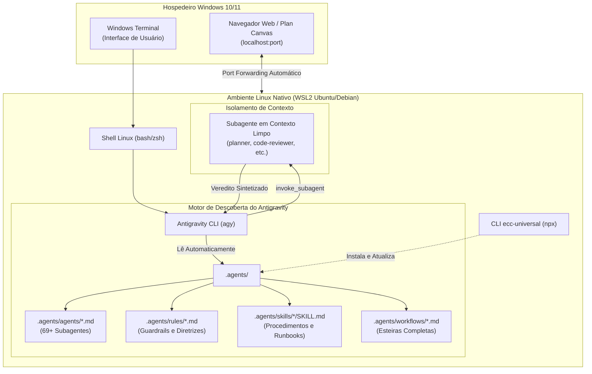
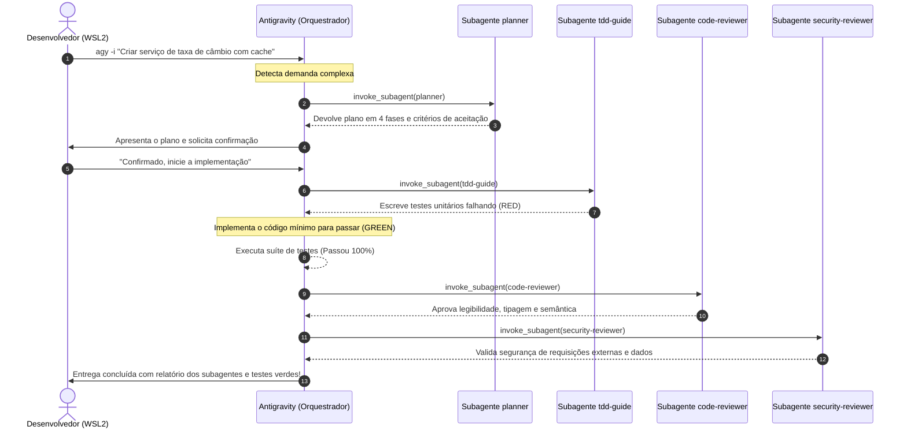

# Guia de Instalação e Utilização do ECC no Antigravity CLI (WSL2)

O **Antigravity CLI (`agy`)** é o ambiente de execução em linha de comando (*agent harness*) de nova geração da Google, projetado para empoderar desenvolvedores com agentes autônomos, execução paralela de subagentes e ferramentas avançadas de raciocínio.

Ao integrar o **ECC (*Everything Claude Code*)** ao Antigravity CLI rodando dentro do **WSL2 (Windows Subsystem for Linux 2)**, você transforma o terminal em uma esteira completa de engenharia de software governada por:
- **69+ Agentes Especialistas** acionados cirurgicamente em contextos limpos (*fresh context*);
- **300+ Skills Modulares** carregadas sob demanda via *progressive disclosure*;
- **120+ Regras Normativas e Guardrails** que impedem alucinações, código sem testes e falhas de segurança;
- **Memória Unificada (`unified-memory`)** compartilhável entre múltiplos harnesses e sessões.

---

## 1. Arquitetura da Integração (Antigravity + ECC + WSL2)

O ecossistema opera em camadas coordenadas: o Windows atua como hospedeiro da interface gráfica e navegador, o WSL2 provê o kernel Linux nativo de alta performance para execução de ferramentas, e o Antigravity gerencia o ciclo do agente descobrindo dinamicamente as definições do ECC.



### Por que rodar no WSL2?
1. **Desempenho de I/O Nativo**: Sistemas de arquivos ext4 no Linux executam compilações, varreduras de repositórios git e verificações de linters com velocidade até 10x superior em relação ao acesso via Windows.
2. **Ambiente Idêntico à Produção**: Evita incompatibilidades de scripts shell (`.sh`), caminhos POSIX e binários de desenvolvimento.
3. **Isolamento e Segurança**: Mantém dependências de desenvolvimento, pacotes npm e ferramentas do agente isolados do sistema operacional hospedeiro.

---

## 2. Pré-requisitos e Configuração do WSL2

Antes de instalar o ECC, certifique-se de que seu ambiente WSL2 e o Antigravity CLI estão configurados corretamente.

### 2.1. Regra de Ouro do WSL2: Localização do Repositório
> [!CAUTION]
> **NUNCA clone ou execute seus projetos sob o ponto de montagem do Windows (`/mnt/c/...`).**  
> O acesso de leitura/escrita cruzando a fronteira DrvFs (`/mnt/c/`) causa lentidão extrema, falhas de permissão (`chmod`) e quebra eventos de *file watcher*.  
> **Sempre mantenha seus repositórios no sistema de arquivos nativo do Linux**, por exemplo em:
> ```bash
> ~/projects/meu-projeto
> # ou
> /home/$USER/workspace/meu-projeto
> ```

### 2.2. Ferramentas Necessárias no WSL2
Abra seu terminal WSL2 (Ubuntu/Debian) e execute:

```bash
# 1. Atualizar repositórios do sistema
sudo apt update && sudo apt upgrade -y

# 2. Instalar dependências essenciais
sudo apt install -y curl git build-essential jq

# 3. Instalar Node.js (v18+ ou v20+ recomendado via nvm ou NodeSource)
if ! command -v node &> /dev/null; then
    curl -fsSL https://deb.nodesource.com/setup_20.x | sudo -E bash -
    sudo apt install -y nodejs
fi

# Verificar versões
node --version
npm --version
git --version
```

### 2.3. Instalação e Autenticação do Antigravity CLI (`agy`)
Caso ainda não tenha o binário `agy` instalado no seu WSL2:

```bash
# 1. Confirmar se o executável agy está disponível
which agy

# 2. Garantir que ~/.local/bin está no seu PATH (~/.bashrc ou ~/.zshrc)
echo 'export PATH="$HOME/.local/bin:$PATH"' >> ~/.bashrc
source ~/.bashrc

# 3. Testar a versão instalada
agy --version

# 4. Primeira autenticação (se necessário)
# O comando abrirá uma URL de autorização no navegador padrão do Windows via WSLg / xdg-open
agy
```

> [!TIP]
> O WSL2 faz o encaminhamento automático de portas para o Windows (`localhost`). Quando o Antigravity ou ferramentas do ECC abrirem servidores locais (como na autenticação web ou no *Plan Canvas*), você poderá acessá-los diretamente pelo navegador no Windows via `http://localhost:<porta>`.

---

## 3. Instalação do ECC no Antigravity CLI

O ECC disponibiliza o pacote universal `ecc-universal`. No ecossistema do ECC, o Antigravity é categorizado formalmente como um **Adaptador Avançado (*Advanced Adapter*)**.

### 3.1. Por que o Antigravity não aparece no menu interativo `--guided`?

Ao executar o assistente genérico interativo:
```bash
npx ecc-universal install --guided
```
O terminal exibe o seguinte menu de seleção:

```text
Which coding agents should ECC configure?
  1. Claude Code — Selected Claude plugin scope: ~/.claude or ./.claude
  2. Codex — ~/.codex through the Codex native plugin lifecycle
  3. Kimi Code — ./.kimi-code
  all. All three guided harnesses

Advanced adapters (use ecc install --target): Cursor, Antigravity, Gemini CLI, OpenCode, CodeBuddy, JoyCode, Qwen Code, Zed, Hermes, and OpenClaw.

Choose one or more (for example 1,3 or all):
```

> [!IMPORTANT]
> **Explicação Arquitetural**:  
> O menu interativo numerado (`1, 2, 3`) destina-se exclusivamente a ambientes que possuem ciclos de vida de plugins interativos gerenciados pelo próprio assistente (escopos de plugins e ganchos em runtime no Claude Code, Codex e Kimi).  
> 
> Para o **Antigravity** (assim como Cursor, OpenCode, Gemini CLI e Zed), o ECC utiliza a esteira de **Adaptadores Avançados**:
> 1. A instalação é **direta e não-interativa** via flag `--target antigravity`.
> 2. É **obrigatório** declarar um perfil (`--profile <nome>`) ou os módulos de linguagem desejados. Executar apenas `npx ecc-universal install --target antigravity` sem perfil resultará no erro:  
>    `Error: No install profile, module IDs, included components, or legacy languages were provided`.

No Antigravity, o ECC se materializa criando e gerenciando a pasta **`.agents/`** na raiz do seu repositório.

---

### 3.2. Sintaxe Canônica de Instalação (Método Recomendado)

> [!TIP]
> Para uma análise comparativa completa de todos os perfis, árvores de decisão e instruções detalhadas sobre como adicionar skills e módulos extras, consulte o guia dedicado [profiles.md](file:///home/willycornelissen/Desktop/Dablio/ecc/harness/profiles.md).

Navegue até a raiz do seu projeto no WSL2 e selecione um dos perfis pré-calibrados:

#### A. Perfil de Desenvolvimento (`developer`) — Recomendado
Instala o catálogo de 69+ subagentes, regras de desenvolvimento limpo, workflows de qualidade e memória unificada:
```bash
cd ~/projects/meu-projeto

npx ecc-universal install --target antigravity --profile developer
```

#### B. Perfil Enxuto / Baixo Consumo de Contexto (`minimal` ou `core`)
Ideal para projetos menores ou para manter a janela de contexto o mais livre possível:
```bash
cd ~/projects/meu-projeto

# Minimal: apenas regras essenciais, subagentes e comandos base
npx ecc-universal install --target antigravity --profile minimal
```

#### C. Perfil Completo (`full`)
Instala todas as regras de todas as stacks, catálogo total de skills e agentes:
```bash
npx ecc-universal install --target antigravity --profile full
```

#### D. Perfil de Segurança e Auditoria (`security`)
Focado em análise estática, detecção de vulnerabilidades OWASP e auditoria:
```bash
npx ecc-universal install --target antigravity --profile security
```

---

### 3.3. Instalação com Suporte a Linguagens Específicas

Você pode enriquecer qualquer perfil informando as linguagens da sua stack técnica no mesmo comando:

```bash
# Exemplo 1: Stack Node/TypeScript e React
npx ecc-universal install --target antigravity --profile developer typescript

# Exemplo 2: Stack Backend Python e Go
npx ecc-universal install --target antigravity --profile developer python go

# Exemplo 3: Stack Mobile com Flutter/Dart
npx ecc-universal install --target antigravity --profile developer dart
```

---

### 3.4. Teste Prévio da Instalação (`--dry-run`)
Antes de criar os arquivos no repositório, você pode simular a operação e inspecionar todo o plano de cópia:
```bash
npx ecc-universal install --target antigravity --profile developer --dry-run
```

---

### 3.5. Estrutura de Arquivos Criada no Projeto

Após a execução, a estrutura de diretórios do projeto conterá:

```text
meu-projeto/
├── .agents/
│   ├── agents/                   # 69+ subagentes especializados (.md)
│   │   ├── planner.md
│   │   ├── code-reviewer.md
│   │   ├── security-reviewer.md
│   │   ├── build-error-resolver.md
│   │   └── ...
│   ├── rules/                    # Regras normativas e diretrizes
│   │   ├── common-rules.md
│   │   ├── common-agents.md
│   │   ├── git-rules.md
│   │   └── typescript-rules.md
│   ├── skills/                   # Procedimentos detalhados (runbooks)
│   │   ├── tdd-workflow/
│   │   │   └── SKILL.md
│   │   ├── unified-memory/
│   │   │   └── SKILL.md
│   │   └── ...
│   ├── workflows/                # Orquestrações de esteira
│   │   ├── plan-interview.md
│   │   └── santa-loop.md
│   └── ecc-install-state.json    # Manifesto de integridade e auditoria
├── AGENTS.md                     # Catálogo e instruções de orquestração raiz
└── ... (seus arquivos de código)
```

> [!NOTE]
> O arquivo `ecc-install-state.json` registra a versão instalada, hash dos arquivos e módulos ativos. Ele é utilizado pelos comandos de diagnóstico (`doctor`), atualização (`auto-update`) e desinstalação limpa (`uninstall`).

---

## 4. Como o Antigravity Carrega e Executa o ECC

Diferente de IDEs que necessitam de plugins proprietários, o Antigravity possui uma arquitetura aberta baseada em arquivos de configuração que lê nativamente a pasta `.agents/`.

### 4.1. Ordem de Descoberta e Precedência
Quando você inicia o `agy` em qualquer diretório de trabalho, o agente sobe a árvore de pastas até a raiz do repositório procurando por:
1. **`.agents/` no repositório**: Customizações com prioridade máxima.
2. **`AGENTS.md` / `GEMINI.md`**: Regras hierárquicas carregadas conforme o diretório ativo.
3. **`~/.gemini/config/`**: Configurações globais da máquina WSL2.
4. **Customizações Built-in**: Habilidades e ferramentas nativas do próprio Antigravity.

### 4.2. Proteção de Janela de Contexto (*Progressive Disclosure*)
O Antigravity evita o estouro de contexto (*context bloat*) através de três mecanismos nativos:
* **Progressive Disclosure de Skills**: Na inicialização, apenas o nome e a descrição do YAML frontmatter de cada `SKILL.md` são indexados. As instruções detalhadas só entram no contexto se você ou o modelo solicitarem a execução daquela habilidade.
* **Teto Orçamentário de Regras (20.000 tokens)**: Regras ativas compartilham um teto máximo de tokens. Se as regras ultrapassarem esse limite, o Antigravity rebaixa as regras menos prioritárias para ponteiros de arquivos sob demanda.
* **Limite por Arquivo de Regra (24 KB)**: Arquivos de regra com mais de 24.000 bytes são truncados de forma limpa, garantindo estabilidade.

---

## 5. Utilização Prática no Dia a Dia

### 5.1. Iniciando o Agente

Navegue até a raiz do seu repositório no WSL2 e inicie a sessão:

```bash
cd ~/projects/meu-projeto
agy
```

#### Modos de Inicialização Úteis:
```bash
# Continuar a sessão anterior de onde parou
agy -c

# Iniciar já passando um prompt inicial interativo
agy -i "Analise a estrutura do projeto e prepare o plano de arquitetura"

# Execução pontual não-interativa (print mode)
agy -p "Rode a verificação de segurança no auth.ts"

# Modo com autoaprovação de comandos (use com critério em automações)
agy --dangerously-skip-permissions
```

---

### 5.2. Verificando os Agentes Disponíveis
Para listar todos os agentes especialistas importados pelo ECC no seu ambiente Antigravity:

```bash
agy agents
```
Você verá a lista completa com `planner`, `security-reviewer`, `code-reviewer`, `tdd-guide`, `build-error-resolver`, `performance-optimizer` e dezenas de outros.

---

### 5.3. Invocação de Agentes Especialistas

No Antigravity, os subagentes operam em **contextos limpos (*fresh context*)** via chamada nativa de `invoke_subagent`. Isso garante que o subagente não sofra com viés de confirmação nem com a poluição de logs da sessão principal.

#### A. Acionamento Proativo e Automático pelo Orquestrador
Seguindo a governança do arquivo [`.agents/rules/common-agents.md`](file:///home/willycornelissen/Desktop/Dablio/ecc/.agents/rules/common-agents.md), o Antigravity aciona especialistas automaticamente nos seguintes gatilhos:
- **Ao receber um pedido complexo ou refatoração**: Dispara o `planner` ou `architect`.
- **Após escrever ou alterar código**: Dispara o `code-reviewer` ou o revisor da stack (ex: `typescript-reviewer`, `python-reviewer`).
- **Ao detectar quebra de compilação ou tipos**: Dispara o resolver correspondente (ex: `build-error-resolver`, `react-build-resolver`, `go-build-resolver`).
- **Ao tocar em regras de autenticação, tokens ou SQL**: Dispara o `security-reviewer` ou `database-reviewer`.

#### B. Acionamento Explícito por Você no Prompt
Você pode delegar tarefas pontuais usando linguagem natural:
```text
> Use o planner para quebrar a implementação da rota de pagamento em passos com TDD.
```
```text
> Acione o security-reviewer para auditar o arquivo src/services/auth.ts antes do commit.
```
```text
> O build do Go quebrou. Chame o go-build-resolver para aplicar um diff cirúrgico.
```

---

### 5.4. Utilizando Skills e Workflows do ECC

As *skills* do ECC ensinam procedimentos padronizados de engenharia ao Antigravity.

#### Exemplos de Skills Frequentes:
| Skill | Como Acionar no Prompt | O que o Antigravity faz |
| :--- | :--- | :--- |
| **`tdd-workflow`** | *"Implemente essa função seguindo tdd-workflow"* | Cria teste que falha (RED), implementa código mínimo (GREEN) e refatora (REFACTOR) com cobertura $\ge 80\%$. |
| **`production-audit`** | *"Execute um production-audit antes do deploy"* | Audita variáveis de ambiente, logs sensíveis, rotas abertas e pontos de quebra em produção. |
| **`unified-memory`** | *"Salve o handoff da sessão no unified-memory"* | Persiste o estado da tarefa para que você continue em outro agente ou amanhã. |
| **`context-budget`** | *"Faça uma auditoria de context-budget"* | Analisa o consumo de tokens das regras e sugere podas para evitar saturação. |
| **`agent-self-evaluation`** | *"Avalie a entrega anterior com o agent-evaluator"* | Gera uma nota técnica em 5 eixos (precisão, completude, clareza, acionabilidade e concisão). |

---

### 5.5. Memória Unificada e Handoff entre Ferramentas

Uma das maiores forças do ECC no Antigravity é a capacidade de compartilhar memória entre diferentes ferramentas (por exemplo, planejar no Antigravity CLI no WSL2 e depois inspecionar no Cursor no Windows ou continuar no Claude Code):

```bash
# Inicializar o cofre de memória no repositório
npx ecc-universal memory init

# Pesquisar decisões registradas em sessões anteriores
npx ecc-universal memory search "arquitetura de autenticação"
```

---

## 6. Manutenção, Atualização e Diagnóstico

O ecossistema do ECC inclui ferramentas de governança para manter seu ambiente sempre sincronizado e funcional.

### 6.1. Diagnóstico de Saúde (`doctor`)
Verifica se algum arquivo de agente, regra ou skill foi corrompido, excluído acidentalmente ou sofreu desvio (*drift*):

```bash
npx ecc-universal doctor --target antigravity
```

### 6.2. Reparo Automático (`repair`)
Restaura arquivos padrão gerenciados pelo ECC que tenham sido alterados ou apagados:

```bash
# Visualizar o que seria restaurado
npx ecc-universal repair --dry-run

# Executar o reparo
npx ecc-universal repair
```

### 6.3. Atualização para Novas Versões (`auto-update`)
Mantém seu catálogo de 69+ agentes e regras alinhado com as melhorias mais recentes do repositório upstream:

```bash
npx ecc-universal auto-update
```

### 6.4. Desinstalação Limpa (`uninstall`)
Caso deseje remover os arquivos gerenciados pelo ECC sem afetar o restante do seu projeto:

```bash
# Prévia da desinstalação
npx ecc-universal uninstall --target antigravity --dry-run

# Remoção definitiva dos arquivos ECC
npx ecc-universal uninstall --target antigravity
```

---

## 7. Dicas de Otimização e Troubleshooting no WSL2

### 7.1. Terminal Recomendado: Windows Terminal
Para a melhor experiência visual com o Antigravity CLI (suporte completo a cores ANSI, caracteres Unicode, divisões de painel e fontes monospace modernas):
1. Instale o **Windows Terminal** via Microsoft Store ou `winget install Microsoft.WindowsTerminal`.
2. Configure uma fonte com suporte a ícones (Nerd Fonts, como *CaskaydiaCove Nerd Font* ou *JetBrains Mono Nerd Font*).
3. Garanta que a codificação padrão do shell seja UTF-8 (`export LANG=en_US.UTF-8` no seu `~/.bashrc`).

### 7.2. Git Line Endings (CRLF vs LF)
Como o código é executado no WSL2 mas pode ser visualizado no Windows, configure o Git no WSL2 para evitar conversões automáticas indesejadas:

```bash
git config --global core.autocrlf input
```

### 7.3. Port Forwarding e Conflito de Firewall
Se ferramentas web como o *Plan Canvas* (`ecc control-pane`) ou callbacks de autenticação não responderem no Windows:
- Verifique se a porta está ouvindo em `0.0.0.0` ou `localhost`.
- No Windows PowerShell (como Administrador), se necessário, libere o tráfego do WSL:
  ```powershell
  New-NetFirewallRule -DisplayName "WSL2 Inbound" -Direction Inbound -InterfaceAlias "vEthernet (WSL)" -Action Allow
  ```

### 7.4. Limite de Memória e SWAP do WSL2
Modelos de IA e ferramentas pesadas de build (como compilações Rust, C++ ou empacotadores Vite) podem consumir bastante memória. Você pode calibrar seu arquivo `.wslconfig` no Windows (`%USERPROFILE%\.wslconfig`):

```ini
[wsl2]
memory=16GB          # Ajuste de acordo com a RAM da sua máquina
processors=8        # Quantidade de cores virtuais
swap=8GB
localhostForwarding=true
```

---

## 8. Exemplo Completo de Ciclo de Desenvolvimento

Abaixo está uma demonstração prática de ponta a ponta desenvolvendo uma nova funcionalidade no WSL2 com o Antigravity CLI e o ECC:



Com essa estrutura, seu fluxo de desenvolvimento no WSL2 ganha o rigor, a governança e a disciplina das melhores práticas de engenharia de software assistida por IA.
