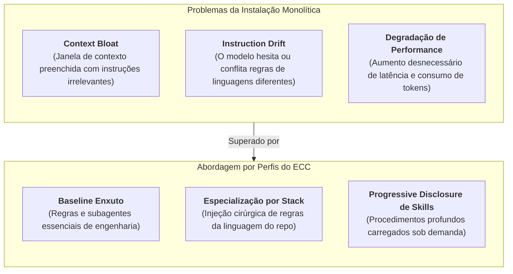
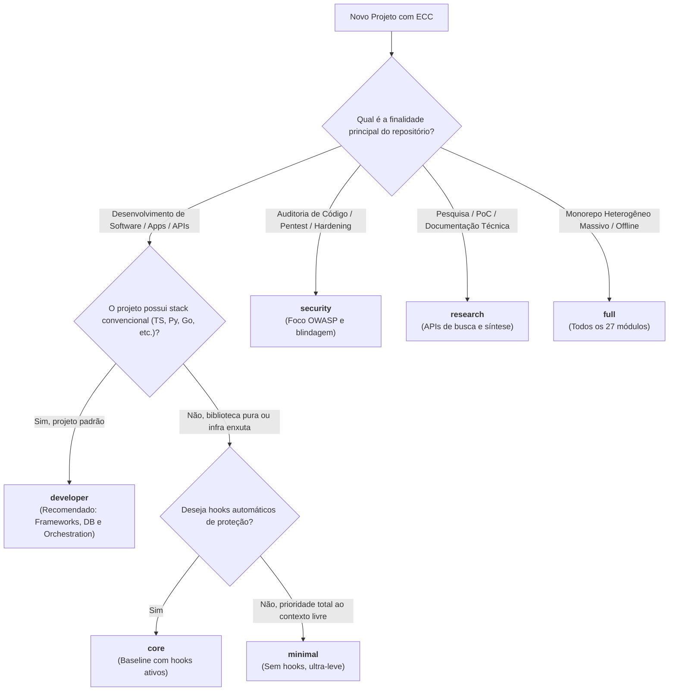
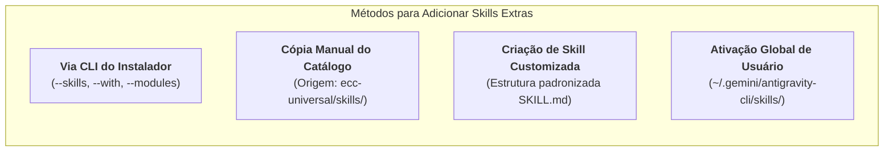

# Guia de Perfis de Instalação e Gerenciamento de Skills do ECC

O **ECC (*Everything Claude Code*)** adota uma arquitetura estritamente modular. Em vez de despejar centenas de regras, dezenas de subagentes e mais de 290 procedimentos operacionais (*skills*) indiscriminadamente em todo e qualquer projeto, o ECC organiza seu ecossistema em **Perfis de Instalação (*Install Profiles*)**, **Módulos Funcionais (*Modules*)** e **Componentes Granulares (*Components*)**.

Este guia é a referência técnica oficial para desenvolvedores e arquitetos que utilizam o ECC (com ênfase no **Antigravity CLI / WSL2** e outros harnesses suportados), detalhando todos os perfis disponíveis, os critérios para a escolha de cada um e os métodos canônicos para adicionar **skills extras** sempre que uma demanda técnica exigir.

---

## 1. Por que Usar Perfis de Instalação?

Modelos de linguagem avançados (como Claude 3.5 Sonnet, Gemini 1.5 Pro ou GPT-4o) possuem janelas de contexto amplas, porém o excesso de informações normativas e contextuais não relacionadas ao projeto gera três problemas críticos:



Ao selecionar o perfil adequado para o seu repositório:
1. **Economia de Context Window**: O agente inicia cada interação com a memória leve e espaço máximo para o raciocínio e para o código.
2. **Precisão Arquitetural**: O agente aplica apenas as regras de estilo, segurança e testes pertinentes à tecnologia do projeto.
3. **Escalabilidade Modular**: Você pode começar com um perfil mínimo e incorporar módulos ou skills extras conforme o projeto amadurece.

---

## 2. Catálogo Completo dos Perfis Oficiais do ECC

O manifesto oficial do instalador (`install-profiles.json` do pacote `ecc-universal`) define **7 perfis principais de instalação**. Cada perfil agrupa um conjunto específico de módulos gerenciados:

| Perfil | Total de Módulos | Hook Runtime? | Foco Principal | Caso de Uso Primário |
| :--- | :---: | :---: | :--- | :--- |
| **`developer`** | 9 módulos | Sim | Engenharia de software fullstack completa | **Recomendado para 90% dos repositórios de desenvolvimento**. |
| **`minimal`** | 5 módulos | Não | Operação enxuta, sem hooks automáticos | Projetos pequenos, scripts rápidos ou economia máxima de contexto. |
| **`core`** | 6 módulos | Sim | Baseline funcional com hooks ativos | Repositórios que exigem guardrails mecânicos sem regras de frameworks. |
| **`security`** | 7 módulos | Sim | Auditoria, conformidade OWASP e DevSecOps | Auditorias de vulnerabilidades, pentests e projetos financeiros/críticos. |
| **`research`** | 9 módulos | Sim | Pesquisa técnica, redação e distribuição | Provas de conceito (PoCs), redação técnica e análise exploratória. |
| **`opencode`** | 3 módulos | Não | Compatibilidade com o ambiente OpenCode | Instalações leves com comandos e fluxos voltados ao OpenCode. |
| **`full`** | 27 módulos | Sim | Arsenal completo de todos os módulos | Repositórios de exploração de IA, laboratórios e monorepos heterogêneos. |

---

### 2.1. Perfil `developer` (Recomendado para Desenvolvimento Ativo)

O perfil **`developer`** é a configuração padrão recomendada para desenvolvedores que trabalham no dia a dia com aplicações web, mobile, APIs ou microsserviços.

* **Módulos Inclusos**:
  1. `rules-core`: Diretrizes fundamentais de codificação limpa, git e revisão.
  2. `agents-core`: Catálogo completo de 69+ subagentes especialistas ([`planner`](file:///home/willycornelissen/Desktop/Dablio/ecc/.agents/agents/planner.md), [`code-reviewer`](file:///home/willycornelissen/Desktop/Dablio/ecc/.agents/agents/code-reviewer.md), [`build-error-resolver`](file:///home/willycornelissen/Desktop/Dablio/ecc/.agents/agents/build-error-resolver.md), etc.).
  3. `commands-core`: Biblioteca de comandos de barra (*slash commands*).
  4. `hooks-runtime`: Ganchos de ciclo de vida automáticos para proteção contra comandos destrutivos.
  5. `platform-configs`: Configurações de plataforma, gerenciadores de pacotes e catálogo MCP.
  6. `workflow-quality`: Procedimentos essenciais de qualidade (TDD, verificação rigorosa, compactação estratégica).
  7. `framework-language`: Competências das principais linguagens e frameworks do mercado.
  8. `database`: Skills de modelagem, migração, consultas SQL e persistência.
  9. `orchestration`: Gerenciamento de tarefas paralelas, worktrees do git e tmux.

* **Comando Canônico de Instalação (Antigravity)**:
  ```bash
  npx ecc-universal install --target antigravity --profile developer
  ```

---

### 2.2. Perfil `minimal` (Baixo Consumo de Contexto)

O perfil **`minimal`** entrega apenas o esqueleto operacional indispensável, eliminando o runtime de hooks e os pacotes pesados de frameworks.

* **Módulos Inclusos**:
  - `rules-core`, `agents-core`, `commands-core`, `platform-configs`, `workflow-quality`.
* **Diferencial Crítico**: **Não instala o `hooks-runtime`**. Ideal para ambientes com restrição de permissões ou quando o operador deseja controle manual estrito sem interrupções de hooks.
* **Comando Canônico de Instalação**:
  ```bash
  npx ecc-universal install --target antigravity --profile minimal
  ```

---

### 2.3. Perfil `core` (Baseline com Governança Mecânica)

O perfil **`core`** é equivalente ao `minimal`, porém **com o runtime de hooks ativado**.

* **Módulos Inclusos**:
  - `rules-core`, `agents-core`, `commands-core`, `hooks-runtime`, `platform-configs`, `workflow-quality`.
* **Quando Usar**: Quando você precisa que o agente seja protegido contra comandos perigosos no terminal e siga fluxos de TDD, mas não quer carregar regras de linguagens de programação pré-definidas (por exemplo, em projetos em linguagens pouco convencionais ou bibliotecas puras).
* **Comando Canônico de Instalação**:
  ```bash
  npx ecc-universal install --target antigravity --profile core
  ```

---

### 2.4. Perfil `security` (DevSecOps e Auditoria Rigorosa)

O perfil **`security`** é calibrado para equipes de segurança da informação, analistas de código estático e desenvolvedores atuando em funcionalidades críticas de autenticação, criptografia ou transações financeiras.

* **Módulos Inclusos**:
  - `rules-core`, `agents-core`, `commands-core`, `hooks-runtime`, `platform-configs`, `workflow-quality`, `security`.
* **O que o módulo `security` adiciona**:
  - Regras rígidas contra vulnerabilidades OWASP Top 10 (SQLi, XSS, SSRF, IDOR).
  - Procedimentos de verificação de vazamento de segredos em arquivos de ambiente (`.env`).
  - Ativação prioritária de agentes como [`security-reviewer`](file:///home/willycornelissen/Desktop/Dablio/ecc/.agents/agents/security-reviewer.md) e [`silent-failure-hunter`](file:///home/willycornelissen/Desktop/Dablio/ecc/.agents/agents/silent-failure-hunter.md).
* **Comando Canônico de Instalação**:
  ```bash
  npx ecc-universal install --target antigravity --profile security
  ```

---

### 2.5. Perfil `research` (Investigação Técnica e Criação de Conteúdo)

Projetado para cientistas de dados, pesquisadores técnicos, arquitetos escrevendo especificações (*RFCs/ADRs*) e redação técnica.

* **Módulos Inclusos**:
  - `rules-core`, `agents-core`, `commands-core`, `hooks-runtime`, `platform-configs`, `workflow-quality`, `research-apis`, `business-content`, `social-distribution`.
* **Habilidades Destacadas**:
  - Integração com APIs de busca profunda e síntese bibliográfica.
  - Formatação e estruturação de artigos técnicos, resumos executivos e relatórios de viabilidade.
  - Geração de diagramas explicativos e documentações públicas.
* **Comando Canônico de Instalação**:
  ```bash
  npx ecc-universal install --target antigravity --profile research
  ```

---

### 2.6. Perfil `opencode` (Adaptação para OpenCode)

Configuração desenhada para compatibilidade cirúrgica com o harness OpenCode.

* **Módulos Inclusos**:
  - `commands-core`, `platform-configs`, `workflow-quality`.
* **Quando Usar**: Exclusivamente quando o alvo for o OpenCode e houver necessidade de economizar memória de contexto, mantendo hooks desativados por padrão.
* **Comando Canônico de Instalação**:
  ```bash
  npx ecc-universal install --target opencode --profile opencode
  ```

---

### 2.7. Perfil `full` (Arsenal Completo e Irrestrito)

Instala absolutamente todos os 27 módulos mapeados no catálogo do ECC.

* **Módulos Inclusos**:
  - Todos os anteriores somados a: `devops-infra`, `machine-learning`, `supply-chain-domain`, `document-processing`, `swift-apple`, `media-generation`, `prediction-market-skills`, `operator-workflows`, `optimization-workflows`, `ito-compute`, `nasiko-control-plane`, etc.
* **Quando Usar**:
  - Em monorepos corporativos heterogêneos (que misturam modelos de ML, contratos de backend, pipelines de infraestrutura Docker/K8s e apps Swift/Kotlin).
  - Em ambientes offline ou air-gapped onde não será possível baixar skills posteriormente.
* **Comando Canônico de Instalação**:
  ```bash
  npx ecc-universal install --target antigravity --profile full
  ```

---

## 3. Matriz Decisória: Qual Perfil Escolher?

Utilize a árvore de decisão abaixo para determinar o perfil exato para o seu projeto:



### Resumo Comparativo Rápido

| Cenário de Trabalho | Perfil Indicado | Complemento Recomendado |
| :--- | :--- | :--- |
| Aplicação Web/Mobile (Next.js, FastAPI, Spring, Flutter) | `developer` | Declarar a linguagem (ex: `typescript`, `python`) |
| API Rest com Banco de Dados Relacional | `developer` | Módulo `database` já vem incluso |
| Auditoria de Segurança pré-deploy | `security` | Invocar [`security-reviewer`](file:///home/willycornelissen/Desktop/Dablio/ecc/.agents/agents/security-reviewer.md) |
| Repositório de Documentação, RFCs e Whitepapers | `research` | Adicionar skill `architecture-decision-records` |
| Scripts de automação / utilitários CLI simples | `minimal` | Nenhuma skill extra necessária |
| Monorepo de Machine Learning com Serving e Infra | `developer` | Adicionar módulo `--modules machine-learning,devops-infra` |

---

## 4. Enriquecendo Perfis com Linguagens e Stacks

Qualquer perfil base pode ser enriquecido diretamente durante a instalação ao passar os identificadores das linguagens do seu projeto:

```bash
# Stack Frontend/Fullstack (Node, TypeScript, React)
npx ecc-universal install --target antigravity --profile developer typescript

# Stack Backend (Python, Django/FastAPI e Go)
npx ecc-universal install --target antigravity --profile developer python go

# Stack Mobile (Dart e Flutter)
npx ecc-universal install --target antigravity --profile developer dart

# Stack de Sistemas / Alta Performance (Rust ou C++)
npx ecc-universal install --target antigravity --profile developer rust cpp
```

> [!NOTE]
> As linguagens suportadas nativamente pelo instalador incluem:  
> `arkts`, `c`, `cpp`, `csharp`, `dart`, `fsharp`, `go`, `golang`, `harmonyos`, `java`, `javascript`, `kotlin`, `perl`, `php`, `python`, `rails`, `ruby`, `rust`, `swift` e `typescript`.

---

## 5. Como Instalar Skills Extras

Se você já instalou um perfil (como `developer` ou `minimal`) e seu projeto agora necessita de capacidades adicionais (como pipelines de Machine Learning, documentação de decisões de arquitetura ou testes de interface com Playwright), você dispõe de **quatro abordagens canônicas**.



---

### 5.1. Método 1: Pelo Instalador CLI (`--skills`, `--with` e `--modules`)

O instalador `ecc-universal` possui parâmetros específicos para adicionar componentes individuais sem a necessidade de reinstalar o projeto inteiro do zero.

#### A. Adicionar Skills Específicas por Nome (`--skills`)
Permite informar uma ou mais skills separadas por vírgula:

```bash
# Instalar skills de aprendizado contínuo e arquitetura no Antigravity:
npx ecc-universal install --target antigravity --skills continuous-learning-v2,architecture-decision-records
```

#### B. Adicionar Componentes Granulares (`--with`)
Permite incluir componentes de famílias variadas (`skill:*`, `capability:*`, `lang:*`, `framework:*`):

```bash
# Incluir capacidades de DevOps e Machine Learning ao perfil developer:
npx ecc-universal install --target antigravity --profile developer \
  --with capability:devops \
  --with capability:machine-learning \
  --with skill:plan-canvas
```

#### C. Adicionar Módulos Inteiros (`--modules`)
Se precisar de um domínio técnico completo com todas as suas skills associadas:

```bash
# Adicionar o módulo completo de Machine Learning e o de Otimização:
npx ecc-universal install --target antigravity --modules machine-learning,optimization-workflows
```

*Módulos disponíveis para inclusão*:
* `devops-infra`: Docker, CI/CD, Kubernetes e infraestrutura como código.
* `machine-learning`: MLOps, contratos de dados, pipelines reproduzíveis e serving.
* `document-processing`: Processamento, conversão e tradução de documentos.
* `optimization-workflows`: Execução paralela, benchmarks e redução de latência.
* `swift-apple`: Concorrência Swift, SwiftUI e arquitetura Apple.
* `business-content`: Comunicação de produto, redação institucional e marketing.

---

### 5.2. Método 2: Cópia Direta do Catálogo Universal do ECC

O pacote `ecc-universal` armazena mais de 290 skills prontas para uso. No Antigravity, o agente descobre automaticamente qualquer skill localizada em [`.agents/skills/<nome-da-skill>/`](file:///home/willycornelissen/Desktop/Dablio/ecc/.agents/skills/).

Você pode copiar qualquer skill diretamente do cache do npx para o seu projeto:

```bash
# 1. Localizar o diretório de skills no cache do npx (ou no repositório clone do ECC)
ECC_CACHE=$(find ~/.npm/_npx/ -type d -path "*/ecc-universal/skills" 2>/dev/null | head -n 1)

# 2. Exemplo: Copiar a skill 'architecture-decision-records' para o seu projeto
mkdir -p .agents/skills/architecture-decision-records
cp -r "$ECC_CACHE/architecture-decision-records/"* .agents/skills/architecture-decision-records/

# 3. Exemplo: Copiar a skill 'browser-qa' para testes de interface
mkdir -p .agents/skills/browser-qa
cp -r "$ECC_CACHE/browser-qa/"* .agents/skills/browser-qa/
```

Assim que a pasta e o arquivo `SKILL.md` estiverem presentes em `.agents/skills/`, o Antigravity reconhecerá a nova skill instantaneamente na próxima chamada.

---

### 5.3. Método 3: Criando uma Skill Customizada para o Projeto

Você pode criar uma skill exclusiva para as necessidades da sua organização ou projeto.

1. **Crie a pasta da skill dentro de `.agents/skills/`**:
   ```bash
   mkdir -p .agents/skills/minha-skill-customizada
   ```

2. **Crie o arquivo canônico `SKILL.md` com YAML frontmatter**:
   ```markdown
   ---
   name: minha-skill-customizada
   description: Explicação clara de quando esta skill deve ser invocada e o que ela resolve.
   ---

   # Procedimento Operacional: Minha Skill Customizada

   ## Quando Usar
   - Descreva os gatilhos semânticos e intenções do usuário.

   ## Passo a Passo
   1. Etapa 1 detalhada...
   2. Etapa 2 detalhada...

   ## Critérios de Validação
   - Como o agente verifica se o trabalho foi concluído com sucesso.
   ```

> [!TIP]
> Use a skill [`agy-customizations`](file:///home/willycornelissen/.gemini/antigravity-cli/builtin/skills/agy-customizations/SKILL.md) ou invoque o subagente [`code-architect`](file:///home/willycornelissen/Desktop/Dablio/ecc/.agents/agents/code-architect.md) para gerar scaffolds perfeitos de novas skills aderentes ao padrão do Antigravity.

---

### 5.4. Método 4: Skills Globais de Usuário (Disponíveis em Todos os Projetos)

Caso você queira que uma skill esteja acessível no Antigravity CLI em **qualquer diretório ou projeto**, sem precisar instalá-la em cada repositório:

* **Local Global de Skills do Antigravity CLI**:
  ```text
  ~/.gemini/antigravity-cli/skills/<nome-da-skill>/SKILL.md
  ```

Basta criar ou copiar a pasta da skill para esse caminho no WSL2. O motor de resolução do Antigravity busca primeiramente no diretório local do projeto (`.agents/skills/`) e, em seguida, no diretório global do usuário (`~/.gemini/antigravity-cli/skills/`).

---

## 6. Diagnóstico e Verificação de Integridade

### 6.1. Simulação sem Efeitos Colaterais (`--dry-run`)
Sempre que desejar testar um comando de instalação ou adição de skills sem alterar arquivos no disco, adicione a flag `--dry-run`:

```bash
npx ecc-universal install --target antigravity --profile developer --with capability:devops --dry-run
```

### 6.2. Auditoria e Rastreabilidade (`ecc-install-state.json`)
Ao concluir qualquer instalação, o ECC gera ou atualiza o manifesto [`.agents/ecc-install-state.json`](file:///home/willycornelissen/Desktop/Dablio/ecc/.agents/ecc-install-state.json). Ele registra:
- Versão do pacote ECC instalado.
- Perfil selecionado (`developer`, `minimal`, etc.).
- Módulos ativos e lista de arquivos instalados com seus respectivos hashes SHA256.

Para inspecionar o status das ferramentas instaladas a qualquer momento:
```bash
# Listar skills presentes no repositório atual:
ls -1 .agents/skills/

# Listar agentes disponíveis:
ls -1 .agents/agents/
```

### 6.3. Otimização de Contexto com `agent-sort`
Se você acumulou muitas skills ao longo do tempo e desconfia que o contexto está sobrecarregado, execute a skill [`agent-sort`](file:///home/willycornelissen/Desktop/Dablio/ecc/.agents/skills/agent-sort/SKILL.md):
- Ela analisa o repositório e classifica as ferramentas em **DAILY** (uso diário indispensável para a stack) e **LIBRARY** (guardadas em arquivo e carregadas apenas por demanda pontual).

---

## 7. Documentos Relacionados

- [Catálogo e Arquitetura de Agentes do ECC](file:///home/willycornelissen/Desktop/Dablio/ecc/AGENTS.md)
- [Guia de Utilização do ECC no Antigravity CLI](file:///home/willycornelissen/Desktop/Dablio/ecc/harness/antigravity.md)
- [Diretório de Subagentes Instalados](file:///home/willycornelissen/Desktop/Dablio/ecc/.agents/agents/)
- [Diretório de Skills do Repositório](file:///home/willycornelissen/Desktop/Dablio/ecc/.agents/skills/)
