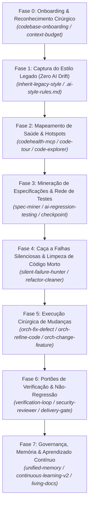
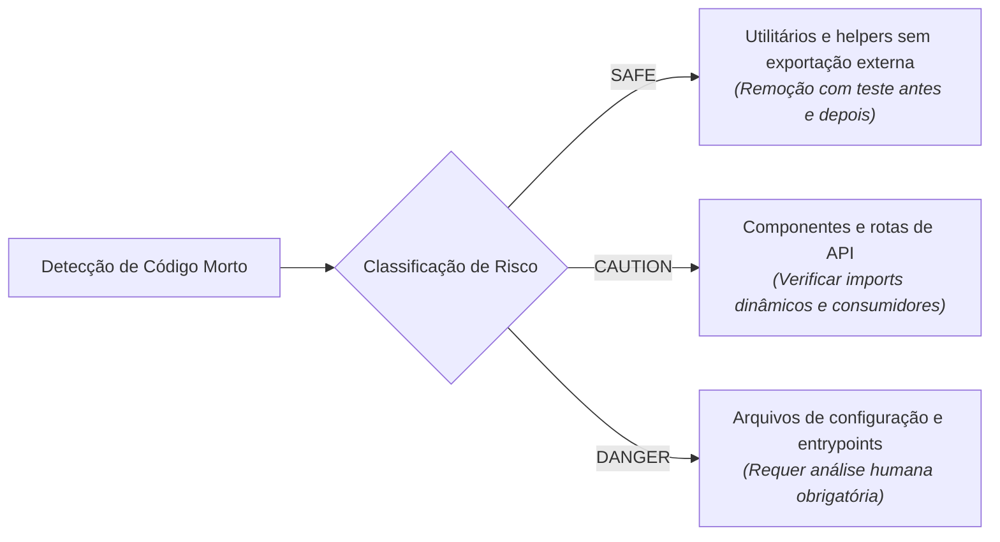
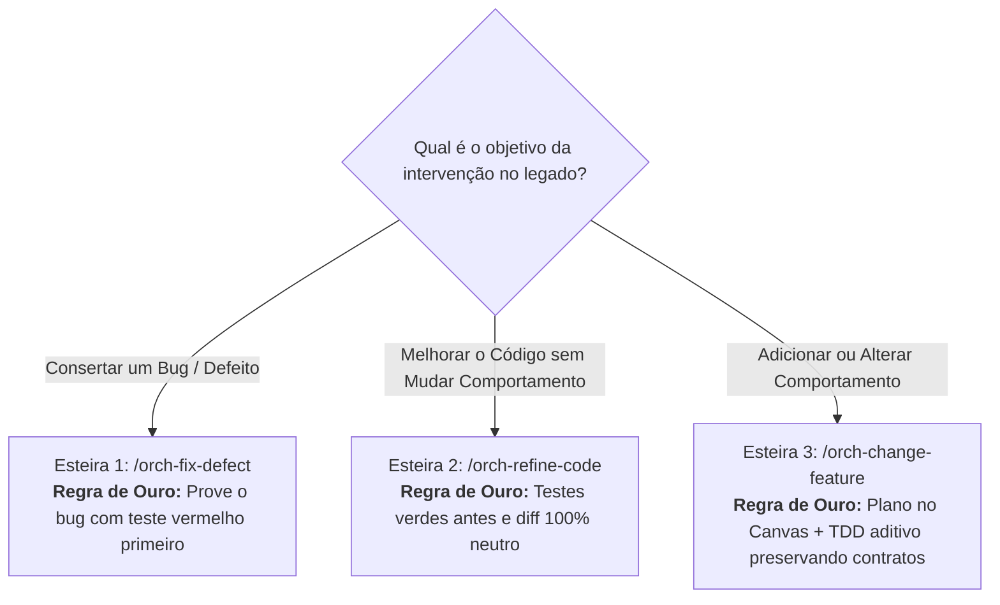

# Guia Prático: Dominando Código Legado (Brownfield) com o ECC

Este guia estabelece o **passo a passo canônico e a melhor trilha de engenharia** para analisar, blindar, refatorar e evoluir um repositório existente com código legado (*Brownfield*) utilizando o **ECC (*Everything Claude Code*)**.

---

## 1. O Desafio Brownfield com IA e a Abordagem do ECC

Trabalhar com IA sobre bases de código existentes e complexas (*Brownfield*) é radicalmente diferente de iniciar um projeto do zero. Enquanto no [guia Greenfield](file:///home/willy/Dablio/ecc/howtos/greenfield.md) o foco é construir fatias verticais a partir do nada, no código legado o maior desafio é **não quebrar o que já funciona e respeitar as premissas implícitas do sistema**.

### As 4 Armadilhas Clássicas da IA em Código Legado

1. **Desvio de Estilo e Padrões (*AI Style Drift*)**: A IA ignora os padrões do time e reescreve arquivos com padrões modernos aleatórios (ex: trocando Promises legadas por async/await sem suporte no runtime, inventando novas estruturas de diretórios ou alterando a convenção de nomenclatura de variáveis).
2. **Regressões Silenciosas e Efeitos Colaterais**: Em sistemas legados com alto acoplamento, uma alteração em uma função utilitária aparentemente inofensiva quebra contratos não documentados consumidos em outros módulos.
3. **Degradação da Saúde Estrutural (*Code Health Decay*)**: A IA adiciona código remendado (*workarounds*) em cima de arquivos que já são gargalos de complexidade (*hotspots*), tornando-os ainda mais difíceis de manter.
4. **Alucinação por Inchaço de Contexto (*Context Bloat*)**: Tentar fazer a IA ler centenas de arquivos legados de uma vez satura a janela de tokens, fazendo com que ela esqueça regras críticas e responda no improviso.

### A Filosofia do ECC para Brownfield

O ECC trata código legado como um território com leis próprias que devem ser descobertas e respeitadas mecanicamente:
* **Entendimento Sem Leitura Exaustiva**: Uso de reconhecimento cirúrgico por amostragem e mapas arquiteturais vivos.
* **Cristalização do Estilo Legado**: Extração automática das regras implícitas do repositório em um arquivo auditável (`.ai-style-rules.md`).
* **Mineração de Especificações (*Spec Mining*)**: Extração de contratos comportamentais reais diretamente do código antes de qualquer refatoração.
* **Redes de Segurança e Testes de Caracterização**: Nada é refatorado sem testes que comprovem a preservação do comportamento exato.
* **Revisão em Contexto Limpo (*Fresh-Context Review*)**: Subagentes isolados que auditam estritamente o `git diff` contra regressões e vulnerabilidades.

---

## 2. Visão Geral da Trilha Canônica Brownfield

O ciclo ideal de intervenção em código legado com o ECC organiza-se em 8 etapas estruturadas:



---

## 3. Passo a Passo Detalhado (Runbook Brownfield)

### Fase 0: Onboarding Inicial & Reconhecimento Cirúrgico

Ao abrir um repositório legado com o ECC pela primeira vez, o assistente **não deve tentar ler todos os arquivos**. Isso destruiria o orçamento de contexto da sessão.

#### 1. Reconhecimento Rápido com [`codebase-onboarding`](file:///home/willy/Dablio/ecc/.agents/skills/codebase-onboarding/SKILL.md)
Ative o procedimento de onboarding estruturado:
```text
"Execute o codebase-onboarding neste repositório"
```
A skill [`codebase-onboarding`](file:///home/willy/Dablio/ecc/.agents/skills/codebase-onboarding/SKILL.md) opera em camadas rápidas:
1. **Inspeção de Manifestos**: Identifica gerenciadores de pacotes (`package.json`, `pom.xml`, `pyproject.toml`, `Cargo.toml`, `go.mod`).
2. **Impressão Digital de Frameworks**: Detecta configurações (`tsconfig.json`, `next.config.*`, configurações de ORM, Dockerfiles, rotinas de CI).
3. **Mapeamento de Pontos de Entrada**: Localiza os bootstraps da aplicação (`main.*`, `index.*`, `server.*`, controladores de rotas).
4. **Detecção de Testes**: Mapeia onde residem os testes existentes e qual ferramenta é utilizada (Jest, Vitest, Pytest, Go test, JUnit).
5. **Geração do `CLAUDE.md` Inicial**: Documenta os comandos canônicos de compilação, testes e lint da base legada.

#### 2. Calibragem de Contexto com [`agent-sort`](file:///home/willy/Dablio/ecc/.agents/skills/agent-sort/SKILL.md) e [`context-budget`](file:///home/willy/Dablio/ecc/.agents/skills/context-budget/SKILL.md)
* Rode o [`agent-sort`](file:///home/willy/Dablio/ecc/.agents/skills/agent-sort/SKILL.md) para garantir que apenas as regras e revisores da stack real do projeto fiquem no balde `DAILY`.
* Audite o consumo inicial com [`context-budget`](file:///home/willy/Dablio/ecc/.agents/skills/context-budget/SKILL.md). O overhead inicial de instruções do agente não deve ultrapassar 15% da janela.

---

### Fase 1: Captura e Preservação do Estilo Legado (*Zero AI Drift*)

O maior risco em repositórios maduros é a IA injetar código que "grita" ter sido gerado por inteligência artificial, divergindo das convenções do time.

#### 1. Executar a Varredura de Estilo com [`inherit-legacy-style`](file:///home/willy/Dablio/ecc/.agents/skills/inherit-legacy-style/SKILL.md)
Execute o comando dedicado:
```text
/inherit-legacy-style
```
A skill avalia o repositório em 4 dimensões meta-arquiteturais:
* **Anatomia do Arquivo**: Ordem padrão de declaração interna (ex: imports → tipos/interfaces → classe/função principal → helpers locais → exports).
* **Estado & Fluxo de Controle**: Padrão de nomes para variáveis assíncronas, paginação, tratamento de erros e flags.
* **Infraestrutura**: Onde vivem os utilitários transversais (interceptors de API, formatadores de data, middlewares).
* **Idiomas de Linguagem**: Versão do dialeto adotado (ex: uso de classes vs funções puras, TypeScript estrito vs interfaces permissivas).

#### 2. Resolução de Conflitos e Cristalização em `.ai-style-rules.md`
Se a base de código contiver divergências de estilo entre módulos antigos e novos:
* A skill apresenta **um conflito por vez** para o desenvolvedor decidir qual padrão prevalece.
* O consenso é registrado no arquivo raiz `.ai-style-rules.md`, contendo:
  * **Golden Files**: Arquivos de referência oficial do repositório que a IA deve imitar.
  * **Explicit DONTs**: Lista inegociável do que o modelo está proibido de fazer (ex: *"NUNCA substitua Axios por Fetch nativo neste projeto"*, *"NUNCA utilize enums; utilize const objects com as const"*).

---

### Fase 2: Mapeamento de Saúde Estrutural & Hotspots

Antes de editar módulos legados, é essencial saber se você está tocando em um arquivo saudável ou em um código de altíssimo risco e complexidade ciclomática.

#### 1. Auditoria de Saúde Estrutural com [`codehealth-mcp`](file:///home/willy/Dablio/ecc/.agents/skills/codehealth-mcp/SKILL.md) (CodeScene)
Se o servidor CodeScene MCP estiver habilitado:
* Inspecione o escore de manutenibilidade estrutural dos arquivos alvo antes de tocá-los.
* O MCP identifica **Hotspots** (arquivos com alta complexidade e alto churn de commits históricos).
* Estabelece a linha de base (*baseline*) para que a intervenção da IA seja proibida de degradar a nota de saúde do arquivo.

#### 2. Investigação Cirúrgica com o Subagente [`code-explorer`](file:///home/willy/Dablio/ecc/.agents/agents/code-explorer.md)
Quando precisar entender um subsistema legado:
* Invoque o [`code-explorer`](file:///home/willy/Dablio/ecc/.agents/agents/code-explorer.md) para rastrear caminhos de execução, dependências injetadas e pontos de integração.
* O [`code-explorer`](file:///home/willy/Dablio/ecc/.agents/agents/code-explorer.md) opera em modo estritamente somente-leitura e produz um resumo conciso sem poluir o histórico.

#### 3. Criar Roteiro de Ambientação com [`code-tour`](file:///home/willy/Dablio/ecc/.agents/skills/code-tour/SKILL.md)
Para fluxos complexos do legado (como uma rotina de faturamento com 10 anos de regras acumuladas), gere um arquivo `.tour` via [`code-tour`](file:///home/willy/Dablio/ecc/.agents/skills/code-tour/SKILL.md). Isso cria um passo a passo ancorado em linhas reais de código para guiar humanos e agentes em sessões futuras.

---

### Fase 3: Mineração de Especificações & Rede de Testes

Código legado frequentemente carece de documentação ou possui requisitos implícitos que só existem no código em execução.

#### 1. Minerar Contratos Reais com o Subagente [`spec-miner`](file:///home/willy/Dablio/ecc/.agents/agents/spec-miner.md)
Invoque o minerador de especificações:
```text
"Minerar especificações comportamentais para o módulo de pagamentos usando o spec-miner"
```
O [`spec-miner`](file:///home/willy/Dablio/ecc/.agents/agents/spec-miner.md) lê a implementação existente e extrai um documento OpenSpec em `openspec/specs/<capability>/spec.md` dividido em:
* **Requirements (Gatilhos)**: Condições acionáveis (`WHEN evento X ocorre THEN o sistema DEVE fazer Y`).
* **Invariants (Invariantes)**: Regras que são sempre verdadeiras (`O saldo NUNCA pode ser negativo`, `IDs NUNCA são reatribuídos`).

#### 2. Criar Testes de Caracterização (*Characterization Tests*) com [`ai-regression-testing`](file:///home/willy/Dablio/ecc/.agents/skills/ai-regression-testing/SKILL.md)
Se a cobertura de testes da área legada for baixa ou inexistente:
* **Não tente refatorar ainda**.
* Escreva **Testes de Caracterização**: testes automatizados que executam a função ou endpoint atual com dados reais e cravam o comportamento existente em asserts. O objetivo não é julgar se o comportamento é "bonito", mas sim criar uma rede que grite caso qualquer detalhe mude.

#### 3. Criar Snapshot de Segurança com [`checkpoint.md`](file:///home/willy/Dablio/ecc/.agents/workflows/checkpoint.md)
Antes de alterar qualquer linha de código arriscada:
```text
/checkpoint create "pre-refactor-modulo-auth"
```
O checkpoint registra o hash do git, o estado da suíte de testes e o diff atual em `.claude/checkpoints.log`, permitindo rollback instantâneo caso a intervenção tome um rumo inesperado.

---

### Fase 4: Caça a Falhas Silenciosas & Limpeza de Código Morto

Bases legadas acumulam anos de erros mascarados e exportações órfãs que confundem o raciocínio da IA.

#### 1. Caçar Erros Engolidos com [`silent-failure-hunter`](file:///home/willy/Dablio/ecc/.agents/agents/silent-failure-hunter.md)
Invoque o subagente especialista em caçar anti-padrões de resiliência falsa:
* Blocos `catch (e) { /* ignore */ }` que ocultam exceções de banco de dados.
* Fallbacks inadequados que retornam valores nulos falsos, transferindo o erro para outras camadas.
* Promessas e goroutines disparadas sem tratamento de rejeição (*fire-and-forget* desgovernado).

#### 2. Varredura Segura de Código Morto com [`refactor-clean.md`](file:///home/willy/Dablio/ecc/.agents/workflows/refactor-clean.md)
Para remover funções, arquivos e dependências órfãs com segurança comprovada:
```text
/refactor-clean
```
O workflow executa ferramentas de análise estática (`knip`, `ts-prune`, `depcheck`, `vulture`, `deadcode`) e classifica os achados em 3 níveis de risco:



* **Loop Seguro de Remoção**: Para cada item `SAFE`, o subagente [`refactor-cleaner`](file:///home/willy/Dablio/ecc/.agents/agents/refactor-cleaner.md) roda a suíte de testes, deleta cirurgicamente a linha, reexecuta os testes e, se houver qualquer falha, executa rollback imediato.

---

### Fase 5: Execução Cirúrgica de Mudanças (As 3 Esteiras Brownfield)

Toda intervenção em código legado deve escolher expressamente uma das três esteiras de engenharia do ECC:



#### Esteira 1: Correção Estruturada de Defeitos (`/orch-fix-defect`)
```text
/orch-fix-defect "Token JWT expira sem disparar o refresh token automático"
```
1. **Classificação e Diagnóstico**: Isola a causa raiz com [`code-explorer`](file:///home/willy/Dablio/ecc/.agents/agents/code-explorer.md).
2. **Reprodução Obrigatória (Fase RED)**: Escreve um **novo teste de regressão automatizado que falha** reproduzindo o defeito. Provar a falha antes de editar o código é o que diferencia uma correção de engenharia de um remendo.
3. **Conserto Cirúrgico (Fase GREEN)**: Altera a quantidade mínima de linhas até o teste passar.
4. **Revisão em Contexto Limpo**: O [`code-reviewer`](file:///home/willy/Dablio/ecc/.agents/agents/code-reviewer.md) confere o diff.
5. **Commit Atômico**: Gera commit convencional padronizado `fix: ...`.

#### Esteira 2: Refatoração com Preservação de Comportamento (`/orch-refine-code`)
```text
/orch-refine-code "Extrair rotina de cálculo de impostos do arquivo OrderService legado"
```
1. **Verificação Prévia**: Garante que os testes existentes estão 100% verdes antes de tocar em qualquer arquivo. Se não houver testes, cria testes de caracterização primeiro.
2. **Plano da Refatoração**: Apresenta a estratégia de refatoração para aprovação (**GATE 1**).
3. **Restruturação em Passos Mínimos**: Move funções ou quebra arquivos executando a suíte de testes a cada pequeno passo. Proibido adicionar novos comportamentos.
4. **Auditoria de Neutralidade**: O diff é revisado para comprovar que nenhuma regra de negócio mudou.
5. **Commit**: Registrado como `refactor: ...`.

#### Esteira 3: Modificação ou Adição de Funcionalidade (`/orch-change-feature`)
```text
/orch-change-feature "Permitir exportação de relatórios em formato Parquet além de CSV"
```
1. **Mapeamento de Impacto**: Analisa quais pontos do sistema legado consomem a rota ou serviço modificado.
2. **Design de Tipos e Compatibilidade**: O [`type-design-analyzer`](file:///home/willy/Dablio/ecc/.agents/agents/type-design-analyzer.md) assegura que o novo parâmetro seja opcional ou retrocompatível, evitando quebrar chamadas antigas.
3. **Validação no [`plan-canvas`](file:///home/willy/Dablio/ecc/.agents/skills/plan-canvas/SKILL.md)**: O plano é aprovado visualmente antes da codificação.
4. **TDD Incremental**: Implementação com testes para a nova capacidade.

---

### Fase 6: Portões de Verificação, Auditoria de Saúde & Não-Regressão

Depois de concluída a codificação, o código legado modificado passa por barreiras rigorosas de contenção.

#### 1. Os 6 Portões do [`verification-loop`](file:///home/willy/Dablio/ecc/.agents/skills/verification-loop/SKILL.md)
Executa a bateria obrigatória sem tolerância a falhas:
1. **Build**: Compilação sem erros. Se falhar, aciona subagentes cirúrgicos como [`build-error-resolver`](file:///home/willy/Dablio/ecc/.agents/agents/build-error-resolver.md).
2. **Typecheck**: Verificação de tipos estrita.
3. **Lint**: Conformidade com as regras do repositório.
4. **Testes de Regressão**: 100% dos testes da suíte legada continuam verdes.
5. **Grep de Segurança**: Sem credenciais ou vazamentos expostos.
6. **Revisão de Diff**: Confirma que apenas os arquivos necessários foram modificados, sem alterações cosméticas acidentais em arquivos vizinhos.

#### 2. Verificação de Manutenibilidade com [`codehealth-mcp`](file:///home/willy/Dablio/ecc/.agents/skills/codehealth-mcp/SKILL.md)
Compara a pontuação de Code Health antes e depois da alteração:
* Se o escore de manutenibilidade do arquivo cair (delta negativo), a alteração é rejeitada para impedir que a IA introduza nova dívida técnica.

#### 3. Auditoria de Pontos de Toque com [`click-path-audit`](file:///home/willy/Dablio/ecc/.agents/skills/click-path-audit/SKILL.md)
Em aplicações com frontend, o [`click-path-audit`](file:///home/willy/Dablio/ecc/.agents/skills/click-path-audit/SKILL.md) valida se refatorações no estado compartilhado (Redux, Zustand, Context) não desabilitaram botões ou geraram estados inconsistentes na interface.

#### 4. Barreira Mecânica de Conclusão com [`delivery-gate`](file:///home/willy/Dablio/ecc/.agents/skills/delivery-gate/SKILL.md)
O [`delivery-gate`](file:///home/willy/Dablio/ecc/.agents/skills/delivery-gate/SKILL.md) impede mecanicamente que o assistente encerre a sessão se houver testes falhando, avisos suprimidos ou pendências não resolvidas.

---

### Fase 7: Governança Contínua, Memória Persistente & Handoff

Ao encerrar o ciclo de trabalho sobre o legado, o conhecimento adquirido deve ser protegido para as próximas sessões.

#### 1. Salvar Nuances do Legado com `/save-session`
Execute o comando de salvamento:
```text
/save-session
```
Utilizando [`ck`](file:///home/willy/Dablio/ecc/.agents/skills/ck/SKILL.md) e [`unified-memory`](file:///home/willy/Dablio/ecc/.agents/skills/unified-memory/SKILL.md), o ECC grava no cofre do projeto:
* Quais armadilhas do código legado foram descobertas;
* Quais dependências não óbvias foram mapeadas;
* O estado exato para a próxima sessão retomar via `/resume-session`.

#### 2. Aprendizado Contínuo de Peculiaridades com [`continuous-learning-v2`](file:///home/willy/Dablio/ecc/.agents/skills/continuous-learning-v2/SKILL.md)
Se você precisou corrigir o modelo (ex: *"Aqui não usamos a tabela X porque ela é legada, usamos a view Y"*):
* O [`continuous-learning-v2`](file:///home/willy/Dablio/ecc/.agents/skills/continuous-learning-v2/SKILL.md) cria um **instinto atômico escopado ao projeto**.
* Isso previne a contaminação cruzada com outros projetos e garante que o modelo nunca mais cometa o mesmo erro nessa base.

#### 3. Atualização de Mapas Vivos com [`living-docs-governance`](file:///home/willy/Dablio/ecc/.agents/skills/living-docs-governance/SKILL.md) e [`doc-updater`](file:///home/willy/Dablio/ecc/.agents/agents/doc-updater.md)
O subagente [`doc-updater`](file:///home/willy/Dablio/ecc/.agents/agents/doc-updater.md) atualiza os mapas de código em `docs/CODEMAPS/*` e registra a remoção de código morto na seção de histórico, evitando que outros desenvolvedores recriem módulos obsoletos.

---

## 4. Matriz Comparativa: Greenfield vs. Brownfield no ECC

Entenda rapidamente as diferenças fundamentais de abordagem entre começar do zero e intervir em um legado:

| Dimensão | Abordagem Greenfield (Do Zero) | Abordagem Brownfield (Legado) |
| :--- | :--- | :--- |
| **Ponto de Partida** | Repositório vazio (`git init`). | Repositório existente com histórico e dívida técnica. |
| **Foco Inicial** | Discovery de produto, PRD e definição de stack. | Reconhecimento cirúrgico e captura do estilo legado. |
| **Estilo de Código** | Definido do zero com padrões modernos e limpos. | **Intocável**: Capturado via `.ai-style-rules.md` para evitar drift. |
| **Especificações** | Criadas a partir de PRDs e Critérios `AC-xxx` novos. | Mineradas do código existente com [`spec-miner`](file:///home/willy/Dablio/ecc/.agents/agents/spec-miner.md). |
| **Estratégia de Testes** | TDD puro (escrever testes novos para tudo). | **Caracterização primeiro**: blindar o comportamento atual antes de refatorar. |
| **Manejo de Riscos** | Fatias verticais finas (*Thin Vertical Slices*). | Snapshots via [`checkpoint.md`](file:///home/willy/Dablio/ecc/.agents/workflows/checkpoint.md) e auditoria de Code Health. |
| **Fluxo de Trabalho** | `/plan-prd` ➔ `/plan` ➔ `tdd-guide` | `/orch-fix-defect` ou `/orch-refine-code` ou `/orch-change-feature`. |

---

## 5. Anti-padrões no Desenvolvimento com IA sobre Código Legado

| Anti-padrão Clássico | Por que é Catastrófico? | Como o ECC Previne? |
| :--- | :--- | :--- |
| **"Refatore este arquivo legado para deixá-lo moderno"** | A IA altera o estilo, quebra chamadas de terceiros e introduz dezenas de bugs silenciosos. | O ECC exige `/orch-refine-code` com suíte de testes verde obrigatória antes de qualquer edição e diff neutro. |
| **Confiar em testes unitários incompletos** | Sistemas legados frequentemente têm 20% de cobertura; a IA quebra os 80% não cobertos. | Invoque [`spec-miner`](file:///home/willy/Dablio/ecc/.agents/agents/spec-miner.md) e crie testes de caracterização antes de tocar no código. |
| **Pedir para a IA "ler o repositório inteiro"** | Satura a janela de tokens e induz alucinações severas em arquivos grandes. | Use [`codebase-onboarding`](file:///home/willy/Dablio/ecc/.agents/skills/codebase-onboarding/SKILL.md) por amostragem e navegue pontualmente com [`code-explorer`](file:///home/willy/Dablio/ecc/.agents/agents/code-explorer.md). |
| **Consertar um bug sem teste que falhe antes** | Vira um "remendo cego"; o bug volta na semana seguinte com outra alteração. | O workflow [`orch-fix-defect.md`](file:///home/willy/Dablio/ecc/.agents/workflows/orch-fix-defect.md) impõe escrever o teste vermelho de reprodução antes do fix. |
| **Ignorar erros engolidos antigos** | Novos códigos chamam rotinas que falham em silêncio, dificultando o debug. | Varra a área com o subagente [`silent-failure-hunter`](file:///home/willy/Dablio/ecc/.agents/agents/silent-failure-hunter.md). |

---

## 6. Checklist de Bolso para Intervenção em Código Legado

Use este checklist prático antes de autorizar qualquer commit em uma base legada:

- [ ] **Fase de Preparação e Reconhecimento**
  - [ ] Reconhecimento arquitetural concluído sem inchaço de contexto (`codebase-onboarding`).
  - [ ] Regras implícitas de estilo capturadas em `.ai-style-rules.md` (`/inherit-legacy-style`).
  - [ ] Hotspots e nota de manutenibilidade mapeados (`codehealth-mcp`, se ativo).
- [ ] **Rede de Segurança e Blindagem**
  - [ ] Snapshot de restauração criado (`/checkpoint create "pre-mudanca"`).
  - [ ] Comportamento atual documentado ou coberto por testes de caracterização (`spec-miner`).
  - [ ] Erros silenciosos e falhas mascaradas verificados na área afetada (`silent-failure-hunter`).
- [ ] **Execução Controlada**
  - [ ] Fluxo correto escolhido: `/orch-fix-defect` (bug), `/orch-refine-code` (refatoração) ou `/orch-change-feature` (nova feature).
  - [ ] Se defeito: bug reproduzido em teste com falha comprovada antes da correção.
  - [ ] Se refatoração: suíte de testes 100% verde antes de iniciar e diff comportamental neutro.
- [ ] **Verificação e Não-Regressão**
  - [ ] 6 Portões do `verification-loop` validados sem supressão de erros.
  - [ ] Auditoria de segurança aprovada (`security-reviewer`).
  - [ ] Delta de Code Health auditado para garantir não-degradação.
  - [ ] Trava mecânica de parada liberada pelo `delivery-gate`.
- [ ] **Persistência de Memória**
  - [ ] Nuances e regras descobertas salvas no cofre de memória (`/save-session`).
  - [ ] Instintos de armadilhas do legado gerados com escopo de projeto (`continuous-learning-v2`).
