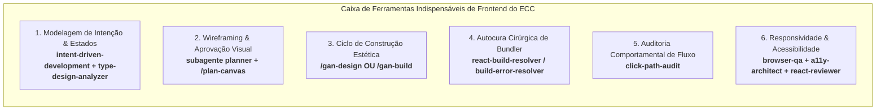
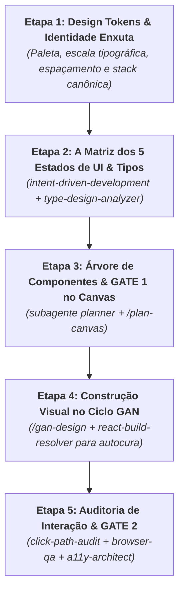
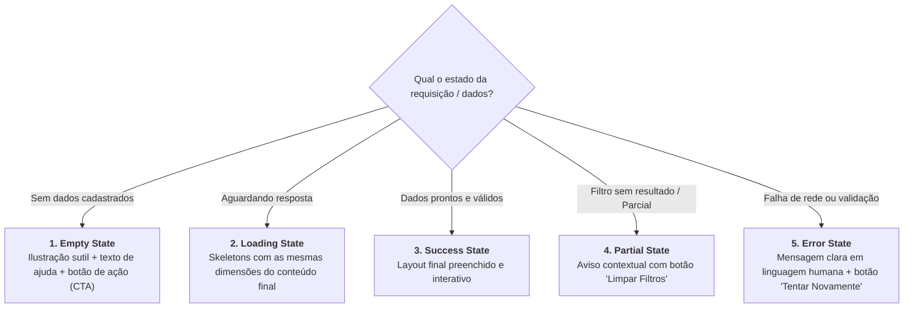
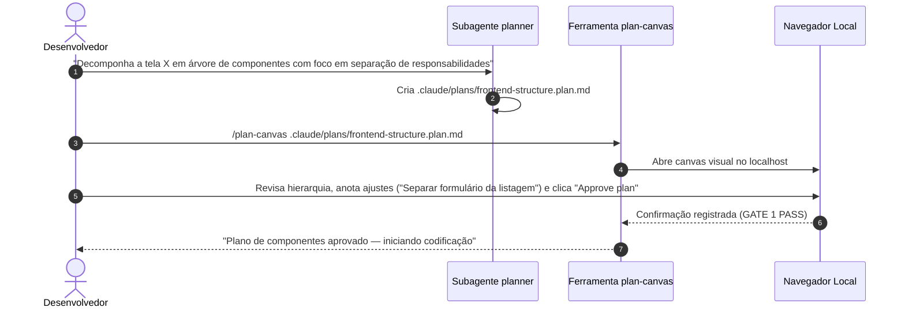
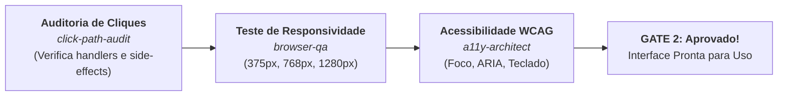

# Guia Prático: Especificação Rápida de Frontend com o ECC

Este guia estabelece o **passo a passo canônico e a esteira acelerada de engenharia** para especificar, desenhar e prototipar rapidamente a interface de usuário (Frontend/UI) de uma aplicação moderna utilizando **apenas as ferramentas indispensáveis** do **ECC (*Everything Claude Code*)**.

---

## 1. O Desafio do Frontend com IA e a Abordagem do ECC

Desenvolver interfaces visuais com modelos de linguagem apresenta desafios únicos que não existem no backend. Quando o frontend é construído sem método ou através de "vibe coding" no chat, ocorrem invariavelmente cinco falhas recorrentes:

```mermaid
flowchart LR
    subgraph VibeFailures["Armadilhas Clássicas do Frontend com IA"]
        direction TB
        A1["<b>Visual Genérico Clichê</b><br/><i>(Gradientes roxos sem personalidade)</i>"]
        A2["<b>Componentes Monolíticos</b><br/><i>(Arquivos JSX de 1.500 linhas)</i>"]
        A3["<b>Amnésia de Estados</b><br/><i>(Sem loading skeletons ou error states)</i>"]
        A4["<b>Efeitos que se Anulam</b><br/><i>(Botões que não fazem nada)</i>"]
        A5["<b>Inacessibilidade Total</b><br/><i>(divs clicáveis sem foco de teclado)</i>"]
    end

    subgraph ECCFrontend["A Solução do ECC"]
        direction TB
        B1["<b>Design Tokens & Tokens Enxutos</b>"]
        B2["<b>Árvore de Componentes no Canvas</b>"]
        B3["<b>Matriz dos 5 Estados de UI</b>"]
        B4["<b>Auditoria click-path-audit</b>"]
        B5["<b>Conformidade a11y-architect</b>"]
    end

    VibeFailures -->|Superado por| ECCFrontend
```



### Como o ECC Resolve Isso na Prototipagem Rápida
* **Especificação dos 5 Estados de UI**: Nenhuma tela é implementada considerando apenas o "caminho perfeito". Todo componente nasce com seus estados de **Vazio, Carregando, Sucesso, Parcial e Erro** previstos em contratos de tipos.
* **Validação Visual Imediata com Plan Canvas**: Antes de gerar montanhas de JSX, o operador visualiza e aprova a estrutura da interface diretamente no navegador.
* **Ciclo Adversarial de Design (GAN Harness)**: Utiliza a metodologia inspirada nos experimentos de design da Anthropic, onde um gerador cria a UI e um avaliador independente testa visualmente via Playwright e pontua critérios como Acabamento, Originalidade e Usabilidade.
* **Auditoria Comportamental de Cliques (*Click-Path Audit*)**: Rastreia se os manipuladores de eventos (`onClick`, `onChange`) realmente entregam o estado prometido ou se efeitos colaterais se anulam silenciosamente.

---

## 2. O Kit Mínimo Indispensável de Frontend no ECC

Para projetar e construir o frontend com velocidade máxima sem carregar regras desnecessárias, ative estritamente estas ferramentas:



### Tabela de Ferramentas Essenciais de Frontend

| Ferramenta / Agente | Arquivo de Origem / Referência | Papel no Frontend | Momento de Uso |
| :--- | :--- | :--- | :--- |
| **`intent-driven-development`** | [`.agents/skills/intent-driven-development/SKILL.md`](file:///home/willycornelissen/Desktop/Dablio/ecc/.agents/skills/intent-driven-development/SKILL.md) | Define os comportamentos de UI e a **Matriz dos 5 Estados** para cada tela. | Início da especificação (10 min). |
| **`type-design-analyzer`** | [`.agents/agents/type-design-analyzer.md`](file:///home/willycornelissen/Desktop/Dablio/ecc/.agents/agents/type-design-analyzer.md) | Cria uniões discriminadas para estados de carregamento e contratos de props de componentes. | Modelagem do estado de UI. |
| **`planner` & `/plan-canvas`** | [`.agents/agents/planner.md`](file:///home/willycornelissen/Desktop/Dablio/ecc/.agents/agents/planner.md) <br/> [`.agents/workflows/plan-canvas.md`](file:///home/willycornelissen/Desktop/Dablio/ecc/.agents/workflows/plan-canvas.md) | Estrutura a árvore de componentes e permite aprovação visual interativa no navegador. | Gate 1 de aprovação da interface. |
| **`/gan-design`** | [`.agents/workflows/gan-design.md`](file:///home/willycornelissen/Desktop/Dablio/ecc/.agents/workflows/gan-design.md) | Executa o loop gerador-avaliador focado em alta qualidade visual, originalidade e acabamento. | Implementação da UI e estilos. |
| **`react-build-resolver`** | [`.agents/agents/react-build-resolver.md`](file:///home/willycornelissen/Desktop/Dablio/ecc/.agents/agents/react-build-resolver.md) | Resolve cirurgicamente erros de JSX/TSX, importações de pacotes e falhas de bundlers (Vite/Next.js). | Quando o build quebrar. |
| **`click-path-audit`** | [`.agents/skills/click-path-audit/SKILL.md`](file:///home/willycornelissen/Desktop/Dablio/ecc/.agents/skills/click-path-audit/SKILL.md) | Rastreador sistemático de botões e formulários: garante que handlers não cancelem o estado da tela. | Pós-implementação de formulários/ações. |
| **`browser-qa`** | [`.agents/skills/browser-qa/SKILL.md`](file:///home/willycornelissen/Desktop/Dablio/ecc/.agents/skills/browser-qa/SKILL.md) | Testa responsividade em 3 breakpoints (desktop, tablet, mobile) e zera erros no console. | Smoke test antes de apresentar. |
| **`a11y-architect`** | [`.agents/agents/a11y-architect.md`](file:///home/willycornelissen/Desktop/Dablio/ecc/.agents/agents/a11y-architect.md) | Audita conformidade WCAG 2.2 AA (foco por teclado, contraste e atributos ARIA semânticos). | Pré-entrega do componente. |

### O Que IGNORAR Deliberadamente no Frontend Rápido
* ❌ **Configurações Complexas de Backend/DB**: Isole o frontend utilizando mocks tipados ou adaptadores em memória (`localStorage` ou Mock Service Worker).
* ❌ **Bateria Pesada de Testes de Snapshot Pixel-a-Pixel**: Não use ferramentas de regressão visual pesadas que travam a velocidade de experimentação do layout.
* ❌ **Micro-Frontends e Configurações Excessivas de Bundlers**: Adote a stack mínima canônica (ex: Vite + Tailwind CSS + Lucide Icons).

---

## 3. Visão Geral da Trilha de Especificação de Frontend

O processo rápido de especificação e entrega de uma interface elegante e funcional divide-se em **5 etapas determinísticas**:



---

## 4. Passo a Passo Detalhado (Runbook de Frontend)

### Etapa 1: Design Tokens & Identidade Enxuta

> **Objetivo**: Evitar interfaces genéricas ou visuais amadores, estabelecendo um sistema coeso de cores, tipografia e espaçamento antes de desenhar botões.

#### 1. Definir a Stack Canônica Rápida
Para máxima velocidade e confiabilidade com os agentes do ECC, adote o ecossistema padrão:
* **Bundler & Runtime**: Vite + React + TypeScript.
* **Estilização**: Tailwind CSS v3/v4 (classes utilitárias previsíveis).
* **Ícones**: Lucide Icons (ícones consistentes e leves).
* **Componentes Base / Primitivas**: Radix UI ou shadcn/ui (acessibilidade embutida por padrão).

#### 2. Declarar os Tokens Essenciais em 1 Arquivo
Em vez de definir estilos no improviso, especifique a identidade em `src/styles/tokens.ts` ou configure diretamente no `tailwind.config.js`:

```typescript
export const themeTokens = {
  colors: {
    primary: {
      DEFAULT: '#0f172a', // Slate 900
      accent: '#2563eb',  // Blue 600
      subtle: '#f1f5f9',  // Slate 100
    },
    surface: {
      base: '#ffffff',
      subtle: '#f8fafc',
      border: '#e2e8f0',
    },
    status: {
      success: '#16a34a',
      warning: '#ca8a04',
      danger: '#dc2626',
    }
  },
  typography: {
    fontSans: 'Inter, system-ui, sans-serif',
    fontMono: 'JetBrains Mono, monospace',
  }
};
```

> [!TIP]
> **Evite o Clichê "AI Purple"**: Instrua expressamente o agente: *"Adote uma paleta sóbria e moderna orientada ao domínio da aplicação; evite gradientes roxos genéricos e cantos arredondados excessivos"*.

---

### Etapa 2: A Matriz dos 5 Estados de UI & Tipos de Dados

> **Objetivo**: Blindar a interface contra telas congeladas e falhas silenciosas, especificando como o componente se comporta sob todas as condições possíveis.

Toda tela, painel ou componente de dados no ECC **deve** atender à **Matriz dos 5 Estados**:



#### 1. Modelagem com [`type-design-analyzer`](file:///home/willycornelissen/Desktop/Dablio/ecc/.agents/agents/type-design-analyzer.md)
Solicite:
```text
"Use o subagente type-design-analyzer para modelar o estado de UI desta tela usando uniões discriminadas."
```

Exemplo gerado em `src/types/ui-states.ts`:
```typescript
export type AsyncViewData<T> =
  | { type: 'IDLE' }
  | { type: 'LOADING' }
  | { type: 'SUCCESS'; data: T }
  | { type: 'PARTIAL'; data: T; activeFilters: string[] }
  | { type: 'ERROR'; errorMessage: string; canRetry: boolean };
```

> [!IMPORTANT]
> Nunca utilize variáveis de estado booleanas soltas como `const [isLoading, setIsLoading] = useState(false)` combinadas com `const [isError, setIsError] = useState(false)`. Essa prática permite estados impossíveis (como estar em carregamento e com erro ao mesmo tempo).

---

### Etapa 3: Árvore de Componentes & Aprovação no Plan Canvas

> **Objetivo**: Decompor o layout em componentes atômicos desacoplados e aprovar visualmente a estrutura antes de gerar centenas de linhas de código.



#### 1. Decomposição com o [`planner`](file:///home/willycornelissen/Desktop/Dablio/ecc/.agents/agents/planner.md)
O assistente organiza os componentes segundo a regra da responsabilidade única:
* **Container / Page (`AppPage.tsx`)**: Orquestra o estado global/local e distribui dados.
* **Componentes Apresentacionais (`ItemTable.tsx`, `SummaryCard.tsx`)**: Recebem dados via props e emitem eventos (puros, fáceis de testar).
* **Feedback & Estados (`SkeletonLoader.tsx`, `EmptyStateBanner.tsx`)**: Reutilizáveis em diferentes visualizações.

#### 2. Validação Visual via [`/plan-canvas`](file:///home/willycornelissen/Desktop/Dablio/ecc/.agents/workflows/plan-canvas.md)
```text
/plan-canvas .claude/plans/frontend-structure.plan.md
```
No navegador, valide se:
* A hierarquia de pastas faz sentido (`src/components/`, `src/hooks/`, `src/types/`).
* Não há componentes "deus" concentrando lógica e apresentação.
* O fluxo de props e eventos está explícito.

---

### Etapa 4: Construção Visual no Ciclo GAN (`/gan-design`)

> **Objetivo**: Obter uma interface de alto impacto estético e usabilidade superior através do ciclo autônomo gerador-avaliador.

O ECC oferece o comando especializado [`/gan-design`](file:///home/willycornelissen/Desktop/Dablio/ecc/.agents/workflows/gan-design.md), inspirado nos experimentos de design da Anthropic:

```text
/gan-design "Dashboard financeiro moderno com gráfico de fluxo de caixa, listagem de despesas categorizadas e modal de nova transação" --max-iterations 6 --pass-threshold 7.5
```

#### A Rubrica de Avaliação de Design do GAN
O avaliador autônomo (`gan-evaluator`) pontua a aplicação viva no Playwright considerando pesos estéticos:

```markdown
### Qualidade do Design (Peso: 0.35)
- Hierarquia visual limpa e escaneabilidade de dados.
- Uso harmonioso de espaços em branco e contraste.

### Originalidade & Identidade (Peso: 0.30)
- Foge de templates prontos clichês; identidade própria adaptada ao público.

### Acabamento & Detalhes / Craft (Peso: 0.25)
- Microinterações em botões (hover, focus, active).
- Estados de transição suaves (animações sutis de entrada de listas).

### Funcionalidade (Peso: 0.10)
- Interações básicas funcionam sem travar a interface.
```

#### Autocura Mecânica de Build com [`react-build-resolver`](file:///home/willycornelissen/Desktop/Dablio/ecc/.agents/agents/react-build-resolver.md)
Se durante as iterações do GAN ocorrer algum erro de tipagem TSX, importação incorreta do Tailwind ou incompatibilidade de hooks, o assistente aciona cirurgicamente o `react-build-resolver`:
* Não perde tempo tentando reescrever a tela inteira.
* Aplica o diff mínimo no componente que quebrou.
* Restabelece o servidor de desenvolvimento em segundos.

---

### Etapa 5: Auditoria Comportamental de Fluxo & Portões de Qualidade

> **Objetivo**: Garantir que todos os botões e interações entreguem o resultado prometido, que o layout seja responsivo e que a acessibilidade atenda aos padrões normativos.



#### 1. Auditoria de Interações com [`click-path-audit`](file:///home/willycornelissen/Desktop/Dablio/ecc/.agents/skills/click-path-audit/SKILL.md)
Solicite:
```text
"Execute o click-path-audit em todos os botões e formulários do componente de transações."
```
O agente rastreia cada touchpoint interativo:
1. **Identifica o handler**: `onSubmit`, `onClick`, `onFilterChange`.
2. **Rastreia a sequência de mutações de estado**:
   * O clique abre o modal? Sim.
   * Ao confirmar o envio, o estado de loading é ativado? Sim.
   * A requisição simulada grava o dado? Sim.
   * **Checagem de Cancelamento Silencioso**: Alguma ação posterior desfaz a anterior por engano? *(Ex: fechar o modal reseta o dado recém-inserido antes do re-render?)*
3. **Checagem de Concorrência**: Há chamadas assíncronas que possam sobrescrever estados se o usuário clicar duas vezes rapidamente?

#### 2. Responsividade e Smoke Check com [`browser-qa`](file:///home/willycornelissen/Desktop/Dablio/ecc/.agents/skills/browser-qa/SKILL.md)
Execute a verificação multiplataforma:
```text
"Use o browser-qa para auditar a tela em Desktop (1280px), Tablet (768px) e Mobile (375px)."
```
O agente verifica:
* **Mobile (375px)**: Nenhum elemento gera overflow horizontal (rolagem lateral indesejada); tabelas colapsam em cartões legíveis.
* **Console**: 0 erros (`console.error` limpo, sem avisos de *"Each child in a list should have a unique key"*).
* **Interatividade**: Teclado virtual não cobre os campos de formulário.

#### 3. Auditoria de Acessibilidade com [`a11y-architect`](file:///home/willycornelissen/Desktop/Dablio/ecc/.agents/agents/a11y-architect.md)
O assistente passa o pente fino de conformidade WCAG 2.2 AA:
* Elementos interativos utilizam `<button>` nativo em vez de `<div onClick>`.
* Modais possuem captura de foco (*focus trap*) e fecham com a tecla `Escape`.
* Tamanho mínimo de toque (*touch target*) de pelo menos **44x44 pixels** em dispositivos móveis.
* Relação de contraste de cores de pelo menos **4.5:1** para textos normais.

---

## 5. Exemplo Prático: Especificando um Componente Complexo

Abaixo está o exemplo real de especificação e entrega de um componente de **Tabela Dinâmica de Usuários com Filtros e Ações**.

### 1. Especificação de Tipos (`src/types/user-management.ts`)
```typescript
export interface UserItem {
  id: string;
  name: string;
  email: string;
  role: 'admin' | 'editor' | 'viewer';
  status: 'active' | 'suspended';
  lastLogin: string;
}

export type UserTableFilter = {
  search: string;
  roleFilter: UserItem['role'] | 'all';
  statusFilter: UserItem['status'] | 'all';
};

// Matriz dos 5 Estados explicitada no tipo
export type UserTableViewState =
  | { kind: 'loading' }
  | { kind: 'empty'; message: 'Nenhum usuário cadastrado no sistema.' }
  | { kind: 'partial'; users: UserItem[]; totalFound: number }
  | { kind: 'success'; users: UserItem[] }
  | { kind: 'error'; reason: string; retryFn: () => void };
```

### 2. Implementação com Tratamento Rigoroso de Estados
```tsx
import React from 'react';
import { UserItem, UserTableViewState } from '../types/user-management';
import { AlertCircle, RefreshCw, UserPlus, Users } from 'lucide-react';

interface Props {
  state: UserTableViewState;
  onAddUser: () => void;
}

export const UserTableView: React.FC<Props> = ({ state, onAddUser }) => {
  // 1. Loading State com Skeletons
  if (state.kind === 'loading') {
    return (
      <div className="space-y-3 p-4 animate-pulse" aria-busy="true">
        <div className="h-10 bg-slate-200 rounded-md w-full" />
        <div className="h-16 bg-slate-100 rounded-md w-full" />
        <div className="h-16 bg-slate-100 rounded-md w-full" />
      </div>
    );
  }

  // 2. Empty State
  if (state.kind === 'empty') {
    return (
      <div className="flex flex-col items-center justify-center p-12 text-center border-2 border-dashed border-slate-200 rounded-xl">
        <Users className="w-12 h-12 text-slate-400 mb-3" />
        <h3 className="text-lg font-semibold text-slate-800">Nenhum usuário encontrado</h3>
        <p className="text-sm text-slate-500 mb-4">{state.message}</p>
        <button
          onClick={onAddUser}
          className="inline-flex items-center gap-2 px-4 py-2 bg-blue-600 text-white rounded-lg hover:bg-blue-700 transition"
        >
          <UserPlus className="w-4 h-4" /> Adicionar Primeiro Usuário
        </button>
      </div>
    );
  }

  // 3. Error State
  if (state.kind === 'error') {
    return (
      <div className="p-6 bg-red-50 border border-red-200 rounded-xl text-center" role="alert">
        <AlertCircle className="w-8 h-8 text-red-500 mx-auto mb-2" />
        <p className="text-red-800 font-medium">{state.reason}</p>
        <button
          onClick={state.retryFn}
          className="mt-3 inline-flex items-center gap-1.5 px-3 py-1.5 bg-red-600 text-white text-sm rounded-md hover:bg-red-700"
        >
          <RefreshCw className="w-3.5 h-3.5" /> Tentar Novamente
        </button>
      </div>
    );
  }

  // 4 & 5. Success / Partial State
  const users = state.kind === 'partial' ? state.users : state.users;

  return (
    <div className="overflow-x-auto rounded-lg border border-slate-200 shadow-sm">
      {state.kind === 'partial' && (
        <div className="bg-amber-50 px-4 py-2 text-xs text-amber-800 border-b border-amber-200">
          Exibindo {state.totalFound} resultado(s) filtrado(s).
        </div>
      )}
      <table className="w-full text-left text-sm text-slate-600">
        <thead className="bg-slate-50 text-xs uppercase text-slate-500 font-semibold border-b border-slate-200">
          <tr>
            <th scope="col" className="px-4 py-3">Nome / E-mail</th>
            <th scope="col" className="px-4 py-3">Papel</th>
            <th scope="col" className="px-4 py-3">Status</th>
          </tr>
        </thead>
        <tbody className="divide-y divide-slate-100 bg-white">
          {users.map((user) => (
            <tr key={user.id} className="hover:bg-slate-50 transition">
              <td className="px-4 py-3">
                <div className="font-medium text-slate-900">{user.name}</div>
                <div className="text-xs text-slate-400">{user.email}</div>
              </td>
              <td className="px-4 py-3 capitalize">{user.role}</td>
              <td className="px-4 py-3">
                <span className={`inline-flex items-center px-2 py-0.5 rounded-full text-xs font-medium ${
                  user.status === 'active' ? 'bg-emerald-100 text-emerald-800' : 'bg-slate-100 text-slate-700'
                }`}>
                  {user.status === 'active' ? 'Ativo' : 'Suspenso'}
                </span>
              </td>
            </tr>
          ))}
        </tbody>
      </table>
    </div>
  );
};
```

---

## 6. Anti-Padrões Críticos de Frontend com IA

| Anti-Padrão | Como se Manifesta | Como o ECC Previne |
| :--- | :--- | :--- |
| **Componente Monolítico ("God Component")** | Arquivo de 1.200 linhas com tabela, formulário, chamadas de API e 18 hooks misturados. | O subagente [`planner`](file:///home/willycornelissen/Desktop/Dablio/ecc/.agents/agents/planner.md) divide antecipadamente a árvore em componentes container, apresentacionais e de estado. |
| **"Div Button Syndrome"** | Uso de `<div onClick={...}>` sem `role="button"`, sem `tabIndex` e sem suporte ao teclado. | O [`a11y-architect`](file:///home/willycornelissen/Desktop/Dablio/ecc/.agents/agents/a11y-architect.md) bloqueia e substitui por elementos semânticos nativos (`<button>`). |
| **Efeitos que se Anulam Silenciosamente** | Um botão de confirmação dispara uma ação e fecha o modal, mas o fechar modal limpa o estado antes da gravação. | O [`click-path-audit`](file:///home/willycornelissen/Desktop/Dablio/ecc/.agents/skills/click-path-audit/SKILL.md) rastreia cada mutação sequencialmente e detecta reversões indesejadas. |
| **Spinner Infinito em Erro de Rede** | Se a chamada falha, o estado de `loading` nunca é desligado e o usuário vê a tela girando para sempre. | A **Matriz dos 5 Estados** exige que a união discriminada tenha obrigatoriamente um estado de `ERROR` com ação de retry. |
| **Quebra de Layout Mobile** | O painel fica lindo no desktop, mas no celular de 375px cria rolagem horizontal e quebra botões. | O [`browser-qa`](file:///home/willycornelissen/Desktop/Dablio/ecc/.agents/skills/browser-qa/SKILL.md) testa obrigatoriamente a viewport móvel antes da aprovação. |

---

## 7. Checklist Rápido de Prontidão da Interface (UI Ready-to-Demo)

Antes de considerar a especificação e construção do frontend concluídas, verifique:

- [ ] **Design Tokens Definidos**: Tipografia, paleta e espaçamentos centralizados.
- [ ] **Matriz dos 5 Estados Presente**: Empty, Loading (com skeletons), Success, Partial e Error testados.
- [ ] **Aprovação Visual no Canvas**: Árvore de componentes validada no [`plan-canvas`](file:///home/willycornelissen/Desktop/Dablio/ecc/.agents/workflows/plan-canvas.md).
- [ ] **Build 100% Limpo**: Zero avisos de TypeScript ou React bundler via [`react-build-resolver`](file:///home/willycornelissen/Desktop/Dablio/ecc/.agents/agents/react-build-resolver.md).
- [ ] **Jornadas de Clique Auditadas**: [`click-path-audit`](file:///home/willycornelissen/Desktop/Dablio/ecc/.agents/skills/click-path-audit/SKILL.md) rodado em formulários e modais.
- [ ] **Responsividade 3-Breakpoints**: Validado em 375px, 768px e 1280px via [`browser-qa`](file:///home/willycornelissen/Desktop/Dablio/ecc/.agents/skills/browser-qa/SKILL.md).
- [ ] **Acessibilidade Básica WCAG 2.2**: Navegação completa por teclado (`Tab`, `Enter`, `Escape`) auditada pelo [`a11y-architect`](file:///home/willycornelissen/Desktop/Dablio/ecc/.agents/agents/a11y-architect.md).
