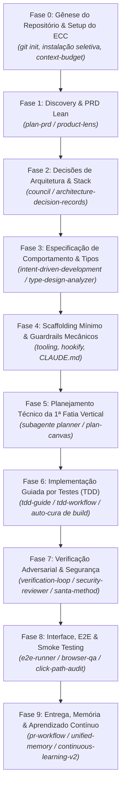
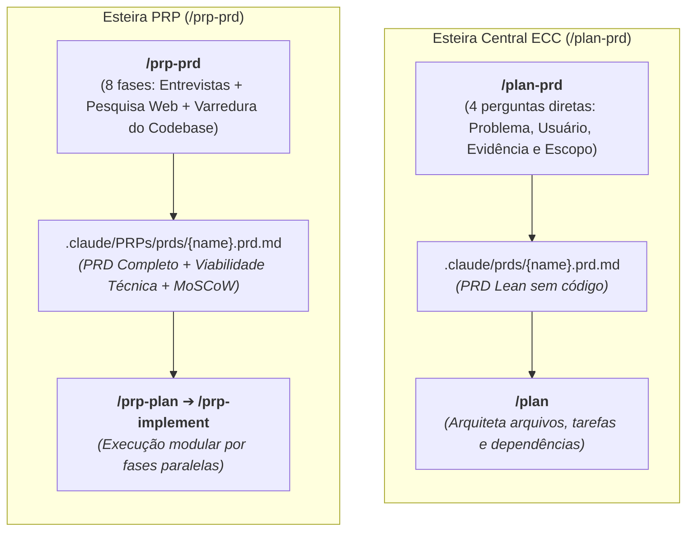
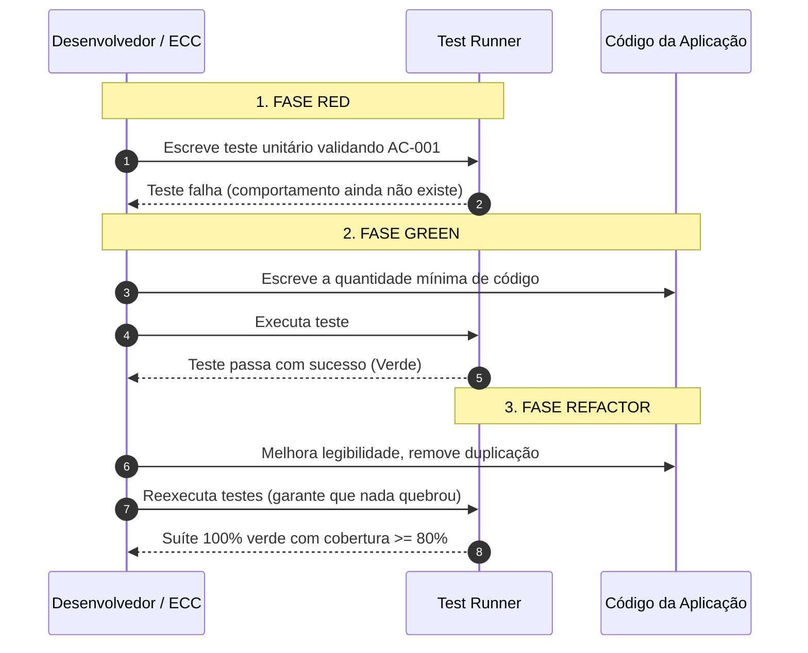

# Guia Prático: Construindo um Projeto do Zero (Greenfield) com o ECC

Este guia estabelece o **passo a passo canônico e a melhor trilha de engenharia** para iniciar, estruturar e evoluir um novo projeto de desenvolvimento de software (*Greenfield*) a partir de uma pasta vazia utilizando o **ECC (*Everything Claude Code*)**.

---

## 1. O Desafio Greenfield com IA e a Filosofia do ECC

Em projetos que partem do absoluto zero (*Greenfield*), a abordagem convencional de desenvolvimento com IA via "vibe coding" (pedir código no improviso pelo chat) costuma falhar rapidamente devido a três armadilhas clássicas:

1. **Ilusão da Velocidade Inicial vs. Dívida Técnica Instantânea**: A IA cospe dezenas de arquivos sem arquitetura consolidada, contratos de tipos frouxos e zero testes unitários. No segundo dia de projeto, qualquer alteração quebra partes não mapeadas.
2. **Saturação Prematura da Janela de Contexto (*Context Bloat*)**: Injetar centenas de regras ou gerar um monólito desordenado satura o limite de tokens do agente, induzindo alucinações e perda de instruções anteriores.
3. **Ausência de Guardrails Mecânicos**: Sem *hooks* e portões de verificação (*gates*), a IA ignora regras passivas de texto contidas em arquivos estáticos quando o histórico do chat se torna extenso.

### Como o ECC Resolve Isso no Greenfield

O lema fundamental do ECC é: **"Otimize a janela de contexto. Persista todo o resto"**.

No desenvolvimento a partir do zero, o ECC impõe um ciclo de engenharia disciplinado:
* **Fatias Verticais Finas (*Thin Vertical Slices*)**: Em vez de tentar gerar "todo o backend" ou "todo o banco de dados" de uma vez, constrói-se uma única funcionalidade ponta a ponta (do contrato à interface), testada e verificada.
* **Governança de Contexto**: Instalação seletiva de regras específicas da stack e subagentes cirúrgicos que entram, cumprem sua missão e liberam a memória.
* **Validação Mecânica em Contexto Limpo (*Fresh-Context Review*)**: Quem revisa e audita o código não é o agente enviesado que o escreveu, mas subagentes independentes com contexto limpo avaliando o `diff` real.

---

## 2. Visão Geral da Trilha Canônica Greenfield

O fluxo ideal para levar uma ideia da tela em branco até a primeira entrega funcional e testada segue 9 fases sequenciais:



---

## 3. Passo a Passo Detalhado (Runbook Greenfield)

### Fase 0: Gênese do Repositório & Calibração do ECC

Antes de redigir qualquer especificação ou invocar a IA para código, o ambiente de desenvolvimento precisa ser preparado com um orçamento de contexto saudável.

#### 1. Inicializar o Repositório Git
```bash
mkdir meu-novo-projeto
cd meu-novo-projeto
git init
git branch -M main
```

#### 2. Instalação e Calibração Seletiva do ECC
Evite o erro de carregar todas as 300+ skills do ecossistema no seu projeto novo. Utilize o instalador guiado ou o comando de onboarding:

```bash
# Executa a instalação seletiva adaptada ao seu harness (Claude Code, Antigravity, Cursor, etc.)
npx ecc-universal install --guided
```
Ou dentro da sessão interativa:
```text
/project-init --dry-run
```

* **Separar Regras com [`agent-sort`](file:///home/willy/Dablio/ecc/.agents/skills/agent-sort/SKILL.md)**: Classifique os componentes em `DAILY` (regras e skills essenciais da stack carregadas ativamente) e `LIBRARY` (acionadas apenas sob demanda).
* **Auditar Consumo com [`context-budget`](file:///home/willy/Dablio/ecc/.agents/skills/context-budget/SKILL.md)**: Certifique-se de que as instruções iniciais não consumam mais do que 15-20% da sua janela de contexto útil.
* **Inicializar a Memória de Sessão com [`ck`](file:///home/willy/Dablio/ecc/.agents/skills/ck/SKILL.md) / [`unified-memory`](file:///home/willy/Dablio/ecc/.agents/skills/unified-memory/SKILL.md)**: Garante que as decisões tomadas hoje permaneçam acessíveis amanhã.

---

### Fase 1: Concepção, Discovery de Produto & Hipótese de Valor

O maior desperdício em projetos novos é construir com perfeição a coisa errada. O ECC inicia pelo **problema**, não pela solução.

#### 1. Iniciar o Documento de Requisitos de Produto (PRD)
Execute o workflow interativo de PRD:
```text
/plan-prd "Descrição sucinta da ideia do produto ou sistema"
```
ou utilizando a esteira PRP:
```text
/prp-prd "Meu novo produto"
```

* **Perguntas de Ancoragem**: O workflow [`plan-prd.md`](file:///home/willycornelissen/Desktop/Dablio/ecc/.agents/workflows/plan-prd.md) interroga ativamente:
  * Quem é o usuário primário exato?
  * Qual dor mensurável está sendo resolvida?
  * Qual a hipótese de sucesso mensurável (ex: conversão > 10%, tempo de onboarding < 2 minutos)?
* **Definição Explícita de Non-Goals (*O que NÃO Fazer*)**: Delimita a fronteira do MVP para impedir que o modelo alucine funcionalidades periféricas desnecessárias.

##### Diferença entre os Comandos `/plan-prd` e `/prp-prd`

Embora ambos os comandos sirvam para conceber e especificar um PRD antes da escrita de código, eles pertencem a filosofias e esteiras distintas dentro do ECC:

* **[`/plan-prd`](file:///home/willycornelissen/Desktop/Dablio/ecc/.agents/workflows/plan-prd.md)** é o comando **Lean e Moderno do ECC**, focado em velocidade, delimitação rigorosa de escopo e entrega imediata para o [`/plan`](file:///home/willycornelissen/Desktop/Dablio/ecc/.agents/workflows/plan.md).
* **[`/prp-prd`](file:///home/willycornelissen/Desktop/Dablio/ecc/.agents/workflows/prp-prd.md)** é o gerador **Extensivo da Esteira PRP (*Product Requirements to PR*)**, adaptado da metodologia de engenharia agêntica de Wirasm (*PRPs-agentic-eng*), incluindo pesquisa ativa de mercado e viabilidade técnica no código.



| Critério | [`/plan-prd`](file:///home/willycornelissen/Desktop/Dablio/ecc/.agents/workflows/plan-prd.md) | [`/prp-prd`](file:///home/willycornelissen/Desktop/Dablio/ecc/.agents/workflows/prp-prd.md) |
| :--- | :--- | :--- |
| **Família / Esteira** | **Esteira Central do ECC**<br/>(`/plan-prd` ➔ `/plan` ➔ `tdd-workflow` ➔ `/pr`) | **Esteira PRP (*PRP Workflow Series*)**<br/>(`/prp-prd` ➔ `/prp-plan` ➔ `/prp-implement` ➔ `/prp-pr`) |
| **Profundidade & Fases** | **4 fases enxutas (*Fast-Gate*)**:<br/>`FRAME` ➔ `GROUND` ➔ `DECIDE` ➔ `GENERATE` | **8 fases detalhadas**:<br/>`INITIATE` ➔ `FOUNDATION` ➔ `RESEARCH` ➔ `DEEP DIVE` ➔ `FEASIBILITY` ➔ `DECISIONS` ➔ `GENERATE` ➔ `OUTPUT` |
| **Pesquisa Ativa de Mercado** | ❌ Não pesquisa concorrentes na web; foca em extrair a visão e evidências do operador. | ✅ **Sim**; pesquisa concorrentes, tendências de mercado e padrões similares na web durante a interação. |
| **Varredura Técnica no Código** | ❌ **Expressamente proibido**. Isola o *"o quê/por quê"* e delega 100% dos aspectos técnicos ao `/plan`. | ✅ **Sim**; inspeciona ativamente o repositório para avaliar viabilidade técnica, dependências e riscos. |
| **Frameworks de Produto** | Hipótese mensurável + *Milestones* de negócio + *Non-Goals*. | *Jobs-To-Be-Done (JTBD)* + Priorização *MoSCoW* (Must/Should/Could/Won't) + Mapa de dependências. |
| **Local do Artefato** | `.claude/prds/{name}.prd.md` | `.claude/PRPs/prds/{name}.prd.md` |
| **Tempo Médio de Execução** | **5 a 10 minutos** (conversação rápida). | **20 a 40 minutos** (múltiplas rodadas de perguntas e análises). |
| **Próximo Passo Canônico** | [`/plan`](file:///home/willycornelissen/Desktop/Dablio/ecc/.agents/workflows/plan.md) `.claude/prds/{name}.prd.md` | [`/prp-plan`](file:///home/willycornelissen/Desktop/Dablio/ecc/.agents/workflows/prp-plan.md) `.claude/PRPs/prds/{name}.prd.md` |

**Critérios de Escolha na Fase 1**:
* **Escolha [`/plan-prd`](file:///home/willycornelissen/Desktop/Dablio/ecc/.agents/workflows/plan-prd.md)** se a dor a ser resolvida já é conhecida e o objetivo for delimitar escopo, estabelecer métricas e partir rápido para a arquitetura com [`/plan`](file:///home/willycornelissen/Desktop/Dablio/ecc/.agents/workflows/plan.md) e TDD.
* **Escolha [`/prp-prd`](file:///home/willycornelissen/Desktop/Dablio/ecc/.agents/workflows/prp-prd.md)** se o projeto estiver em ideação inicial complexa e você quiser que a IA atue como um Product Manager consultivo, pesquisando concorrentes e avaliando a viabilidade técnica de antemão.

#### 2. Priorização e Tração com [`product-lens`](file:///home/willycornelissen/Desktop/Dablio/ecc/.agents/skills/product-lens/SKILL.md)
Se estiver estruturando um MVP comercial ou startup, ative o [`product-lens`](file:///home/willy/Dablio/ecc/.agents/skills/product-lens/SKILL.md) para rodar o diagnóstico de Time-to-Value e priorização ICE (*Impact, Confidence, Ease*), gerando o `PRODUCT-BRIEF.md`.

---

### Fase 2: Decisões de Arquitetura & Stack Tecnológica

Em projetos do zero, a escolha da stack e da infraestrutura define a longevidade da base de código. Em vez de aceitar a primeira sugestão genérica da IA, submeta escolhas críticas a um debate técnico estruturado.

#### 1. Resolver Trade-offs com a Skill [`council`](file:///home/willy/Dablio/ecc/.agents/skills/council/SKILL.md)
Convoque o conselho técnico para analisar dilemas arquiteturais clássicos de início de projeto:
* *PostgreSQL/Supabase vs. SQLite/Turso vs. MongoDB*
* *Next.js (App Router) vs. Vite SPA + Hono/FastAPI*
* *Monorrepositório (Turborepo) vs. Repositório Único Simples*

O [`council`](file:///home/willy/Dablio/ecc/.agents/skills/council/SKILL.md) simula 4 vozes divergentes (Engenheiro Sênior Pragmático, Arquiteto de Sistemas, Engenheiro de Operações/DevOps e Especialista em Segurança) apontando custos ocultos, limites de escala e complexidade operacional.

#### 2. Formalizar Decisões com [`architecture-decision-records`](file:///home/willy/Dablio/ecc/.agents/skills/architecture-decision-records/SKILL.md)
Cada decisão fundamental acordada deve ser salva imediatamente como um ADR numerado em `docs/adr/0001-escolha-da-stack-e-banco-de-dados.md`. Isso previne que em sessões futuras o agente tente sugerir refatorações arbitrárias de frameworks.

---

### Fase 3: Especificação Comportamental (SDD) & Design de Tipos

Não passe direto do PRD para a codificação. Transforme os requisitos de negócio em **especificações observáveis e contratos formais de software**.

#### 1. Definir Critérios de Aceitação com [`intent-driven-development`](file:///home/willy/Dablio/ecc/.agents/skills/intent-driven-development/SKILL.md)
Escreva os critérios de aceitação atômicos para o primeiro épico em formato verificável por testes:
* **Formato Canônico dos Critérios (`AC-xxx`)**:
  * **Cenário**: Pré-condições de entrada.
  * **Ação**: Operação realizada pelo usuário ou sistema.
  * **Resultado Esperado**: Estado final observável e código HTTP/retorno esperado.
  * **Invariantes (*Must Not*)**: O que o sistema é expressamente proibido de fazer (ex: nunca gravar senhas em texto puro, nunca retornar dados de outros tenants).
  * **Método de Teste**: Se será verificado via teste unitário, integração ou E2E.

#### 2. Blindagem de Domínio com o Subagente [`type-design-analyzer`](file:///home/willy/Dablio/ecc/.agents/agents/type-design-analyzer.md)
Invoque o [`type-design-analyzer`](file:///home/willy/Dablio/ecc/.agents/agents/type-design-analyzer.md) para modelar o sistema de tipos da aplicação:
* Aplicar a regra *"Make illegal states unrepresentable"* (tornar estados inválidos impossíveis de compilar).
* Definir tipos discriminados (*tagged unions / algebraic data types*), wrappers nominais e validações de fronteira com bibliotecas como Zod, Pydantic ou typestate patterns em Rust.

---

### Fase 4: Scaffolding Mínimo & Guardrails Mecânicos

Agora que a especificação e os tipos estão definidos, monte a infraestrutura básica do código e estabeleça as travas de proteção.

#### 1. Criar o Projeto com o Tooling Nativo
Execute o scaffold oficial da stack escolhida:
```bash
# Exemplo TypeScript/Next:
pnpm create next-app@latest . --typescript --tailwind --eslint --app --src-dir

# Ou Go:
go mod init github.com/usuario/meu-projeto

# Ou Rust:
cargo init --bin
```

#### 2. Estabelecer o Contrato em `CLAUDE.md` / `AGENTS.md`
Crie ou configure o arquivo raiz de diretrizes com os comandos canônicos e estritos do repositório:
```markdown
# Diretrizes do Projeto

## Comandos Canônicos
- Build: `pnpm build`
- Testes: `pnpm test`
- Lint & Formatação: `pnpm lint && pnpm prettier --check .`
- Typecheck: `pnpm tsc --noEmit`

## Regras Obrigatórias
- Cobertura mínima de testes: 80% nos caminhos de negócio.
- Proibido uso de `any` ou supressões de erro no linter.
- Commits atômicos seguindo Conventional Commits.
```

#### 3. Configurar Travas Mecânicas com [`hookify-rules`](file:///home/willy/Dablio/ecc/.agents/skills/hookify-rules/SKILL.md) e [`delivery-gate`](file:///home/willy/Dablio/ecc/.agents/skills/delivery-gate/SKILL.md)
* Ative ganchos para bloquear edição acidental de arquivos `.env`, chaves secretas e comandos destrutivos (`rm -rf`, `DROP TABLE`).
* O [`delivery-gate`](file:///home/willy/Dablio/ecc/.agents/skills/delivery-gate/SKILL.md) intercepta a ação de parada do agente: se houver testes quebrados ou arquivos não compilando, o assistente é bloqueado no terminal até corrigir.

---

### Fase 5: Planejamento Técnico da 1ª Fatia Vertical (*Thin Vertical Slice*)

Em vez de planejar um sistema gigantesco, selecione a **primeira fatia vertical fina** do seu MVP (ex: criação de conta de usuário com persistência e teste de endpoint).

#### 1. Decomposição com o Subagente [`planner`](file:///home/willy/Dablio/ecc/.agents/agents/planner.md)
Invoque o subagente especializado em arquitetura técnica:
```text
/plan "Implementar Fatia Vertical 1: Cadastro e autenticação de usuário com persistência em PostgreSQL"
```
ou através do workflow PRP:
```text
/prp-plan
```

O [`planner`](file:///home/willy/Dablio/ecc/.agents/agents/planner.md) gera um plano cirúrgico contendo:
1. Ordem exata de construção (Migration → Model/Schema → Service/Domain → Route/Controller → Testes).
2. Lista nominal de arquivos que serão criados ou editados.
3. Riscos de concorrência e dependências externas.
4. Critérios de conclusão de cada passo.

#### 2. Validação Visual com [`plan-canvas`](file:///home/willy/Dablio/ecc/.agents/skills/plan-canvas/SKILL.md) (**GATE 1: APROVAÇÃO OBRIGATÓRIA**)
Abra o plano gerado no navegador via [`plan-canvas`](file:///home/willy/Dablio/ecc/.agents/skills/plan-canvas/SKILL.md). Você pode apontar detalhes, ajustar nomes de tabelas ou fluxos e clicar em aprovar. **Nenhuma linha de código de negócio deve ser escrita antes da aprovação formal do plano.**

---

### Fase 6: Implementação Guiada por Testes (TDD) & Auto-Cura de Build

A fase de escrita de código no ECC é rigorosamente ancorada em testes automatizados.

#### 1. Ciclo Red-Green-Refactor Estrito com [`tdd-guide`](file:///home/willy/Dablio/ecc/.agents/agents/tdd-guide.md)
Ative o subagente [`tdd-guide`](file:///home/willy/Dablio/ecc/.agents/agents/tdd-guide.md) e a skill [`tdd-workflow`](file:///home/willy/Dablio/ecc/.agents/skills/tdd-workflow/SKILL.md):



#### 2. Acionamento de Revisores Especializados da Stack
À medida que os arquivos são criados, o ECC envolve especialistas automáticos:
* [`typescript-reviewer`](file:///home/willy/Dablio/ecc/.agents/agents/typescript-reviewer.md) / [`react-reviewer`](file:///home/willy/Dablio/ecc/.agents/agents/react-reviewer.md) / [`python-reviewer`](file:///home/willy/Dablio/ecc/.agents/agents/python-reviewer.md) / [`go-reviewer`](file:///home/willy/Dablio/ecc/.agents/agents/go-reviewer.md)
* [`database-reviewer`](file:///home/willy/Dablio/ecc/.agents/agents/database-reviewer.md): Audita índices, migrations seguras e queries N+1.

#### 3. Auto-Cura de Falhas de Compilação
Se a compilação ou checagem de tipos quebrar, acione o subagente de reparo específico para sua linguagem (como [`build-error-resolver`](file:///home/willy/Dablio/ecc/.agents/agents/build-error-resolver.md) ou [`react-build-resolver`](file:///home/willy/Dablio/ecc/.agents/agents/react-build-resolver.md)). Ele aplica diffs mínimos para corrigir o erro de sintaxe/tipagem sem alterar a arquitetura pré-estabelecida.

---

### Fase 7: Qualidade Adversarial & Portões de Segurança

No ECC vigora o princípio do **Fresh-Context Review**: o agente que implementou a funcionalidade não pode ser o único a atestar sua correção.

#### 1. Os 6 Portões do [`verification-loop`](file:///home/willy/Dablio/ecc/.agents/skills/verification-loop/SKILL.md)
Antes de aceitar a entrega, o assistente roda obrigatoriamente a esteira:
1. **Build**: Compilação estrita em modo de produção.
2. **Typecheck**: Verificação sem avisos ou `any` não justificado.
3. **Lint**: Zero alertas de estilo ou formatação.
4. **Testes Unitários & Integração**: 100% dos testes verdes com relatório de cobertura >= 80%.
5. **Grep de Segurança**: Varredura por chaves em texto plano, tokens ou `TODO` de segurança esquecidos.
6. **Revisão de Diff**: Conferência de cada linha modificada contra os critérios de aceitação originais.

#### 2. Auditoria Especializada de Segurança com [`security-reviewer`](file:///home/willy/Dablio/ecc/.agents/agents/security-reviewer.md)
O [`security-reviewer`](file:///home/willy/Dablio/ecc/.agents/agents/security-reviewer.md) audita o diff em um contexto isolado buscando:
* OWASP Top 10 (SQL Injection, XSS, CSRF, quebra de autorização).
* Vetores de injeção em APIs ou conexões MCP.
* Sanitização e escape de entradas de usuário em endpoints públicos.

#### 3. Revisão Dupla Adversarial com [`santa-method`](file:///home/willy/Dablio/ecc/.agents/skills/santa-method/SKILL.md)
Para sistemas críticos, utilize o [`santa-method`](file:///home/willy/Dablio/ecc/.agents/skills/santa-method/SKILL.md): dois subagentes revisores independentes recebem o mesmo código e a mesma rubrica; o commit só é liberado se ambos aprovarem as alterações de forma convergente.

---

### Fase 8: Interface, E2E & Smoke Testing (Para Aplicações com Frontend)

Se a fatia vertical incluir interface de usuário ou APIs expostas:

#### 1. Testes Ponta a Ponta com [`e2e-runner`](file:///home/willy/Dablio/ecc/.agents/agents/e2e-runner.md) e [`e2e-testing`](file:///home/willy/Dablio/ecc/.agents/skills/e2e-testing/SKILL.md)
Crie fluxos Playwright utilizando o padrão Page Object Model (POM) para validar o comportamento real no navegador Chromium/Firefox/WebKit.

#### 2. Auditoria Pós-Deploy e Visual com [`browser-qa`](file:///home/willy/Dablio/ecc/.agents/skills/browser-qa/SKILL.md)
* **Smoke Checks**: Captura erros no console do navegador e métricas de Core Web Vitals.
* **Responsividade**: Compara capturas de tela em 3 *breakpoints* (mobile, tablet, desktop).
* **Acessibilidade**: Executa a varredura automatizada com axe-core baseada no padrão WCAG 2.2 do [`a11y-architect`](file:///home/willy/Dablio/ecc/.agents/agents/a11y-architect.md).
* **Veredito**: Emite o selo formal **SHIP** ou **DO-NOT-SHIP**.

#### 3. Rastreamento de Estado com [`click-path-audit`](file:///home/willy/Dablio/ecc/.agents/skills/click-path-audit/SKILL.md)
Mapeia botões interativos e transições de estado para detectar cliques rápidos concorrentes que possam deixar a interface congelada ou inconsistente.

---

### Fase 9: Release, Memória Persistente & Aprendizado Contínuo

Concluída a primeira fatia vertical funcional com sucesso, registre o progresso e prepare a esteira para as próximas iterações.

#### 1. Auditoria de Prontidão para Produção com [`production-audit`](file:///home/willy/Dablio/ecc/.agents/skills/production-audit/SKILL.md)
Inspecione localmente se faltam variáveis de ambiente documentadas em `.env.example`, se os logs não vazam dados sensíveis e se existe estratégia de rollback.

#### 2. Publicação e Pull Request via [`pr.md`](file:///home/willy/Dablio/ecc/.agents/workflows/pr.md)
```text
/pr
```
O workflow valida que o diretório Git está limpo, sintetiza os commits atômicos gerados durante a fase de TDD e monta a descrição estruturada do Pull Request vinculada aos critérios `AC-xxx`.

#### 3. Salvar o Estado da Sessão (`/save-session`)
```text
/save-session
```
Utilizando a skill [`ck`](file:///home/willy/Dablio/ecc/.agents/skills/ck/SKILL.md) e [`unified-memory`](file:///home/willy/Dablio/ecc/.agents/skills/unified-memory/SKILL.md), o ECC grava no cofre local:
* O que foi construído e testado;
* Decisões pendentes e armadilhas identificadas;
* Qual a próxima fatia vertical a ser implementada na sessão seguinte (`/resume-session`).

#### 4. Extração de Instintos com [`continuous-learning-v2`](file:///home/willy/Dablio/ecc/.agents/skills/continuous-learning-v2/SKILL.md)
O ECC analisa o histórico da sessão:
* Se você corrigiu o modelo sobre uma convenção da sua stack, o sistema gera um **instinto atômico** com pontuação de confiança.
* Após validação contínua, esse instinto é promovido a uma nova regra permanente do seu repositório em `.agents/rules/`.

#### 5. Governança de Documentação com [`living-docs-governance`](file:///home/willy/Dablio/ecc/.agents/skills/living-docs-governance/SKILL.md)
O subagente [`doc-updater`](file:///home/willy/Dablio/ecc/.agents/agents/doc-updater.md) atualiza os mapas de código em `docs/CODEMAPS/*` e o README para refletir com exatidão a nova topologia criada.

---

## 4. Escolhendo a Sua Trilha Greenfield

Nem todo projeto exige a esteira completa com conselhos e revisões adversariais duplas. O ECC disponibiliza duas trilhas principais:

| Dimensão | Trilha Ágil / MVP (Fast-Track) | Trilha Crítica / Enterprise (High-Assurance Track) |
| :--- | :--- | :--- |
| **Público & Contexto** | Startups em validação, protótipos funcionais, ferramentas internas rápidas. | FinTechs, HealthTechs, sistemas com autenticação complexa, bancos de dados em produção. |
| **Foco Central** | Velocidade com testes mínimos garantidos. | Blindagem contra regressões, segurança rigorosa e conformidade de tipos. |
| **Sequência de Comandos** | `/plan-prd` ➔ `/plan` ➔ `tdd-workflow` ➔ `verification-loop` ➔ `/save-session` ➔ `/pr` | `product-lens` ➔ `council` ➔ `architecture-decision-records` ➔ `intent-driven-development` ➔ `type-design-analyzer` ➔ `plan-canvas` ➔ `dev-team` + `tdd-guide` ➔ `santa-method` + `security-reviewer` ➔ `browser-qa` ➔ `production-audit` ➔ `delivery-gate` |
| **Tempo até 1ª Fatia** | 30 a 60 minutos | 2 a 4 horas (com auditorias completas) |

---

## 5. Anti-padrões Críticos em Projetos Greenfield com IA

Evite cometer os seguintes erros ao desenvolver do zero com o ECC:

| Anti-padrão Clássico | Por que Falha? | Abordagem Correta no ECC |
| :--- | :--- | :--- |
| **"Crie o sistema inteiro de uma vez"** | O modelo esgota o contexto, corta trechos de código e cria arquivos com `// TODO: implementar depois`. | **Fatia Vertical Fina (*Thin Vertical Slice*)**: Implemente uma funcionalidade completa e testada por vez. |
| **Carregar todas as skills e regras de início** | Consome 40% a 60% da janela de tokens em instruções estáticas antes de escrever uma única linha. | Use [`agent-sort`](file:///home/willy/Dablio/ecc/.agents/skills/agent-sort/SKILL.md) e selecione apenas os módulos essenciais da sua stack (`DAILY`). |
| **"Pular o TDD porque é só um MVP"** | Código gerado por IA sem testes quebra na primeira refatoração; a equipe perde horas depurando no escuro. | Aplique [`tdd-workflow`](file:///home/willy/Dablio/ecc/.agents/skills/tdd-workflow/SKILL.md): escreva o teste que falha antes da implementação do código. |
| **Auto-revisão pelo mesmo agente** | O agente possui viés cognitivo sobre suas próprias premissas e ignora as próprias falhas de lógica. | Ative **Fresh-Context Review** com [`security-reviewer`](file:///home/willy/Dablio/ecc/.agents/agents/security-reviewer.md) ou revisores dedicados por linguagem. |
| **Fechar a sessão sem persistir a memória** | Na sessão seguinte, o agente não sabe o que já foi acordado e sugere reescrever a arquitetura. | Execute sempre `/save-session` com [`unified-memory`](file:///home/willy/Dablio/ecc/.agents/skills/unified-memory/SKILL.md) e [`ck`](file:///home/willy/Dablio/ecc/.agents/skills/ck/SKILL.md) antes de sair. |

---

## 6. Checklist de Bolso para o Início do Projeto

Utilize este checklist em Markdown para rastrear o avanço da primeira semana de desenvolvimento do seu projeto Greenfield:

- [ ] **Configuração do Ambiente**
  - [ ] Repositório Git inicializado com branch `main` e `.gitignore` adequado.
  - [ ] ECC instalado seletivamente (`npx ecc-universal install --guided`).
  - [ ] Orçamento de contexto auditado (`context-budget`).
- [ ] **Definição de Produto e Arquitetura**
  - [ ] PRD Lean concluído com problema, métricas e *Non-Goals* (`/plan-prd`).
  - [ ] Trade-offs técnicos debatidos e resolvidos (`council`).
  - [ ] Decisões registradas em ADRs (`docs/adr/0001-...`).
- [ ] **Especificação Comportamental**
  - [ ] Critérios de aceitação atômicos documentados no formato `AC-xxx` (`intent-driven-development`).
  - [ ] Modelagem de tipos estritos definida (`type-design-analyzer`).
- [ ] **Scaffolding e Governança**
  - [ ] Estrutura do projeto inicializada com ferramentas nativas da stack.
  - [ ] Comandos canônicos de build, teste e lint formalizados em `CLAUDE.md`.
  - [ ] Ganchos mecânicos de segurança ativos (`hookify` / `delivery-gate`).
- [ ] **Execução da 1ª Fatia Vertical**
  - [ ] Plano técnico revisado e aprovado no navegador (`/plan-canvas`).
  - [ ] Ciclo TDD executado com suíte 100% verde (`tdd-guide`).
  - [ ] Cobertura de testes superior a 80%.
- [ ] **Auditoria e Entrega**
  - [ ] 6 Portões do `verification-loop` validados sem supressões.
  - [ ] Auditoria de segurança aprovada (`security-reviewer`).
  - [ ] Verificação de UI e acessibilidade concluída com veredito *SHIP* (`browser-qa`, se aplicável).
  - [ ] Pull Request aberto e estruturado (`/pr`).
  - [ ] Estado da sessão salvo no cofre de memória (`/save-session`).
