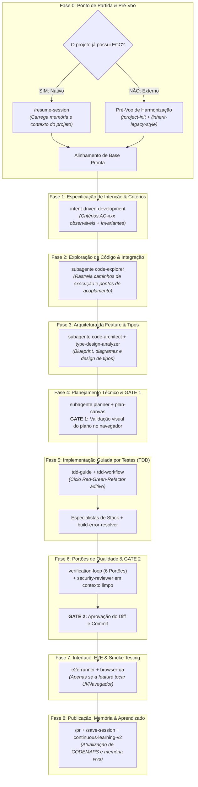
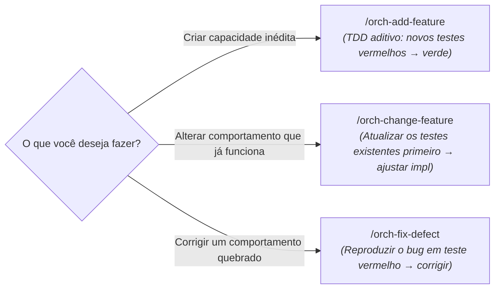

# Guia Prático: Adicionando uma Nova Funcionalidade com o ECC

Este guia estabelece o **passo a passo canônico e a melhor trilha de engenharia** para projetar, integrar e entregar uma nova funcionalidade (*New Feature*) em uma base de código existente utilizando o **ECC (*Everything Claude Code*)**.

---

## 1. Faz Diferença se o Projeto já Tiver Sido Gerado pelo ECC?

**Sim, faz uma diferença significativa no ponto de partida**, embora a esteira de implementação final convirja para o mesmo rigor técnico.

A tabela abaixo compara o estado de entrada e os passos prévios necessários:

| Critério | Projeto Nativo ECC (Já gerado/iniciado com ECC) | Projeto Externo (Nunca usou ECC antes) |
| :--- | :--- | :--- |
| **Ponto de Partida** | Repositório estruturado segundo o [Guia Greenfield](file:///home/willy/Dablio/ecc/howtos/greenfield.md). | Repositório pré-existente ou legado ([Guia Brownfield](file:///home/willy/Dablio/ecc/howtos/brownfield.md)). |
| **Regras e Convenções** | `.agents/rules/` já calibradas; `.ai-style-rules.md` e *Golden Files* presentes. | Desconhecidas pela IA; risco altíssimo de *AI Style Drift*. |
| **Comandos de Tooling** | `CLAUDE.md` / `AGENTS.md` com comandos canônicos de build, teste e lint já testados. | Não mapeados; a IA tentará adivinhar os comandos no terminal. |
| **Travas e Portões** | `delivery-gate` e ganchos do `hookify` já ativos impedindo quebras acidentais. | Ausentes; o agente pode tentar commitar código quebrado. |
| **Memória de Sessão** | Histórico arquitetural e decisões em `docs/adr/` e cofre [`unified-memory`](file:///home/willy/Dablio/ecc/.agents/skills/unified-memory/SKILL.md). | Sessão "fria"; a IA não conhece o contexto nem armadilhas prévias. |
| **Ação Prévia Obrigatória** | Nenhuma. Basta rodar `/resume-session` e iniciar a feature. | **Pré-Voo Obrigatório**: Rodar `/project-init` e `/inherit-legacy-style` antes de codificar. |

> [!IMPORTANT]
> **Em Projetos Externos (Sem ECC prévio)**: Antes de iniciar o desenvolvimento da nova feature, você **DEVE** executar o "Pré-Voo de Harmonização" (Fase 0A). Se você pular essa etapa, o assistente tentará criar a funcionalidade usando padrões modernos que entram em conflito com o restante da sua aplicação.

---

## 2. Visão Geral da Trilha Canônica de Nova Funcionalidade

O fluxo do ECC para entrega de novas funcionalidades divide-se em 8 fases determinísticas com dois portões de aprovação obrigatórios (**GATE 1** e **GATE 2**):



---

## 3. Passo a Passo Detalhado (Runbook Operacional)

### Fase 0: Inicialização e Verificação de Ambiente

#### Cenário A: O Projeto já é Nativo ECC
Se o projeto foi gerado pelo ECC ou já passou pelo setup:
1. Retome o contexto salvo da última sessão:
   ```text
   /resume-session
   ```
2. O ECC injeta o resumo de arquitetura, decisões pendentes e convenções vigentes, garantindo que o agente comece a trabalhar com foco total e sem alucinações.

#### Cenário B: O Projeto é Externo (Nunca usou ECC antes)
Se o projeto nunca foi configurado com o ECC:
1. Execute o instalador guiado ou o onboarding em dry-run:
   ```bash
   npx ecc-universal install --guided
   ```
   ou dentro da sessão:
   ```text
   /project-init --dry-run
   ```
2. Capture o estilo do código existente com [`inherit-legacy-style`](file:///home/willy/Dablio/ecc/.agents/skills/inherit-legacy-style/SKILL.md):
   ```text
   /inherit-legacy-style
   ```
   *Isso analisa os arquivos existentes e cria o `.ai-style-rules.md`, blindando o repositório contra desvios de estilo.*
3. Calibre o orçamento de contexto com [`agent-sort`](file:///home/willy/Dablio/ecc/.agents/skills/agent-sort/SKILL.md) e [`context-budget`](file:///home/willy/Dablio/ecc/.agents/skills/context-budget/SKILL.md).

---

### Fase 1: Especificação de Intenção & Critérios de Aceitação

Não comece a codificar pedindo *"adicione autenticação via Google"*. Transforme a demanda em requisitos de negócio testáveis.

#### 1. Definir Critérios Atômicos com [`intent-driven-development`](file:///home/willy/Dablio/ecc/.agents/skills/intent-driven-development/SKILL.md)
Escreva os critérios de aceitação que a nova funcionalidade deve satisfazer:

```markdown
### AC-001: Autenticação via Provedor OAuth2 Google
- **Cenário**: Usuário não autenticado clica em "Login com Google".
- **Ação**: Redirecionamento para o fluxo OAuth2 e retorno do callback com código de autorização válido.
- **Resultado Esperado**: Usuário é persistido na tabela `users` se não existir, sessão JWT criada com expiração em 24h e redirecionamento para `/dashboard`.
- **Invariantes (Must Not)**: 
  - NUNCA sobrescrever usuários criados via email/senha sem confirmação expressa.
  - NUNCA expor o `client_secret` no bundle do frontend.
- **Método de Teste**: Teste de integração mockando a resposta da API do Google.
```

---

### Fase 2: Exploração de Código & Mapeamento de Integração

Antes de propor a arquitetura da nova funcionalidade, investigue exatamente onde ela vai se acoplar na base de código existente.

#### 1. Inspecionar com o Subagente [`code-explorer`](file:///home/willy/Dablio/ecc/.agents/agents/code-explorer.md)
Invoque o [`code-explorer`](file:///home/willy/Dablio/ecc/.agents/agents/code-explorer.md) para analisar:
* Quais serviços ou rotas existentes serão tocados.
* Onde vivem os modelos de dados e se há migrations pendentes.
* Quais middlewares ou interceptadores interceptarão a nova funcionalidade.

O [`code-explorer`](file:///home/willy/Dablio/ecc/.agents/agents/code-explorer.md) roda em modo estritamente leitura e devolve uma síntese dos pontos de acoplamento sem inchar o contexto da conversa.

---

### Fase 3: Arquitetura da Feature & Blindagem de Tipos

A nova funcionalidade deve parecer que sempre fez parte do projeto, e não um remendo isolado.

#### 1. Desenhar a Arquitetura com o Subagente [`code-architect`](file:///home/willy/Dablio/ecc/.agents/agents/code-architect.md)
O [`code-architect`](file:///home/willy/Dablio/ecc/.agents/agents/code-architect.md) elabora o blueprint técnico da funcionalidade:
* **Padrões Vigentes**: Adota o mesmo padrão de injeção de dependências, factories ou services já utilizado no projeto.
* **Mapeamento de Arquivos**: Lista os arquivos a serem criados e modificados.
* **Diagrama de Fluxo de Dados**: Demonstra como a informação transita do controller até a persistência.

#### 2. Modelar os Contratos de Tipos com [`type-design-analyzer`](file:///home/willy/Dablio/ecc/.agents/agents/type-design-analyzer.md)
* Define schemas e tipos para impedir estados inválidos (*"Make illegal states unrepresentable"*).
* Assegura que novos parâmetros em interfaces existentes sejam opcionais ou retrocompatíveis para não quebrar consumidores existentes.

---

### Fase 4: Planejamento Técnico da Execução (**GATE 1: APROVAÇÃO**)

Nenhuma linha de código deve ser escrita antes da aprovação formal de um plano de tarefas decomposto.

#### 1. Decomposição com o Subagente [`planner`](file:///home/willy/Dablio/ecc/.agents/agents/planner.md) ou `/orch-add-feature`
Dispare o orquestrador de novas funcionalidades:
```text
/orch-add-feature "Adicionar login social OAuth2 via Google"
```
O orquestrador gera a lista ordenada de tarefas atômicas:
1. Criar migration de schema para suporte a `oauth_accounts`.
2. Modelar schemas de validação Zod/Pydantic para payload do callback.
3. Criar serviço de integração `GoogleAuthService`.
4. Implementar rotas `/auth/google` e `/auth/google/callback`.
5. Adicionar botão e estado de login na interface.

#### 2. Revisão Visual no [`plan-canvas`](file:///home/willy/Dablio/ecc/.agents/skills/plan-canvas/SKILL.md)
Abra o plano interativamente no navegador:
* Verifique a ordem de execução.
* Faça anotações pontuais nos itens que deseja alterar.
* **GATE 1**: Confirme o plano formalmente. O agente só inicia a escrita após seu aceite explícito.

---

### Fase 5: Implementação Guiada por Testes (TDD Aditivo)

O desenvolvimento segue a disciplina estrita do ciclo *Red-Green-Refactor*.

#### 1. Ciclo TDD com [`tdd-guide`](file:///home/willy/Dablio/ecc/.agents/agents/tdd-guide.md) e [`tdd-workflow`](file:///home/willy/Dablio/ecc/.agents/skills/tdd-workflow/SKILL.md)
Para cada tarefa do plano:
1. **RED**: Escreve o teste automatizado baseado no critério `AC-xxx` e roda a suíte para comprovar que o teste falha (comportamento inexistente).
2. **GREEN**: Escreve a quantidade mínima de código para o teste passar.
3. **REFACTOR**: Limpa o código, remove duplicações e melhora a nomenclatura sem quebrar a suíte.
4. **Meta de Cobertura**: Exige cobertura mínima de 80%+ no novo caminho de código.

#### 2. Suporte dos Especialistas de Linguagem e Auto-Cura
* Especialistas revisam cada arquivo criado: [`typescript-reviewer`](file:///home/willy/Dablio/ecc/.agents/agents/typescript-reviewer.md), [`python-reviewer`](file:///home/willy/Dablio/ecc/.agents/agents/python-reviewer.md), [`database-reviewer`](file:///home/willy/Dablio/ecc/.agents/agents/database-reviewer.md).
* Se a compilação quebrar, o subagente dedicado entra em ação ([`build-error-resolver`](file:///home/willy/Dablio/ecc/.agents/agents/build-error-resolver.md)) para aplicar correções cirúrgicas sem desviar da arquitetura acordada.

---

### Fase 6: Portões de Qualidade & Segurança (**GATE 2: APROVAÇÃO DO DIFF**)

Antes de consolidar a entrega, o código deve passar pelos portões de qualidade em contexto limpo.

#### 1. Os 6 Portões Mecânicos do [`verification-loop`](file:///home/willy/Dablio/ecc/.agents/skills/verification-loop/SKILL.md)
A esteira roda os testes de integridade:
1. **Build**: Compilação sem falhas em modo de produção.
2. **Typecheck**: Verificação estrita sem `@ts-ignore` ou tipos `any` indevidos.
3. **Lint**: Zero avisos ou inconformidades de formatação.
4. **Testes Unitários & Integração**: 100% dos testes verdes (novos testes + todos os testes pré-existentes do projeto).
5. **Grep de Segurança**: Sem credenciais ou segredos em texto plano.
6. **Revisão de Diff**: Conferência de cada linha modificada.

#### 2. Auditoria de Segurança com [`security-reviewer`](file:///home/willy/Dablio/ecc/.agents/agents/security-reviewer.md)
O [`security-reviewer`](file:///home/willy/Dablio/ecc/.agents/agents/security-reviewer.md) audita o diff em contexto isolado procurando por:
* Vulnerabilidades do OWASP Top 10 (CSRF no fluxo OAuth, falhas de injeção, escalada de privilégio).
* Validação de redirecionamentos abertos (*Open Redirects* no callback).

#### 3. Trava Mecânica com [`delivery-gate`](file:///home/willy/Dablio/ecc/.agents/skills/delivery-gate/SKILL.md) (**GATE 2**)
O commit convencional `feat: ...` só é gerado após confirmação formal do desenvolvedor e liberação mecânica pelo [`delivery-gate`](file:///home/willy/Dablio/ecc/.agents/skills/delivery-gate/SKILL.md).

---

### Fase 7: Interface, E2E & Smoke Testing (Se a Feature Tocar UI)

Se a funcionalidade possuir componentes visuais ou interação via navegador:

1. **Testes E2E com [`e2e-runner`](file:///home/willy/Dablio/ecc/.agents/agents/e2e-runner.md)**: Cria cenários Playwright com Page Object Model (POM) cobrindo o fluxo feliz e caminhos de erro.
2. **Smoke Test & Acessibilidade com [`browser-qa`](file:///home/willy/Dablio/ecc/.agents/skills/browser-qa/SKILL.md)**:
   - Verifica ausência de erros no console do navegador.
   - Audita acessibilidade WCAG 2.2 com axe-core.
   - Emite o veredito formal **SHIP** ou **DO-NOT-SHIP**.
3. **Auditoria de Máquina de Estado com [`click-path-audit`](file:///home/willy/Dablio/ecc/.agents/skills/click-path-audit/SKILL.md)**: Assegura que múltiplos cliques no botão de login não disparem requisições duplicadas concorrentes.

---

### Fase 8: Publicação, Memória Persistente & Governança

#### 1. Abertura do Pull Request com [`pr.md`](file:///home/willy/Dablio/ecc/.agents/workflows/pr.md)
```text
/pr
```
O workflow monta a descrição do PR vinculando os critérios de aceitação `AC-xxx`, lista de testes executados e garantia de que nenhum teste legado foi degradado.

#### 2. Atualização dos Mapas de Código com [`living-docs-governance`](file:///home/willy/Dablio/ecc/.agents/skills/living-docs-governance/SKILL.md)
O subagente [`doc-updater`](file:///home/willy/Dablio/ecc/.agents/agents/doc-updater.md) atualiza os mapas em `docs/CODEMAPS/*` para documentar a existência das novas rotas e serviços.

#### 3. Salvar Estado no Cofre de Memória via `/save-session`
```text
/save-session
```
Utilizando [`unified-memory`](file:///home/willy/Dablio/ecc/.agents/skills/unified-memory/SKILL.md) e [`ck`](file:///home/willy/Dablio/ecc/.agents/skills/ck/SKILL.md), o ECC grava o estado atual, novos termos de domínio aprendidos e sugestões de próximos passos.

#### 4. Absorção de Instintos com [`continuous-learning-v2`](file:///home/willy/Dablio/ecc/.agents/skills/continuous-learning-v2/SKILL.md)
Se você corrigiu a IA sobre particularidades da sua infraestrutura durante a criação da feature, o sistema cria instintos atômicos para que nas próximas features essas preferências já estejam incorporadas automaticamente.

---

## 4. Escolhendo o Comando Certo: `/orch-add-feature` vs. `/orch-change-feature`

O ECC diferencia claramente a adição de uma funcionalidade inédita da alteração de um comportamento já existente:



* **Use `/orch-add-feature`**: Quando a funcionalidade **não existia** no sistema (ex: *"Suportar exportação de relatórios em PDF"*). O processo cria novos testes e novas classes/rotas.
* **Use `/orch-change-feature`**: Quando o sistema já possui uma funcionalidade, mas você deseja que ela passe a se comportar de outra forma (ex: *"Alterar o cálculo de desconto para considerar cupom progressivo em vez de percentual fixo"*). Aqui, os testes existentes devem ser alterados primeiro para refletir o novo contrato.

---

## 5. Anti-padrões ao Adicionar Novas Features com IA

| Anti-padrão Clássico | Por que Falha? | Abordagem Correta no ECC |
| :--- | :--- | :--- |
| **"Acoplamento Predatório"** | A IA altera arquivos globais de configuração ou funções existentes para atender à nova feature, quebrando chamadas antigas. | O subagente [`code-architect`](file:///home/willy/Dablio/ecc/.agents/agents/code-architect.md) projeta a feature de forma modular e retrocompatível. |
| **Pular a Exploração Prévia** | O modelo cria uma função duplicada porque não percebeu que o projeto já possuía um utilitário idêntico. | O subagente [`code-explorer`](file:///home/willy/Dablio/ecc/.agents/agents/code-explorer.md) mapeia utilitários existentes antes do planejamento. |
| **Codificar sem aprovar o plano** | A IA implementa uma solução complexa que não atende ao que o desenvolvedor tinha em mente. | **GATE 1 Obrigatório**: Nenhuma linha é escrita sem validação e aprovação no [`plan-canvas`](file:///home/willy/Dablio/ecc/.agents/skills/plan-canvas/SKILL.md). |
| **Ignorar testes da suíte antiga** | A nova feature passa em seus testes unitários isolados, mas 12 testes antigos do sistema quebraram. | O [`verification-loop`](file:///home/willy/Dablio/ecc/.agents/skills/verification-loop/SKILL.md) executa a suíte completa do repositório para garantir **não-regressão**. |
| **Deixar a IA revisar seu próprio código** | O agente que cometeu uma falha de lógica não consegue enxergá-la na auto-revisão. | **Fresh-Context Review**: O [`security-reviewer`](file:///home/willy/Dablio/ecc/.agents/agents/security-reviewer.md) e revisores de linguagem auditam o diff em contexto limpo. |

---

## 6. Checklist de Bolso para Entrega de Nova Feature

- [ ] **Alinhamento Inicial & Pré-Voo**
  - [ ] Projeto verificado: se externo, `/project-init` e `/inherit-legacy-style` executados.
  - [ ] Se projeto com ECC, `/resume-session` disparado para recuperar contexto.
- [ ] **Definição & Arquitetura**
  - [ ] Critérios de aceitação atômicos documentados no formato `AC-xxx` (`intent-driven-development`).
  - [ ] Pontos de integração e caminhos de execução mapeados com [`code-explorer`](file:///home/willy/Dablio/ecc/.agents/agents/code-explorer.md).
  - [ ] Blueprint e contratos de tipos definidos com [`code-architect`](file:///home/willy/Dablio/ecc/.agents/agents/code-architect.md) e [`type-design-analyzer`](file:///home/willy/Dablio/ecc/.agents/agents/type-design-analyzer.md).
- [ ] **Planejamento Técnico (GATE 1)**
  - [ ] Plano de tarefas atômicas revisado e aprovado no [`plan-canvas`](file:///home/willy/Dablio/ecc/.agents/skills/plan-canvas/SKILL.md).
- [ ] **Construção TDD**
  - [ ] Testes vermelhos criados para cada tarefa antes do código de implementação (`tdd-guide`).
  - [ ] Implementação mínima escrita até os testes passarem com sucesso (verde).
  - [ ] Cobertura de testes superior a 80% nos caminhos da nova funcionalidade.
- [ ] **Portões de Qualidade & Segurança (GATE 2)**
  - [ ] 6 Portões do `verification-loop` 100% verdes (Build, Types, Lint, Testes, Grep de Segurança, Diff).
  - [ ] Auditoria de segurança aprovada pelo [`security-reviewer`](file:///home/willy/Dablio/ecc/.agents/agents/security-reviewer.md).
  - [ ] Diff aprovado pelo desenvolvedor e commit convencional gerado (`delivery-gate`).
- [ ] **Validação Visual & Fechamento**
  - [ ] Testes E2E e auditoria de acessibilidade executados com veredito *SHIP* (`browser-qa`, se aplicável).
  - [ ] Pull Request aberto com resumo completo (`/pr`).
  - [ ] Sessão persistida no cofre de memória (`/save-session`).
