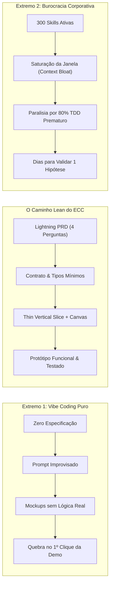
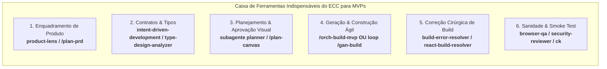
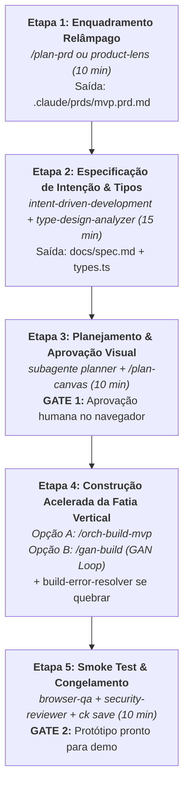
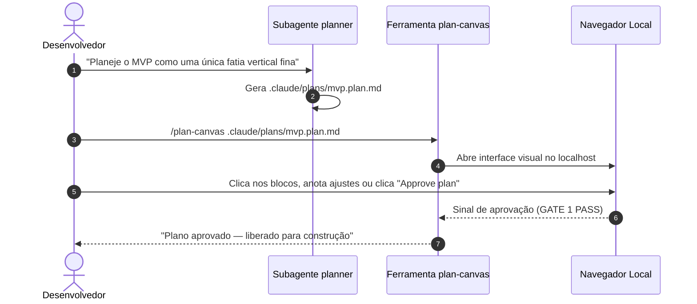
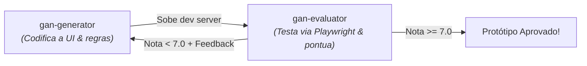

# Guia Prático: Especificação Rápida e Prototipagem de MVPs com o ECC

Este guia estabelece o **passo a passo canônico e a esteira acelerada de engenharia** para conceber, especificar e construir rapidamente uma aplicação, protótipo funcional ou MVP (*Minimum Viable Product*) utilizando **apenas as ferramentas indispensáveis** do **ECC (*Everything Claude Code*)**.

---

## 1. O Dilema do MVP com IA: Vibe Coding vs. Sobrecarga de Governança

Ao construir um protótipo ou MVP com assistência de IA, equipes e desenvolvedores costumam cair em um de dois extremos perigosos:



### Por Que os Dois Extremos Falham na Prototipagem?
1. **O Perigo do *Vibe Coding* (Sem Especificação)**: Gerar código no improviso resulta em interfaces aparentemente bonitas, porém vazias de dados reais, com estados inconsistentes e rotas quebradas. Ao primeiro clique de um investidor ou cliente em potencial, a aplicação trava.
2. **O Perigo do Excesso de Governança (Paralisia por Processo)**: Carregar a artilharia pesada corporativa do ECC (comitês multi-modelos, 4 camadas de governança de documentação, dezenas de ADRs formais e bateria exaustiva de testes antes de validar o produto) anula a velocidade necessária para testar uma tese de mercado.

### A Filosofia do ECC para MVPs: "Lean, Factual e Focado na 1ª Fatia Vertical"
Para prototipar com velocidade máxima sem abrir mão da consistência técnica, o ECC adota três princípios fundamentais:
* **Enquadramento Relâmpago**: Especificar o problema, a dor, o usuário e os limites em menos de 15 minutos via perguntas diretas.
* **Tipagem & Contratos Primeiro**: Desenhar as estruturas de dados fundamentais antes de gerar código. Tipos sólidos tornam estados inválidos impossíveis e eliminam 80% das alucinações da IA.
* **Fatia Vertical Fina (*Thin Vertical Slice*)**: Construir uma única jornada ponta a ponta funcional (interface $\rightarrow$ lógica $\rightarrow$ dados/persistência) em vez de telas estáticas desordenadas.

---

## 2. Comparativo: MVP Lean ECC vs. Greenfield Completo vs. Vibe Coding

| Critério | *Vibe Coding* Puro | **MVP Lean ECC (Este Guia)** | Greenfield Corporativo ([Guia Greenfield](file:///home/willycornelissen/Desktop/Dablio/ecc/howtos/greenfield.md)) |
| :--- | :--- | :--- | :--- |
| **Tempo até 1º Protótipo** | Minutos (frágil) | **30 a 90 minutos (funcional)** | Dias / Semanas |
| **Especificação Prévia** | Nenhuma | **Lean PRD (1 página) + ACs observáveis** | PRD extenso + SRS + ADRs em `docs/adr/` |
| **Ferramentas Ativas do ECC** | Nenhuma | **6 ferramentas essenciais (Kit Mínimo)** | 69 agentes + esteira de 9 fases |
| **Design de Tipos** | Improvisado | **Tipos centrais validados (`type-design-analyzer`)** | Modelagem formal de domínio e invariantes |
| **Estratégia de Implementação** | Geração em lote desordenada | **Orquestrador de MVP ou Ciclo GAN (Generator + Evaluator)** | TDD estrito Red-Green-Refactor ($\ge 80\%$) |
| **Validação** | Olhômetro humano | **Aprovação no navegador (`plan-canvas`) + Smoke Test** | Fresh-Context review, Santa Method e E2E |
| **Reaproveitamento do Código** | Descarta-se tudo | **Base sólida promovível para produção** | Pronto para escala e produção |

---

## 3. O Kit Mínimo Indispensável do ECC para Protótipos

Para prototipar rapidamente, você **NÃO DEVE** carregar todo o arsenal do ECC. Utilize estritamente as ferramentas listadas abaixo:



### O Que USAR (As Ferramentas Indispensáveis)

| Ferramenta / Agente | Arquivo de Origem / Referência | Papel no MVP | Momento de Uso |
| :--- | :--- | :--- | :--- |
| **`/plan-prd`** ou **`product-lens`** | [`.agents/workflows/plan-prd.md`](file:///home/willycornelissen/Desktop/Dablio/ecc/.agents/workflows/plan-prd.md) <br/> [`.agents/skills/product-lens/SKILL.md`](file:///home/willycornelissen/Desktop/Dablio/ecc/.agents/skills/product-lens/SKILL.md) | Enquadrar o problema, persona e *non-goals* em 4 perguntas objetivas. | Início absoluto da ideação (10 min). |
| **`intent-driven-development`** | [`.agents/skills/intent-driven-development/SKILL.md`](file:///home/willycornelissen/Desktop/Dablio/ecc/.agents/skills/intent-driven-development/SKILL.md) | Extrair 3 a 5 Critérios de Aceitação observáveis (`AC-001` a `AC-005`) e caminhos infelizes. | Imediatamente após o PRD enxuto. |
| **`type-design-analyzer`** | [`.agents/agents/type-design-analyzer.md`](file:///home/willycornelissen/Desktop/Dablio/ecc/.agents/agents/type-design-analyzer.md) | Criar o arquivo de tipos/estruturas de dados essenciais blindando contra estados inválidos. | Antes de qualquer linha de lógica ou UI. |
| **`planner` & `plan-canvas`** | [`.agents/agents/planner.md`](file:///home/willycornelissen/Desktop/Dablio/ecc/.agents/agents/planner.md) <br/> [`.agents/skills/plan-canvas/SKILL.md`](file:///home/willycornelissen/Desktop/Dablio/ecc/.agents/skills/plan-canvas/SKILL.md) | Planejar a primeira fatia vertical e exibi-la em uma tela interativa no navegador para aprovação visual. | Gate de aprovação do plano antes do código. |
| **`/orch-build-mvp`** ou **`/gan-build`** | [`.agents/workflows/orch-build-mvp.md`](file:///home/willycornelissen/Desktop/Dablio/ecc/.agents/workflows/orch-build-mvp.md) <br/> [`.agents/workflows/gan-build.md`](file:///home/willycornelissen/Desktop/Dablio/ecc/.agents/workflows/gan-build.md) | Automação da fatia vertical ponta a ponta ou ciclo adversarial rápido gerador-avaliador. | Fase de implementação do código. |
| **`build-error-resolver`** | [`.agents/agents/build-error-resolver.md`](file:///home/willycornelissen/Desktop/Dablio/ecc/.agents/agents/build-error-resolver.md) | Correção mecânica e cirúrgica de qualquer falha de compilação ou empacotamento. | Quando o bundler ou compilador falhar. |
| **`browser-qa`** | [`.agents/skills/browser-qa/SKILL.md`](file:///home/willycornelissen/Desktop/Dablio/ecc/.agents/skills/browser-qa/SKILL.md) | Teste de fumaça interativo no navegador real (abre página, clica, valida renderização). | Validação pré-apresentação/demo. |
| **`security-reviewer`** | [`.agents/agents/security-reviewer.md`](file:///home/willycornelissen/Desktop/Dablio/ecc/.agents/agents/security-reviewer.md) | Checagem rápida de sanidade: nenhuma chave de API vazada e nenhuma falha primária de injeção. | Antes de salvar/compartilhar o protótipo. |
| **`ck` / `unified-memory`** | [`.agents/skills/ck/SKILL.md`](file:///home/willycornelissen/Desktop/Dablio/ecc/.agents/skills/ck/SKILL.md) | Salva a memória e o resumo da sessão para retomada instantânea sem reexplicar o projeto. | Conclusão do protótipo. |

### O Que IGNORAR DELIBERADAMENTE no MVP
Para evitar lentidão e perda de foco, suspenda o uso de:
* ❌ **Conselho Multi-Modelos (`council-multi-model`)**: Desnecessário para decisões descartáveis de protótipo.
* ❌ **Mineração de Legado (`spec-miner` / `codebase-onboarding`)**: O projeto é novo; não há código legado para minerar.
* ❌ **Governança Complexa de Documentação (`living-docs-governance` / `code-tour`)**: Basta 1 arquivo de PRD e 1 arquivo de especificação.
* ❌ **Cobertura Rígida de Testes Unitários ($\ge 80\%$)**: Escreva apenas o teste de fumaça da jornada crítica; o foco inicial é validar usabilidade e valor.

---

## 4. Visão Geral da Trilha de Prototipagem Rápida

O fluxo recomendado para sair de uma ideia crua até um MVP interativo rodando na máquina compõe-se de **5 etapas sequenciais**:



---

## 5. Passo a Passo Detalhado (Runbook de Prototipagem)

### Etapa 1: Enquadramento Relâmpago do Problema (Lightning PRD)

> **Objetivo**: Fixar o que construir e, fundamentalmente, **o que NÃO construir**, evitando escopo inflado e alucinações.

#### 1. Iniciar o Enquadramento
No chat com o assistente, execute:
```text
/plan-prd "Nome ou resumo da ideia do MVP"
```
Ou ative o modo diagnóstico do [`product-lens`](file:///home/willycornelissen/Desktop/Dablio/ecc/.agents/skills/product-lens/SKILL.md):
```text
"Use o product-lens para fazer o diagnóstico YC da seguinte ideia: [descreva a ideia em 2 frases]"
```

#### 2. Responder às 4 Perguntas Inegociáveis
O assistente fará perguntas de ancoragem obrigatórias. Responda sucintamente:
1. **Quem é o usuário primário exato?** *(Ex: pequenos corretores de imóveis autônomos, não "qualquer pessoa")*.
2. **Qual é a dor observável?** *(Ex: perdem 4 horas semanais organizando fotos e links de imóveis no WhatsApp)*.
3. **Qual é a hipótese mensurável de validação?** *(Ex: o corretor consegue montar e compartilhar uma página de imóvel em menos de 90 segundos)*.
4. **Quais são os Non-Goals explícitos (*O que NÃO Fazer*)?** *(Ex: não teremos pagamentos, não teremos múltiplos usuários, não teremos chat em tempo real)*.

> [!IMPORTANT]
> **A Regra Anti-Fluff do PRD**: Se algum detalhe for desconhecido (ex: qual API de mapas utilizar), registre como `TBD — validar com protótipo`. Nunca invente requisitos rebuscados nesta fase.

#### 3. Artefato Gerado: `.claude/prds/mvp.prd.md`
O comando criará automaticamente um PRD conciso de 1 página:

```markdown
# MVP: [Nome da Aplicação]

## 1. Problema & Usuário
- **Usuário**: [Quem sente a dor]
- **Dor Real**: [Comportamento observado hoje]

## 2. Hipótese de Sucesso
- Acreditamos que **[capacidade central]** permitirá a **[usuários]** **[resolver a dor]**.
- Validaremos se **[métrica simples, ex: 5 usuários criarem seu catálogo na 1ª sessão]**.

## 3. Escopo do MVP (Thin Slice)
- [Funcionalidade Central 1]
- [Funcionalidade Central 2]

## 4. Non-Goals (Explicitamente Fora do Escopo)
- NÃO criar autenticação complexa (usar sessão local ou login mockado se necessário).
- NÃO construir painel de administração.
- NÃO criar integrações periféricas.
```

---

### Etapa 2: Especificação de Intenção e Design de Tipos Mínimos

> **Objetivo**: Converter a ideia em contratos técnicos claros antes de disparar a geração de código.

#### 1. Extração de Critérios Observáveis com [`intent-driven-development`](file:///home/willycornelissen/Desktop/Dablio/ecc/.agents/skills/intent-driven-development/SKILL.md)
Solicite ao assistente:
```text
"Use a skill intent-driven-development para extrair os critérios de aceitação AC e invariantes para o nosso MVP a partir do PRD gerado."
```

O assistente produzirá de 3 a 5 critérios observáveis no formato `Dado / Quando / Então`:
* **AC-001 (Caminho Feliz Central)**: Usuário insere dados $\rightarrow$ Dados são validados $\rightarrow$ Interface exibe resultado instantâneo.
* **AC-002 (Estado Vazio / Inicial)**: Sem dados inseridos $\rightarrow$ Interface exibe instrução clara e CTA.
* **AC-003 (Caminho Infeliz)**: Entrada inválida ou erro na fonte $\rightarrow$ Interface exibe mensagem amigável sem quebrar o layout.

#### 2. Blindagem de Tipos com [`type-design-analyzer`](file:///home/willycornelissen/Desktop/Dablio/ecc/.agents/agents/type-design-analyzer.md)
Antes de criar componentes visuais, o assistente desenha os tipos fundamentais:
```text
"Use o subagente type-design-analyzer para modelar os tipos essenciais deste MVP, garantindo que estados inválidos sejam irrepresentáveis."
```

Exemplo de design limpo gerado em `src/types.ts`:
```typescript
// Exemplo: Modelagem discriminada à prova de inconsistências
export type LoadingState<T> =
  | { status: 'idle' }
  | { status: 'loading' }
  | { status: 'success'; data: T }
  | { status: 'error'; message: string };

export interface CoreItem {
  id: string;
  title: string;
  value: number;
  createdAt: string;
}
```

> [!TIP]
> Ter este arquivo de tipos pronto reduz em **mais de 70%** as tentativas e erros do gerador de código nas próximas etapas.

---

### Etapa 3: Planejamento da Fatia Vertical & Aprovação Visual no Canvas

> **Objetivo**: Estruturar a ordem de montagem técnica e permitir que o operador valide visualmente o plano antes de gastar tokens de geração.



#### 1. Planejamento com o Subagente [`planner`](file:///home/willycornelissen/Desktop/Dablio/ecc/.agents/agents/planner.md)
Solicite:
```text
"Use o subagente planner para criar o plano de execução da primeira fatia vertical do MVP em .claude/plans/mvp.plan.md."
```

O plano conterá apenas 3 blocos ordenados:
1. **Scaffolding Mínimo**: Criação do esqueleto do projeto (ex: Vite + React + Tailwind ou FastAPI + SQLite).
2. **Implementação da Lógica e Estado Central**: Conexão dos tipos, estado e camada de dados/mock.
3. **Interface e Interação**: Componente central que atende aos ACs definidos.

#### 2. Revisão Visual com [`plan-canvas`](file:///home/willycornelissen/Desktop/Dablio/ecc/.agents/workflows/plan-canvas.md)
Em vez de ler um arquivo longo de texto, abra o canvas no navegador:
```text
/plan-canvas .claude/plans/mvp.plan.md
```
* O navegador abrirá automaticamente exibindo o plano em blocos interativos.
* Você pode clicar em itens, deixar anotações rápidas (*"Troque Axios por Fetch nativo"*) ou clicar diretamente em **"Approve plan"** (**GATE 1**).

---

### Etapa 4: Construção Acelerada da Fatia Vertical

Com o plano aprovado, o ECC oferece **duas abordagens de alta velocidade** para construir o código:

#### Opção A: O Orquestrador Direto de MVP (`/orch-build-mvp`)
Ideal quando a especificação detalha tanto backend quanto frontend integrados:
```text
/orch-build-mvp docs/spec.md
```
O workflow [`orch-build-mvp`](file:///home/willycornelissen/Desktop/Dablio/ecc/.agents/workflows/orch-build-mvp.md) executará de forma autônoma:
1. Cria a estrutura de pastas e arquivos de configuração básicos.
2. Implementa os contratos de tipos e serviços centrais.
3. Monta a interface de usuário correspondente.
4. Aciona automaticamente o [`build-error-resolver`](file:///home/willycornelissen/Desktop/Dablio/ecc/.agents/agents/build-error-resolver.md) se algum erro de compilação ou pacote faltante ocorrer.

#### Opção B: O Ciclo Autônomo GAN (`/gan-build`)
Ideal para protótipos de interface e produtos interativos que necessitam de iterações visuais refinadas:
```text
/gan-build "Criador rápido de catálogo de imóveis com compartilhamento de link" --eval-mode playwright --max-iterations 5
```
Como o GAN funciona por baixo dos panos:
1. **`gan-planner`**: Cria uma rubrica de avaliação rápida (`eval-rubric.md`).
2. **`gan-generator`**: Escreve o código da aplicação e sobe o servidor de desenvolvimento local.
3. **`gan-evaluator`**: Abre a aplicação via Playwright, insere dados, tira prints e pontua a aplicação de 0 a 10.
4. Se a nota for inferior à nota de corte (ex: 7.0), o avaliador envia feedback corretivo para o gerador, repetindo o ciclo até passar.



> [!NOTE]
> Durante a construção, se o compilador acusar erro de tipagem ou arquivo não encontrado, o ECC invoca cirurgicamente o [`react-build-resolver`](file:///home/willycornelissen/Desktop/Dablio/ecc/.agents/agents/react-build-resolver.md) ou [`build-error-resolver`](file:///home/willycornelissen/Desktop/Dablio/ecc/.agents/agents/build-error-resolver.md). Ele corrige estritamente a linha quebrada sem tentar refatorar a arquitetura inteira.

---

### Etapa 5: Validação do Caminho Crítico, Sanidade & Congelamento

> **Objetivo**: Garantir que o protótipo não trave na frente de ninguém e salvar o estado de desenvolvimento.

#### 1. Teste de Fumaça no Navegador com [`browser-qa`](file:///home/willycornelissen/Desktop/Dablio/ecc/.agents/skills/browser-qa/SKILL.md)
Peça ao assistente:
```text
"Use a skill browser-qa para executar um smoke check no fluxo principal da aplicação em http://localhost:3000."
```
O agente automatizado executará:
* Verificação de erros no console JavaScript (`console.error` = 0).
* Interação com os campos principais do formulário.
* Clique no botão de ação principal.
* Captura de screenshot da tela final comprovando o funcionamento.

#### 2. Checagem Rápida de Segurança com [`security-reviewer`](file:///home/willycornelissen/Desktop/Dablio/ecc/.agents/agents/security-reviewer.md)
Antes de compartilhar ou commitar o código:
```text
"Use o security-reviewer para verificar se há segredos, chaves de API expostas ou riscos críticos de segurança no diff atual."
```
O revisor verifica se:
* Arquivos `.env` estão incluídos no `.gitignore`.
* Nenhuma chave de API de LLM (OpenAI, Anthropic, Google) foi colocada em texto puro no código cliente.

#### 3. Congelamento da Memória com [`ck`](file:///home/willycornelissen/Desktop/Dablio/ecc/.agents/skills/ck/SKILL.md) ou `/save-session`
Para não perder o contexto do protótipo ao encerrar o terminal:
```text
/save-session "Protótipo MVP da fatia vertical v0.1 concluído e validado com sucesso"
```
A skill registra o resumo do que foi construído, os arquivos principais e os próximos passos para quando você for apresentar ou continuar o desenvolvimento.

---

## 6. Exemplo Prático de Ponta a Ponta

Para ilustrar a esteira completa em ação, acompanhe a especificação e criação de um protótipo real: **"QuickFeedback — Coletor de Feedback com Análise de Sentimento"**.

### Minuto 0 a 10: O Prompt Inicial e o PRD Lean
**Comando do Usuário**:
```text
/plan-prd "QuickFeedback: Widget embeddable onde usuários deixam nota de 1 a 5 e um comentário, com dashboard instantâneo agrupando o sentimento"
```

**Respostas Rápidas ao Assistente**:
* *Usuário*: Criadores de produtos digitais independentes (indie hackers).
* *Dor*: Ferramentas existentes de feedback são caras e complexas de configurar.
* *Hipótese*: Se a instalação exigir apenas colar 1 linha de script ou iframe, 50% dos criadores adotam no primeiro dia.
* *Non-Goals*: Sem integração com Slack/Discord, sem exportação para CSV, sem planos pagos.

O arquivo `.claude/prds/quick-feedback.prd.md` é gravado.

---

### Minuto 10 a 20: Especificação de Intenção e Tipos
O assistente extrai 3 critérios de aceite:
* `AC-001`: O widget permite selecionar nota de 1 a 5, digitar texto e clicar em "Enviar".
* `AC-002`: Ao enviar, salva no armazenamento local (`localStorage` ou SQLite simples) e exibe mensagem de agradecimento.
* `AC-003`: A tela de visualização lista os feedbacks recebidos ordenados por data com indicador visual de sentimento (Verde: 4-5, Amarelo: 3, Vermelho: 1-2).

O arquivo `src/types.ts` é criado com o [`type-design-analyzer`](file:///home/willycornelissen/Desktop/Dablio/ecc/.agents/agents/type-design-analyzer.md):
```typescript
export type Rating = 1 | 2 | 3 | 4 | 5;
export type Sentiment = 'positive' | 'neutral' | 'negative';

export interface FeedbackSubmission {
  id: string;
  rating: Rating;
  comment: string;
  createdAt: string;
  sentiment: Sentiment;
}
```

---

### Minuto 20 a 30: Planejamento & Canvas
O assistente gera `.claude/plans/quick-feedback.plan.md`:
* Tarefa 1: Scaffolding Vite + React + Tailwind + Lucide Icons.
* Tarefa 2: Componente do Widget de Envio (`src/components/FeedbackWidget.tsx`).
* Tarefa 3: Painel de Listagem de Feedbacks (`src/components/FeedbackDashboard.tsx`).

Comando executado:
```text
/plan-canvas .claude/plans/quick-feedback.plan.md
```
O desenvolvedor abre o navegador, confirma as 3 tarefas e clica em **"Approve plan"**.

---

### Minuto 30 a 60: Construção via Orquestrador
Executa-se:
```text
/orch-build-mvp .claude/plans/quick-feedback.plan.md
```
* O orquestrador gera a estrutura.
* Um erro de importação de ícone ocorre; o [`react-build-resolver`](file:///home/willycornelissen/Desktop/Dablio/ecc/.agents/agents/react-build-resolver.md) corrige o nome do pacote em 5 segundos.
* O dev server sobe em `http://localhost:5173`.

---

### Minuto 60 a 70: Smoke Test e Demonstração Pronta
Executa-se o teste rápido:
```text
"browser-qa teste a submissão de um feedback de nota 5 com o texto 'Excelente MVP!' e confirme se aparece no dashboard."
```
O [`browser-qa`](file:///home/willycornelissen/Desktop/Dablio/ecc/.agents/skills/browser-qa/SKILL.md) reporta:
* Formulário preenchido com sucesso.
* Mensagem de sucesso visível na tela.
* Item listado no dashboard com tag verde `positive`.
* 0 erros no console.

O desenvolvedor roda `/save-session` e o MVP está pronto para validação com usuários reais!

---

## 7. Anti-Padrões na Prototipagem com o ECC

Para manter a velocidade e a eficiência, evite as armadilhas mais frequentes:

| Anti-Padrão | Sintoma / Erro | Como Corrigir no ECC |
| :--- | :--- | :--- |
| **"E se o usuário quiser..."** | Adicionar funcionalidades hipotéticas antes de validar o núcleo (ex: login social, tema escuro). | Fixe os **Non-Goals** na Etapa 1 e rejeite qualquer tarefa fora deles. |
| **Tela Vazia / Mockup Fake** | A interface tem botões que não disparam nenhuma ação e dados fixos no HTML. | Exija a **Thin Vertical Slice**: um único fluxo, mas que funcione com persistência real (mesmo que seja `localStorage`). |
| **Ativação Maciça de Agentes** | Carregar 15 subagentes diferentes na mesma conversa. | Restrinja-se ao **Kit Mínimo**: `planner`, `build-resolver`, `browser-qa` e `security-reviewer`. |
| **Refatoração Oportunista Prematura** | Perder 40 minutos discutindo se a arquitetura aguenta 1 milhão de conexões simultâneas. | Use a regra de ouro do MVP: *"Construa para 10 usuários hoje; refatore para 1 milhão quando eles aparecerem"*. |
| **Esquecer o Snapshot de Sessão** | Fechar a janela do terminal e, no dia seguinte, a IA não saber o que foi feito. | Sempre execute `/save-session` ou use [`ck`](file:///home/willycornelissen/Desktop/Dablio/ecc/.agents/skills/ck/SKILL.md) ao final da sessão. |

---

## 8. Transição: Do MVP Validado para o Greenfield Corporativo

Uma das maiores vantagens de prototipar com o ECC em vez do *vibe coding* convencional é que **seu código não precisa ser jogado no lixo se a hipótese for validada**.

Quando seu MVP atingir tração e você decidir transformá-lo em um produto definitivo:
1. Abra o [**Guia Greenfield**](file:///home/willycornelissen/Desktop/Dablio/ecc/howtos/greenfield.md).
2. Promova os critérios de aceite simples para a suíte completa de testes com [`tdd-guide`](file:///home/willycornelissen/Desktop/Dablio/ecc/.agents/agents/tdd-guide.md).
3. Formalize as decisões arquiteturais persistentes com [`architecture-decision-records`](file:///home/willycornelissen/Desktop/Dablio/ecc/.agents/skills/architecture-decision-records/SKILL.md) em `docs/adr/`.
4. Ative os portões contínuos de qualidade com [`verification-loop`](file:///home/willycornelissen/Desktop/Dablio/ecc/.agents/skills/verification-loop/SKILL.md) e [`delivery-gate`](file:///home/willycornelissen/Desktop/Dablio/ecc/.agents/skills/delivery-gate/SKILL.md).

Assim, seu protótipo evolui de forma fluida para uma aplicação empresarial de alta robustez sem recomeçar do zero.
