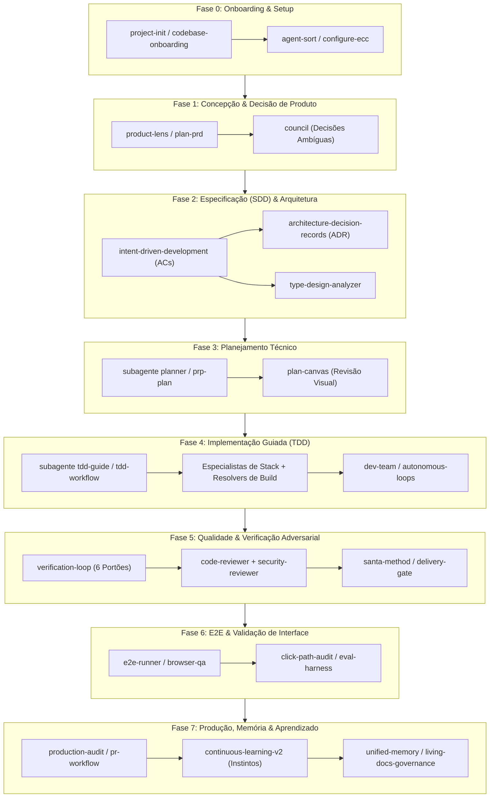

# Pipeline Completa de Desenvolvimento com ECC (Everything Claude Code)

Este documento descreve a esteira de engenharia completa do **ECC Universal (v2.2.3)**, cobrindo todo o ciclo de vida de desenvolvimento de software (SDLC) com suporte a agentes autônomos, verificações adversariais, TDD e governança contínua.

---

## Visão Geral do Fluxo



---

## Fases da Pipeline

### Fase 0: Inicialização e Onboarding do Projeto
*Objetivo: Estabelecer as regras, mapear a stack e calibrar o consumo de contexto.*

* **Ferramentas**:
  - [`project-init.md`](file:///home/willy/Sandbox/ecc/.agents/workflows/project-init.md): Detecta manifestos (`package.json`, `Cargo.toml`, `pyproject.toml`) e gera plano de instalação sob medida.
  - [`codebase-onboarding`](file:///home/willy/Sandbox/ecc/.agents/skills/codebase-onboarding/SKILL.md): Analisa repositórios legados e gera guia inicial de arquitetura.
  - [`agent-sort`](file:///home/willy/Sandbox/ecc/.agents/skills/agent-sort/SKILL.md): Separa regras essenciais das opcionais para evitar inchaço de contexto.
  - [`context-budget`](file:///home/willy/Sandbox/ecc/.agents/skills/context-budget/SKILL.md) e [`config-gc`](file:///home/willy/Sandbox/ecc/.agents/skills/config-gc/SKILL.md): Otimiza tokens e remove redundâncias.
* **Artefato Gerado**: `ecc-install-state.json`, regras selecionadas em `.agents/rules/`.

---

### Fase 1: Concepção, Discovery e Decisões de Produto
*Objetivo: Descobrir o problema real, validar a hipótese e evitar construir a coisa errada.*

* **Possibilidades**:
  1. **Trilha Lean / PRD**: Workflow [`plan-prd.md`](file:///home/willy/Sandbox/ecc/.agents/workflows/plan-prd.md) para delimitar o problema, hipótese mensurável, usuário primário e o que está expressamente **fora de escopo**.
  2. **Trilha YC / Product Discovery**: Skill [`product-lens`](file:///home/willy/Sandbox/ecc/.agents/skills/product-lens/SKILL.md) para diagnóstico de tração, time-to-value e priorização ICE (*Impact, Confidence, Ease*).
  3. **Decisões Complexas / Trade-offs**: Skill [`council`](file:///home/willy/Sandbox/ecc/.agents/skills/council/SKILL.md) ou [`council-multi-model`](file:///home/willy/Sandbox/ecc/.agents/skills/council-multi-model/SKILL.md) que convoca um conselho com 4 vozes divergentes para debater escolhas ambíguas (ex: PostgreSQL vs DynamoDB, Monolito vs Microsserviços).
* **Artefato Gerado**: `.claude/prds/{name}.prd.md` ou `PRODUCT-BRIEF.md`.

---

### Fase 2: Especificação Comportamental (SDD) & Design
*Objetivo: Transformar a visão de produto em contratos comportamentais observáveis e testáveis.*

* **Ferramentas**:
  - [`intent-driven-development`](file:///home/willy/Sandbox/ecc/.agents/skills/intent-driven-development/SKILL.md): Define critérios de aceitação estritos (`AC-001`, `AC-002`) contendo Cenário, Ação, Resultado Esperado, Invariantes (*Must Not*) e método de teste.
  - [`spec-miner`](file:///home/willy/Sandbox/ecc/.agents/agents/spec-miner.md): Se o projeto já tem código legado sem documentação, extrai especificações comportamentais no padrão OpenSpec (`openspec/specs/<capability>/spec.md`).
  - [`architecture-decision-records`](file:///home/willy/Sandbox/ecc/.agents/skills/architecture-decision-records/SKILL.md): Registra decisões estruturais com contexto e consequências em `docs/adr/NNNN-titulo.md`.
  - [`type-design-analyzer`](file:///home/willy/Sandbox/ecc/.agents/agents/type-design-analyzer.md): Projeta o design de tipos para tornar estados inválidos irrepresentáveis no compilador.
* **Artefato Gerado**: `specs/spec.md`, arquivos ADR e schemas de dados.

---

### Fase 3: Planejamento Técnico de Implementação
*Objetivo: Quebrar a especificação em passos de execução atômicos e ordenados.*

* **Ferramentas**:
  - Subagente [`planner`](file:///home/willy/Sandbox/ecc/.agents/agents/planner.md): Cria plano detalhado com caminhos de arquivo, dependências entre fases, estimativas de risco e estratégias de mitigação.
  - Workflow [`prp-plan.md`](file:///home/willy/Sandbox/ecc/.agents/workflows/prp-plan.md): Plano auto-contido projetado para execução contínua sem interrupções.
  - [`plan-canvas`](file:///home/willy/Sandbox/ecc/.agents/skills/plan-canvas/SKILL.md): Abre o plano em uma interface visual no navegador para você anotar, aprovar ou solicitar alterações antes de qualquer linha de código.
* **Artefato Gerado**: `plans/{feature}.plan.md`.

---

### Fase 4: Implementação Guiada por Testes (TDD & Pair Programming)
*Objetivo: Escrever código de alta qualidade, orientado a testes e com suporte de especialistas.*

* **Possibilidades de Execução**:
  1. **Desenvolvimento TDD Obrigatório**:
     - Subagente [`tdd-guide`](file:///home/willy/Sandbox/ecc/.agents/agents/tdd-guide.md) + skill [`tdd-workflow`](file:///home/willy/Sandbox/ecc/.agents/skills/tdd-workflow/SKILL.md): Garante ciclo estrito **Red-Green-Refactor** com cobertura mínima de 80%.
  2. **Especialistas por Linguagem**:
     - O ECC ativa automaticamente revisores específicos (ex: `typescript-reviewer`, `python-reviewer`, `react-reviewer`, `go-reviewer`, `rust-reviewer`, `java-reviewer`).
  3. **Auto-Cura de Falhas de Compilação**:
     - Se o build quebrar, subagentes dedicados entram em ação para consertar cirurgicamente: `build-error-resolver`, `react-build-resolver`, `rust-build-resolver`, `go-build-resolver`.
  4. **Modos de Orquestração**:
     - **Equipe Simulada**: Skill [`dev-team`](file:///home/willy/Sandbox/ecc/.agents/skills/dev-team/SKILL.md) (reúne PM, Arquiteto, Dev e QA na mesma sessão).
     - **Loops Autônomos**: Skill [`loop-design-check`](file:///home/willy/Sandbox/ecc/.agents/skills/loop-design-check/SKILL.md) e subagente `loop-operator` para execuções iterativas controladas sem fuga de objetivo.

---

### Fase 5: Qualidade, Segurança & Verificação Adversarial
*Objetivo: Garantir que nenhum código defeituoso ou vulnerável seja aceito.*

* **Ferramentas**:
  - [`verification-loop`](file:///home/willy/Sandbox/ecc/.agents/skills/verification-loop/SKILL.md): Executa 6 portões de verificação obrigatórios:
    1. *Build*, 2. *Typecheck*, 3. *Lint*, 4. *Testes com Cobertura*, 5. *Grep de Segurança*, 6. *Revisão de Diff*.
  - Subagente [`security-reviewer`](file:///home/willy/Sandbox/ecc/.agents/agents/security-reviewer.md): Escaneia por vulnerabilidades do OWASP Top 10, vazamentos de credenciais, injeção de SQL e falhas de autorização.
  - Subagentes Complementares: [`a11y-architect`](file:///home/willy/Sandbox/ecc/.agents/agents/a11y-architect.md) (Acessibilidade WCAG 2.2), [`performance-optimizer`](file:///home/willy/Sandbox/ecc/.agents/agents/performance-optimizer.md), [`silent-failure-hunter`](file:///home/willy/Sandbox/ecc/.agents/agents/silent-failure-hunter.md).
  - [`santa-method`](file:///home/willy/Sandbox/ecc/.agents/skills/santa-method/SKILL.md): **Revisão adversarial**. Dois agentes independentes recebem o código e a mesma rubrica; a entrega só avança se ambos aprovarem de forma convergente.
  - [`delivery-gate`](file:///home/willy/Sandbox/ecc/.agents/skills/delivery-gate/SKILL.md): Impede mecanicamente que o assistente declare uma tarefa como "concluída" se houver pendências de qualidade.

---

### Fase 6: Testes Ponta a Ponta (E2E) e Auditoria de UI
*Objetivo: Validar a experiência do usuário final nos navegadores e fluxos de estado.*

* **Ferramentas**:
  - Subagente [`e2e-runner`](file:///home/willy/Sandbox/ecc/.agents/agents/e2e-runner.md) + skill [`e2e-testing`](file:///home/willy/Sandbox/ecc/.agents/skills/e2e-testing/SKILL.md): Cria e roda testes Playwright com Page Object Model.
  - [`browser-qa`](file:///home/willy/Sandbox/ecc/.agents/skills/browser-qa/SKILL.md): Smoke tests automatizados pós-deploy (erros de console, Core Web Vitals, regressão visual em 3 breakpoints, auditoria axe-core de acessibilidade com veredito *SHIP* / *DO-NOT-SHIP*).
  - [`click-path-audit`](file:///home/willy/Sandbox/ecc/.agents/skills/click-path-audit/SKILL.md): Mapeia todos os botões e pontos de toque rastreando máquinas de estado para evitar inconsistências concorrentes na UI.
  - [`eval-harness`](file:///home/willy/Sandbox/ecc/.agents/skills/eval-harness/SKILL.md): Framework de testes de regressão para medir taxa de confiabilidade (`pass@k`).

---

### Fase 7: Publicação, Pull Request & Produção
*Objetivo: Integrar as alterações no Git e auditar a prontidão para o mundo real.*

* **Ferramentas**:
  - [`production-audit`](file:///home/willy/Sandbox/ecc/.agents/skills/production-audit/SKILL.md): Auditoria com evidências locais de segurança, variáveis de ambiente, logs e rollback ("O que pode quebrar em produção?").
  - Workflows de PR: [`pr.md`](file:///home/willy/Sandbox/ecc/.agents/workflows/pr.md) ou `review-pr.md` aplicando as convenções de commit limpo de [`common-git-workflow.md`](file:///home/willy/Sandbox/ecc/.agents/rules/common-git-workflow.md).
  - Preparação Open Source (se aplicável): [`opensource-forker`](file:///home/willy/Sandbox/ecc/.agents/agents/opensource-forker.md) → [`opensource-sanitizer`](file:///home/willy/Sandbox/ecc/.agents/agents/opensource-sanitizer.md) → [`opensource-packager`](file:///home/willy/Sandbox/ecc/.agents/agents/opensource-packager.md).

---

### Fase 8: Governança, Memória Contínua & Aprendizado
*Objetivo: Manter o contexto vivo entre sessões e aprender com os erros e preferências do usuário.*

* **Ferramentas**:
  - **Memória de Sessão**: [`unified-memory`](file:///home/willy/Sandbox/ecc/.agents/skills/unified-memory/SKILL.md) e [`ck`](file:///home/willy/Sandbox/ecc/.agents/skills/ck/SKILL.md) via `/save-session` e `/resume-session` garantem persistência de contexto entre sessões.
  - **Aprendizado Contínuo (Instintos)**: [`continuous-learning-v2`](file:///home/willy/Sandbox/ecc/.agents/skills/continuous-learning-v2/SKILL.md) observa correções feitas pelo desenvolvedor, gera "instintos atômicos" com pontuação de confiança e evolui esses instintos em regras permanentes.
  - **Governança de Documentação**: [`living-docs-governance`](file:///home/willy/Sandbox/ecc/.agents/skills/living-docs-governance/SKILL.md) e [`doc-updater`](file:///home/willy/Sandbox/ecc/.agents/agents/doc-updater.md) evitam o apodrecimento da documentação (*doc rot*) e mantêm os mapas de código (`CODEMAPS`) atualizados.

---

## Trilhas de Execução Práticas

1. **Trilha Ágil / MVP (Fast-Track)**:
   ```text
   /plan-prd ➔ intent-driven-development ➔ /plan ➔ tdd-workflow ➔ verification-loop ➔ /pr
   ```
2. **Trilha Crítica / Enterprise (High-Assurance Track)**:
   ```text
   product-lens ➔ council ➔ intent-driven-development ➔ plan-canvas ➔ dev-team + tdd-guide ➔ santa-method + security-reviewer ➔ browser-qa ➔ production-audit
   ```
