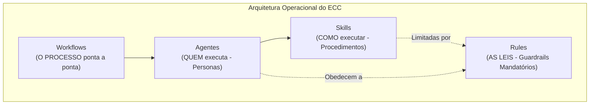
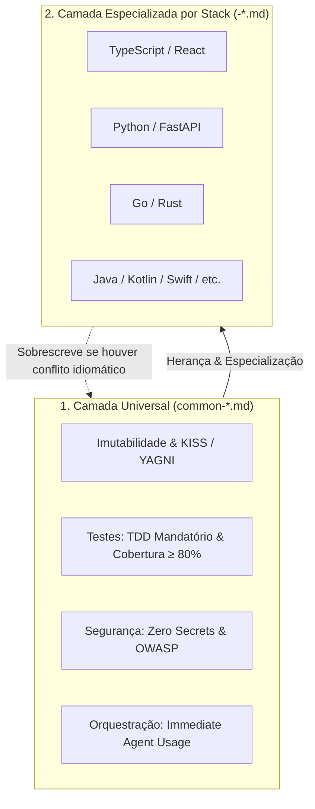

# Guia de Rules do ECC (Everything Claude Code)

No ecossistema do **ECC (*Everything Claude Code*, também referenciado em pipelines corporativos como *Enterprise Custom Configuration*)**, as **Rules** representam a **camada de governança normativa e guardrails mandatórios**. Elas definem as leis, padrões de engenharia, limites de segurança e restrições arquiteturais que os modelos de IA e os desenvolvedores são **obrigados a seguir** durante toda a sessão.

Enquanto as **Skills** explicam *como executar* uma técnica e os **Workflows** orquestram *o fluxo de ponta a ponta*, as **Rules** estabelecem **o que é permitido, proibido ou mandatório** (*what to do, what NOT to do*).

O repositório possui **121 arquivos de regras** em [`.agents/rules/`](file:///home/willycornelissen/Desktop/Dablio/ecc/.agents/rules/), cobrindo princípios universais e convenções idiomáticas de mais de 20 linguagens e frameworks.

---

## 1. Os Quatro Pilares do ECC



| Pilar | Pergunta que Responde | Natureza | Exemplo |
| :--- | :--- | :--- | :--- |
| **Workflow** | *Qual é a sequência de etapas?* | Orquestração ordenada | `/plan`, `/pr`, `/feature-dev` |
| **Agent** | *Quem tem a autoridade para fazer?* | Persona e ferramentas | `planner`, `security-reviewer` |
| **Skill** | *Como executar essa técnica?* | Manual procedimental | `tdd-workflow`, `spec-miner` |
| **Rule** | *Quais são os limites inegociáveis?* | Norma mandatória | Cobertura $\ge 80\%$, sem segredos |

---

## 2. A Arquitetura em Duas Camadas (*Layered Rules*)

As regras do ECC são organizadas em uma estrutura hierárquica inteligente:



### Precedência e Regra de Resolução (*Specific Overrides General*)
Quando uma regra específica da linguagem entra em conflito com uma diretriz genérica da camada universal, **a regra da linguagem tem precedência** (seguindo o princípio de especificidade do CSS ou precedência de `.gitignore`):

* *Exemplo*: A regra universal [`common-coding-style.md`](file:///home/willycornelissen/Desktop/Dablio/ecc/.agents/rules/common-coding-style.md) exige imutabilidade estrita como padrão. No entanto, [`golang-coding-style.md`](file:///home/willycornelissen/Desktop/Dablio/ecc/.agents/rules/golang-coding-style.md) sobrescreve essa restrição para permitir mutação de *structs* via receptores de ponteiro (*pointer receivers*), por ser o padrão idiomático da linguagem Go.

---

## 3. A Camada Universal (`common-*`)

A camada universal estabelece os padrões inegociáveis válidos para **qualquer projeto**, independentemente da linguagem:

| Regra | Arquivo | Principais Diretrizes e Guardrails |
| :--- | :--- | :--- |
| **Estilo de Código** | [`common-coding-style.md`](file:///home/willycornelissen/Desktop/Dablio/ecc/.agents/rules/common-coding-style.md) | **Imutabilidade Mandatória** (gerar novos objetos, nunca mutar in-place); Princípios KISS, DRY e YAGNI; Preferência por múltiplos arquivos pequenos (teto suave de **800 linhas** por arquivo); Proibição de engolir exceções em silêncio. |
| **Segurança** | [`common-security.md`](file:///home/willycornelissen/Desktop/Dablio/ecc/.agents/rules/common-security.md) | **Checklist Obrigatório Pré-Commit**: Proibição estrita de credenciais/chaves hardcoded; Validação de todos os inputs; Prevenção de SQL Injection e XSS; Ativação de rate limiting; Protocolo de parada imediata e acionamento do [`security-reviewer`](file:///home/willycornelissen/Desktop/Dablio/ecc/.agents/agents/security-reviewer.md) se uma falha for detectada. |
| **Testes** | [`common-testing.md`](file:///home/willycornelissen/Desktop/Dablio/ecc/.agents/rules/common-testing.md) | **Cobertura Mínima de 80%**; Ciclo Red-Green-Refactor do TDD mandatório; Testes organizados no padrão AAA (*Arrange-Act-Assert*); Acionamento obrigatório do [`tdd-guide`](file:///home/willycornelissen/Desktop/Dablio/ecc/.agents/agents/tdd-guide.md). |
| **Revisão de Código** | [`common-code-review.md`](file:///home/willycornelissen/Desktop/Dablio/ecc/.agents/rules/common-code-review.md) | **Gatilhos Mandatórios de Revisão** (após escrever código ou tocar em auth/pagamento); Níveis de severidade: `CRITICAL` (**BLOCK**), `HIGH` (**WARN**), `MEDIUM` (**INFO**), `LOW` (**NOTE**). |
| **Orquestração de Agentes** | [`common-agents.md`](file:///home/willycornelissen/Desktop/Dablio/ecc/.agents/rules/common-agents.md) | **Uso Imediato de Agentes** (o orquestrador é obrigado a chamar `planner`, `code-reviewer` ou `build-error-resolver` sem pedir permissão); Execução em paralelo por padrão; **Contrato de Finalização** (quem delega é obrigado a esperar o resultado e consolidá-lo). |
| **Fluxo de Git** | [`common-git-workflow.md`](file:///home/willycornelissen/Desktop/Dablio/ecc/.agents/rules/common-git-workflow.md) | Padronização em *Conventional Commits*; Branches de curta duração; Rebase linear local antes de abrir Pull Requests. |
| **Performance** | [`common-performance.md`](file:///home/willycornelissen/Desktop/Dablio/ecc/.agents/rules/common-performance.md) | Proibição de queries N+1; Paginação obrigatória em consultas; Eliminação de computação redundante em loops. |
| **Padrões de Projeto** | [`common-patterns.md`](file:///home/willycornelissen/Desktop/Dablio/ecc/.agents/rules/common-patterns.md) | Separação de responsabilidades (SoC); Injeção de dependências; Encapsulamento de regras de negócio. |

---

## 4. Catálogo das Regras Específicas por Stack Tecnológica

Para cada tecnologia suportada, o ECC disponibiliza um conjunto quíntuplo de regras:
1. `*-coding-style.md`: Convenções idiomáticas, formatação e tipos.
2. `*-security.md`: Vetores de ataque e vulnerabilidades específicas do ecossistema.
3. `*-testing.md`: Frameworks de teste, mocks e estratégias de assert.
4. `*-patterns.md`: Padrões arquiteturais recomendados para o ecossistema.
5. `*-hooks.md`: Ganchos para formatação silenciosa e linter automático em cada edição.

### Resumo das Stacks Catalogadas em [`.agents/rules/`](file:///home/willycornelissen/Desktop/Dablio/ecc/.agents/rules/):

| Stack / Ecossistema | Arquivos de Regras Disponíveis | Foco Técnico |
| :--- | :--- | :--- |
| **TypeScript / JavaScript** | `typescript-coding-style.md`, `typescript-security.md`, `typescript-testing.md`, `typescript-patterns.md`, `typescript-hooks.md` | Tipagem estrita de APIs públicas, interfaces vs types, proibição do tipo `any`, eslint. |
| **React** | `react-coding-style.md`, `react-security.md`, `react-testing.md`, `react-patterns.md`, `react-hooks.md` | Regras de Hooks, Server/Client components, memoização, prevenção de re-renders desnecessários. |
| **React Native** | `react-native-coding-style.md`, `react-native-accessibility.md`, `react-native-performance.md`, `react-native-security.md`, `react-native-testing.md`, `react-native-production-readiness.md` | Gestão de memória mobile, Bridge/JSI, acessibilidade móvel, layout responsivo Expo/CLI. |
| **Python & FastAPI** | `python-coding-style.md`, `python-security.md`, `python-testing.md`, `python-patterns.md`, `python-hooks.md`, `python-fastapi.md` | PEP 8, Pydantic v2, injeção de dependências, async/await seguro, Pytest, Ruff. |
| **Go (Golang)** | `golang-coding-style.md`, `golang-security.md`, `golang-testing.md`, `golang-patterns.md`, `golang-hooks.md` | Concorrência com goroutines e canais, tratamento de erro explícito (`if err != nil`), pointer receivers. |
| **Rust** | `rust-coding-style.md`, `rust-security.md`, `rust-testing.md`, `rust-patterns.md`, `rust-hooks.md` | Gestão de ownership, borrow checker, uso estrito de `Result<T, E>`, auditoria de blocos `unsafe`. |
| **Vue & Nuxt** | `vue-*` (5 arquivos) / `nuxt-*` (4 arquivos) | Composition API (`<script setup>`), Pinia, reatividade com `ref`/`reactive`, SSR hydration. |
| **Angular** | `angular-*` (5 arquivos) | Signals, Standalone Components, injeção com `inject()`, RxJS seguro. |
| **Java & Kotlin** | `java-*` (5 arquivos) / `kotlin-*` (5 arquivos) | Spring Boot / Quarkus, JPA/Panache, coroutines seguras em Kotlin, immutability em records. |
| **C++ & C# (.NET)** | `cpp-*` (5 arquivos) / `csharp-*` (5 arquivos) | RAII e smart pointers em C++20; async/await, tipos anuláveis e LINQ corporativo em .NET. |
| **Mobile & Multiplataforma** | `swift-*` (5 arquivos), `dart-*` (5 arquivos), `arkts-*` (5 arquivos) | Swift Concurrency e SwiftUI; Widgets Flutter e BLoC; HarmonyOS ArkTS/ArkUI. |
| **PHP & Ruby** | `php-*` (5 arquivos), `ruby-*` (5 arquivos) | PHP 8+ com tipagem forte e PSR-12; Ruby on Rails moderno, Hotwire e RSpec. |
| **Web Geral & Perl** | `web-*` (7 arquivos), `perl-*` (4 arquivos) | Performance web, Core Web Vitals, HTML semântico, qualidade visual e legado Perl. |

---

## 5. Como as Rules são Ativadas e Aplicadas?

As regras do ECC são ativadas em tempo real através de **três mecanismos complementares**:

### 1. Correspondência de Caminho (*Path Matching / Frontmatter*)
Diversas regras de linguagem possuem metadados de correspondência no topo do arquivo:
```yaml
---
paths:
  - "**/*.ts"
  - "**/*.tsx"
---
```
Quando o agente lê ou prepara-se para editar um arquivo `.ts` ou `.tsx`, o ambiente de execução injeta automaticamente as regras de [`typescript-coding-style.md`](file:///home/willycornelissen/Desktop/Dablio/ecc/.agents/rules/typescript-coding-style.md) e [`typescript-security.md`](file:///home/willycornelissen/Desktop/Dablio/ecc/.agents/rules/typescript-security.md) no contexto ativo.

### 2. Guardrails Mecânicos em Tempo de Execução (*Hooks*)
As regras contidas em `*-hooks.md` ativam ganchos de ciclo de vida (como regras de [Hookify](file:///home/willycornelissen/Desktop/Dablio/ecc/.agents/workflows/hookify.md)):
* Se a IA tentar rodar `git push --force` ou modificar arquivos `.env`, um hook mecânico **bloqueia** a execução imediatamente com base na regra de segurança.
* A cada gravação de arquivo, linters e formatadores (Prettier, Black, Gofmt, Clippy) rodam silenciosamente para garantir a conformidade estética.

### 3. Gatilhos de Orquestração Proativa
Regras como a de [`common-agents.md`](file:///home/willycornelissen/Desktop/Dablio/ecc/.agents/rules/common-agents.md) atuam sobre a tomada de decisão do próprio modelo:
* O modelo sabe que, por força da regra, ele **não pode** entregar uma feature sem antes ter rodado o revisor de código ou sem ter criado os testes correspondentes.

---

## 6. Resumo Operacional

Graças a esse arcabouço normativo:
1. **O código mantém consistência industrial**: mesmo com múltiplos agentes e desenvolvedores alternando no repositório, o padrão de design e formatação permanece unificado.
2. **Vulnerabilidades são contidas na origem**: regras rígidas de segurança previnem brechas antes mesmo do commit local.
3. **A IA ganha limites claros**: a inteligência artificial deixa de atuar de forma opinativa ou improvisada e passa a operar rigorosamente sob as diretrizes de governança da empresa.
