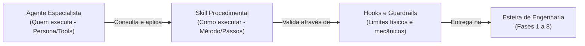

# Catálogo Completo de Skills do ECC (Everything Claude Code)

As **Skills** do **ECC (*Everything Claude Code*, também referenciado em pipelines corporativos como *Enterprise Custom Configuration*)** são pacotes modulares de instruções procedimentais, scripts determinísticos, padrões de engenharia e regras de execução que ensinam aos modelos de IA **como executar tarefas de engenharia de software com rigor profissional**.

Enquanto os **Agentes** definem *quem* executa o trabalho (a persona, modelo e ferramentas delimitadas), as **Skills** definem os *manuais de procedimento* — detalhando passo a passo metodologias como TDD, auditorias de segurança, testes visuais de UI, escrita de ADRs e memória contínua.

Este documento cataloga as **48 skills instaladas no repositório** em [`.agents/skills/`](file:///home/willycornelissen/Desktop/Dablio/ecc/.agents/skills/), agrupadas em **8 categorias funcionais**.

---

## Índice das Categorias

1. [Concepção, Discovery e Decisões de Produto](#1-concepção-discovery-e-decisões-de-produto) (4 skills)
2. [Especificação Comportamental, Arquitetura e Modelagem](#2-especificação-comportamental-arquitetura-e-modelagem) (5 skills)
3. [Implementação, TDD e Qualidade de Código](#3-implementação-tdd-e-qualidade-de-código) (6 skills)
4. [Testes Ponta a Ponta (E2E), UI e Verificação de Interface](#4-testes-ponta-a-ponta-e2e-ui-e-verificação-de-interface) (5 skills)
5. [Portões de Qualidade, Segurança e Verificação Adversarial](#5-portões-de-qualidade-segurança-e-verificação-adversarial) (4 skills)
6. [Controle de Versão, Pull Request e Onboarding](#6-controle-de-versão-pull-request-e-onboarding) (3 skills)
7. [Governança, Memória Contínua e Aprendizado](#7-governança-memória-contínua-e-aprendizado) (8 skills)
8. [Gerenciamento de Sessão, Operação de Agentes e Otimização do ECC](#8-gerenciamento-de-sessão-operação-de-agentes-e-otimização-do-ecc) (13 skills)

---

## 1. Concepção, Discovery e Decisões de Produto

Skills focadas em validar o valor de negócio, resolver dilemas arquiteturais sob ambiguidade e simular perspectivas multifuncionais antes da escrita de código.

| Skill | Definição no Repositório | Guia Aprofundado | Função Principal |
| :--- | :--- | :--- | :--- |
| **`product-lens`** | [`SKILL.md`](file:///home/willycornelissen/Desktop/Dablio/ecc/.agents/skills/product-lens/SKILL.md) | [`product-lens.md`](file:///home/willycornelissen/Desktop/Dablio/ecc/skills/2.%20PRD/product-lens.md) | Validação do "porquê" antes de construir via 4 diagnósticos de produto (estilo YC, PMF Founder Review, Time-to-Value e Matriz ICE). |
| **`council`** | [`SKILL.md`](file:///home/willycornelissen/Desktop/Dablio/ecc/.agents/skills/council/SKILL.md) | [`council.md`](file:///home/willycornelissen/Desktop/Dablio/ecc/skills/2.%20PRD/council.md) | Convocação de conselho deliberativo de 4 vozes para decisões técnicas difíceis, avaliação de trade-offs e julgamentos go/no-go. |
| **`council-multi-model`** | [`SKILL.md`](file:///home/willycornelissen/Desktop/Dablio/ecc/.agents/skills/council-multi-model/SKILL.md) | [`council-multi-model.md`](file:///home/willycornelissen/Desktop/Dablio/ecc/skills/2.%20PRD/council-multi-model.md) | Adiciona uma crítica adversarial de um provedor de IA externo (Codex CLI) para estressar e tentar quebrar o consenso gerado pelo council. |
| **`dev-team`** | [`SKILL.md`](file:///home/willycornelissen/Desktop/Dablio/ecc/.agents/skills/dev-team/SKILL.md) | — | Simula uma equipe de engenharia multifuncional (PM, Arquiteto, Desenvolvedor e QA) debatendo o mesmo problema em uma única sessão colaborativa. |

---

## 2. Especificação Comportamental, Arquitetura e Modelagem

Skills voltadas para transformar requisitos abstratos em contratos executáveis, preservar decisões e modelar tipos à prova de falhas.

| Skill | Definição no Repositório | Guia Aprofundado | Função Principal |
| :--- | :--- | :--- | :--- |
| **`intent-driven-development`** | [`SKILL.md`](file:///home/willycornelissen/Desktop/Dablio/ecc/.agents/skills/intent-driven-development/SKILL.md) | [`intent-driven-development.md`](file:///home/willycornelissen/Desktop/Dablio/ecc/skills/3.%20SDD/intent-driven-development.md) | Converte intenções ambíguas em critérios de aceitação observáveis e testáveis (`AC-xxx`), separando fatos técnicos de regras de negócio. |
| **`architecture-decision-records`** | [`SKILL.md`](file:///home/willycornelissen/Desktop/Dablio/ecc/.agents/skills/architecture-decision-records/SKILL.md) | [`architecture-decision-records.md`](file:///home/willycornelissen/Desktop/Dablio/ecc/skills/3.%20SDD/architecture-decision-records.md) | Captura e governa decisões técnicas na forma de arquivos padronizados em `docs/adr/NNNN-titulo.md`, documentando alternativas e trade-offs. |
| **`spec-miner`** | [`SKILL.md`](file:///home/willycornelissen/Desktop/Dablio/ecc/.agents/skills/spec-miner.md) | [`spec-miner.md`](file:///home/willycornelissen/Desktop/Dablio/ecc/skills/3.%20SDD/spec-miner.md) | Minera especificações comportamentais e invariantes a partir de código legado, estruturando blocos planos no padrão OpenSpec. |
| **`type-design-analyzer`** | [`SKILL.md`](file:///home/willycornelissen/Desktop/Dablio/ecc/.agents/skills/type-design-analyzer/SKILL.md) | [`type-design-analyzer.md`](file:///home/willycornelissen/Desktop/Dablio/ecc/skills/3.%20SDD/type-design-analyzer.md) | Modela tipos avançados (*branded types*, uniões discriminadas) para tornar estados de erro impossíveis de representar em tempo de compilação. |
| **`inherit-legacy-style`** | [`SKILL.md`](file:///home/willycornelissen/Desktop/Dablio/ecc/.agents/skills/inherit-legacy-style/SKILL.md) | — | Examina projetos legados para extrair convenções não-escritas e evitar que o agente cometa desvios de estilo (*style drift*). |

---

## 3. Implementação, TDD e Qualidade de Código

Skills que regem a escrita de código limpo, o ciclo estrito de testes e a manutenção da saúde da base de código.

| Skill | Definição no Repositório | Guia Aprofundado | Função Principal |
| :--- | :--- | :--- | :--- |
| **`tdd-workflow`** | [`SKILL.md`](file:///home/willycornelissen/Desktop/Dablio/ecc/.agents/skills/tdd-workflow/SKILL.md) | [`tdd-workflow.md`](file:///home/willycornelissen/Desktop/Dablio/ecc/skills/4.%20TDD/tdd-workflow.md) | Conduz o ciclo Red-Green-Refactor de Test-Driven Development, exigindo teste falho prévio e cobertura mínima de 80%. |
| **`ai-regression-testing`** | [`SKILL.md`](file:///home/willycornelissen/Desktop/Dablio/ecc/.agents/skills/ai-regression-testing/SKILL.md) | [`ai-regression-testing.md`](file:///home/willycornelissen/Desktop/Dablio/ecc/skills/4.%20TDD/ai-regression-testing.md) | Combate o principal ponto cego da IA: divergência entre caminhos de sandbox e de produção, garantindo paridade em testes rápidos. |
| **`eval-harness`** | [`SKILL.md`](file:///home/willycornelissen/Desktop/Dablio/ecc/.agents/skills/eval-harness/SKILL.md) | [`eval-harness.md`](file:///home/willycornelissen/Desktop/Dablio/ecc/skills/4.%20TDD/eval-harness.md) | Framework de Eval-Driven Development (EDD) para medir confiabilidade de prompts e código através de métricas `pass@k` e `pass^k`. |
| **`error-handling`** | [`SKILL.md`](file:///home/willycornelissen/Desktop/Dablio/ecc/.agents/skills/error-handling/SKILL.md) | — | Padrões de engenharia para tratamento robusto de erros em TypeScript, Python e Go (erros tipados, circuit breakers e retries). |
| **`plankton-code-quality`** | [`SKILL.md`](file:///home/willycornelissen/Desktop/Dablio/ecc/.agents/skills/plankton-code-quality/SKILL.md) | [`plankton-code-quality.md`](file:///home/willycornelissen/Desktop/Dablio/ecc/skills/6.%20Quality%20and%20Security/plankton-code-quality.md) | Imposição de qualidade em tempo de escrita (*write-time enforcement*): formatação silenciosa, lint e correções automáticas em cada edição. |
| **`codehealth-mcp`** | [`SKILL.md`](file:///home/willycornelissen/Desktop/Dablio/ecc/.agents/skills/codehealth-mcp/SKILL.md) | — | Monitoramento estrutural da saúde do código via servidor CodeScene MCP, avaliando deltas de pontuação antes e após modificações. |

---

## 4. Testes Ponta a Ponta (E2E), UI e Verificação de Interface

Skills dedicadas à interação com navegador, estabilidade visual e integridade de fluxos de usuário:

| Skill | Definição no Repositório | Guia Aprofundado | Função Principal |
| :--- | :--- | :--- | :--- |
| **`e2e-testing`** | [`SKILL.md`](file:///home/willycornelissen/Desktop/Dablio/ecc/.agents/skills/e2e-testing/SKILL.md) | [`e2e-testing.md`](file:///home/willycornelissen/Desktop/Dablio/ecc/skills/4.%20TDD/e2e-testing.md) | Padrões de testes ponta a ponta com Playwright, Page Object Model (POM), quarentena de testes instáveis e coleta de traces/vídeos. |
| **`browser-qa`** | [`SKILL.md`](file:///home/willycornelissen/Desktop/Dablio/ecc/.agents/skills/browser-qa/SKILL.md) | [`browser-qa.md`](file:///home/willycornelissen/Desktop/Dablio/ecc/skills/5.%20UI/browser-qa.md) | Auditoria visual pós-deploy no navegador (Core Web Vitals, testes de formulários, 3 breakpoints e acessibilidade axe-core). |
| **`click-path-audit`** | [`SKILL.md`](file:///home/willycornelissen/Desktop/Dablio/ecc/.agents/skills/click-path-audit/SKILL.md) | [`click-path-audit.md`](file:///home/willycornelissen/Desktop/Dablio/ecc/skills/5.%20UI/click-path-audit.md) | Rastreia touchpoints visuais por toda a sequência de transição de estado da UI, detectando botões quebrados ou estados desincronizados. |
| **`windows-desktop-e2e`** | [`SKILL.md`](file:///home/willycornelissen/Desktop/Dablio/ecc/.agents/skills/windows-desktop-e2e/SKILL.md) | — | Testes ponta a ponta para aplicações nativas de desktop Windows (WPF, WinForms, Qt) usando pywinauto e Windows UI Automation. |
| **`plan-canvas`** | [`SKILL.md`](file:///home/willycornelissen/Desktop/Dablio/ecc/.agents/skills/plan-canvas/SKILL.md) | — | Apresenta planos de implementação em um canvas HTML interativo local, permitindo ao usuário fazer anotações visuais e aprovar mudanças. |

---

## 5. Portões de Qualidade, Segurança e Verificação Adversarial

Skills que garantem barreiras mecânicas intransponíveis para impedir que código vulnerável ou incompleto chegue a produção:

| Skill | Definição no Repositório | Guia Aprofundado | Função Principal |
| :--- | :--- | :--- | :--- |
| **`verification-loop`** | [`SKILL.md`](file:///home/willycornelissen/Desktop/Dablio/ecc/.agents/skills/verification-loop/SKILL.md) | [`verification-loop.md`](file:///home/willycornelissen/Desktop/Dablio/ecc/skills/6.%20Quality%20and%20Security/verification-loop.md) | Bateria de 6 fases mecânicas: build, tipagem estática, lint, testes com cobertura, varredura de segurança e revisão de diff. |
| **`delivery-gate`** | [`SKILL.md`](file:///home/willycornelissen/Desktop/Dablio/ecc/.agents/skills/delivery-gate/SKILL.md) | [`delivery-gate.md`](file:///home/willycornelissen/Desktop/Dablio/ecc/skills/6.%20Quality%20and%20Security/delivery-gate.md) | Stop hook mecânico que impede a finalização do agente diante de racionalizações, aprendizado não-registrado ou espaço baixo em disco. |
| **`santa-method`** | [`SKILL.md`](file:///home/willycornelissen/Desktop/Dablio/ecc/.agents/skills/santa-method/SKILL.md) | [`santa-method.md`](file:///home/willycornelissen/Desktop/Dablio/ecc/skills/6.%20Quality%20and%20Security/santa-method.md) | Verificação adversarial dupla-cega: dois revisores independentes avaliam a entrega sob o mesmo gabarito (veredito NICE ou NAUGHTY). |
| **`production-audit`** | [`SKILL.md`](file:///home/willycornelissen/Desktop/Dablio/ecc/.agents/skills/production-audit/SKILL.md) | [`production-audit.md`](file:///home/willycornelissen/Desktop/Dablio/ecc/skills/7.%20PR/production-audit.md) | Auditoria local pré-merge respondendo à pergunta *"O que quebra em produção?"*, gerando pontuação e impondo tetos rígidos. |

---

## 6. Controle de Versão, Pull Request e Onboarding

Skills que regem a higiene do repositório, facilitação de entrada de novos colaboradores e padronização de commits:

| Skill | Definição no Repositório | Guia Aprofundado | Função Principal |
| :--- | :--- | :--- | :--- |
| **`git-workflow`** | [`SKILL.md`](file:///home/willycornelissen/Desktop/Dablio/ecc/.agents/skills/git-workflow/SKILL.md) | [`git-workflow.md`](file:///home/willycornelissen/Desktop/Dablio/ecc/skills/7.%20PR/git-workflow.md) | Boas práticas de Git: estratégias de branch (GitHub Flow, Trunk, GitFlow), Conventional Commits, rebase linear e resolução de conflitos. |
| **`codebase-onboarding`** | [`SKILL.md`](file:///home/willycornelissen/Desktop/Dablio/ecc/.agents/skills/codebase-onboarding/SKILL.md) | — | Analisa bases de código desconhecidas, gerando guia estruturado com mapa de arquitetura, pontos de entrada e starter `CLAUDE.md`. |
| **`code-tour`** | [`SKILL.md`](file:///home/willycornelissen/Desktop/Dablio/ecc/.agents/skills/code-tour/SKILL.md) | — | Cria arquivos `.tour` navegáveis, guiando desenvolvedores passo a passo pelas linhas de código mais críticas para onboarding ou revisão. |

---

## 7. Governança, Memória Contínua e Aprendizado

Skills que blindam o repositório contra obsolescência de documentação, perdas de contexto entre sessões e repetição de falhas:

| Skill | Definição no Repositório | Função Principal |
| :--- | :--- | :--- |
| **`living-docs-governance`** | [`SKILL.md`](file:///home/willycornelissen/Desktop/Dablio/ecc/.agents/skills/living-docs-governance/SKILL.md) | Combate o apodrecimento documental atribuindo 4 papéis canônicos aos arquivos existentes: **Constitution**, **Map**, **Status** e **History**. |
| **`continuous-learning-v2`** | [`SKILL.md`](file:///home/willycornelissen/Desktop/Dablio/ecc/.agents/skills/continuous-learning-v2/SKILL.md) | Sistema de aprendizado baseado em instintos atômicos com pontuação de confiança e estrito isolamento por repositório (evita contaminação). |
| **`growth-log`** | [`SKILL.md`](file:///home/willycornelissen/Desktop/Dablio/ecc/.agents/skills/growth-log/SKILL.md) | Governança de lições pós-tarefa pelo Princípio de Bole: extrai a causa-raiz, a regra transferível e o sinal observável para não repetir erros. |
| **`unified-memory`** | [`SKILL.md`](file:///home/willycornelissen/Desktop/Dablio/ecc/.agents/skills/unified-memory/SKILL.md) | Compartilha contexto durável e handoffs entre diferentes ferramentas (Claude, Codex, Cursor, Hermes) via ECC Memory Vault (`ecc.memory.v1`). |
| **`ck` (*Context Keeper*)** | [`SKILL.md`](file:///home/willycornelissen/Desktop/Dablio/ecc/.agents/skills/ck/SKILL.md) | Memória determinística de projeto via Node.js (`/ck:init`, `/ck:save`, `/ck:resume`), restaurando o estado sem re-explicações. |
| **`rules-distill`** | [`SKILL.md`](file:///home/willycornelissen/Desktop/Dablio/ecc/.agents/skills/rules-distill/SKILL.md) | Varre skills e sessões para identificar princípios repetidos e destilá-los em regras formais versionadas no repositório. |
| **`hookify-rules`** | [`SKILL.md`](file:///home/willycornelissen/Desktop/Dablio/ecc/.agents/skills/hookify-rules/SKILL.md) | Cria e gerencia regras de hookify (arquivos markdown com YAML) para interceptar comandos bash perigosos ou arquivos restritos em tempo real. |
| **`continuous-learning`** | [`SKILL.md`](file:///home/willycornelissen/Desktop/Dablio/ecc/.agents/skills/continuous-learning/SKILL.md) | *[Legado/Depreciado]* Versão v1 do extrator de aprendizado via stop-hook (substituída e superada pela v2). |

---

## 8. Gerenciamento de Sessão, Operação de Agentes e Otimização do ECC

Skills utilitárias voltadas para a própria manutenção, autodiagnóstico, orquestração e gerenciamento da janela de contexto dos modelos:

| Skill | Definição no Repositório | Função Principal |
| :--- | :--- | :--- |
| **`configure-ecc`** | [`SKILL.md`](file:///home/willycornelissen/Desktop/Dablio/ecc/.agents/skills/configure-ecc/SKILL.md) | Wizard conversacional para inventariar, instalar, atualizar, reparar ou alterar perfis de hooks do ECC. |
| **`ecc-guide`** | [`SKILL.md`](file:///home/willycornelissen/Desktop/Dablio/ecc/.agents/skills/ecc-guide/SKILL.md) | Responde a dúvidas sobre o ECC lendo os arquivos reais do repositório em vez de confiar apenas em memória. |
| **`ecc-recipes`** | [`SKILL.md`](file:///home/willycornelissen/Desktop/Dablio/ecc/.agents/skills/ecc-recipes/SKILL.md) | Mapeia descrições de objetivos de engenharia para o grupo exato de comandos e sequências de execução recomendadas. |
| **`agent-sort`** | [`SKILL.md`](file:///home/willycornelissen/Desktop/Dablio/ecc/.agents/skills/agent-sort/SKILL.md) | Constrói um plano enxuto de instalação para repositórios específicos, separando componentes em baldes DAILY vs LIBRARY. |
| **`skill-stocktake`** | [`SKILL.md`](file:///home/willycornelissen/Desktop/Dablio/ecc/.agents/skills/skill-stocktake/SKILL.md) | Realiza a auditoria de qualidade das skills e comandos instalados no ambiente (Quick Scan ou Full Stocktake). |
| **`skill-comply`** | [`SKILL.md`](file:///home/willycornelissen/Desktop/Dablio/ecc/.agents/skills/skill-comply/SKILL.md) | Testa se os agentes estão de fato seguindo as diretrizes e regras com testes em 3 níveis de rigor. |
| **`skill-scout`** | [`SKILL.md`](file:///home/willycornelissen/Desktop/Dablio/ecc/.agents/skills/skill-scout/SKILL.md) | Busca skills existentes em fontes locais, no marketplace e no GitHub antes de autorizar a criação de uma nova skill. |
| **`agent-introspection-debugging`** | [`SKILL.md`](file:///home/willycornelissen/Desktop/Dablio/ecc/.agents/skills/agent-introspection-debugging/SKILL.md) | Fluxo de depuração estruturado para quando um agente falha, capturando diagnósticos reproduzíveis em vez de meras tentativas cegas. |
| **`agent-self-evaluation`** | [`SKILL.md`](file:///home/willycornelissen/Desktop/Dablio/ecc/.agents/skills/agent-self-evaluation/SKILL.md) | Autoavaliação rigorosa da entrega do agente em 5 eixos de qualidade: Precisão, Completude, Clareza, Acionabilidade e Concisão. |
| **`loop-design-check`** | [`SKILL.md`](file:///home/willycornelissen/Desktop/Dablio/ecc/.agents/skills/loop-design-check/SKILL.md) | Revisa designs de loops autônomos contra modos de falha (spinning, Goodhart-gaming e runaway). |
| **`context-budget`** | [`SKILL.md`](file:///home/willycornelissen/Desktop/Dablio/ecc/.agents/skills/context-budget/SKILL.md) | Audita o consumo de tokens na janela de contexto por agentes, skills, regras e MCPs, sugerindo cortes e otimizações. |
| **`strategic-compact`** | [`SKILL.md`](file:///home/willycornelissen/Desktop/Dablio/ecc/.agents/skills/strategic-compact/SKILL.md) | Sugere a compactação manual da janela de contexto em marcos lógicos naturais para evitar que a auto-compactação nativa descarte contexto vital. |
| **`iterative-retrieval`** | [`SKILL.md`](file:///home/willycornelissen/Desktop/Dablio/ecc/.agents/skills/iterative-retrieval/SKILL.md) | Padrão de refinamento progressivo de contexto para subagentes, evitando passar código massivo desnecessário. |
| **`config-gc`** | [`SKILL.md`](file:///home/willycornelissen/Desktop/Dablio/ecc/.agents/skills/config-gc/SKILL.md) | Garbage Collector para a configuração do Claude Code (`~/.claude`), removendo itens redundantes ou caches órfãos. |
| **`repo-scan`** | [`SKILL.md`](file:///home/willycornelissen/Desktop/Dablio/ecc/.agents/skills/repo-scan/SKILL.md) | Ponte de bootstrap que instala a skill externa de auditoria de código-fonte e inventário de ativos multi-stack. |

---

## Resumo e Relação com os Agentes

Graças a este catálogo, o ecossistema do ECC garante previsibilidade técnica de ponta a ponta: qualquer que seja a stack ou a complexidade da demanda, existe um procedimento catalogado, testado e pronto para uso.
