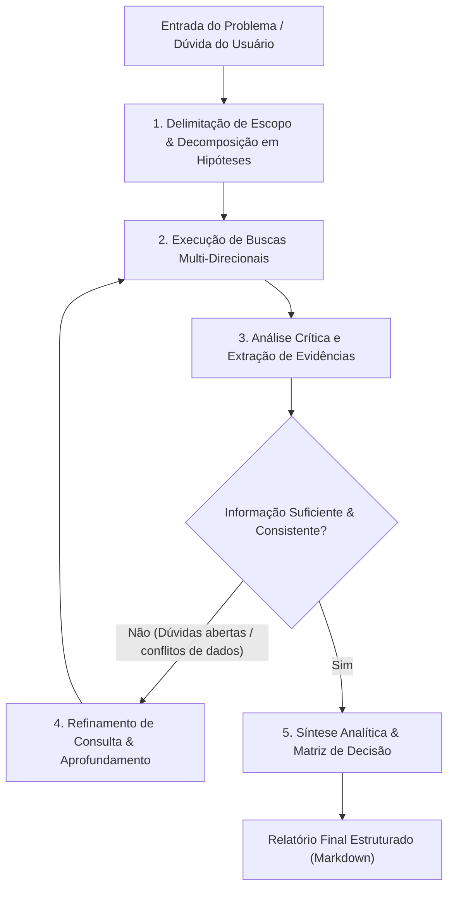

# Skill: Deep Research (`deepresearch`)

O **Deep Research** é uma habilidade especializada projetada para conduzir investigações técnicas e arquiteturais profundas, autônomas e iterativas. Diferente de uma busca pontual ou consulta simples na web, o `deepresearch` atua como um pesquisador sênior: decompondo problemas complexos em múltiplas frentes de investigação, navegando por documentações oficiais, repositórios de código aberto, RFCs, discussões de comunidades e artigos técnicos, validando informações cruzadas e sintetizando os achados em relatórios altamente estruturados e acionáveis.

---

## 🎯 O que faz a Skill

A skill `deepresearch` preenche a lacuna existente entre uma dúvida técnica complexa e a tomada de decisão segura, evitando que desenvolvedores e agentes de IA tomem decisões baseadas em suposições obsoletas ou alucinações.

### Capacidades Centrais

1. **Decomposição Sistemática de Questões**:
   - Quebra perguntas abrangentes em sub-hipóteses investigáveis.
   - Identifica restrições implícitas (compatibilidade de versões, licenças de software, limitações de concorrência, overhead de latência).

2. **Pesquisa Recursiva e Multi-Fonte**:
   - Realiza buscas iterativas, refinando os termos de consulta conforme descobre novos termos técnicos, nomes de métodos ou referências a issues conhecidas.
   - Cruza fontes primárias (documentação oficial, código-fonte original, changelogs e RFCs) com fontes secundárias (relatórios de post-mortem, benchmarks independentes, threads de fóruns técnicos e Stack Overflow).

3. **Verificação Cruzada e Detecção de Inconsistências**:
   - Identifica divergências entre a documentação oficial e a realidade de implementação em versões recentes.
   - Mapeia limitações (*gotchas*), bugs abertos crônicos e comportamentos não documentados de bibliotecas e ferramentas.

4. **Síntese Estruturada para Engenharia**:
   - Gera relatórios densos com sumário executivo, matrizes comparativas de prós e contras, análise de trade-offs, riscos e um plano de recomendação prática com referências citadas.

---

## 🔄 Fluxo de Execução do Deep Research

O diagrama abaixo ilustra o ciclo analítico realizado durante uma sessão de pesquisa profunda:



---

## ⚖️ Quando Usar vs. Quando Não Usar

| Cenário | Usar `deepresearch`? | Motivo |
| :--- | :---: | :--- |
| **Escolha de arquitetura / stack / banco de dados** |  | Decisão de alto impacto que exige análise aprofundada de prós, contras e benchmarks reais. |
| **Investigação de bugs obscuros / vazamentos de memória** |  | Erros difíceis frequentemente dependem de detalhes sutis do runtime e issues pouco documentadas. |
| **Migrações críticas de versão / breaking changes** |  | Mapeia impactos ocultos, bibliotecas descontinuadas e caminhos de migração recomendados. |
| **Avaliação de segurança e compatibilidade de dependências** |  | Requer verificação de CVEs, histórico de manutenção e saúde do ecossistema. |
| *Dúvidas triviais de sintaxe (ex: 'como ordenar um array em Go')* |  | Uma resposta direta ou consulta à documentação básica é muito mais rápida e econômica. |
| *Edição de código local onde a solução já é conhecida* |  | Desperdício de contexto e chamadas de busca; deve-se ir direto para a implementação. |

---

## 📋 Estrutura do Relatório Gerado

Sempre que a skill conclui sua investigação, ela produz um artefato técnico no seguinte padrão:

1. **Sumário Executivo**: Conclusão direta e recomendação principal em poucas linhas.
2. **Contexto & Formulação do Problema**: Definição clara do que foi investigado e premissas adotadas.
3. **Matriz Comparativa de Alternativas**: Tabela com critérios (desempenho, curva de aprendizado, maturidade, manutenção, riscos).
4. **Análise Detalhada dos Achados**: Detalhes técnicos, exemplos de código de validação e explicações aprofundadas.
5. **Pegadinhas, Limitações e Riscos (*Gotchas*)**: Pontos de atenção que podem surpreender o time no médio e longo prazo.
6. **Recomendação Acionável**: Passos práticos sugeridos para o time executar.
7. **Referências e Fontes**: Links diretos para documentações, repositórios, RFCs e issues auditadas.

---

## 💡 Exemplos Práticos de Utilização

### Exemplo 1: Seleção de Stack e Trade-off Arquitetural

> [!NOTE]
> **Cenário**: O time precisa escolher uma biblioteca de mensageria/filas para processamento assíncrono em Node.js com TypeScript, avaliando suporte a retry com backoff, confiabilidade e escala.

#### Prompt de Invocação:
```text
Ative a skill deepresearch para analisar as melhores opções de filas de mensageria em Node.js/TypeScript (como BullMQ vs pg-boss vs RabbitMQ/amqplib).
Considere nosso cenário:
- Volume inicial de 50.000 jobs/dia com picos de 500 jobs/minuto.
- Já temos instâncias de PostgreSQL e Redis em produção.
- Requisitos obrigatórios: retries exponenciais, cancelamento de jobs, idempotência e observabilidade via painel/dashboard.
Forneça uma matriz comparativa detalhada, custos operacionais adicionais e a recomendação justificada.
```

#### Saída Esperada do `deepresearch`:
* Comparação direta de arquitetura (Redis-based vs Postgres-based vs AMQP Broker).
* Análise de overhead de banco no PostgreSQL caso `pg-boss` seja adotado vs overhead de persistência em memória do Redis com `BullMQ`.
* Mapeamento de suporte a TypeScript em cada biblioteca.
* Matriz de decisão recomendando a solução mais adequada ao volume e infraestrutura já disponível.

---

### Exemplo 2: Investigação de Bug Obscuro de Concorrência ou Runtime

> [!NOTE]
> **Cenário**: Uma aplicação Go está sofrendo de consumo excessivo e crescente de memória (*memory bloat*) sob alta taxa de requisições HTTP, mas o pprof não indica vazamento óbvio no heap.

#### Prompt de Invocação:
```text
Use deepresearch para investigar o comportamento do runtime do Go em relação ao gerenciamento de memória (scavenger, MADV_DONTNEED vs MADV_FREE) sob alta alocação temporária em contêineres Docker/Kubernetes.
A aplicação está sendo finalizada por OOMKilled mesmo quando o heap alocado ativo reportado pelo pprof é baixo.
Identifique se isso é um comportamento conhecido nas versões Go 1.20+, como o runtime libera memória para o OS no Linux e quais variáveis de ambiente ou flags de build mitigam o problema.
```

#### Saída Esperada do `deepresearch`:
* Explicação do comportamento das flags de gerenciamento de memória do Go runtime (`GODEBUG=madvdontneed=1` / mudanças recentes nas versões do Go).
* Como o cgroup v1 vs cgroup v2 do Linux/Kubernetes interpreta RSS e cache de páginas.
* Soluções práticas testadas pela comunidade (ex: tuning do `GOMEMLIMIT` introduzido no Go 1.19 e ajuste de memória de contêiner).

---

### Exemplo 3: Migração Crítica com Breaking Changes

> [!NOTE]
> **Cenário**: O projeto utiliza um ORM antigo e precisa planejar uma migração para uma versão principal mais recente sem paralisar o sistema.

#### Prompt de Invocação:
```text
Execute um deepresearch sobre a migração de Prisma v4 para Prisma v5/v6 em um backend NestJS corporativo.
Mapeie:
1. Todas as breaking changes de tipagem e geração de cliente.
2. Alterações no motor de consulta (Wasm/Rust query engine) e impacto em tempo de cold-start em ambientes serverless.
3. Problemas conhecidos relatados no repositório oficial nos últimos 6 meses.
4. Um checklist passo a passo de migração com baixo risco de regressão.
```

#### Saída Esperada do `deepresearch`:
* Relatório consolidado com a lista completa de mudanças que quebram contratos existentes.
* Métricas reais de impacto no tempo de inicialização.
* Lista de issues abertas críticas que podem afetar o ambiente específico.
* Roteiro sugerido de migração em fases (testes unitários → staging → canário em produção).

---

### Exemplo 4: Avaliação de Segurança e Escolha de Criptografia

> [!NOTE]
> **Cenário**: O time precisa implementar autenticação com tokens de longa duração e criptografia de dados sensíveis em repouso no banco de dados.

#### Prompt de Invocação:
```text
Faça um deepresearch sobre práticas modernas de armazenamento seguro de segredos e chaves de sessão no PostgreSQL:
- Comparativo entre AES-256-GCM vs ChaCha20-Poly1305 para criptografia a nível de aplicação vs pgcrypto nativo do banco.
- Gestão de rotação de chaves via KMS (AWS KMS ou HashiCorp Vault).
- Análise de vulnerabilidades comuns e riscos de vazamento em logs de query ou backups.
```

#### Saída Esperada do `deepresearch`:
* Análise comparativa criptográfica com justificativas de desempenho e aceleração de hardware (instruções AES-NI).
* Diagrama do fluxo seguro de chave envelope (*Envelope Encryption*).
* Boas práticas para prevenir exposição acidental de dados descriptografados em buffers e auditorias.

---

## 🔗 Integração na Esteira ECC

A skill `deepresearch` atua como um acelerador estratégico e pode ser integrada a diversas fases da esteira do ECC:

* **[Fase 1: Concepção & Decisão](file:///home/willycornelissen/Desktop/Dablio/ecc/markdown/Fase%201%20-%20Concepção,%20Discovery%20&%20Decisões%20de%20Produto.md)**:
  Fornece insumos técnicos robustos para o [`council`](file:///home/willycornelissen/Desktop/Dablio/ecc/.agents/skills/council/SKILL.md) e para o [`product-lens`](file:///home/willycornelissen/Desktop/Dablio/ecc/.agents/skills/product-lens/SKILL.md) antes de firmar compromissos de produto.
* **[Fase 2: Especificação & Arquitetura](file:///home/willycornelissen/Desktop/Dablio/ecc/markdown/Fase%202%20-%20Especificação%20Comportamental%20(SDD)%20&%20Design.md)**:
  Embasar o registro de decisões de arquitetura em ADRs via [`architecture-decision-records`](file:///home/willycornelissen/Desktop/Dablio/ecc/.agents/skills/architecture-decision-records/SKILL.md).
* **[Fase 3: Planejamento Técnico](file:///home/willycornelissen/Desktop/Dablio/ecc/markdown/Fase%203%20-%20Planejamento%20Técnico%20de%20Implementação.md)**:
  Reduzir o risco de estimativas irreais e antecipar bloqueadores para o subagente `planner`.

---

> [!TIP]
> **Dica para prompts eficientes**: Ao invocar o `deepresearch`, sempre especifique a **stack**, as **versões dos componentes**, o **volume/escala esperada** e quaisquer **restrições mandatórias de negócio**. Quanto mais contexto de restrição for fornecido, mais precisa e cirúrgica será a investigação.
