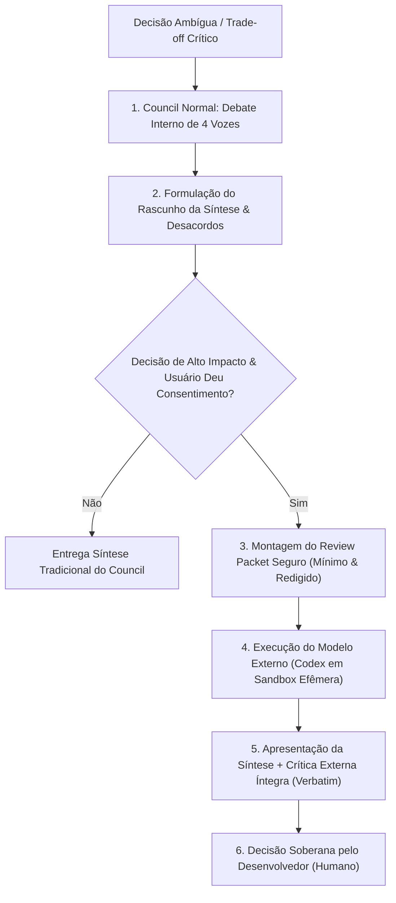

# Skill: Council Multi-Model (`council-multi-model`)

A skill **Council Multi-Model** é uma extensão adversarial avançada da skill [`council`](file:///home/willycornelissen/Desktop/Dablio/ecc/.agents/skills/council/SKILL.md) dentro do ecossistema do **ECC (Enterprise Custom Configuration)**, posicionada na [Fase 1: Concepção, Discovery & Decisões de Produto](file:///home/willycornelissen/Desktop/Dablio/ecc/markdown/Fase%201%20-%20Concepção,%20Discovery%20&%20Decisões%20de%20Produto.md).

Enquanto o `council` convencional convoca um comitê interno de quatro vozes com papéis delimitados (*Arquiteto*, *Cético*, *Pragmático* e *Crítico*) para estruturar o desacordo técnico e produzir uma síntese, o **`council-multi-model`** adiciona uma camada opcional de **crítica externa multi-provedor** (invocando de forma isolada um modelo concorrente, como o OpenAI Codex) para tentar **"quebrar a síntese"** (*attempt to break the synthesis*) antes que o desenvolvedor tome uma decisão de alto impacto.

---

## 🎯 Por que ela existe? (O Problema que ela Resolve)

Quando um único LLM simula diferentes personas (arquiteto, cético, etc.), todas as vozes ainda compartilham o mesmo modelo base e a mesma distribuição de pesos probabilísticos. Isso cria o risco de **monocultura cognitiva e viés de confirmação**:
- O modelo pode ter pontos cegos compartilhados por todas as personas simuladas.
- Premissas errôneas ou desatualizadas daquele provedor específico passam sem contestação.

O `council-multi-model` resolve isso introduzindo **heterogeneidade de modelos**:
1. O host principal (ex: Claude) debate e formula a proposta de decisão consolidada.
2. Um modelo independente de outro ecossistema (ex: OpenAI Codex) recebe estritamente a síntese e a divergência com a missão de **encontrar falhas graves, modos de falha não mapeados e supressão de discordâncias**.
3. A crítica externa é apresentada ao usuário de forma crua e literal, sem edições cosméticas.

---

## 🔄 Fluxo de Execução



---

## 🛡️ Guardrails Rígidos de Segurança e Privacidade

O `council-multi-model` adota proteções rigorosas para evitar vazamento de dados ou execuções inesperadas:

1. **Consentimento Explícito Obrigatório**:
   - A skill **nunca** envia dados para a OpenAI silenciosamente. O agente é obrigado a solicitar permissão explícita ao desenvolvedor antes de despachar o pacote.
2. **Review Packet Mínimo (*Zero Repo Leak*)**:
   - **Nenhum arquivo do repositório**, variável de ambiente, segredo ou histórico completo da conversa é enviado. Apenas o resumo do desacordo técnico e o rascunho da síntese são incluídos, encapsulados em blocos de segurança:
     ```text
     <BEGIN_UNTRUSTED_DISAGREEMENT>
     [Resumo do desacordo do conselho]
     <END_UNTRUSTED_DISAGREEMENT>

     <BEGIN_UNTRUSTED_DRAFT>
     [Rascunho da síntese da decisão]
     <END_UNTRUSTED_DRAFT>
     ```
3. **Sandbox Estritamente Desarmada**:
   - O adaptador executa o Codex CLI em um diretório temporário vazio e efêmero.
   - Ferramentas de terminal, execução de arquivos, acesso ao navegador, servidores MCP e buscas web são completamente **desabilitadas**.
   - A sessão é de somente leitura e o diretório temporário é destruído imediatamente após a resposta.
4. **Transparência de Provedor (*No Fake Diversity*)**:
   - A skill rotula claramente a relação entre anfitrião e revisor:
     - Host Claude + Crítica Codex ➔ `cross-provider external critique` (diversidade real)
     - Host Codex + Crítica Codex ➔ `same-provider external critique` (alerta de mesmo provedor)
     - Provedor desconhecido ➔ `provider relationship unverified`
5. **Citação Íntegra (*Verbatim*)**:
   - A crítica do modelo externo é transcrita exatamente como foi retornada. O modelo principal é proibido de resumir ou "suavizar" a crítica com a sua própria voz.

---

## ⚖️ Quando Usar vs. Quando Não Usar

| Cenário | Usar `council-multi-model`? | Motivo |
| :--- | :---: | :--- |
| **Decisões arquiteturais irreversíveis (*One-way doors*)** |  | Ex: Monolito vs Microsserviços, SQL vs NoSQL, escolha de linguagem ou orquestrador central. |
| **Trade-offs técnicos com alto risco financeiro ou de escala** |  | Uma segunda opinião de modelo independente pode expor falhas estruturais invisíveis. |
| *Dúvidas triviais ou planejamento de sprints rotineiras* |  | Desperdício de tempo e tokens; use respostas diretas ou o `planner`. |
| *Revisão de código de PRs ou auditoria de bugs* |  | Para código pronto, use [`code-reviewer`](file:///home/willycornelissen/Desktop/Dablio/ecc/.agents/agents/code-reviewer.md) ou a skill [`santa-method`](file:///home/willycornelissen/Desktop/Dablio/ecc/.agents/skills/santa-method/SKILL.md). |
| *Projetos com restrições contratuais de dados fechados (On-premise)* |  | Caso seja proibido o envio de dados para APIs externas, mantenha-se estritamente no `council` padrão. |

---

## 📋 Formato de Saída do Relatório

Quando o `council-multi-model` conclui sua execução, a entrega segue este modelo padronizado:

```markdown
## Council com Crítica Externa: [Título da Decisão]

### Posições Iniciais (Vozes do Conselho)
- **Arquiteto**: [Visão de sustentabilidade, corretude e longo prazo]
- **Cético**: [Desafio às premissas, riscos de complexidade desnecessária]
- **Pragmático**: [Velocidade de entrega, viabilidade operacional]
- **Crítico**: [Cenários de estresse, pontos de quebra sob carga]

### Rascunho da Síntese do Conselho
[Proposta de recomendação formulada pelo comitê interno]

### Crítica Externa: [cross-provider external critique | same-provider external critique]
> [Resposta literal e integral do modelo externo (ex: OpenAI Codex),
> apontando onde a conclusão falha ou o que foi ignorado]

### Conclusão e Decisão Final
- **Consenso Interno**: [Resumo do alinhamento]
- **Maior Ponto de Divergência**: [Principal contra-argumento]
- **A crítica externa alterou a recomendação?**: Sim / Não
- **Veredito**: Decisão final delegada soberanamente ao desenvolvedor.
```

---

> [!IMPORTANT]
> **O revisor externo não tem poder decisório**: Ele não vota, não aprova e não substitui o julgamento humano. Ele funciona exclusivamente como um crítico adversarial independente para garantir que você tome a decisão final ciente de todos os pontos fracos da proposta.

---

## 🔗 Relação na Esteira ECC

- **Requisito Base**: [`council`](file:///home/willycornelissen/Desktop/Dablio/ecc/.agents/skills/council/SKILL.md) (é executado antes como etapa obrigatória).
- **Formalização da Decisão**: Uma vez resolvida a decisão, o resultado deve ser consolidado em um ADR via [`architecture-decision-records`](file:///home/willycornelissen/Desktop/Dablio/ecc/.agents/skills/architecture-decision-records/SKILL.md).
