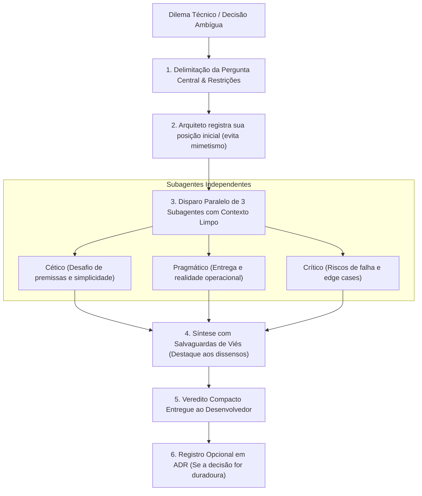

# Skill: Council (`council`)

A skill **Council** é uma ferramenta deliberativa do **ECC (Enterprise Custom Configuration)** criada especificamente para **tomada de decisão sob ambiguidade** (*decision-making under ambiguity*), posicionada na [Fase 1: Concepção, Discovery & Decisões de Produto](file:///home/willycornelissen/Desktop/Dablio/ecc/markdown/Fase%201%20-%20Concepção,%20Discovery%20&%20Decisões%20de%20Produto.md).

O princípio fundamental do `council` é:
> *"O objetivo não é buscar unanimidade ou consenso artificial, mas tornar o desacordo técnico e os trade-offs transparentes e legíveis antes de tomar uma decisão de engenharia."*

---

## 🎯 Objetivo Central

Quando um problema técnico possui múltiplos caminhos válidos e nenhum deles é obviamente superior, opiniões superficiais levam a decisões frágeis. O `council` convoca um comitê de quatro vozes com papéis e vieses deliberadamente conflitantes para estressar a questão por todos os ângulos:

- **Corretude e longo prazo** vs. **Velocidade de entrega imediata**.
- **Ambição arquitetural** vs. **Simplicidade radical**.
- **Cenário otimista** vs. **Modos de falha sob carga extrema**.

---

## 👥 As 4 Vozes do Conselho

| Voz | Lente Analítica | Pergunta Central que Responde |
| :--- | :--- | :--- |
| **Arquiteto** (*Architect*) | Corretude estrutural, sustentabilidade, padrões de código e implicações de longo prazo. | *"Essa solução é manutenível e escalável daqui a 2 anos?"* |
| **Cético** (*Skeptic*) | Desafio das premissas originais, combate à complexidade desnecessária e quebra de suposições. | *"Precisamos mesmo construir isso ou estamos complicando um problema simples?"* |
| **Pragmático** (*Pragmatist*) | Velocidade de entrega, viabilidade operacional e impacto prático no mundo real. | *"O que podemos colocar no ar hoje com menor esforço e sem quebrar a confiança do usuário?"* |
| **Crítico** (*Critic*) | Casos de borda (*edge cases*), riscos de cauda (*downside risk*), gargalos e modos de falha sob estresse. | *"Onde exatamente isso vai quebrar quando estiver sob alta demanda ou carga crítica?"* |

---

## 🛡️ O Mecanismo Anti-Ancoragem (*Anti-Anchoring*)

Em chats e sessões interativas de IA, solicitar "segundas opiniões" em um único contexto gera o vício da **ancoragem conversacional**: o modelo tende a concordar e reforçar a premissa sugerida pelo desenvolvedor.

Para garantir independência cognitiva real:
1. As três vozes externas (*Cético*, *Pragmático* e *Crítico*) são disparadas como **subagentes independentes e paralelos**.
2. Cada subagente recebe **apenas a questão central e o contexto mínimo indispensável**, sem acesso ao histórico completo da conversa ou preferências declaradas.
3. Isso preserva a neutralidade de cada voz e garante que o desacordo seja autêntico.

---

## 🔄 Fluxo de Execução do Workflow



---

## ⚖️ Quando Usar vs. Quando Não Usar

| Cenário | Usar `council`? | Alternativa Correta no ECC |
| :--- | :---: | :--- |
| **Bifurcações de stack e arquitetura** (ex: Monorepo vs Polyrepo, GraphQL vs REST, Postgres vs Mongo) |  | — |
| **Trade-offs de entrega** (ex: Lançar versão Alpha agora vs adiar para polir a interface) |  | — |
| **Estratégias de lançamento** (ex: Feature Flag progressivo vs Rollout imediato) |  | — |
| *Revisão de código de PRs ou auditoria de bugs* |  | Use [`code-reviewer`](file:///home/willycornelissen/Desktop/Dablio/ecc/.agents/agents/code-reviewer.md) ou a skill [`santa-method`](file:///home/willycornelissen/Desktop/Dablio/ecc/.agents/skills/santa-method/SKILL.md). |
| *Detalhamento e desenho formal de arquitetura* |  | Use o agente [`architect`](file:///home/willycornelissen/Desktop/Dablio/ecc/.agents/agents/architect.md). |
| *Divisão de uma funcionalidade em etapas de código* |  | Use o agente [`planner`](file:///home/willycornelissen/Desktop/Dablio/ecc/.agents/agents/planner.md). |
| *Perguntas factuais de sintaxe ou tarefas óbvias de programação* |  | Responda diretamente ou codifique de imediato. |

---

## 📋 Formato de Saída (Veredito do Conselho)

O resultado é condensado e estruturado para rápida leitura (legível até na tela de um celular):

```markdown
## Council: [Título da Decisão]

**Architect:** [Posição em 1-2 frases]
- [Razão principal com foco em arquitetura/longo prazo]

**Skeptic:** [Posição em 1-2 frases]
- [Razão principal com foco em simplicidade/desafio da premissa]

**Pragmatist:** [Posição em 1-2 frases]
- [Razão principal com foco em velocidade de entrega/viabilidade]

**Critic:** [Posição em 1-2 frases]
- [Razão principal com foco em riscos e modos de falha]

### Verdict
- **Consensus:** [Onde as visões convergem]
- **Strongest dissent:** [O desacordo mais relevante levantado]
- **Premise check:** [A premissa da dúvida foi desafiada com sucesso pelo Cético?]
- **Recommendation:** [Síntese sugerida para fundamentar a decisão do desenvolvedor]
```

---

## 💡 Exemplo Real de Aplicação

### Pergunta:
> *"Devemos lançar a versão 2.0 do produto como Alpha pública agora ou segurar o release até que o painel de controle esteja 100% polido?"*

### Dinâmica do Conselho:
* **Arquiteto**: Defende segurar o release para evitar que uma interface incompleta degrade a percepção de solidez da arquitetura.
* **Cético**: Questiona se o painel de controle é realmente o fator limitante ou se a funcionalidade central via CLI/API já resolve o problema real dos usuários.
* **Pragmático**: Argumenta que liberar um Alpha restrito gera feedback imediato e valida as hipóteses com menor custo de retrabalho.
* **Crítico**: Alerta para a sobrecarga de suporte, dívida de expectativas geradas e risco de churn caso a experiência inicial gere frustração.

---

## 🔗 Integração com a Pipeline do ECC

- **Extensão Heterogênea**: Para decisões de altíssima criticidade (*One-way doors*), o conselho pode ser estendido com o [`council-multi-model`](file:///home/willycornelissen/Desktop/Dablio/ecc/skills/1.%20Brainstorming/council-multi-model.md) para receber a crítica adversarial de um modelo externo (ex: OpenAI Codex).
- **Formalização em ADR**: Quando a decisão do conselho definir diretrizes duradouras do projeto, ela é formalizada em um registro de arquitetura através de [`architecture-decision-records`](file:///home/willycornelissen/Desktop/Dablio/ecc/.agents/skills/architecture-decision-records/SKILL.md).
