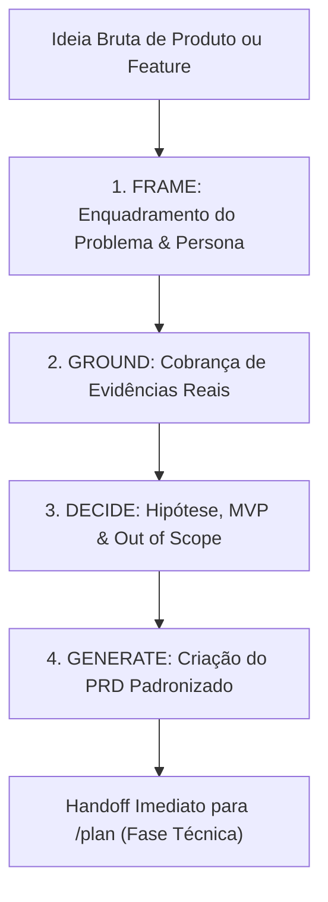

# Skill / Workflow: Plan PRD (`plan-prd`)

O **Plan PRD** é o gerador interativo de **PRDs (Product Requirements Documents — Documentos de Requisitos de Produto)** orientado a problemas (*problem-first*) do ecossistema **ECC (Everything Claude Code)**, posicionado na [Fase 1: Concepção, Discovery & Decisões de Produto](file:///home/willycornelissen/Desktop/Dablio/ecc/markdown/Fase%201%20-%20Concepção,%20Discovery%20&%20Decisões%20de%20Produto.md).

Seu lema central de engenharia é claro e taxativo:
> **"Capture o QUE deve ser verdade para o sucesso e o PORQUÊ, e pare rigorosamente antes do COMO."**

---

## 🎯 Objetivo e Separação de Responsabilidades

O `plan-prd` resolve o vício comum de desenvolvedores e agentes de IA começarem a desenhar arquitetura, escolher pacotes e escrever código antes de entender se o problema real foi delimitado.

Ele impõe uma barreira intransponível entre a definição dos **Requisitos de Produto** e o **Planejamento de Engenharia**:

| O que o `plan-prd` FAZ | O que o `plan-prd` NÃO FAZ (Pertence ao `/plan`) |
| :--- | :--- |
| Enquadra o problema e a dor observável | Não desenha a arquitetura de software |
| Define a persona específica (evita o genérico "usuários") | Não escolhe bibliotecas, padrões ou arquivos |
| Estabelece hipóteses testáveis e métricas mensuráveis | Não quebra tarefas de implementação técnica |
| Delimita rigidamente o **MVP** e o que está **Fora de Escopo** | Não escreve código ou testes |
| Salva o documento padronizado em `.claude/prds/{nome}.prd.md` | A decomposição de código é delegada ao comando `/plan` |

> [!IMPORTANT]
> **Regra Anti-Fluff (Sem enrolação)**: Quando uma evidência, métrica ou dado de suporte estiver faltando, o `plan-prd` é expressamente proibido de inventar suposições plausíveis. O documento deve registrar: `Assumption — needs validation via {método}` ou `TBD`.

---

## 🔄 As 4 Fases do Workflow

O `plan-prd` avança por quatro portões de qualidade sequenciais com questionamento direto:



### Fase 1 — FRAME (Enquadramento)
Define o núcleo da proposta através de quatro perguntas mandatórias:
1. **Quem** tem esse problema? (papel, contexto ou segmento específico de cliente).
2. **Qual** é a dor observável na prática? (descreve comportamento e atrito, não soluções imaginadas).
3. **Por que** o usuário não consegue resolver com o que já existe hoje no sistema?
4. **Por que agora?** O que mudou no contexto técnico ou de negócio que torna essa entrega necessária hoje?

### Fase 2 — GROUND (Fundamentação em Evidências)
Cobra dados concretos:
> *"Quais evidências você tem de que esse problema é real e vale a pena ser resolvido? (depoimentos de clientes, tickets de suporte, métricas de churn, logs de erro ou contornos manuais com planilhas)"*

Se não houver dados, o item é catalogado honestamente como suposição não comprovada, evitando falsas certezas na esteira de desenvolvimento.

### Fase 3 — DECIDE (Hipótese & Limites de Escopo)
Fecha os compromissos em formato de contrato:
1. **Hipótese Padronizada**:
   > *"Acreditamos que **{funcionalidade}** resolverá **{problema}** para **{usuários}**. Saberemos que estamos certos quando **{métrica observável}** for atingida."*
2. **Definição de MVP**: O menor incremento entregável capaz de provar ou refutar a hipótese.
3. **Out of Scope (*Não-Objetivos*)**: Lista explícita do que **NÃO** será construído nesta etapa (mesmo que os clientes peçam), protegendo o time de *scope creep*.
4. **Perguntas Abertas**: Incertezas que podem alterar a rota antes da implementação.

### Fase 4 — GENERATE & HAND OFF (Geração do Artefato)
Cria o diretório de destino e escreve o documento padronizado:
- **Caminho de Saída**: `.claude/prds/{kebab-case-name}.prd.md`

Ao finalizar, ele exibe um sumário executivo com o status de validação e instrui o próximo comando da engenharia:
```text
PRD criado: .claude/prds/{nome}.prd.md

Validação:
  Problema:  [validado | suposição]
  Usuários:  [persona concreta | genérica - refinar]
  Métricas:  [definida | TBD]

Próximo passo: /plan .claude/prds/{nome}.prd.md
  → O comando /plan consumirá o PRD para gerar o plano técnico de implementação.
```

---

## 📋 Template Padrão do PRD Gerado

```markdown
# [Nome do Produto / Feature]

## Problem
[2 a 3 frases: quem sofre a dor e qual o custo de deixá-la sem solução?]

## Evidence
- [Citação de usuário, métrica ou dado de suporte]
- [OU: "Assumption — needs validation via {método}"]

## Users
- **Primary**: [Papel, contexto operacional e gatilho da necessidade]
- **Not for**: [Quem está expressamente excluído desta solução]

## Hypothesis
Acreditamos que **[funcionalidade]** resolverá **[problema]** para **[usuários]**.
Saberemos que estamos certos quando **[resultado mensurável]**.

## Success Metrics
| Métrica | Meta | Como será medida |
|---|---|---|
| [Métrica primária] | [Valor numérico] | [Telemetria/Analytics/Logs] |

## Scope
**MVP** — [O mínimo indispensável para validar a hipótese]

**Out of scope**
- [Item excluído] — [Motivo de ter sido adiado]

## Delivery Milestones (Marcos de Negócio)
| # | Marco | Resultado Visível ao Usuário | Status | Plano Técnico |
|---|---|---|---|---|
| 1 | [Nome do Marco] | [Mudança percebida pelo cliente] | pending | — |
| 2 | [Nome do Marco] | [Mudança percebida pelo cliente] | pending | — |

## Open Questions
- [ ] [Questão aberta que pode alterar escopo ou abordagem]

## Risks
| Risco | Probabilidade | Impacto | Mitigação |
|---|---|---|---|
| [Risco mapeado] | Baixa/Média/Alta | Baixo/Médio/Alto | [Ação preventiva] |
```

---

## 🔗 Integração com a Esteira Completa do ECC

O `plan-prd` é a engrenagem que conecta a concepção do produto à execução de código:

1. **Entrada**: Ideias refinadas pelo [`product-lens`](file:///home/willycornelissen/Desktop/Dablio/ecc/skills/1.%20Brainstorming/product-lens.md) e trade-offs resolvidos no [`council`](file:///home/willycornelissen/Desktop/Dablio/ecc/skills/1.%20Brainstorming/council.md).
2. **Especificação**: Envia insumos para a [Fase 2 (SDD)](file:///home/willycornelissen/Desktop/Dablio/ecc/markdown/Fase%202%20-%20Especificação%20Comportamental%20(SDD)%20&%20Design.md) detalhar os critérios de aceitação com `intent-driven-development`.
3. **Planejamento Técnico**: O comando `/plan` pega cada *Milestone* do PRD e o transforma em tarefas técnicas, arquivos e testes.
4. **Implementação**: A execução do código prossegue estritamente via `tdd-workflow` (Test-Driven Development).
