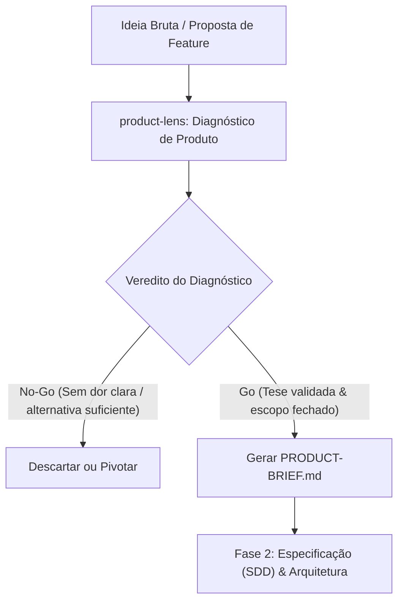

# Skill: Product Lens (`product-lens`)

A skill **Product Lens** tem como lema central **"Think Before You Build"** (*Pense antes de construir*). Ela atua como um framework estruturado de **Product Discovery e validação de produto**, posicionada estrategicamente na [Fase 1 da pipeline ECC (Concepção, Discovery & Decisões de Produto)](file:///home/willycornelissen/Desktop/Dablio/ecc/markdown/Fase%201%20-%20Concepção,%20Discovery%20&%20Decisões%20de%20Produto.md).

Seu papel primordial é **testar, tensionar e validar o "porquê"** de uma ideia antes que tempo e energia de engenharia sejam desperdiçados especificando ou codificando funcionalidades que não resolvem dores reais.

---

## 🎯 Objetivo Central

Evitar o *"vibe coding"* e o desperdício em desenvolvimento:
1. Validar se o problema que se pretende resolver realmente existe e é mensurável.
2. Identificar quem é o usuário específico e qual é a alternativa que ele utiliza hoje.
3. Definir limites claros de escopo (*Anti-Goals*) para prevenir inchaço precoce (*scope creep*).
4. Emitir um veredito objetivo de **Go** (avançar para especificação) ou **No-Go** (descartar ou pivotar a ideia).

---

## 🔄 Fluxo de Descoberta e Diagnóstico



---

## ⚙️ Os 4 Modos de Operação da Skill

### 1. Diagnóstico de Produto (*Product Diagnostic — Estilo YC*)
Simula uma mentoria rigorosa de aceleração (no formato *Y Combinator office hours*), submetendo a proposta a questionamentos contundentes:

* **Público-alvo específico**: Quem é a persona primária (evita termos vagos como "desenvolvedores" ou "usuários em geral").
* **Dor quantificável**: Qual é o problema real, com que frequência ocorre, qual o custo da ineficiência e o que o usuário usa hoje como solução provisória (*workaround*).
* **Por que agora?**: O que mudou técnica ou mercadologicamente para viabilizar isso hoje (nova API, mudança regulatória, barateamento de infraestrutura).
* **Versão 10 estrelas vs. MVP**: A visão ideal de longo prazo versus o menor incremento viável para provar a hipótese.
* **Anti-Goals (*Non-Goals*)**: O que está **expressamente fora de escopo** na versão inicial.
* **Métricas de sucesso**: Indicador numérico mensurável (ex: retenção > 20%, tempo de onboarding reduzido em 50%), não impressões subjetivas.

📄 **Artefato Gerado**: `PRODUCT-BRIEF.md` contendo as respostas estruturadas, riscos mapeados e a recomendação formal de **Go / No-Go**.

---

### 2. Revisão de Fundador (*Founder Review*)
Analisa o repositório atual (lendo `README.md`, dependências, arquitetura e histórico de commits) sob a perspectiva de um investidor ou cofundador:

* **Sinais de Product-Market Fit (0 a 10)**: Avalia trajetória de adoção, engajamento e métricas de retenção.
* **Fosso Competitivo (*Competitive Moat*)**: Identifica o que no produto é genuinamente difícil de copiar por concorrentes.
* **A Alavanca 10x**: Aponta qual é a única mudança ou funcionalidade que multiplicaria o valor da aplicação por uma ordem de grandeza.
* **Corte de Distrações**: Identifica e recomenda a suspensão de códigos e features que estão sendo desenvolvidas mas não agregam valor central.

---

### 3. Auditoria da Jornada do Usuário (*User Journey Audit*)
Mapeia a experiência de ponta a ponta a partir da perspectiva de um usuário iniciante:

* **Mapeamento de Atrito**: Rastreia passos confusos na instalação, falhas de documentação, erros de configuração e telas ambíguas.
* **Medição de Time-to-Value (TTV)**: Cronometra quanto tempo o usuário leva entre o primeiro contato e a percepção do primeiro benefício real (*first win*).
* **Benchmark Competitivo**: Compara a experiência inicial com soluções concorrentes.
* **Top 3 Correções**: Prioriza cirurgicamente as três intervenções mais urgentes para destravar a ativação de usuários.

---

### 4. Priorização de Funcionalidades (*Feature Prioritization — Matriz ICE*)
Quando há uma lista extensa de ideias concorrendo pelo tempo limitado da equipe:

* **Cálculo da Pontuação ICE**:
  $$\text{ICE Score} = \frac{\text{Impacto (1-5)} \times \text{Confiança (1-5)}}{\text{Esforço (1-5)}}$$
* **Aplicação de Restrições Reais**: Pondera tamanho do time, orçamento, débito técnico existente e dependências externas.
* **Roadmap Justificado**: Entrega a ordem ótima de execução com racional explícito para cada decisão.

---

## 📌 Quando Usar vs. Quando Não Usar

| Cenário | Usar `product-lens`? | Motivo |
| :--- | :---: | :--- |
| **Antes de iniciar qualquer nova feature ou épico** |  | Garante que a equipe não construa coisas irrelevantes. |
| **Ideias abstratas precisando de foco** |  | Converte *brainstorms* soltos em um documento de produto acionável. |
| **Dilema entre múltiplas funcionalidades em backlog** |  | Fornece critérios objetivos via ICE para desempatar prioridades. |
| **Antes de lançamentos públicos (*sanity check*)** |  | Avalia a jornada completa e o Time-to-Value do usuário. |
| *Correção de bugs ou refatorações puramente técnicas* |  | Casos estritamente técnicos devem ir direto para testes e implementação. |
| *Tarefas com especificação e requisitos já consolidados* |  | Passe direto para a fase de planejamento técnico ou escrita de testes. |

---

## 💡 Exemplos de Prompts para Invocação

### Exemplo 1: Validação de Nova Ideia de Feature (Product Diagnostic)
```text
Ative a skill product-lens em modo Product Diagnostic para avaliar a seguinte proposta:
"Queremos criar um dashboard analítico em tempo real com gráficos interativos para os usuários visualizarem o histórico de gastos com infraestrutura."
Pressione a ideia com as perguntas de dor real, persona, alternativas atuais, anti-goals e nos dê o veredito Go/No-Go em um PRODUCT-BRIEF.md.
```

### Exemplo 2: Priorização de Backlog via ICE
```text
Use a skill product-lens para rodar uma priorização ICE nas seguintes 5 demandas:
1. Exportação de relatórios para PDF e Excel.
2. Integração com webhooks do Stripe.
3. Modo escuro (Dark Mode) na interface web.
4. Suporte a autenticação via Google e GitHub OAuth.
5. Sistema de notificações push via WebSockets.
Considere que somos 2 desenvolvedores com prazo de 3 semanas.
```

---

## 🔗 Conexão com Outras Etapas da Pipeline ECC

* **Antecede o [`council`](file:///home/willycornelissen/Desktop/Dablio/ecc/.agents/skills/council/SKILL.md)**: Se houver dilemas arquiteturais decorrentes do produto validado.
* **Alimenta a [Fase 2 (SDD)](file:///home/willycornelissen/Desktop/Dablio/ecc/markdown/Fase%202%20-%20Especificação%20Comportamental%20(SDD)%20&%20Design.md)**: O `PRODUCT-BRIEF.md` serve como entrada direta para o [`intent-driven-development`](file:///home/willycornelissen/Desktop/Dablio/ecc/.agents/skills/intent-driven-development/SKILL.md) transformar hipóteses em critérios de aceitação verificáveis.
