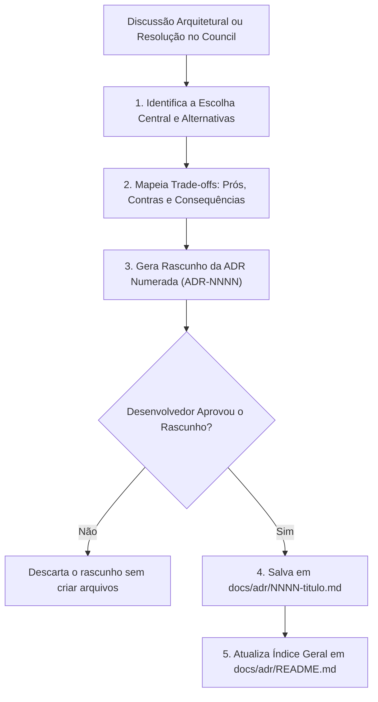

# Skill: Architecture Decision Records (`architecture-decision-records`)

A skill **Architecture Decision Records (ADR)** é a ferramenta de governança e memória arquitetural do ecossistema **ECC (Everything Claude Code)**, posicionada na [Fase 2: Especificação Comportamental (SDD) & Design](file:///home/willycornelissen/Desktop/Dablio/ecc/markdown/Fase%202%20-%20Especificação%20Comportamental%20(SDD)%20&%20Design.md).

Seu lema de engenharia é:
> **"Em vez de decisões arquiteturais viverem apenas em conversas de chat, comentários soltos de PR ou na memória volátil de alguém, este processo produz documentos estruturados que vivem versionados junto ao código-fonte em `docs/adr/`."**

---

## 🎯 Por que a Skill de ADR Existe?

Com o passar do tempo, desenvolvedores e agentes de IA olham para trechos de código e se perguntam:
- *"Por que usamos PostgreSQL em vez de MongoDB para esse módulo?"*
- *"Por que essa API é REST síncrona e não gRPC ou GraphQL?"*
- *"Por que criamos um lock distribuído em vez de usar uma fila?"*

Quando o contexto e os trade-offs de uma escolha são perdidos, ocorrem refatorações catastróficas onde um desenvolvedor "corrige" um design sem saber que aquela solução existia para contornar uma limitação severa de infraestrutura ou de negócio.

A skill `architecture-decision-records` captura a decisão **no exato momento em que ela acontece**, documentando as alternativas descartadas e as consequências assumidas.

---

## 🧭 Quando a Skill Deve Ser Acionada

1. **Sinais Explícitos**:
   - O desenvolvedor diz: *"vamos registrar isso como ADR"*, *"ADR this"*, *"registre essa decisão"*.
   - *"Decidimos usar X em vez de Y porque..."*.
2. **Sinais Implícitos (Sugestão de Registro)**:
   - Comparação técnica e escolha entre duas bibliotecas, frameworks ou bancos de dados.
   - Definição de estratégia de autenticação/autorização (JWT vs Session, OAuth2 vs SAML).
   - Escolha de padrões estruturais (Monolito vs Microsserviços, Event-driven vs Request/Response).
   - Migração ou versionamento de APIs públicas.
3. **Consulta de Histórico**:
   - O desenvolvedor pergunta: *"Por que escolhemos a biblioteca X?"* (a skill lê e apresenta o contexto das ADRs salvas no repositório).

---

## 🔄 Fluxo de Captura e Registro



---

## 📋 Estrutura Padronizada de uma ADR

Baseada no formato clássico de Michael Nygard, adaptado para desenvolvimento assistido por IA:

```markdown
# ADR-NNNN: [Título Claro da Decisão]

**Date**: YYYY-MM-DD
**Status**: proposed | accepted | deprecated | superseded by ADR-NNNN
**Deciders**: [Desenvolvedores / Agentes envolvidos]

## Context
Qual é o problema ou necessidade que está motivando esta decisão?
[2 a 5 frases descrevendo o cenário real, forças de mercado, gargalos de infraestrutura e restrições].

## Decision
Qual é a mudança que decidimos adotar?
[1 a 3 frases afirmativas e claras no tempo presente: "Utilizamos X para Y"].

## Alternatives Considered

### Alternative 1: [Nome da Alternativa Rejeitada]
- **Pros**: [Vantagens da opção]
- **Cons**: [Desvantagens da opção]
- **Why not**: [Motivo específico pelo qual foi descartada]

### Alternative 2: [Nome da Outra Alternativa]
- **Pros**: [Vantagens]
- **Cons**: [Desvantagens]
- **Why not**: [Motivo específico do descarte]

## Consequences
O que se torna mais fácil ou mais difícil no projeto devido a esta escolha?

### Positive
- [Benefício concreto 1]
- [Benefício concreto 2]

### Negative
- [Trade-off ou custo operacional aceito conscientemente 1]
- [Trade-off 2]

### Risks & Mitigation
- **Risco**: [Possível ponto de falha ou gargalo futuro]
- **Mitigação**: [Ação preventiva adotada pela equipe]
```

---

## 📁 Estrutura de Diretórios no Repositório

Todas as decisões arquiteturais ficam centralizadas na pasta de documentação técnica:

```
docs/
└── adr/
    ├── README.md              ← Tabela índice de todas as decisões
    ├── 0001-use-nextjs.md
    ├── 0002-postgres-over-mongo.md
    ├── 0003-rest-over-graphql.md
    └── template.md            ← Molde em branco para criação manual
```

### Formato do Índice (`docs/adr/README.md`):

```markdown
# Architecture Decision Records

| ADR | Título | Status | Data |
| :--- | :--- | :--- | :--- |
| [0001](0001-use-nextjs.md) | Utilização de Next.js como framework frontend | accepted | 2026-01-15 |
| [0002](0002-postgres-over-mongo.md) | PostgreSQL sobre MongoDB como banco relacional primário | accepted | 2026-01-20 |
| [0003](0003-rest-over-graphql.md) | Adoção de REST API sobre GraphQL para endpoints públicos | accepted | 2026-02-01 |
```

---

## ♻️ Ciclo de Vida de uma Decisão

```
proposed  ──►  accepted  ──►  [ deprecated  OU  superseded by ADR-NNNN ]
```

* **`proposed`**: Proposta em debate, ainda não ratificada pela equipe.
* **`accepted`**: Decisão aprovada e em vigor no código atual.
* **`deprecated`**: Decisão que deixou de fazer sentido (ex: o módulo inteiro foi descontinuado).
* **`superseded`**: A decisão foi substituída por uma nova ADR mais recente (deve incluir link obrigatório para a nova ADR que a substituiu).

---

## 💡 O que Torna uma ADR Excelente (Boas Práticas)

| O que FAZER (Do's) | O que NÃO FAZER (Don'ts) |
| :--- | :--- |
| **Seja específico**: *"Usar Prisma ORM com PostgreSQL"* e não *"usar um ORM"*. | **Não registre decisões triviais**: Nomes de variáveis, identação e linter não pertencem a ADRs. |
| **Foque no PORQUÊ**: O racional da escolha importa muito mais do que a sintaxe. | **Não escreva redações longas**: Se o contexto passar de 10 linhas, sintetize. Deve ser lida em 2 minutos. |
| **Liste as alternativas rejeitadas**: Sem isso, o time futuro não saberá o que já foi testado e falhou. | **Não esconda os trade-offs negativos**: Toda escolha arquitetural tem um lado negativo. Seja honesto. |
| **Escreva no presente**: *"Utilizamos X"* em vez de *"Nós utilizaremos X no futuro"*. | **Nunca deixe ADRs obsoletas sem link**: Se uma escolha mudou, marque `superseded` e aponte a nova. |

---

## 🔗 Integração na Pipeline ECC

1. **Conexão com a [Fase 1 (Council)](file:///home/willycornelissen/Desktop/Dablio/ecc/skills/1.%20Brainstorming/council.md)**: Quando a skill `council` conclui um debate ambíguo de alto impacto (ex: Monorepo vs Polyrepo), o veredito sintetizado é convertido diretamente em uma ADR.
2. **Fundamentação para a [Fase 2 (SDD)](file:///home/willycornelissen/Desktop/Dablio/ecc/markdown/Fase%202%20-%20Especificação%20Comportamental%20(SDD)%20&%20Design.md)**: Os critérios de aceitação do [`intent-driven-development`](file:///home/willycornelissen/Desktop/Dablio/ecc/skills/3.%20SDD/intent-driven-development.md) referenciam as restrições registradas nas ADRs.
3. **Guia para a [Fase 3: Planejamento Técnico (`/plan`)](file:///home/willycornelissen/Desktop/Dablio/ecc/markdown/Fase%203%20-%20Planejamento%20Técnico%20de%20Implementação.md)**: O subagente [`planner`](file:///home/willycornelissen/Desktop/Dablio/ecc/.agents/agents/planner.md) consulta `docs/adr/` antes de propor qualquer alteração estrutural no código.
4. **Governança na [Fase 5 (Code Review)](file:///home/willycornelissen/Desktop/Dablio/ecc/markdown/Fase%205%20-%20Qualidade,%20Segurança%20&%20Verificação%20Adversarial.md)**: O [`code-reviewer`](file:///home/willycornelissen/Desktop/Dablio/ecc/.agents/agents/code-reviewer.md) avisa e bloqueia Pull Requests que introduzem mudanças arquiteturais sem a respectiva ADR documentada.
