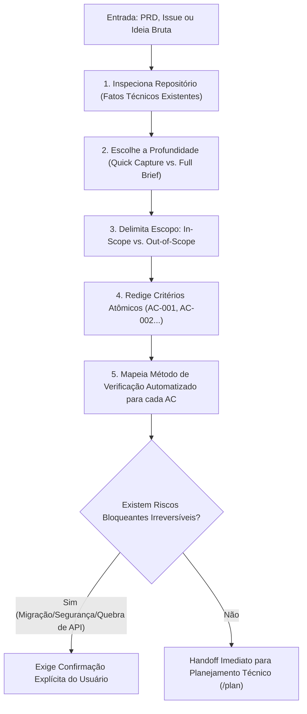

# Skill: Intent-Driven Development (`intent-driven-development`)

A skill **Intent-Driven Development (IDD)** é a engrenagem central de **Spec-Driven Development (SDD)** do ecossistema **ECC (Enterprise Custom Configuration)**, posicionada estrategicamente na [Fase 2: Especificação Comportamental (SDD) & Design](file:///home/willycornelissen/Desktop/Dablio/ecc/markdown/Fase%202%20-%20Especificação%20Comportamental%20(SDD)%20&%20Design.md).

O propósito fundamental da skill é:
> **"Transformar intenções, ideias e requisitos ambíguos ou de alto impacto em Critérios de Aceitação (ACs) estritos, delimitados e verificáveis por testes automatizados, antes ou paralelamente à implementação, sem transformar a especificação em burocracia estéril."**

---

## 🎯 Por que ela existe? (O Problema que ela Resolve)

Em times de software e sessões com agentes de IA, a maioria das falhas graves não decorre de bugs de sintaxe, mas de **ambiguidade de intenção**:
- Especificações vagas (*"o sistema deve ser rápido e seguro"* ou *"adicionar autenticação OAuth"*).
- Suposições tácitas não documentadas que quebram contratos existentes.
- Efeitos colaterais destrutivos (vazamento de dados entre tenants, saldo negativo em concorrência).

O `intent-driven-development` estabelece um contrato comportamental inequívoco antes de tocar no código: ele define o que deve acontecer, o que **não pode** acontecer sob hipótese alguma (*Must Not*) e como isso será comprovado por testes.

---

## 🛡️ O Grande Princípio de Engenharia: Fatos Técnicos vs. Regras de Negócio

Uma das regras operacionais mais rigorosas do IDD é a separação entre código e produto:

1. **Fatos Técnicos são descobertos no repositório**:
   O agente lê schemas, rotas, convenções e infraestrutura de testes já existentes para entender como o sistema opera hoje.
2. **Regras de Negócio NUNCA são inferidas do código**:
   Regras de conformidade, SLAs, limites de retenção de dados, precificação e regras de domínio pertencem ao negócio e aos usuários. O código apenas mostra como está implementado atualmente, não o que o negócio requer. Se faltar uma definição de negócio, ela deve ser catalogada como **suposição pendente de confirmação**, e nunca inventada pelo agente.

---

## 🔄 Fluxo de Trabalho do IDD



---

## ⚖️ Níveis de Profundidade (*Choose the Depth*)

O IDD evita burocracia ajustando a densidade do documento de acordo com o risco da mudança:

### 1. Captura Rápida (*Quick Capture*)
* **Quando usar**: Mudanças claras com risco técnico baixo a moderado (ex: adicionar exportação CSV no dashboard).
* **Estrutura**:
  - Objetivo em uma linha.
  - O que está dentro e o que está expressamente fora de escopo.
  - Suposições técnicas.
  - **3 a 7 critérios de aceitação atômicos** com método de verificação.
  - Não atrasa o desenvolvimento esperando aprovações formais caso não haja risco bloqueante.

### 2. Brief Completo de Aceitação (*Full Acceptance Brief*)
* **Quando usar**: Mudanças de alta criticidade (autenticação, migração irreversível de banco de dados, alterações em APIs públicas, conformidade regulatória ou custos financeiros).
* **Estrutura**: Matriz completa de riscos, estratégias explícitas de rollback, revisão de efeitos colaterais e decisões bloqueantes (*Blocking Decisions*) que exigem aprovação humana antes de qualquer execução destrutiva.

### 3. Revisão de Especificação Existente (*Spec Review*)
* **Quando usar**: Quando o desenvolvedor já colou um PRD, issue ou especificação pronta.
* **Ação**: O IDD revisa o documento caçando palavras vagas (*"funcionar corretamente"*, *"alta performance"*), limites ausentes e suposições perigosas, retornando critérios corrigidos sem reiniciar a descoberta do zero.

---

## 🔬 Anatomia de um Critério de Aceitação (`AC-NNN`)

Cada critério de aceitação produzido pelo IDD deve conter campos estritos:

| Campo | Descrição | Exemplo |
| :--- | :--- | :--- |
| **Identificador** | Código único rastreável | `AC-001` |
| **Cenário** (*Scenario*) | Condição inicial e estado prévio | Usuário autenticado com pelo menos um pedido no histórico. |
| **Ação** (*Action*) | O gatilho disparado pelo ator ou evento | Clica no botão "Exportar Pedidos em CSV". |
| **Resultado Esperado** (*Expected*) | Comportamento observável final | O navegador inicia o download de um arquivo com cabeçalhos `[id, data, valor]`. |
| **Invariante Proibida** (*Must Not*) | Efeito colateral proibido | **Nunca** expor dados de pedidos pertencentes a outros usuários ou campos internos de auditoria. |
| **Método de Verificação** (*Verification*) | Tipo de prova de engenharia | Teste automatizado de integração (`api_orders_test.go`) + spot-check de schema. |
| **Prioridade** | Grau de necessidade | `Required` (Obrigatório), `Important` ou `Optional`. |

---

### ❌ Exemplo que FALHA vs.  Exemplo que PASSA

#### ❌ Critério Reprovado (Vago e Inauditável):
```text
AC-001: A exportação de dados funciona corretamente e é segura.
```
> **Por que falha?**: Não define quem é o usuário, o que é "correto", qual o formato do arquivo, o que significa "segura", quais dados não podem vazar e como um teste automatizado comprovaria a conclusão.

####  Critério Aprovado no Padrão ECC:
```markdown
### AC-001: Exportação gera CSV com cabeçalhos e registros filtrados
- **Cenário:** Usuário autenticado com permissão 'relatorios:leitura', tabela contendo 15 registros.
- **Ação:** Dispara requisição GET para `/api/v1/relatorios/export?formato=csv`.
- **Resultado Esperado:** Retorno HTTP 200 com header `Content-Type: text/csv` contendo as colunas `[id, nome, criado_em, status]`.
- **Must not:** Não incluir registros de clientes de outras organizações (*multi-tenant isolation*) nem campos de hash ou senhas.
- **Verificação:** Teste de integração automatizado com banco de teste populado.
- **Prioridade:** Required
```

---

## 📋 Template Completo do Artefato (`specs/{feature}.spec.md`)

```markdown
# Acceptance Brief: [Nome da Funcionalidade]

**Status:** Draft | Approved | Implemented | Verified
**Revision:** 1
**Prepared for:** [Equipe / Agente]
**Approval required before risky work:** Sim / Não

## Revision Log
| Rev | Data | Critérios Alterados | Motivo |
| :--- | :--- | :--- | :--- |
| 1 | 2026-11-03 | — | Versão inicial baseada no PRD |

## Goal
[Uma única frase descrevendo o resultado observável pretendido.]

## Scope
**In scope:**
- [Comportamentos expressamente incluídos]

**Out of scope:**
- [Trabalhos adjacentes tentadores que foram excluídos]

## Context
**Fatos Técnicos Descobertos:**
- [Rotas existentes, convenções do repositório, dependências mapeadas]

**Restrições de Negócio / Produto:**
- [Regras de conformidade, SLAs ou retenção fornecidas pelo usuário]

**Suposições:**
- [Afirmações ainda não validadas que precisam de acompanhamento]

## Risk Review
| Área de Risco | Aplica-se? | Mitigação Obrigatória |
| :--- | :---: | :--- |
| Segurança / Privacidade | Sim | Mascaramento de dados e isolamento multi-tenant |
| Dados Persistentes / Migração | Não | Nenhuma alteração de schema necessária |
| Quebra de API / Compatibilidade | Sim | Manter retrocompatibilidade com v1 |

## Acceptance Criteria
### AC-001: [Título do Critério]
- **Scenario:** [Condição inicial]
- **Action:** [Ação desencadeadora]
- **Expected:** [Comportamento esperado]
- **Must not:** [Efeito colateral proibido]
- **Verification:** [Método de teste automatizado]
- **Priority:** Required

## Blocking Decisions
- [ ] [Decisão pendente que impede o início seguro da codificação]

## Verification Plan
| Critério | Evidência de Teste | Status |
| :--- | :--- | :--- |
| AC-001 | `npm test -- test/export.test.ts` | Pending |
```

---

## 🔗 Conexão na Esteira de Engenharia do ECC

O IDD é o elo que viabiliza o desenvolvimento seguro em todas as fases seguintes:

1. **Consome da [Fase 1 (PRD)](file:///home/willycornelissen/Desktop/Dablio/ecc/skills/2.%20PRD/plan-prd.md)**: Recebe o problema, a hipótese e os limites de escopo definidos no `plan-prd`.
2. **Combina-se com a [Fase 2 (Tipos & Arquitetura)](file:///home/willycornelissen/Desktop/Dablio/ecc/markdown/Fase%202%20-%20Especificação%20Comportamental%20(SDD)%20&%20Design.md)**: O [`type-design-analyzer`](file:///home/willycornelissen/Desktop/Dablio/ecc/.agents/agents/type-design-analyzer.md) valida os tipos de dados exigidos pelos ACs, e o [`architecture-decision-records`](file:///home/willycornelissen/Desktop/Dablio/ecc/.agents/skills/architecture-decision-records/SKILL.md) registra decisões de design.
3. **Alimenta a [Fase 3: Planejamento Técnico (`/plan`)](file:///home/willycornelissen/Desktop/Dablio/ecc/markdown/Fase%203%20-%20Planejamento%20Técnico%20de%20Implementação.md)**: O planejador quebra cada critério `AC-NNN` em tarefas atômicas de arquivos.
4. **Governa a [Fase 4: TDD (`tdd-workflow`)](file:///home/willycornelissen/Desktop/Dablio/ecc/markdown/Fase%204%20-%20Implementação%20Guiada%20por%20Testes%20(TDD).md)**: Cada critério `AC-NNN` converte-se diretamente em um caso de teste que falha primeiro (*Red*) antes de qualquer linha de implementação (*Green*).
