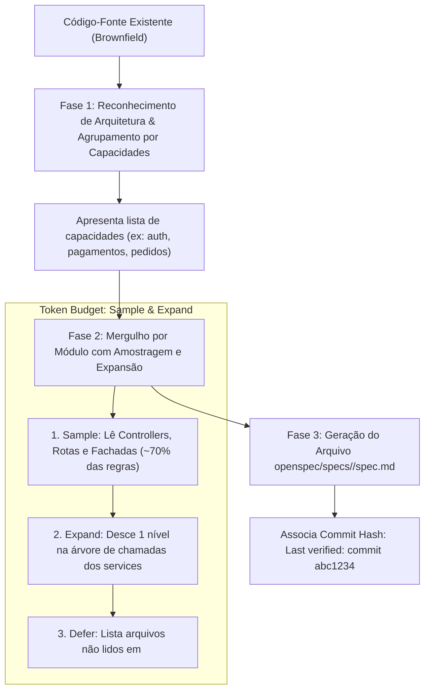

# Skill / Subagente: Spec Miner (`spec-miner`)

O **Spec Miner** é o especialista em engenharia reversa e mineração comportamental do **ECC (Enterprise Custom Configuration)**, projetado para viabilizar o **Spec-Driven Development (SDD)** no padrão **OpenSpec** em repositórios existentes ou legados (*brownfield*), posicionado na [Fase 2: Especificação Comportamental (SDD) & Design](file:///home/willycornelissen/Desktop/Dablio/ecc/markdown/Fase%202%20-%20Especificação%20Comportamental%20(SDD)%20&%20Design.md).

Sua filosofia central é direta e minimalista:
> **"Uma especificação não é um documento burocrático dividido em capítulos conceituais. É uma lista plana de asserções comportamentais observáveis, ancorada diretamente nos métodos e testes que a sustentam no código real."**

---

## 🎯 Por que o Spec Miner Existe? (O Desafio Brownfield)

Enquanto a skill [`intent-driven-development`](file:///home/willycornelissen/Desktop/Dablio/ecc/skills/3.%20SDD/intent-driven-development.md) atua definindo especificações para **novas features**, o `spec-miner` resolve o problema oposto:
- Repositórios com dezenas de milhares de linhas de código onde as regras de negócio existem apenas na cabeça dos desenvolvedores originais ou espalhadas em condicionais obscuras.
- Ausência de contratos formais de comportamento, o que faz novos desenvolvedores ou agentes de IA causarem regressões silenciosas ao alterar qualquer linha de código.

O `spec-miner` analisa o código-fonte existente e extrai a "verdade tácita" do sistema para arquivos OpenSpec estruturados em `openspec/specs/<capability>/spec.md`.

---

## 🧱 Apenas Dois Blocos Comportamentais (Padrão OpenSpec)

Para manter as especificações legíveis por humanos e perfeitamente indexáveis por agentes de IA, o `spec-miner` não divide o documento em capítulos temáticos como "Regras de Negócio", "Contratos de API" ou "Validações".

O documento aceita estritamente **dois tipos de blocos**:

| Bloco | Natureza | Estrutura | Exemplo Real |
| :--- | :--- | :--- | :--- |
| **`### Requirement:`** | Comportamento condicional disparado por um evento ou ação | Contém descrição normativa (`SHALL`/`MUST`) e um ou mais blocos `#### Scenario:` (**WHEN** → **THEN**). | *"Quando o estoque for insuficiente, retornar HTTP 422 com código INSUFFICIENT_STOCK"* |
| **`### Invariant:`** | Restrição que deve ser **absolutamente verdadeira a todo momento**, sem gatilhos | Não possui cenários. Descreve uma verdade inegociável do sistema e pode indicar teste de verificação. | *"A quantidade de itens em estoque nunca pode ser um número negativo"* |

---

## 🏷️ Metadados Estruturados em Comentários HTML (`<!-- -->`)

Para que outros subagentes do ECC consigam buscar comportamentos com velocidade cirúrgica sem poluir a leitura humana, cada requisito e invariante carrega metadados padronizados:

```markdown
### Requirement: Decrementar estoque após confirmação de pagamento
<!-- id: PaymentWebhook.handleSuccess -->
<!-- entities: Order, Inventory, Payment -->
<!-- enforced: InventoryService.decrementStock() -->
<!-- test: InventoryServiceTest.testDecrementOnSuccess() -->
<!-- triggers: OrderService.markAsPaid -->

O sistema DEVE decrementar a quantidade disponível de cada item do pedido assim que o webhook de sucesso do gateway de pagamento for processado.

#### Scenario: Estoque suficiente disponível
- **WHEN** webhook de pagamento recebido com status 'SUCCEEDED' e quantidade em estoque >= quantidade do pedido
- **THEN** subtrair a quantidade dos itens e persistir novo saldo com lock pessimista

#### Scenario: Pagamento aprovado com concorrência de estoque zerado
- **WHEN** webhook de pagamento recebido mas saldo atual < quantidade solicitada
- **THEN** registrar log crítico, transicionar pedido para 'ESTOQUE_ESGOTADO_PENDENTE_ESTORNO' e emitir evento de compensação
```

### Significado dos Metadados:
* **`id`**: Identificador imutável ancorado no ponto de checagem mais upstream (`Arquivo.metodo`). Não muda mesmo se o título do requisito for renomeado.
* **`entities`**: Entidades de domínio envolvidas (ex: `User, Order`).
* **`enforced`**: O método exato no código-fonte onde a regra é validada.
* **`test` / `verified_by`**: A classe ou função de teste automatizado existente que comprova a asserção.
* **`depends_on` / `triggers`**: Relações de causalidade síncrona dentro da mesma capacidade funcional.

---

## 🔄 Fluxo de Mineração em 3 Fases



---

## 🛡️ Regras e Guardrails do Spec Miner

1. **"Sinalize, Não Conserte" (*Flag, Don't Fix*)**:
   O `spec-miner` é um **cartógrafo**, não um refatorador. Se ele encontrar um bug óbvio ou inconsistência no código legado, ele **não altera o código**. Ele registra a dúvida em um comentário estruturado: `<!-- uncertainty: O método X permite saldo negativo sob condição Y -->`.
2. **Prioridade para o Comportamento Real dos Chamadores**:
   Se uma docstring antiga disser *"retorna sempre um User"*, mas todas as chamadas verificam `if (user == null)`, a especificação refletirá a verdade do runtime: o método pode retornar `null`.
3. **Estratégia de Orçamento de Contexto (*Sample and Expand*)**:
   Módulos com dezenas de arquivos não são lidos de uma vez só para não estourar a janela de contexto. Ele lê as portas de entrada (controllers/rotas), desce até 1 nível de chamada e interrompe se atingir 15 arquivos ou encontrar limites externos (banco/rede).
4. **Sem Capítulos de Tipos**:
   Proibido criar títulos `## Business Rules` ou `## API Contracts`. O formato deve ser estritamente plano com `### Requirement:` e `### Invariant:` para manter compatibilidade com deltas futuros do OpenSpec.

---

## 🔗 Como o Spec Miner se Integra à Esteira ECC

Uma vez minerada a especificação, ela se torna a fonte oficial da verdade (*baseline truth*) para todo o restante do ciclo de vida:

* **Para o [`code-explorer`](file:///home/willycornelissen/Desktop/Dablio/ecc/.agents/agents/code-explorer.md)**: Usa a spec minerada para entender o comportamento do sistema sem precisar ler centenas de arquivos.
* **Para a Fase 3 ([`planner`](file:///home/willycornelissen/Desktop/Dablio/ecc/.agents/agents/planner.md))**: Ao criar uma nova feature, o planejador adiciona blocos `## ADDED Requirements` e `## MODIFIED Requirements` diretamente sobre a base minerada.
* **Para a Fase 4 ([`tdd-guide`](file:///home/willycornelissen/Desktop/Dablio/ecc/.agents/agents/tdd-guide.md))**: Lê os blocos `#### Scenario:` com **WHEN** e **THEN** para gerar esqueletos de testes automatizados fiéis à regra.
* **Para a Fase 5 ([`code-reviewer`](file:///home/willycornelissen/Desktop/Dablio/ecc/.agents/agents/code-reviewer.md))**: Verifica se o código alterado preserva os métodos mapeados em `<!-- enforced: -->` sem violar os invariantes.
