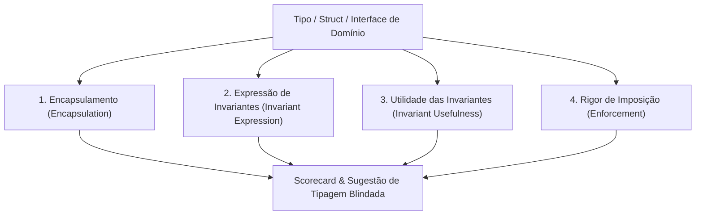

# Skill / Subagente: Type Design Analyzer (`type-design-analyzer`)

O **Type Design Analyzer** é o especialista em modelagem de dados orientada a tipos (*Type-Driven Design*) do ecossistema **ECC (Everything Claude Code)**, posicionado na [Fase 2: Especificação Comportamental (SDD) & Design](file:///home/willycornelissen/Desktop/Dablio/ecc/markdown/Fase%202%20-%20Especificação%20Comportamental%20(SDD)%20&%20Design.md).

Seu lema de engenharia é o célebre axioma formulado por Yaron Minsky:
> **"Make illegal states unrepresentable"** (*Torne estados ilegais impossíveis de serem representados no sistema de tipos*).

---

## 🎯 Por que o Type Design Analyzer Existe?

Em arquiteturas convencionais, equipes confiam excessivamente em validações manuais via `if/else` espalhadas pelo código e em testes unitários para evitar dados inconsistentes. No entanto:
- Testes unitários cobrem apenas exemplos específicos que o desenvolvedor lembrou de escrever.
- Se a estrutura de tipos de uma entidade permitir combinações incoerentes (ex: um pagamento com status `PENDING` que já possui uma data `paidAt`), o sistema fatalmente apresentará comportamentos imprevisíveis sob concorrência ou falhas de rede.

O `type-design-analyzer` audita e refatora o design de tipos, structs, schemas e interfaces **antes da implementação das regras de negócio**, garantindo que estados contraditórios sejam rejeitados diretamente pelo **tempo de compilação**.

---

## 🧭 As 4 Dimensões de Avaliação da Skill

Quando acionado para auditar um modelo de dados, o `type-design-analyzer` submete cada tipo a quatro eixos fundamentais:



### 1. Encapsulamento (*Encapsulation*)
* **Pergunta**: Os detalhes internos estão ocultos e protegidos contra mutações externas indevidas?
* **O que avalia**: Impede que código consumidor altere campos diretamente sem passar por construtores válidos ou métodos que preservem as regras de consistência da entidade.

### 2. Expressão de Invariantes (*Invariant Expression*)
* **Pergunta**: O sistema de tipos codifica as regras reais do negócio?
* **O que avalia**: Verifica se estados impossíveis no mundo real são rejeitados pelo compilador. Por exemplo: se um usuário banido não pode ter tokens ativos, o tipo `BannedUser` não deve conter a propriedade `activeToken`.

### 3. Utilidade das Invariantes (*Invariant Usefulness*)
* **Pergunta**: Essas restrições previnem bugs reais ou são apenas complexidade burocrática (*type gymnastics*)?
* **O que avalia**: Garante que os tipos permaneçam ergonômicos, legíveis e alinhados à linguagem ubíqua do domínio, sem sobrecarregar a produtividade do time com abstrações desnecessárias.

### 4. Rigor de Imposição (*Enforcement*)
* **Pergunta**: As regras são de fato garantidas pelo compilador ou existem rotas de fuga fáceis (*escape hatches*)?
* **O que avalia**: Detecta o uso perigoso de `any`, casts forçados (`as unknown as T`), structs com todos os campos opcionais ou excesso de tipos primitivos genéricos (*Primitive Obsession*).

---

## 🛠️ Padrões e Técnicas Aplicadas pelo Analisador

### 1. Uniões Discriminadas (*Discriminated Unions*) contra Flags Booleanas
Substitui objetos permissivos cheios de propriedades opcionais por tipos fechados e mutuamente exclusivos.

#### ❌ Design Frágil (Permite estados ilegais):
```typescript
// Permite o estado impossível: loading: true E error: Error E data: Data ao mesmo tempo!
interface FetchState<T> {
  isLoading: boolean;
  data?: T;
  error?: Error;
}
```

####  Design Blindado pelo `type-design-analyzer`:
```typescript
// O compilador impede acessar .data quando está em Loading, ou .error quando deu Success
type FetchState<T> =
  | { status: 'idle' }
  | { status: 'loading' }
  | { status: 'success'; data: T }
  | { status: 'error'; error: Error };
```

---

### 2. Tipos Nominais (*Branded Types*) contra a "Cegueira por Primitivos"
Impede que identificadores ou grandezas diferentes sejam trocados acidentalmente apenas porque compartilham o mesmo tipo primitivo (como `string` ou `number`).

#### ❌ Design Frágil:
```typescript
function transfer(sourceAccountId: string, targetAccountId: string, amount: number) {}
// Risco: transfer(targetId, sourceId, amount) compila perfeitamente sem erros!
```

####  Design Blindado:
```typescript
type AccountId = string & { readonly __brand: unique symbol };
type PositiveAmount = number & { readonly __brand: unique symbol };

function transfer(source: AccountId, target: AccountId, amount: PositiveAmount) {}
// O compilador rejeita passar uma string qualquer ou um número negativo sem validação prévia.
```

---

### 3. Máquinas de Estados em Nível de Tipos
Garante que métodos específicos só possam ser chamados quando a entidade estiver no estado correto.

#### ❌ Design Frágil (Validação em tempo de execução):
```typescript
class Order {
  status: 'draft' | 'paid' | 'shipped';
  paidAt?: Date;
  trackingCode?: string;

  ship(tracking: string) {
    if (this.status !== 'paid') throw new Error("Não pode enviar pedido não pago!");
    this.trackingCode = tracking;
  }
}
```

####  Design Blindado:
```typescript
interface DraftOrder {
  readonly id: OrderId;
  readonly items: CartItem[];
}

interface PaidOrder {
  readonly id: OrderId;
  readonly items: CartItem[];
  readonly paidAt: Date;
  readonly paymentId: PaymentId;
}

interface ShippedOrder {
  readonly id: OrderId;
  readonly paidOrder: PaidOrder;
  readonly trackingCode: TrackingCode;
}

// Impossível compilar a função ship() passando um DraftOrder!
function shipOrder(order: PaidOrder, tracking: TrackingCode): ShippedOrder { ... }
```

---

## 📋 Formato de Relatório de Auditoria da Skill

Ao avaliar uma base de código, o `type-design-analyzer` emite o diagnóstico estruturado:

```markdown
## Type Design Audit: [Nome da Entidade / Módulo]

### 1. Entidade: OrderState (local: src/domain/order.ts:12)
- **Encapsulamento**: 3/5 — Os campos de status são públicos e mutáveis fora do pacote.
- **Expressão de Invariantes**: 2/5 — Permite status 'SHIPPED' sem código de rastreio definido.
- **Utilidade**: 5/5 — O ciclo de vida do pedido é crítico para o negócio.
- **Rigor de Imposição**: 2/5 — Depende de verificações em runtime espalhadas em 6 controllers.

### Diagnóstico Geral
O modelo atual permite estados ilegais em memória caso uma exceção ocorra entre a confirmação do pagamento e o registro da data de transação.

### Recomendação de Refatoração
Substituir a interface única por uma União Discriminada representando os estados 'DraftOrder', 'PaidOrder' e 'ShippedOrder'.
```

---

## 🔗 Integração com a Esteira ECC

1. **Atua na [Fase 2 (SDD)](file:///home/willycornelissen/Desktop/Dablio/ecc/markdown/Fase%202%20-%20Especificação%20Comportamental%20(SDD)%20&%20Design.md)**: Recebe os critérios de aceitação do [`intent-driven-development`](file:///home/willycornelissen/Desktop/Dablio/ecc/skills/3.%20SDD/intent-driven-development.md) e molda os tipos antes de qualquer código de regra de negócio.
2. **Protege a [Fase 4 (TDD)](file:///home/willycornelissen/Desktop/Dablio/ecc/markdown/Fase%204%20-%20Implementação%20Guiada%20por%20Testes%20(TDD).md)**: Quando os tipos impedem estados inválidos, o desenvolvedor precisa escrever muito menos testes de asserção defensiva (`assertNotNull`, `checkState`), focando apenas nos fluxos de valor.
3. **Auditado na [Fase 5 (Code Review)](file:///home/willycornelissen/Desktop/Dablio/ecc/markdown/Fase%205%20-%20Qualidade,%20Segurança%20&%20Verificação%20Adversarial.md)**: O [`type-design-analyzer`](file:///home/willycornelissen/Desktop/Dablio/ecc/.agents/agents/type-design-analyzer.md) é acionado no comando `/review-pr` para auditar se novos commits não introduziram tipos permissivos ou quebras de invariantes.
