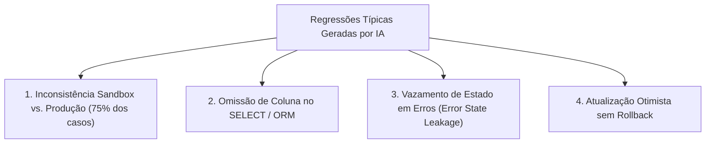

# Skill: AI Regression Testing (`ai-regression-testing`)

A skill **AI Regression Testing** é a guardiã contra regressões silenciosas do ecossistema **ECC (Everything Claude Code)**, posicionada na [Fase 4: Implementação Guiada por Testes (TDD)](file:///home/willycornelissen/Desktop/Dablio/ecc/markdown/Fase%204%20-%20Implementação%20Guiada%20por%20Testes%20(TDD).md).

Seu lema de engenharia é claro e pragmático:
> **"Quando o mesmo modelo de IA escreve o código e depois o revisa, ele carrega exatamente os mesmos pontos cegos cognitivos nas duas etapas. Apenas testes automatizados executáveis quebram esse ciclo vicioso."**

---

## 🎯 O Problema Central: O Ponto Cego da IA (*The Core Blind Spot*)

Em fluxos de desenvolvimento com assistentes de IA (Claude Code, Cursor, Codex, Gemini), ocorre frequentemente o seguinte padrão de falha previsível:

```
IA escreve a alteração  ──►  IA revisa a alteração  ──►  IA diz "parece correto"  ──►  O bug persiste em produção
```

### Exemplo Real Observado em Produção (Caso Documentado no ECC):
1. **Tentativa 1**: A IA adicionou `notification_settings` na resposta da API, mas esqueceu de incluí-lo na consulta `SELECT` do banco. A IA revisou o próprio código e disse que estava tudo certo.
2. **Tentativa 2**: A IA adicionou o campo no `SELECT`, gerando erro de build no TypeScript porque a coluna não estava nos tipos gerados. A IA revisou e não percebeu.
3. **Tentativa 3**: A IA mudou para `SELECT *`, corrigindo a rota de produção, mas **esqueceu o caminho de mock/sandbox**. A IA revisou pela 4ª vez e aprovou novamente o erro.
4. **Tentativa 4 (Com Teste Automatizado)**: Um teste de regressão executou em 12 milissegundos e reprovou a alteração no primeiro milissegundo de execução.

---

## ⚠️ Os 4 Padrões Mais Comuns de Regressão por IA

Análises empíricas no ecossistema ECC identificaram que quase a totalidade das regressões introduzidas por agentes de código recaem sobre quatro padrões específicos:



### Padrão 1: Inconsistência entre Modo Sandbox e Produção (O Mais Frequente)
Ocorre quando o sistema possui mocks para testes/sandbox e código real para produção. A IA altera um caminho e esquece o outro.

#### ❌ Código Vulnerável:
```typescript
if (isSandboxMode()) {
  return { data: { id, email, name } }; // ⚠️ Faltou notification_settings aqui!
}
// Produção
return { data: { id, email, name, notification_settings } };
```

####  Teste de Regressão para Bloquear:
```typescript
it("sandbox e produção devem retornar exatamente a mesma estrutura de campos", async () => {
  const res = await GET(createTestRequest("/api/user/profile"));
  const { json } = await parseResponse(res);

  for (const field of REQUIRED_FIELDS) {
    expect(json.data).toHaveProperty(field);
  }
});
```

---

### Padrão 2: Omissão de Coluna na Cláusula SELECT
A IA adiciona um novo campo na interface de resposta da API ou no frontend, mas esquece de atualizar a query do banco de dados (Prisma, Supabase, SQL nativo).

#### ❌ Código Vulnerável:
```typescript
const { data } = await supabase
  .from("users")
  .select("id, email, name") // ⚠️ 'notification_settings' não foi incluído no SELECT
  .single();

return { data: { ...data, notification_settings: data.notification_settings } };
// Resultado: notification_settings é silenciosamente 'undefined'
```

####  Teste de Regressão para Bloquear:
```typescript
it("campo notification_settings não pode ser undefined (regressão BUG-R1)", async () => {
  const res = await GET(createTestRequest("/api/user/profile"));
  const { json } = await parseResponse(res);

  expect("notification_settings" in json.data).toBe(true);
  expect(json.data.notification_settings).not.toBeUndefined();
});
```

---

### Padrão 3: Vazamento de Estado Residual em Erros (*Error State Leakage*)
Ao capturar uma exceção, a IA define a mensagem de erro, mas esquece de limpar o estado de dados anterior, deixando dados fantasmas ou de outro usuário visíveis na tela.

#### ❌ Código Vulnerável:
```typescript
catch (err) {
  setError("Falha ao carregar");
  // ⚠️ 'reservations' continua com os dados da aba anterior na tela!
}
```

####  Forma Correta:
```typescript
catch (err) {
  setReservations([]); // Limpa o estado residual antigo
  setError("Falha ao carregar");
}
```

---

### Padrão 4: Atualização Otimista sem Rollback
A UI atualiza o estado antes da resposta do servidor (para parecer instantânea), mas não reverte caso a chamada HTTP falhe.

#### ❌ Código Vulnerável:
```typescript
const handleRemove = async (id: string) => {
  setItems(prev => prev.filter(i => i.id !== id));
  await fetch(`/api/items/${id}`, { method: "DELETE" });
  // Se a API falhar, o item sumiu da tela mas continua no banco!
};
```

####  Forma Correta com Rollback:
```typescript
const handleRemove = async (id: string) => {
  const prevItems = [...items]; // Captura snapshot anterior
  setItems(prev => prev.filter(i => i.id !== id));
  try {
    const res = await fetch(`/api/items/${id}`, { method: "DELETE" });
    if (!res.ok) throw new Error("Erro na API");
  } catch {
    setItems(prevItems); // Rollback garantido
    notify("Não foi possível excluir o item.");
  }
};
```

---

## ⚡ Estratégia de Execução: Testes Ultrarrápidos em Modo Sandbox

Testes que dependem de bancos de dados reais ou serviços externos demoram segundos para rodar e acabam sendo ignorados no dia a dia.

A skill preconiza **testes de contrato via Sandbox**:
1. Força variáveis de ambiente mockadas (`process.env.SANDBOX_MODE = "true"`).
2. Não sobe instâncias de banco de dados pesadas.
3. Executa centenas de testes de API em **menos de 1 segundo**.

---

## 🎯 A Filosofia Pragmática: "Teste Onde os Bugs Foram Encontrados"

Em vez de perder tempo perseguindo 100% de cobertura cega em partes triviais do código:

```
Bug encontrado em /api/user/profile     ──► Escreve teste de regressão para profile
Bug encontrado em /api/user/messages    ──► Escreve teste de regressão para messages
Nenhum bug em /api/user/notifications  ──► Não escreve teste agora (evita esforço inútil)
```

### Por que essa estratégia funciona perfeitamente com IA?
1. As IAs tendem a cometer repetidamente **a mesma classe de erro** nas mesmas áreas complexas (autenticação, concorrência, estados multi-abas).
2. Uma vez que o teste de regressão é escrito e nomeado após o bug (ex: `BUG-R1 regression`), **esse erro torna-se impossível de ser reintroduzido por prompts futuros**.
3. A suíte de testes cresce de forma orgânica, focada unicamente nos pontos frágeis reais do software.

---

## 📋 Tabela de Decisão Rápida (DO vs. DON'T)

| O que FAZER (DO) | O que NÃO FAZER (DON'T) |
| :--- | :--- |
| **Escreva o teste imediatamente ao achar o bug** (antes de corrigi-lo). | **Não confie no "self-review" da IA**: se ela gerou o bug, ela achará o bug correto. |
| **Teste o contrato de resposta da API**, e não detalhes internos de implementação. | **Não escreva testes pesados com banco** quando mocks/sandbox resolvem em < 1s. |
| **Nomeie o teste com o código do bug** (ex: `it("deve reverter estado em caso de falha - BUG-R4")`). | **Não busque porcentagens artificiais de cobertura**: foque em prevenir regressões. |
| **Rode os testes antes de qualquer code review**: automação mecânica primeiro, IA depois. | **Nunca ignore testes do modo sandbox** sob a justificativa de que "são apenas dados falsos". |

---

## 🔗 Integração na Esteira ECC

* **Complementa o [`tdd-workflow`](file:///home/willycornelissen/Desktop/Dablio/ecc/skills/4.%20TDD/tdd-workflow.md)**: Garante que bugs descobertos em produção ou staging sejam convertidos em testes do ciclo TDD.
* **Alimenta o comando `/bug-check`**: Toda sessão de caça a bugs roda primeiro os testes mecânicos (`npm test`), depois a compilação de tipos (`npm run build`) e só então a análise contextual.
* **Portão de Entrada da [Fase 5 (Verificação)](file:///home/willycornelissen/Desktop/Dablio/ecc/markdown/Fase%205%20-%20Qualidade,%20Segurança%20&%20Verificação%20Adversarial.md)**: O [`delivery-gate`](file:///home/willycornelissen/Desktop/Dablio/ecc/.agents/skills/delivery-gate/SKILL.md) e o [`verification-loop`](file:///home/willycornelissen/Desktop/Dablio/ecc/.agents/skills/verification-loop/SKILL.md) exigem que todos os testes de regressão estejam 100% verdes antes de autorizar qualquer commit ou PR.
