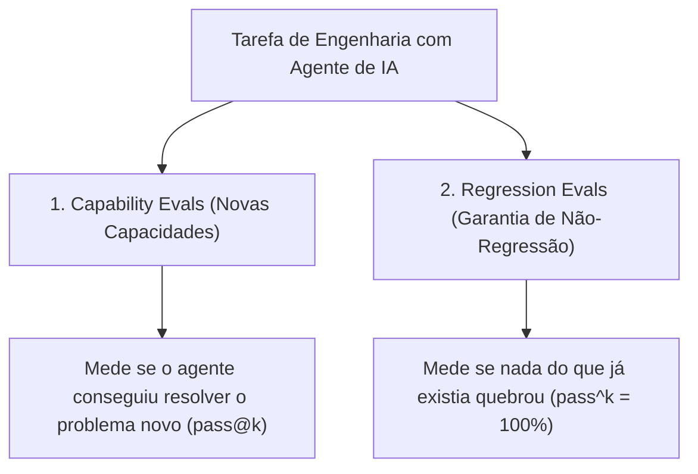
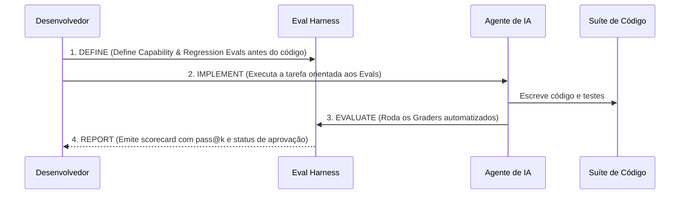

# Skill: Eval Harness (`eval-harness`)

A skill **Eval Harness** é o framework de **Eval-Driven Development (EDD — Desenvolvimento Guiado por Avaliações)** do ecossistema **ECC (Enterprise Custom Configuration)**, posicionada na [Fase 4: Implementação Guiada por Testes (TDD)](file:///home/willycornelissen/Desktop/Dablio/ecc/markdown/Fase%204%20-%20Implementação%20Guiada%20por%20Testes%20(TDD).md).

Sua premissa central é:
> **"Evals são os testes unitários do desenvolvimento assistido por IA. Da mesma forma que o TDD define o teste antes do código, o EDD define os critérios mensuráveis de sucesso e regressão antes que o agente autônomo execute a tarefa."**

---

## 🎯 Por que o Eval Harness Existe?

Quando delegamos tarefas complexas a agentes de IA (como criar uma nova feature, refatorar um subsistema ou migrar rotas de API), não basta confiar no feeling ou em prompts abertos. Sem critérios decidíveis por máquina:
- O agente pode declarar que concluiu a tarefa quando apenas metade foi implementada.
- O código pode compilar, mas falhar silenciosamente em contratos essenciais.
- Modelos diferentes (ou versões atualizadas de LLMs) podem apresentar comportamentos erráticos.

O `eval-harness` introduz **métricas probabilísticas de confiabilidade de agentes (`pass@k` e `pass^k`)** e validadores automatizados (*Graders*), permitindo saber com precisão matemática se a entrega da IA é confiável para ir a produção.

---

## 🔬 Os Dois Tipos de Evals



### 1. Evals de Capacidade (*Capability Evals*)
Avaliam se o agente conseguiu implementar uma habilidade que o sistema não possuía antes:
* *"O usuário consegue se cadastrar via email/senha?"*
* *"O payload inválido é rejeitado com HTTP 422?"*
* *"O token JWT é persistido corretamente nos cookies HttpOnly?"*

### 2. Evals de Regressão (*Regression Evals*)
Garantem que a intervenção do agente não destruiu o código existente:
* *"O login tradicional continua funcionando?"*
* *"As rotas públicas continuam acessíveis?"*
* *"O schema do banco de dados permanece retrocompatível?"*

---

## ⚖️ Os 3 Tipos de Avaliadores (*Graders*)

O `eval-harness` combina diferentes avaliadores dependendo da natureza do que está sendo testado:

| Tipo de Grader | Como Opera | Exemplo Real | Nível de Confiabilidade |
| :--- | :--- | :--- | :---: |
| **Code-Based Grader** | Scripts e comandos determinísticos de código. | `npm test`, `npm run build`, `grep -q "export function"`. | **Máxima** (Determinístico: binário PASS/FAIL) |
| **Model-Based Grader** | Um LLM independente avalia a qualidade da resposta. | Avalia legibilidade, tratamento de bordas e pontua de 1 a 5 com justificativa. | **Média/Alta** (Para aspectos qualitativos) |
| **Human Grader** | Alerta que exige revisão humana explícita. | Gated reviews para mudanças críticas de segurança, billing ou conformidade. | **Soberana** (Decisão humana inegociável) |

---

## 📊 Métricas de Confiabilidade: `pass@k` vs. `pass^k`

Para medir a confiabilidade dos agentes em engenharia de software, o ECC utiliza métricas padronizadas da literatura de IA:

### 1. Métrica `pass@k` (*"Pelo menos um sucesso em k tentativas"*)
* **Significado**: Se dermos ao agente $k$ tentativas de correção/execução, qual a probabilidade de pelo menos uma tentativa atingir o sucesso completo?
  - `pass@1`: Taxa de acerto de primeira (sem retrabalho).
  - `pass@3`: Sucesso garantido em até 3 tentativas.
* **Meta Típica no ECC**: `pass@3 > 90%` para novas features.

### 2. Métrica `pass^k` (*"Todas as k tentativas tiveram sucesso consecutivo"*)
* **Significado**: Exige que **todas** as execuções consecutivas passem sem nenhuma falha.
* **Onde se aplica**: Em caminhos críticos de negócio e segurança (ex: processamento de pagamentos, autenticação, testes de regressão).
* **Meta Típica no ECC**: `pass^3 = 100%` para regressões.

---

## 🔄 Workflow de Execução (O Ciclo EDD)



### 1. Definição Prévia (`.claude/evals/{feature}.md`)
Antes de iniciar o código:
```markdown
## EVAL DEFINITION: user-authentication

### Capability Evals:
- [ ] Usuário registra com email e senha válidos
- [ ] Senha fraca (< 8 caracteres) rejeitada com mensagem amigável
- [ ] Hash de senha utiliza Argon2 ou bcrypt com salt

### Regression Evals:
- [ ] Sessões antigas continuam válidas após o deploy
- [ ] Rota de healthcheck `/api/health` permanece com latência < 50ms

### Metas:
- pass@3 > 90% para capacidades
- pass^3 = 100% para regressões
```

### 2. Implementação
O agente trabalha orientado a satisfazer os critérios objetivos definidos no arquivo de eval.

### 3. Avaliação e Relatório Final
Ao término, a skill consolida o relatório:
```text
EVAL REPORT: user-authentication
=================================
Capability Evals:
  user-register:     PASS (pass@1)
  weak-password:     PASS (pass@1)
  password-hash:     PASS (pass@2)
  Overall:           3/3 passed

Regression Evals:
  session-compat:    PASS
  healthcheck:       PASS
  Overall:           2/2 passed

Métricas:
  pass@1: 67%
  pass@3: 100%

Status: SHIP IT (Pronto para Merge)
```

---

## 📋 Boas Práticas do Eval-Driven Development

* **Defina antes de codificar**: Força o time a pensar em critérios de aceitação claros antes de gastar tokens.
* **Prefira Graders baseados em código**: Testes automatizados e checagens determinísticas de compilador são sempre superiores a opiniões subjetivas de LLMs.
* **Mantenha os Evals rápidos**: Evals que demoram minutos não são executados com frequência; prefira mocks e testes em sandbox.
* **Versione os Evals com o código**: Os arquivos de eval em `.claude/evals/` são artefatos de primeira classe e devem ser commitados no Git.

---

## 🔗 Integração na Esteira ECC

* **Parceiro do [`tdd-workflow`](file:///home/willycornelissen/Desktop/Dablio/ecc/skills/4.%20TDD/tdd-workflow.md)**: Enquanto o `tdd-workflow` guia o ciclo Red-Green-Refactor do código, o `eval-harness` avalia o desempenho e a confiabilidade das tarefas autônomas executadas pelo agente.
* **Combate Regressões com [`ai-regression-testing`](file:///home/willycornelissen/Desktop/Dablio/ecc/skills/4.%20TDD/ai-regression-testing.md)**: Utiliza os mesmos cenários de sandbox para validar a integridade funcional.
* **Portão da [Fase 5 (Verificação Adversarial)](file:///home/willycornelissen/Desktop/Dablio/ecc/markdown/Fase%205%20-%20Qualidade,%20Segurança%20&%20Verificação%20Adversarial.md)**: Alimenta o [`santa-method`](file:///home/willycornelissen/Desktop/Dablio/ecc/.agents/skills/santa-method/SKILL.md) e o [`delivery-gate`](file:///home/willycornelissen/Desktop/Dablio/ecc/.agents/skills/delivery-gate/SKILL.md), impedindo a finalização de tarefas sem evidências de aprovação.
