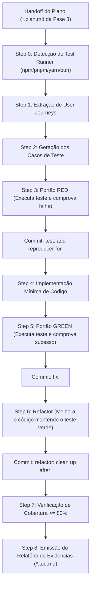

# Skill: TDD Workflow (`tdd-workflow`)

A skill **TDD Workflow** é o motor de execução e implementação da engenharia de software do **ECC (Enterprise Custom Configuration)**, posicionada como o coração da [Fase 4: Implementação Guiada por Testes (TDD)](file:///home/willycornelissen/Desktop/Dablio/ecc/markdown/Fase%204%20-%20Implementação%20Guiada%20por%20Testes%20(TDD).md).

Seu princípio inegociável é:
> **"Nenhum código de produção deve ser escrito antes que exista um teste automatizado compilado, executado e comprovadamente falhando pelo motivo correto (RED). O plano fornece a intenção; o ciclo RED/GREEN fornece a prova."**

---

## 🎯 Por que o TDD Workflow Existe no ECC?

O desenvolvimento comum de software assistido por IA frequentemente cai na armadilha do *"vibe coding"*: o modelo gera centenas de linhas de código de uma vez e só depois escreve testes convenientes que apenas confirmam o código já escrito, criando uma falsa sensação de segurança e pontos cegos graves.

O `tdd-workflow` impõe uma disciplina mecânica rigorosa:
1. **Garante que o teste realmente testa algo**: Ao ver o teste falhar antes da implementação (*Red*), elimina-se o risco de testes viciados que passam sem testar a regra.
2. **Minimiza o escopo de código**: Escreve-se apenas o estritamente necessário para fazer o teste passar (*Green*).
3. **Checkpoints no Git**: Registra commits atômicos de cada estágio com evidências rastreáveis.
4. **Meta de Cobertura**: Exige cobertura mínima comprovada de **80%+** em cenários de sucesso, erro e borda.

---

## 🔄 Os 8 Passos Sequenciais do Workflow



---

### Step 0: Detecção do Test Runner do Projeto
O `tdd-workflow` não presume cegamente `npm test`. Ele inspeciona o gerenciador e o executor de testes:
* Identifica `npm`, `pnpm`, `yarn` ou `bun`.
* Diferencia o gerenciador de pacotes do runner (ex: o projeto pode usar Bun para instalar, mas rodar `vitest` ou `jest`, ou usar o runner nativo `bun test`).
* Mapeia os comandos reais de `<test>`, `<test-watch>` e `<coverage>`.

### Step 1: User Journeys
Extrai ou define as jornadas de valor do usuário:
> *"Como [ator], eu quero [ação], para que [benefício observável]."*

### Step 2: Geração dos Casos de Teste
Cobre o caminho feliz (*Happy Path*), casos de borda (*Edge Cases*), limites de validação e mecanismos de fallback/degradação graciosa.

### Step 3: O Portão RED (Validação Obrigatória de Falha)
Antes de editar qualquer arquivo de produção:
1. O novo teste deve compilar.
2. O teste **deve ser executado** e falhar.
3. A falha deve ocorrer exclusivamente pela ausência da funcionalidade esperada (e não por erro sintático de setup ou dependências ausentes).
4. Registra commit atômico: `test: add reproducer for <feature/bug>`.

### Step 4 & 5: Implementação Mínima e Portão GREEN
1. Implementa a menor quantidade de código de produção suficiente para satisfazer a asserção.
2. Reexecuta o teste exatamente no mesmo alvo e comprova o status **GREEN**.
3. Registra commit atômico: `fix: <feature/bug>`.

### Step 6: Refatoração Limpa (Refactor)
Com a rede de segurança dos testes verdes garantida:
* Remove duplicações de lógica.
* Melhora nomes de funções e variáveis.
* Otimiza consultas e concorrência sem quebrar os testes.
* Registra commit: `refactor: clean up after <feature/bug>`.

### Step 7: Verificação de Cobertura (Coverage >= 80%)
Executa `<coverage>` para validar se a cobertura de linhas, branches e funções atinge a meta mínima de 80%, assegurando que caminhos de erro estejam exercitados.

### Step 8: Relatório de Evidências TDD (`*.tdd.md`)
Ao concluir, a skill gera um documento auditável em `.claude/tdd/{nome}.tdd.md` ou `docs/releases/{versao}/{nome}.tdd.md` contendo:
* Mapeamento entre tarefas do plano e arquivos de teste.
* Tabela de garantias comprovadas por testes automatizados.
* Comandos executados e saídas capturadas nos estágios RED e GREEN.
* Rastreabilidade para fundamentar revisões de Pull Request e *squash merges*.

---

## 🛡️ Gestão de Checkpoints no Git

O `tdd-workflow` utiliza commits granulares para criar uma trilha de auditoria:

| Estágio | Formato do Commit | Evidência Comprovada |
| :--- | :--- | :--- |
| **RED** | `test: add reproducer for <nome>` | O teste falhou pelo motivo esperado antes do código existir. |
| **GREEN** | `fix: <nome>` | A menor alteração necessária fez o teste passar. |
| **REFACTOR** | `refactor: clean up after <nome>` | O código foi otimizado e a suíte permanece 100% verde. |

> [!NOTE]
> Se o projeto adotar *Squash Merge* no GitHub/GitLab, o relatório de evidências do Step 8 preserva o histórico detalhado no corpo do PR para que os revisores saibam exatamente o que foi validado e como.

---

## 📋 Tabela de Garantias Humanas (Exemplo do Relatório TDD)

```markdown
| # | Comportamento Garantido | Alvo do Teste | Tipo | Resultado | Comando de Evidência |
|---|-------------------------|---------------|------|:---------:|----------------------|
| 1 | Busca com string vazia retorna lista vazia sem lançar exceção | `src/search.test.ts:returns empty on empty query` | Unit | PASS | `npm test -- search.test.ts` |
| 2 | Endpoint rejeita payload com preço negativo com HTTP 422 | `src/api/products.test.ts:validates price` | Integration | PASS | `npm test -- products.test.ts` |
| 3 | Fallback para busca textual local se o cache Redis estiver offline | `src/services/cache.test.ts:fallback` | Integration | PASS | `npm test -- cache.test.ts` |
```

---

## 🔗 Integração na Esteira ECC

* **Consome da [Fase 2 (SDD)](file:///home/willycornelissen/Desktop/Dablio/ecc/skills/3.%20SDD/intent-driven-development.md)**: Converte os critérios de aceitação `AC-001`, `AC-002` diretamente em casos de teste unitários e de integração.
* **Recebe da [Fase 3 (Planejamento Técnico)](file:///home/willycornelissen/Desktop/Dablio/ecc/markdown/Fase%203%20-%20Planejamento%20Técnico%20de%20Implementação.md)**: Consome o arquivo `*.plan.md` sanitizando comandos e quebrando cada tarefa técnica em um ciclo RED/GREEN.
* **Supervisionada pelo [`tdd-guide`](file:///home/willycornelissen/Desktop/Dablio/ecc/.agents/agents/tdd-guide.md)**: Subagente que bloqueia desvios do ciclo Red-Green-Refactor.
* **Prepara para a [Fase 5 (Verificação)](file:///home/willycornelissen/Desktop/Dablio/ecc/markdown/Fase%205%20-%20Qualidade,%20Segurança%20&%20Verificação%20Adversarial.md)**: Atinge os pré-requisitos exigidos pelo [`verification-loop`](file:///home/willycornelissen/Desktop/Dablio/ecc/.agents/skills/verification-loop/SKILL.md) e pelo [`delivery-gate`](file:///home/willycornelissen/Desktop/Dablio/ecc/.agents/skills/delivery-gate/SKILL.md).
