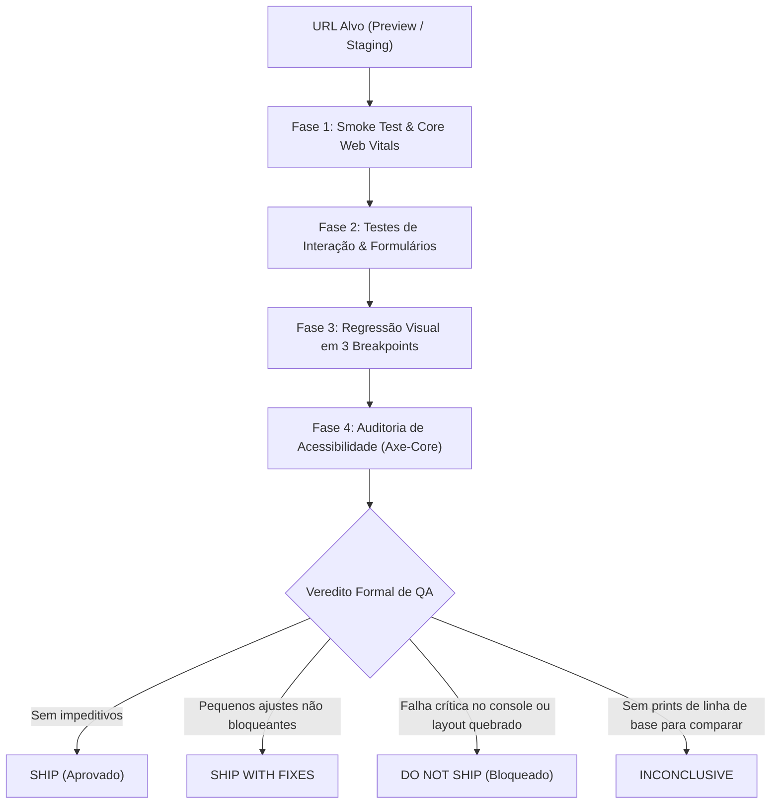

# Skill: Browser QA (`browser-qa`)

A skill **Browser QA** é a ferramenta de auditoria visual automatizada, verificação de interação e smoke tests no navegador do **ECC (Enterprise Custom Configuration)**, posicionada na [Fase 6: Testes Ponta a Ponta (E2E) & Auditoria de UI](file:///home/willycornelissen/Desktop/Dablio/ecc/markdown/Fase%206%20-%20Testes%20Ponta%20a%20Ponta%20(E2E)%20&%20Auditoria%20de%20UI.md).

Seu lema de engenharia é:
> **"Interagir com a aplicação em execução como um usuário real interage, avaliando erros de console, Core Web Vitals, regressão visual responsiva e acessibilidade (axe-core) para emitir um veredito formal de liberação: SHIP ou DO-NOT-SHIP."**

---

## 🎯 Por que o Browser QA Existe?

Testes unitários e de integração validam funções isoladas, mas não enxergam a realidade do navegador:
- Um erro de JavaScript que quebra a renderização da página inteira (`Uncaught TypeError`).
- Quebras graves de layout responsivo em telas de smartphone (elementos que estouram a largura da tela com scroll horizontal).
- Queda brusca no desempenho de renderização (*Core Web Vitals* degradados).
- Violações graves de contraste e acessibilidade que impedem pessoas com deficiência de usar o produto.

O `browser-qa` pilota um navegador real (via MCPs como *claude-in-chrome*, *Playwright* ou *Puppeteer*) para auditar o frontend publicado em ambientes de prévia (*preview*), homologação (*staging*) ou produção.

---

## 🛡️ Princípio de Segurança: Raio de Explosão (*Blast Radius*)

O `browser-qa` executa ações reais no navegador, portanto adota proteções estritas:
1. **Modo Somente Leitura por Padrão (*Read-Only by Default*)**:
   - Nunca executa fluxos mutantes (excluir conta, disparar pagamentos reais, compras com cartão de crédito) em URLs de produção.
   - Fluxos que alteram estado só são autorizados em staging e mediante confirmação explícita (*opt-in*).
2. **Credenciais Fictícias de Teste**:
   - Nunca utiliza logins reais de clientes ou senhas corporativas.
3. **Mascaramento de Mídias (*Redaction*)**:
   - Redige tokens, senhas e informações pessoais (PII) antes de salvar qualquer captura de tela.

---

## 🔄 As 4 Fases de Auditoria do Browser QA



---

### Fase 1: Smoke Test & Métricas Vitais (Core Web Vitals)
1. Navega para a URL alvo e escuta eventos de runtime.
2. **Erros de Console**: Captura e bloqueia se houver exceções não tratadas (`TypeError`, erros 4xx/5xx de assets e APIs).
3. **Core Web Vitals** (Métricas oficiais do Google / web.dev):
   - **LCP** (*Largest Contentful Paint*): Deve ser **< 2.5s** (tempo até o conteúdo principal carregar).
   - **CLS** (*Cumulative Layout Shift*): Deve ser **< 0.1** (estabilidade visual, sem elementos pulando na tela).
   - **INP** (*Interaction to Next Paint*): Deve ser **< 200ms** (responsividade da página ao clique).

---

### Fase 2: Testes de Interação e Formulários
Simula o comportamento humano:
* Clica em todos os links da barra de navegação para certificar que não há links mortos (404).
* Submete formulários com dados válidos (verifica se o estado de sucesso aparece).
* Submete formulários com dados inválidos (verifica se mensagens de erro amigáveis são exibidas).
* Valida o fluxo de autenticação: login ➔ página protegida ➔ logout.

---

### Fase 3: Regressão Visual Responsiva (3 Breakpoints)
Captura screenshots comparando contra imagens de linha de base (*baseline*) em três resoluções padronizadas:
1. **Mobile**: `375px` (iPhone / Android)
2. **Tablet**: `768px` (iPad)
3. **Desktop**: `1440px` (Monitores widescreen)

* **O que busca**:
  - Elementos com overflow horizontal (estourando a viewport).
  - Deslocamentos inesperados de layout (> 5px).
  - Consistência de renderização no Dark Mode / Light Mode.
* *Regra de Ouro*: Se não houver screenshots de baseline salvas para comparar, o relatório emite **`INCONCLUSIVE`**, nunca um "PASS" falso.

---

### Fase 4: Auditoria de Acessibilidade (Axe-Core + WCAG 2.2 AA)
1. Roda a biblioteca **axe-core** injetada no DOM da página.
2. Identifica violações de nível AA:
   - Baixo contraste de cores entre texto e fundo.
   - Imagens sem atributo `alt`.
   - Elementos interativos sem rótulos acessíveis.
3. Testa se a navegação por teclado (tecla `Tab` e `Enter`) percorre a tela na ordem lógica esperada.

> [!NOTE]
> O *axe-core* automatizado cobre aproximadamente 30% a 40% das diretrizes WCAG. Ele é uma condição **necessária, mas não suficiente**; a navegação por teclado e landmarks para leitores de tela devem ser inspecionados.

---

## 📋 Formato do Relatório de Saída (*QA Report*)

Ao concluir a varredura, a skill emite o veredito formal:

```markdown
## QA Report — https://staging.app.com — 2026-11-03 10:05

### Smoke Test
- Console errors: 0 críticos, 1 aviso (analytics)
- Network: todas as rotas 200/304, zero falhas
- Core Web Vitals: LCP 1.1s ✓ | CLS 0.01 ✓ | INP 65ms ✓

### Interactions
- [✓] Links de navegação: 14/14 funcionando
- [✓] Formulário de login: autenticação e redirecionamento corretos
- [✗] Formulário de contato: botão de submit desabilita mas não exibe spinner

### Visual Regression
- [✓] Mobile (375px): sem overflow horizontal
- [✓] Tablet (768px): grid de cards ajustado perfeitamente
- [✓] Desktop (1440px): layout alinhado com baseline
- [✓] Dark Mode: contraste consistente em todas as telas

### Accessibility
- [✗] 1 violação WCAG AA: contraste insuficiente nos links do rodapé (#888 sobre fundo #222)
- [✓] Navegação por teclado: tabulação lógica em todo o fluxo principal

### Verdict: SHIP WITH FIXES (1 ajuste cosmético, 1 contraste AA, 0 bloqueadores)
```

### Vereditos Possíveis:
* **`SHIP`**: Tudo verde, zero falhas. Liberado para deploy.
* **`SHIP WITH FIXES`**: Sem erros de console ou quebras estruturais, mas com pequenas pendências cosméticas não impeditivas.
* **`DO NOT SHIP`**: Erro de console não tratado, formulário crítico quebrado, regressão visual grave ou falha de auth.
* **`INCONCLUSIVE`**: Ausência de baseline visual para comparação.

---

## 🔗 Integração na Esteira ECC

* **Conecta-se à Fase 6 ([E2E & UI](file:///home/willycornelissen/Desktop/Dablio/ecc/markdown/Fase%206%20-%20Testes%20Ponta%20a%20Ponta%20(E2E)%20&%20Auditoria%20de%20UI.md))**: Trabalha ao lado do [`click-path-audit`](file:///home/willycornelissen/Desktop/Dablio/ecc/.agents/skills/click-path-audit/SKILL.md) e do [`e2e-runner`](file:///home/willycornelissen/Desktop/Dablio/ecc/.agents/agents/e2e-runner.md).
* **Parceira do [`a11y-architect`](file:///home/willycornelissen/Desktop/Dablio/ecc/.agents/agents/a11y-architect.md)**: As violações encontradas no axe-core são encaminhadas para o arquiteto de acessibilidade sugerir correções de marcação semântica.
* **Gatilho de Transição para a [Fase 7 (Produção & PR)](file:///home/willycornelissen/Desktop/Dablio/ecc/markdown/Fase%207%20-%20Publicação,%20Pull%20Request%20&%20Produção.md)**: O parecer `SHIP` do `browser-qa` é o sinal verde para o disparo do comando `/pr` e abertura do Pull Request oficial.
