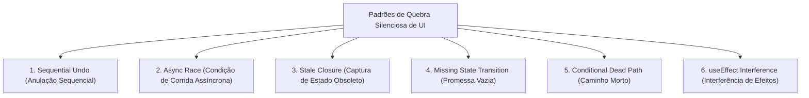

# Skill: Click Path Audit (`click-path-audit`)

A skill **Click Path Audit** é a ferramenta de **auditoria de fluxo comportamental e integridade de máquinas de estado de UI** do **ECC (Enterprise Custom Configuration)**, posicionada na [Fase 6: Testes Ponta a Ponta (E2E) & Auditoria de UI](file:///home/willycornelissen/Desktop/Dablio/ecc/markdown/Fase%206%20-%20Testes%20Ponta%20a%20Ponta%20(E2E)%20&%20Auditoria%20de%20UI.md).

Seu lema de engenharia é:
> **"Encontrar os bugs invisíveis que a leitura estática de código, os linters e os testes unitários não conseguem ver: efeitos colaterais ocultos em stores globais, condições de corrida entre chamadas sequenciais e handlers de eventos que silenciosamente anulam as ações uns dos outros."**

---

## 🎯 O Problema que o Click Path Audit Resolve

O processo tradicional de debugging e revisão verifica:
- A função existe? *(Sim, o código está conectado)*
- O código quebra ou lança exceção no console? *(Não, executa sem erros)*
- Os tipos de dados estão corretos? *(Sim, o TypeScript compila perfeitamente)*

No entanto, o debugging tradicional **não verifica**:
1. **O estado final da interface reflete o que o rótulo do botão promete ao usuário?**
2. **A função B executada em sequência anulou silenciosamente o que a função A acabou de fazer?**
3. **A store global de estado (Zustand, Redux, Context API) possui efeitos colaterais que resetam campos de outros componentes?**

---

### 💡 O Caso Real que Inspirou a Criação da Skill

No botão **"Novo Email"** de um cliente de email web:

```typescript
// Componente ThreadList.tsx
<button
  onClick={() => {
    useEmailStore.getState().setComposeMode(true); // 1. Ativa o modal de composição
    useEmailStore.getState().selectThread(null);   // 2. Limpa o email selecionado na lista
  }}
>
  Novo Email
</button>
```

**O que acontecia**: O usuário clicava no botão e **nada acontecia**.
**A causa oculta**: Dentro da store Zustand, a action `selectThread(null)` continha um reset colateral não documentado:
```typescript
selectThread: (thread) => set({
  selectedThread: thread,
  messages: [],
  composeMode: false, // ⚠️ ESSE RESET SILENCIOSO MATAVA O BOTÃO!
})
```

54 tipos de linters, testes de unidade e inspeções estáticas passaram sem apontar nenhum erro porque **tudo compilava e nada quebrava**. Apenas a auditoria sequencial do `click-path-audit` foi capaz de identificar que a chamada 2 anulava a chamada 1.

---

## 🧭 Os 6 Padrões de Bugs Caçados pelo Audit



### 1. Sequential Undo (Anulação Sequencial)
Acontece quando uma linha define um estado e a linha seguinte o reseta como efeito colateral:
```typescript
handler() {
  setState_A(true);  // Define X = true
  setState_B(null);  // Efeito colateral de B: reseta X = false
}
// Resultado: X permanece false. A primeira chamada foi inútil.
```

### 2. Async Race (Condição de Corrida Assíncrona)
Disparo concorrente de duas requisições assíncronas onde a ordem de resposta do servidor define aleatoriamente o estado final da tela:
```typescript
handler() {
  fetchUserData().then(() => setLoading(false));
  fetchCompanyData().then(() => setLoading(true));
}
// O loading final da tela depende de qual resposta HTTP chegar por último na rede.
```

### 3. Stale Closure (Estado Obsoleto em React)
Handlers presos a referências antigas em closures com hooks `useCallback` ou `useEffect`:
```typescript
const [count, setCount] = useState(0);
const handleClick = useCallback(() => {
  setCount(count + 1); // Captura o count antigo da closure
  setCount(count + 1); // Incrementa em 1 e não em 2
}, [count]);
```

### 4. Missing State Transition (A Promessa Vazia do Botão)
O botão diz *"Salvar"*, *"Enviar"* ou *"Excluir"*, mas o código apenas fecha um modal ou altera um booleano local, sem nunca disparar a chamada real de API ou transição de banco de dados.

### 5. Conditional Dead Path (Caminho Morto em Tempo de Render)
O código contém uma condicional que parece válida, mas que avalia invariavelmente para `false` no momento em que o clique ocorre:
```typescript
handler() {
  if (selectedProject) { // selectedProject é SEMPRE null ao criar um novo item
    salvarProjeto();     // Nunca é executado!
  }
}
```

### 6. useEffect Interference (Interferência de Efeitos React)
O clique do botão altera o estado `isOpen = true`, mas um `useEffect` em outro componente monitora uma dependência secundária e reseta `isOpen = false` no mesmo ciclo de renderização. O usuário vê a tela piscar e nada abrir.

---

## 🔄 Metodologia de Execução em 3 Etapas

### Etapa 1: Mapear as Stores de Estado (*State Store Map*)
Antes de auditar botões, a skill monta o inventário de ações e efeitos colaterais de cada store global (Zustand, Redux, Context API):

```text
STORE: emailStore
  setComposeMode(bool) ➔ Define: {composeMode}
  selectThread(thread) ➔ Define: {selectedThread, messages} 
                         RESETA: {composeMode: false, composeData: null}

DANGEROUS RESETS (Ações que limpam estados que não pertencem a elas):
  selectThread ➔ reseta composeMode (pertencente ao setComposeMode)
```

### Etapa 2: Rastrear Cada Ponto de Toque (*Touchpoint Trace*)
Para cada botão, link, toggle ou submit na tela auditada:
1. Identifica o manipulador (`onClick`, `onSubmit`, `onChange`).
2. Rastreia cada função chamada na ordem exata de execução.
3. Para cada chamada:
   - Que estado ela lê?
   - Que estado ela escreve?
   - Que estado ela **reseta** como efeito colateral?
4. Cruza: **A chamada posterior desfez o que a chamada anterior prometeu?**
5. Avalia: **O estado final da tela cumpre o que o rótulo do botão promete ao usuário?**

### Etapa 3: Emitir Relatório de Conflito

```markdown
CLICK-PATH-001: [Severidade: HIGH]
  Touchpoint: Botão 'Novo Email' em src/components/ThreadList.tsx:42
  Padrão: Sequential Undo (Anulação Sequencial)
  Handler: onClick
  Trace:
    1. useEmailStore.setComposeMode(true) ➔ sets {composeMode: true}
    2. useEmailStore.selectThread(null)   ➔ RESETS {composeMode: false}  ← CONFLITO
  Esperado: O usuário clica e visualiza o formulário de redação aberto.
  Realidade: composeMode permanece false. O botão não responde.
  Correção Recomendada: Remover o reset de composeMode de dentro de selectThread, delegando o controle exclusivamente a setComposeMode.
```

---

## ⚖️ Quando Usar vs. Quando Não Usar

| Cenário | Usar `click-path-audit`? | Alternativa Correta no ECC |
| :--- | :---: | :--- |
| **Usuários reportam que um botão "não faz nada" ao ser clicado** |  | — |
| **Após refatorar uma store global (Zustand, Redux, Context)** |  | — |
| **Formulários complexos onde abas desfazem dados de outras abas** |  | — |
| *Bugs de resposta de API (erro 500, dados nulos vindos do banco)* |  | Use [`ai-regression-testing`](file:///home/willycornelissen/Desktop/Dablio/ecc/skills/4.%20TDD/ai-regression-testing.md). |
| *Problemas estéticos de CSS, quebra de layout ou cores* |  | Use [`browser-qa`](file:///home/willycornelissen/Desktop/Dablio/ecc/skills/5.%20UI/browser-qa.md). |
| *Lentidão de re-renderização em loops longos* |  | Use o subagente [`performance-optimizer`](file:///home/willycornelissen/Desktop/Dablio/ecc/.agents/agents/performance-optimizer.md). |

---

## 🔗 Integração na Esteira ECC

* **Complementa o [`browser-qa`](file:///home/willycornelissen/Desktop/Dablio/ecc/skills/5.%20UI/browser-qa.md)**: Enquanto o `browser-qa` audita a aparência visual, o DOM e os erros de console, o `click-path-audit` inspeciona a coerência lógica das transições de estado na UI.
* **Alimenta o [`tdd-workflow`](file:///home/willycornelissen/Desktop/Dablio/ecc/skills/4.%20TDD/tdd-workflow.md)**: Todo bug de anulação sequencial descoberto nesta auditoria é transformado em um caso de teste reproduzível (*Regression Test*).
* **Portão da [Fase 6](file:///home/willycornelissen/Desktop/Dablio/ecc/markdown/Fase%206%20-%20Testes%20Ponta%20a%20Ponta%20(E2E)%20&%20Auditoria%20de%20UI.md)**: Garante que a aplicação esteja totalmente funcional e livre de botões mortos antes da auditoria de produção da Fase 7.
