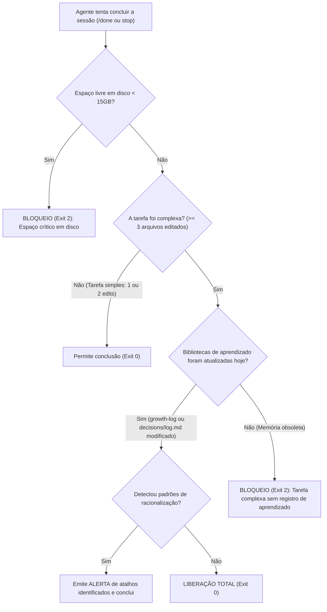

# Skill / Hook: Delivery Gate (`delivery-gate`)

O **Delivery Gate** é o mecanismo de barreira física e higiene de sessão do ecossistema **ECC (Everything Claude Code)**, posicionado na [Fase 5: Qualidade, Segurança & Verificação Adversarial](file:///home/willycornelissen/Desktop/Dablio/ecc/markdown/Fase%205%20-%20Qualidade,%20Segurança%20&%20Verificação%20Adversarial.md).

Seu lema de engenharia é:
> **"Impedir mecanicamente que o assistente declare uma tarefa como 'pronta' antes que os critérios de qualidade passem, atalhos de racionalização sejam expostos e as lições aprendidas sejam devidamente registradas na memória do projeto."**

---

## 🎯 Por que o Delivery Gate Existe? (A Síndrome do "Ship and Forget")

A maioria dos assistentes de código e agentes de IA sofrem de uma falha comportamental recorrente:
1. **Atalhos e Racionalizações Preguiçosas**: Quando encontram um erro difícil, geram frases como *"vamos ignorar os testes por enquanto"* ou *"este bug já existia antes"*.
2. **"Ship and Forget" (Entregar e Esquecer)**: O agente altera 5 ou 10 arquivos, resolve um problema complexo, mas não captura nenhuma lição aprendida. Na sessão seguinte, o mesmo agente (ou outro desenvolvedor) comete exatamente os mesmos erros porque a memória do projeto não foi atualizada.
3. **Falhas Críticas Silenciosas de Disco**: Pipelines e contêineres quebram silenciosamente no meio da execução porque o disco local atingiu limites críticos.

O `delivery-gate` atua como um **Stop Hook** determinístico: ele intercepta o comando de finalização da sessão e **bloqueia fisicamente a conclusão (exit code 2)** caso os requisitos de higiene operacional não tenham sido cumpridos.

---

## 🧭 O que o Delivery Gate Verifica (100% Determinístico)

Diferente de avaliações subjetivas de LLMs, o `delivery-gate` não usa inferência de IA. Ele roda um script estritamente determinístico em Python avaliando fatos verificáveis por máquina:

| Verificação | Mecanismo de Checagem | Ação ao Disparar |
| :--- | :--- | :---: |
| **Padrões de Racionalização** | Regex nos últimos turnos da conversa (*transcript tail*) | **Aviso (*Warning*)** |
| **Bibliotecas de Aprendizado Desatualizadas** | `mtime` (data de modificação no sistema de arquivos) | **Bloqueio (*Exit 2*)** se a tarefa for complexa e as memórias não forem atualizadas |
| **Espaço em Disco < 50 GB** | `shutil.disk_usage` | **Aviso (*Warning*)** |
| **Espaço em Disco < 15 GB** | `shutil.disk_usage` | **Bloqueio Crítico (*Exit 2*)** |

---

## 🔄 Fluxo de Decisão do Hook



---

## 🧠 Bibliotecas de Aprendizado Monitoradas

Em tarefas complexas (definidas por padrão como $\ge 3$ operações de escrita/edição de arquivos), o `delivery-gate` exige que pelo menos um dos arquivos de memória contínua do projeto tenha sido tocado na data atual:

```
memory/
├── growth-log/               # Entradas de aprendizados do dia (padrões e causas-raiz)
├── decisions/log.md          # Registro rápido de decisões tomadas
├── output-index.md           # Índice de entregáveis e artefatos da sessão
├── ratings-tracker.md        # Acompanhamento de qualidade de skills
└── tooling_capabilities.md   # Inventário de ferramentas locais
```

> [!NOTE]
> **O Hábito vs. O Conteúdo**: O `delivery-gate` força o **hábito mecânico** de registrar conhecimento. Para avaliar a **qualidade do conteúdo** registrado, o ECC aciona em conjunto a skill `self-audit`.

---

## 🚫 Detecção de Racionalizações (*Anti-Shortcuts*)

O hook escaneia o histórico da conversa caçando expressões típicas que indicam abandono precoce de raciocínio:

* *"vamos pular os testes por enquanto"* (*skip tests for now*)
* *"esse teste já estava falhando antes"* (*pre-existing bug*)
* *"implementaremos o tratamento de erro depois"* (*add error handling later*)
* *"vamos deixar isso para a próxima sprint"*

Quando detectadas, o hook exibe um aviso explícito ao usuário alertando que o agente tentou justificar um atalho em vez de entregar a solução completa.

---

## 💡 Exemplos Práticos de Execução

### Exemplo 1: Sessão Simples — Permitida
```text
Total de edições = 1 arquivo (< 3)
➔ Classificada como não-complexa
➔ Resultado: Exit 0 (Aprovada)
```

### Exemplo 2: Tarefa Complexa com Aprendizado Registrado — Permitida
```text
Total de edições = 5 arquivos (Tarefa complexa)
➔ Checagem de mtime: memory/growth-log/ atualizado hoje
➔ Resultado: Exit 0 (Aprovada)
```

### Exemplo 3: Tarefa Complexa sem Memória — BLOQUEADA
```text
Total de edições = 4 arquivos (Tarefa complexa)
➔ Checagem de mtime: Todas as 5 bibliotecas de aprendizado estão intocadas hoje
➔ Resultado: Exit 2 (BLOQUEADA)
➔ Erro retornado: "Blocked: complex task completed but no learning captured today. Atualize o growth-log antes de finalizar."
```

### Exemplo 4: Disco em Nível Crítico — BLOQUEADA
```text
Espaço livre em disco = 12 GB (< 15 GB)
➔ Resultado: Exit 2 (BLOQUEADA)
➔ Erro retornado: "Blocked: critical disk space at 12GB (threshold: 15GB). Libere espaço antes de prosseguir."
```

---

## 🔗 Integração na Esteira ECC (Defesa em Profundidade)

O `delivery-gate` trabalha em sinergia com os outros portões da esteira:

* **Camada 1 (Mecânica de Código)**: [`verification-loop`](file:///home/willycornelissen/Desktop/Dablio/ecc/skills/5.%20Quality%20and%20Security/verification-loop.md) valida se o código compila, passa nos linters e testes com cobertura >= 80%.
* **Camada 2 (Higiene Operacional)**: **`delivery-gate`** valida espaço em disco, atalhos de racionalização e atualização de memórias.
* **Camada 3 (Qualidade de Raciocínio)**: [`santa-method`](file:///home/willycornelissen/Desktop/Dablio/ecc/.agents/skills/santa-method/SKILL.md) e `self-audit` validam a completude e honestidade da solução com dois revisores independentes.
* **Alimenta a Fase 8 ([Governança e Memória Contínua](file:///home/willycornelissen/Desktop/Dablio/ecc/markdown/Fase%208%20-%20Governança,%20Memória%20Contínua%20&%20Aprendizado.md))**: Garante que o sistema de *Continuous Learning* receba combustível novo a cada sessão de desenvolvimento.
