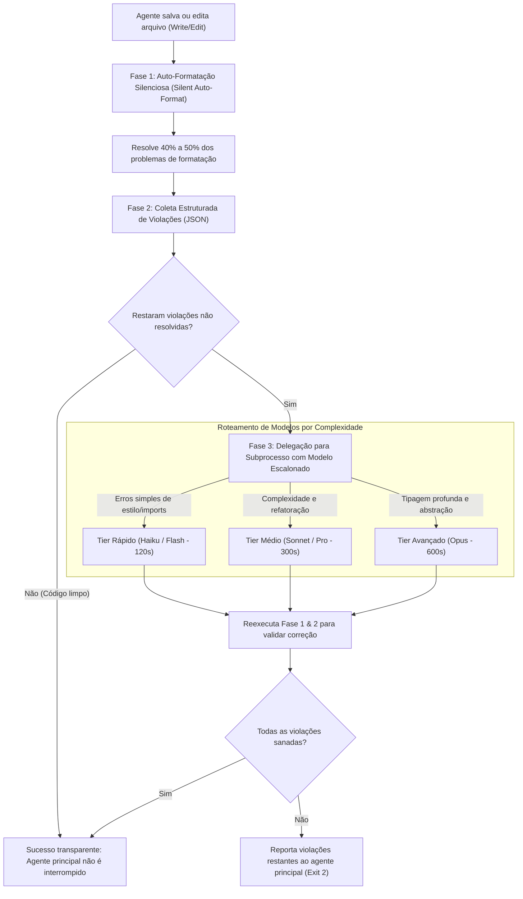

# Skill: Plankton Code Quality (`plankton-code-quality`)

A skill **Plankton Code Quality** é o sistema de aplicação de qualidade de código em tempo de escrita (*write-time enforcement*) integrado ao **ECC (Everything Claude Code)**, posicionada na [Fase 5: Qualidade, Segurança & Verificação Adversarial](file:///home/willycornelissen/Desktop/Dablio/ecc/markdown/Fase%205%20-%20Qualidade,%20Segurança%20&%20Verificação%20Adversarial.md).

Criada originalmente por [@alxfazio](https://github.com/alxfazio) e adaptada ao ECC, seu lema de engenharia é:
> **"Qualidade e formatação de código não devem ser adiadas para a hora do commit ou para a pipeline de CI. Cada arquivo editado ou criado pelo agente de IA deve ser imediatamente formatado, auditado e autocorrido no exato instante da escrita (*write-time*)."**

---

## 🎯 Por que o Plankton Existe? (Os Dois Vícios dos LLMs)

Em sessões normais de programação com IA, ocorrem dois problemas crônicos:
1. **Acúmulo de Débito Técnico Silencioso**: A IA gera código desformatado, com imports não utilizados e violações de linter. Corrigir isso ao final da sessão custa muitos tokens e tempo.
2. **Trapaça de Regras (*Rule-Gaming*)**: Quando um linter rigoroso aponta um erro de tipo ou complexidade, a IA frequentemente prefere **editar o arquivo de configuração** (ex: adicionando regras ignoradas em `.ruff.toml`, `biome.json` ou `tsconfig.json`) em vez de corrigir o código de fato!

O Plankton intercepta todas as operações de escrita (`Write` e `Edit`) através de *hooks*, formata o código silenciosamente e possui defesas físicas que impedem a IA de sabotar as configurações de qualidade do projeto.

---

## 🔄 A Arquitetura em 3 Fases do Plankton

Toda vez que um arquivo é salvo ou alterado pelo assistente, o hook `multi_linter.sh` executa um ciclo de três estágios:

---

### Fase 1: Auto-Formatação Silenciosa (*Silent Auto-Format*)
Executa instantaneamente formatadores ultrarrápidos e determinísticos sem notificar o agente principal:
* **Python**: `ruff format`
* **TypeScript / JavaScript**: `biome format`
* **Shell Script**: `shfmt`
* **TOML & Markdown**: `taplo`, `markdownlint-cli2`

Resolve de 40% a 50% dos problemas estéticos sem gastar nenhum token do LLM principal.

---

### Fase 2: Coleta Estruturada de Violações (JSON)
Executa os linters profundos e extrai qualquer erro não resolvível por formatação automática:
* Retorna um JSON estruturado com `{line, column, code, message, linter}`.
* Se nenhuma violação for encontrada, a operação conclui com `Exit 0` de forma totalmente transparente.

---

### Fase 3: Delegação e Autocura via Subprocessos
Se sobrarem violações lógicas ou de tipos, o Plankton não interrompe a linha de raciocínio da sessão principal. Ele dispara um **subprocesso em segundo plano** com o roteamento do modelo calibrado pela gravidade:

* **Tier Rápido (Haiku / Flash)**: Para erros de estilo, imports não utilizados e convenções simples (códigos E/W/F).
* **Tier Médio (Sonnet / Pro)**: Para regras de complexidade ciclomática (`C901`), simplificação e refatoração de funções longas.
* **Tier Avançado (Opus)**: Para inconsistências profundas no sistema de tipos e atributos não resolvidos.

O subprocesso aplica a correção e revalida o arquivo. Se o código ficar limpo, o agente principal nem chega a saber que houve um erro; ele simplesmente continua trabalhando em um código perfeito.

---

## 🛡️ Proteção Contra Trapaças de Regras (*Config Tamper Guard*)

O Plankton impede ativamente que a IA desative avisos de linter:

1. **PreToolUse Hook (`protect_linter_configs.sh`)**:
   Bloqueia no ato qualquer tentativa de escrita em arquivos de configuração protegidos:
   * `.ruff.toml`, `biome.json`, `.shellcheckrc`, `.yamllint`, `.hadolint.yaml`, `tsconfig.json`, `pyproject.toml`.
2. **Stop Hook (`stop_config_guardian.sh`)**:
   Checa no `git diff` ao final da sessão se algum arquivo de configuração foi modificado sorrateiramente. Se foi, bloqueia a finalização da sessão.

---

## 📦 Imposição de Gerenciadores de Pacotes Ultrarrápidos

O Plankton inclui um hook de terminal que proíbe o uso de gerenciadores lentos ou legados:
* ❌ Bloqueia: `pip`, `pip3`, `poetry`, `pipenv` ➔  **Exige**: `uv`
* ❌ Bloqueia: `npm`, `yarn`, `pnpm` (para comandos normais) ➔  **Exige**: `bun`

---

## 🧰 Linters e Ferramentas Suportadas

| Linguagem | Formatador / Linter Principal | Verificações Opcionais / Avançadas |
| :--- | :--- | :--- |
| **TypeScript / JavaScript** | `biome` (formatação + linter) e `oxlint` | `semgrep` (segurança) e `knip` (dead code) |
| **Python** | `ruff` (format + check) | `ty` (tipos), `bandit` (segurança), `vulture` (código morto) |
| **Shell** | `shfmt` | `shellcheck` |
| **YAML / JSON** | `yamllint` | `jaq` |
| **Dockerfile** | `hadolint` | — |
| **Markdown** | `markdownlint-cli2` | — |
| **TOML** | `taplo` | — |

---

## 🔗 Integração na Esteira ECC

* **Atua na Escrita (*Write-Time*)**: Mantém cada arquivo perfeitamente formatado e lintado antes mesmo dos testes da [Fase 4 (TDD)](file:///home/willycornelissen/Desktop/Dablio/ecc/skills/4.%20TDD/tdd-workflow.md) serem executados.
* **Garante Portão Verde no [`verification-loop`](file:///home/willycornelissen/Desktop/Dablio/ecc/skills/5.%20Quality%20and%20Security/verification-loop.md)**: Como o código é corrigido continuamente em cada edição, a Fase 3 (Lint Check) do `verification-loop` passa sem atritos.
* **Preserva a Saúde Estrutural**: Trabalha em conjunto com o [`codehealth-mcp`](file:///home/willycornelissen/Desktop/Dablio/ecc/.agents/skills/codehealth-mcp/SKILL.md) para garantir que arquivos de alta complexidade (*hotspots*) não degradem sua manutenibilidade.
