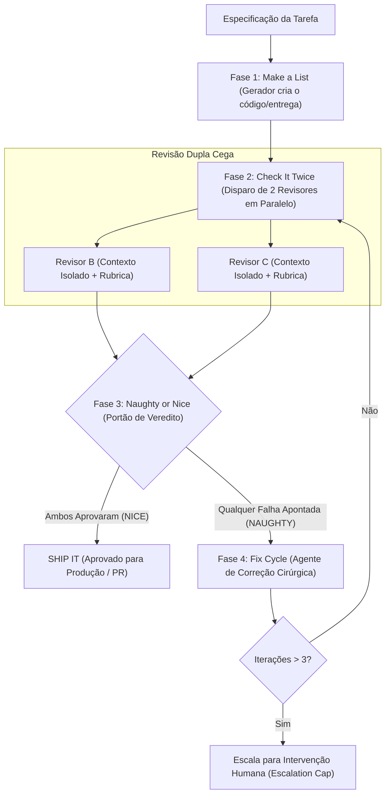

# Skill: Santa Method (`santa-method`)

O **Santa Method** é o framework de **verificação adversarial multi-agente** (*Multi-agent adversarial verification*) do ecossistema **ECC (Enterprise Custom Configuration)**, posicionado na [Fase 5: Qualidade, Segurança & Verificação Adversarial](file:///home/willycornelissen/Desktop/Dablio/ecc/markdown/Fase%205%20-%20Qualidade,%20Segurança%20&%20Verificação%20Adversarial.md).

Criado originalmente por Ronald Skelton (fundador da RapportScore.ai), seu lema inspirador é:
> **"Make a list, check it twice. If it's naughty, fix it until it's nice."** (*Faça uma lista, confira duas vezes. Se estiver com defeito, corrija até ficar perfeito*).

---

## 🎯 Por que o Santa Method Existe?

Quando um único agente de IA revisa o próprio trabalho (ou quando um único revisor faz a inspeção), ele frequentemente compartilha **as mesmas premissas invisíveis, pontos cegos e vieses cognitivos** que causaram o erro em primeiro lugar.

O Santa Method quebra essa armadilha utilizando **dois revisores concorrentes e independentes**, disparados em paralelo com **contexto totalmente limpo e isolado**:
- Nenhum revisor tem acesso ao julgamento do outro.
- Ambos operam sobre a mesma especificação e a mesma rubrica rígida de avaliação.
- Para o código ser aprovado para produção, **ambos devem aprovar obrigatoriamente**. Não existe aprovação por média ou tolerância a falhas parciais.

---

## 🔄 A Arquitetura em 4 Fases



---

### Fase 1: Make a List (Geração)
O agente executor gera o código, refatoração ou funcionalidade normalmente. O Santa Method não interfere na escrita; ele atua estritamente como um **portão de inspeção pós-geração**.

---

### Fase 2: Check It Twice (Revisão Dupla e Cega)
O sistema dispara simultaneamente dois subagentes revisores (Revisor B e Revisor C).
Invariantes fundamentais desta etapa:
1. **Isolamento Total de Contexto**: O Revisor B não sabe o que o Revisor C pensou, impedindo o efeito de manada (*anchoring bias*).
2. **Rubrica Idêntica**: Ambos avaliam rigorosamente sob os mesmos critérios de conformidade.
3. **Instrução Adversarial**: O prompt dos revisores é deliberadamente cético:
   > *"Você é um auditor independente de qualidade. Seu trabalho não é aprovar ou ser complacente; seu trabalho é encontrar falhas, omissões e inconsistências."*
4. **Saída Tipada (JSON)**: Retornam veredito binário (`PASS` ou `FAIL`) e a lista de falhas críticas bloqueadoras.

---

### Fase 3: Naughty or Nice (O Portão de Veredito)
A regra de aprovação é estrita e binária:

```python
def santa_verdict(review_b, review_c):
    # Ambos DEVEM aprovar sem ressalvas críticas
    if review_b.verdict == "PASS" and review_c.verdict == "PASS":
        return "NICE"  # Liberado para entrega

    # Se um reprovou, a falha é considerada real
    critical_issues = dedupe(review_b.critical_issues + review_c.critical_issues)
    return "NAUGHTY", critical_issues
```

> **Por que ambos precisam passar?** Se o Revisor B encontrou uma falha de segurança e o Revisor C deixou passar, a falha é real — o Revisor C simplesmente foi vítima do ponto cego que o Santa Method existe para mitigar.

---

### Fase 4: Fix Until Nice (Loop de Convergência)
Quando o veredito é **NAUGHTY**:
1. O relatório unificado de falhas é entregue a um agente de correção (*Fix Agent*).
2. A instrução é cirúrgica: *"Corrija estritamente os problemas apontados. Não refatore partes não solicitadas nem adicione complexidade nova."*
3. O código corrigido é submetido novamente à Fase 2 com **dois novos revisores frescos**, sem memória das rodadas anteriores.
4. **Teto de Segurança (*Escalation Cap*)**: Se após **3 iterações** o código ainda não atingir aprovação mútua (*NICE*), o loop é interrompido e a tarefa é escalada para julgamento de um engenheiro humano.

---

## 📋 A Rubrica de Avaliação (Critérios Objetivos)

A eficácia do método depende da objetividade da rubrica. Critérios subjetivos geram ruído; critérios de engenharia geram convergência rápida:

| Dimensão | Condição de Aprovação (PASS) | Sinal de Reprovação (FAIL) |
| :--- | :--- | :--- |
| **Acurácia Factual** | Todas as asserções e tipos são verificáveis no código. | Métodos inexistentes chamados, bibliotecas fictícias alucinadas. |
| **Completude** | Todos os critérios de aceitação (`AC-xxx`) da Fase 2 foram atendidos. | Casos de borda esquecidos, seções incompletas, regras ignoradas. |
| **Segurança** | Sanitização de dados, ausência de injeção, sem secrets expostos. | Dados brutos interpolados em queries, tokens expostos. |
| **Integridade de Tipos** | Tipagem estrita respeitando o `type-design-analyzer`. | Uso injustificado de `any`, casts forçados ou `@ts-ignore`. |
| **Consistência Interna** | Sem contradições entre diferentes módulos ou arquivos. | O controller espera retorno X mas o service retorna Y. |

---

## 🛡️ Modos de Falha e Mitigações

| Risco Comum | Sintoma | Mitigação no Santa Method |
| :--- | :--- | :--- |
| **Loop Infinito** | Revisores continuam encontrando detalhes menores indefinidamente. | Teto fixo de no máximo 3 iterações (`MAX_ITERATIONS = 3`), escalando para humano em seguida. |
| **Aprovação Preguiçosa (*Rubber Stamping*)** | Revisores aprovam tudo sem ler a fundo. | Prompt estritamente adversarial enfatizando a responsabilidade de caçar defeitos. |
| **Regressão no Fix** | A correção da falha A quebra a funcionalidade B. | Novos revisores a cada rodada com contexto limpo garantem que regressões sejam pegas. |
| **Explosão de Tokens** | Rodar Santa completo em lotes de centenas de arquivos. | Padrão de amostragem estatística (*Batch Sampling* de 15% do lote). |

---

## 🔗 Integração na Esteira ECC

* **Executado após o [`verification-loop`](file:///home/willycornelissen/Desktop/Dablio/ecc/skills/5.%20Quality%20and%20Security/verification-loop.md)**: Primeiro garantem-se os portões determinísticos mecânicos (build, tipos, testes e linter). O Santa Method é acionado para a camada semântica e comportamental.
* **Alimenta o [`delivery-gate`](file:///home/willycornelissen/Desktop/Dablio/ecc/skills/5.%20Quality%20and%20Security/delivery-gate.md)**: A aprovação *NICE* do Santa Method é uma das condições para a liberação da barreira física de entrega.
* **Nutre o Aprendizado Contínuo**: Problemas que exigiram 2 ou 3 rodadas de correção geram lições que são absorvidas pelo sistema de *Instintos* da Fase 8 para não se repetirem no futuro.
