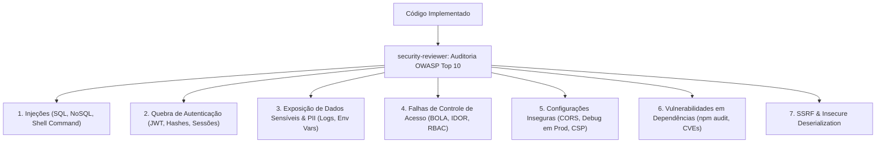

# Skill / Subagente: Security Reviewer (`security-reviewer`)

O **Security Reviewer** é o subagente especialista em detecção e remediação proativa de vulnerabilidades de segurança do **ECC (Enterprise Custom Configuration)**, posicionado estrategicamente na [Fase 5: Qualidade, Segurança & Verificação Adversarial](file:///home/willycornelissen/Desktop/Dablio/ecc/markdown/Fase%205%20-%20Qualidade,%20Segurança%20&%20Verificação%20Adversarial.md).

Seu lema de engenharia é:
> **"Segurança não é um anexo opcional ou um item de backlog para depois do lançamento. Uma única vulnerabilidade em produção pode custar perdas financeiras reais, vazamento de dados de clientes e destruição de reputação. Seja minucioso, seja proativo e seja paranoico."**

---

## 🎯 Por que o Security Reviewer Existe?

Agentes de código e desenvolvedores frequentemente priorizam a funcionalidade imediata (*"fazer o teste passar e o botão funcionar"*), deixando brechas graves de segurança para trás:
- Consultas SQL montadas com concatenação de strings.
- Falta de validação de propriedade de registros (falhas de BOLA/IDOR onde um usuário acessa dados de outro trocando o ID na URL).
- Condições de corrida em saldos e estoques por falta de lock transacional (`SELECT FOR UPDATE`).
- Chaves de API e tokens deixados acidentalmente no código.

O `security-reviewer` atua como um auditor especializado com **mentalidade de atacante (*red-teaming*)**, avaliando cada linha de código alterada antes que ela chegue a staging ou produção.

---

## 🧭 Quando a Skill Deve Ser Acionada

### Gatilhos Mandatórios (*Always Run*):
* Criação ou alteração de **endpoints de API e rotas públicas**.
* Lógica de **autenticação, sessões, JWT, cookies e permissões (RBAC)**.
* Manipulação de **entradas de formulários e uploads de arquivos**.
* Modificação em consultas de **banco de dados, transações ou queries ORM**.
* Código que lida com **pagamentos, carteiras financeiras ou saldos**.
* Integração com **APIs externas e webhooks**.
* Atualização ou adição de novas dependências externas.

---

## 🛡️ Checklist OWASP Top 10 Aplicado pelo Auditor

1. **Injection (Injeção de Código e Dados)**:
   - Todas as queries SQL são parametrizadas?
   - Chamadas de sistema utilizam `execFile` com argumentos separados em vez de shells interpoladas?
2. **Broken Authentication (Quebra de Autenticação)**:
   - Senhas são armazenadas com algoritmos lentos e resistentes a GPU (`bcrypt` com salt ou `argon2id`)? Nunca MD5 ou SHA256 puro!
   - Comparação de senhas usa `timingSafeEqual` para prevenir ataques de temporização (*timing attacks*)?
3. **Sensitive Data Exposure (Exposição de Dados Sensíveis)**:
   - Headers HTTPS, HSTS e cookies `Secure; HttpOnly; SameSite=Lax` estão configurados?
   - Campos de PII (CPF, senhas, dados bancários) são mascarados nos logs da aplicação?
4. **Broken Access Control (BOLA / IDOR)**:
   - Todas as rotas verificam se o usuário autenticado é o dono do registro (`where: { id, userId: session.userId }`)?
5. **Security Misconfiguration (Configurações Inseguras)**:
   - Modo de depuração (*debug mode*) está desabilitado em produção?
   - Configurações de CORS restringem estritamente as origens permitidas?
6. **Cross-Site Scripting (XSS)**:
   - O frontend evita `dangerouslySetInnerHTML` ou `innerHTML` sem sanitização via `DOMPurify`?
7. **SSRF (Server-Side Request Forgery)**:
   - Requisições `fetch()` disparadas para URLs fornecidas pelo usuário passam por uma lista branca estrita de domínios autorizados?

---

## 🚫 Tabela de Padrões Críticos e Correções Imediatas

| Padrão Perigoso Encontrado | Severidade | Correção Obrigatória |
| :--- | :---: | :--- |
| **Segredo hardcoded no código** | `CRITICAL` | Mover para variável de ambiente (`process.env`) e rotacionar a chave exposta. |
| **Comando shell com entrada de usuário** (`exec(cmd + input)`) | `CRITICAL` | Usar APIs tipadas e seguras (`execFile(cmd, [input])`). |
| **SQL concatenado via string** | `CRITICAL` | Consultas preparadas / queries parametrizadas (`$1, $2` ou ORM seguro). |
| **`innerHTML = userInput`** | `HIGH` | Usar `textContent` ou biblioteca de sanitização (`DOMPurify.sanitize`). |
| **`fetch(userProvidedUrl)`** | `HIGH` | Lista branca de domínios permitidos para bloquear chamadas à rede interna (AWS metadata, 127.0.0.1). |
| **Comparação de senha em texto plano** | `CRITICAL` | Usar `bcrypt.compare(password, hash)`. |
| **Rota de API sem verificação de auth** | `CRITICAL` | Adicionar middleware de autenticação e autorização na rota. |
| **Checagem de saldo sem lock pessimista** | `CRITICAL` | Utilizar `SELECT ... FOR UPDATE` dentro de transação atômica contra race conditions. |
| **Ausência de Rate Limiting em rotas sensíveis** | `HIGH` | Configurar middleware de limite de taxa (ex: login, redefinição de senha). |
| **Log de senhas, cartões ou tokens** | `MEDIUM` | Sanitizar e mascarar payloads antes de enviá-los para ferramentas de log. |

---

## 🔍 Diferenciação de Falsos Positivos

O `security-reviewer` é treinado para não gerar alarmes falsos desnecessários que atrasem o time:
* **Não é vulnerabilidade**: Variáveis de exemplo em arquivos `.env.example` (são apenas templates).
* **Não é vulnerabilidade**: Credenciais fictícias em suítes de teste (ex: `user_test_123` em mocks claramente rotulados).
* **Não é vulnerabilidade**: Chaves públicas de serviços que foram desenhadas para serem expostas (ex: `NEXT_PUBLIC_STRIPE_KEY` ou chaves de analytics).
* **Não é vulnerabilidade**: Uso de SHA-256 para gerar checksum de integridade de arquivos (e não para senhas).

---

## 🚨 Protocolo de Resposta a Emergências (Vulnerabilidade Crítica)

Se o `security-reviewer` encontrar uma falha de severidade `CRITICAL`:
1. **Documenta a Evidência**: Registra o ponto exato do código, o vetor de ataque (*Proof of Concept*) e o impacto potencial.
2. **Alerta Imediato**: Sinaliza como bloqueador absoluto na esteira.
3. **Fornece o Código Seguro**: Entrega o diff corrigido com a implementação protegida.
4. **Verifica a Remediação**: Reexecuta a auditoria para comprovar que a vulnerabilidade foi sanada sem quebrar as regras de negócio.
5. **Rotaciona Credenciais**: Se uma chave real foi commitada, instrui a invalidação e troca imediata do segredo no provedor.

---

## 🔗 Integração na Esteira ECC

* **Atua em conjunto com o [`verification-loop`](file:///home/willycornelissen/Desktop/Dablio/ecc/skills/5.%20Quality%20and%20Security/verification-loop.md)**: O loop mecânico faz o grep estático inicial; o `security-reviewer` realiza a análise profunda de fluxo de dados.
* **Alimenta o [`santa-method`](file:///home/willycornelissen/Desktop/Dablio/ecc/skills/5.%20Quality%20and%20Security/santa-method.md)**: Seus apontamentos compõem a rubrica de segurança dos dois revisores independentes.
* **Garante a liberação do [`delivery-gate`](file:///home/willycornelissen/Desktop/Dablio/ecc/skills/5.%20Quality%20and%20Security/delivery-gate.md)**: Nenhuma sessão é concluída com pendências de severidade `CRITICAL` ou `HIGH`.
