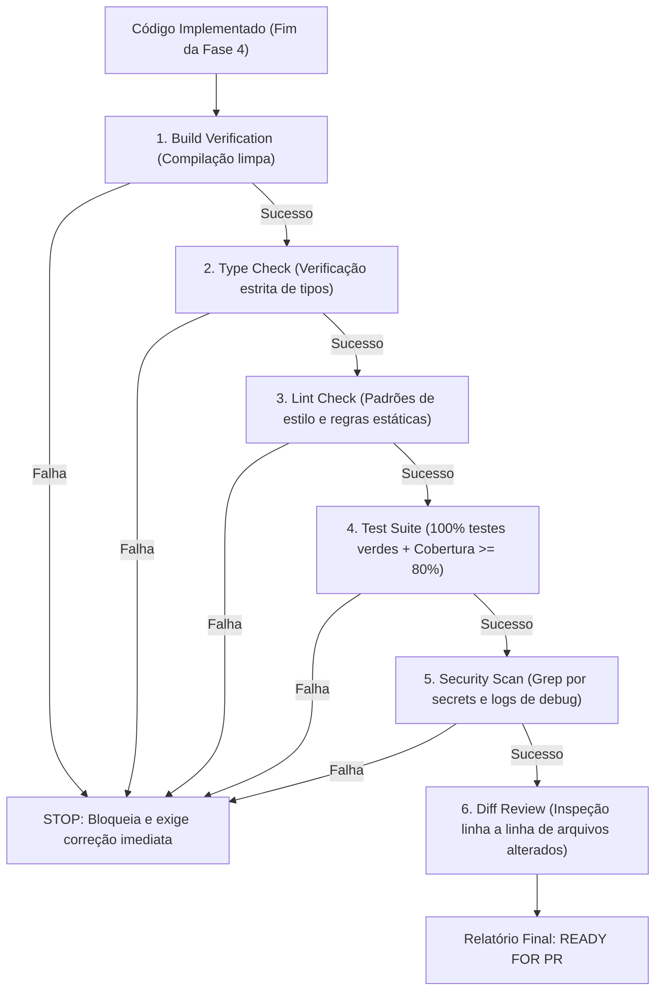

# Skill: Verification Loop (`verification-loop`)

A skill **Verification Loop** é o sistema de auditoria mecânica e verificação determinística do **ECC (Everything Claude Code)**, posicionada como o primeiro e mais rigoroso filtro da [Fase 5: Qualidade, Segurança & Verificação Adversarial](file:///home/willycornelissen/Desktop/Dablio/ecc/markdown/Fase%205%20-%20Qualidade,%20Segurança%20&%20Verificação%20Adversarial.md).

Seu lema de engenharia é:
> **"Nenhum código avança para Pull Request ou produção baseado em suposições ou opiniões subjetivas. Cada entrega é submetida a uma bateria sequencial de 6 portões mecânicos fechados, executados diretamente pelos compiladores e ferramentas do projeto."**

---

## 🎯 Por que o Verification Loop Existe?

Em sessões de desenvolvimento com agentes de IA, é comum o assistente declarar: *"Implementação concluída com sucesso!"*, quando na verdade:
- O código quebra ao rodar `build` em modo de produção.
- Erros de tipo foram mascarados com `@ts-ignore` ou `any`.
- Logs de depuração (`console.log`, `debugger`) e segredos de teste foram deixados no código.
- Arquivos não relacionados foram modificados acidentalmente (*diff pollution*).

O `verification-loop` elimina esse problema executando comandos determinísticos de terminal onde qualquer saída diferente de zero interrompe o fluxo imediatamente (*Fail-Fast*).

---

## 🛡️ Os 6 Portões Mecânicos de Verificação



---

### Fase 1: Build Verification (Compilação de Produção)
Testa se o empacotador e o compilador conseguem gerar os binários ou bundles finais sem warnings que quebrem em ambiente real:
```bash
npm run build 2>&1 | tail -20
# ou pnpm build / cargo build --release / go build ./...
```
> [!IMPORTANT]
> Se o build falhar, a esteira é **interrompida imediatamente**. Nenhuma outra fase é executada até que o build esteja 100% verde.

---

### Fase 2: Type Check (Verificação Estrita de Tipos)
Verifica o sistema de tipos sem emitir arquivos (`--noEmit`), assegurando que a integridade garantida na Fase 2 ([`type-design-analyzer`](file:///home/willycornelissen/Desktop/Dablio/ecc/skills/3.%20SDD/type-design-analyzer.md)) foi preservada:
```bash
set -o pipefail
# TypeScript:
npx --no-install tsc --noEmit 2>&1 | head -30

# Python:
pyright . 2>&1 | head -30
```
* Não tolera casts forçados não justificados ou supressões de erro.

---

### Fase 3: Lint Check (Regras Estáticas e Formatação)
Garante conformidade com o guia de estilo e regras anti-padrão do projeto:
```bash
# JavaScript / TypeScript:
npm run lint 2>&1 | head -30

# Python:
ruff check . 2>&1 | head -30
```

---

### Fase 4: Test Suite (Execução dos Testes com Cobertura)
Roda a suíte completa de testes unitários e de integração validando a meta inegociável de cobertura:
```bash
npm run test -- --coverage 2>&1 | tail -50
```
* **Critério de Aprovação**: 100% dos testes passando e **Cobertura mínima >= 80%**.

---

### Fase 5: Security Scan (Grep por Segredos e Comandos Residuais)
Varredura estática de segurança por padrões conhecidos de credenciais vazadas e resíduos de depuração:
```bash
# Caça chaves de API e tokens expostos:
grep -rn "sk-" --include="*.ts" --include="*.js" . 2>/dev/null | head -10
grep -rn "api_key" --include="*.ts" --include="*.js" . 2>/dev/null | head -10

# Caça resíduos de debug que poluem logs de produção:
grep -rn "console.log" --include="*.ts" --include="*.tsx" src/ 2>/dev/null | head -10
grep -rn "debugger" --include="*.ts" --include="*.tsx" src/ 2>/dev/null | head -10
```

---

### Fase 6: Diff Review (Inspeção de Alterações)
Auditoria visual linha a linha das modificações no Git para prevenir poluição do repositório:
```bash
git diff --stat
git diff HEAD~1 --name-only
```
O revisor verifica se:
1. Arquivos fora do plano foram tocados acidentalmente.
2. Há dependências novas adicionadas sem necessidade.
3. Tratamento de exceções e blocos de erro estão presentes nos novos fluxos.

---

## 📋 Formato do Relatório de Verificação (*Verification Report*)

Ao término das seis etapas, o `verification-loop` emite o veredito formal:

```text
VERIFICATION REPORT
==================

Build:     [PASS]
Types:     [PASS] (0 errors)
Lint:      [PASS] (0 warnings)
Tests:     [PASS] (42/42 passed, 86.4% coverage)
Security:  [PASS] (0 secrets / 0 residual logs)
Diff:      [3 files changed, +145 / -12 lines]

Overall:   [READY FOR PR]
```

Se houver qualquer reprovação, o status muda para `[NOT READY]` com a lista pontual dos itens bloqueadores a serem corrigidos antes de prosseguir.

---

## 🔄 Modo Contínuo (*Continuous Mode*)

Em sessões de engenharia longas, o ECC recomenda executar a verificação periodicamente (a cada 15 a 20 minutos ou após cada função/componente concluído):

```text
Mental Checkpoint:
- Terminou uma função de domínio? ➔ Executa /verify
- Terminou um componente de interface? ➔ Executa /verify
- Antes de iniciar a próxima tarefa do plano? ➔ Executa /verify
```

---

## 🔗 Integração na Esteira ECC

* **Consome da [Fase 4 (TDD)](file:///home/willycornelissen/Desktop/Dablio/ecc/skills/4.%20TDD/tdd-workflow.md)**: Valida a suíte de testes e o código implementado.
* **Pré-requisito do [`delivery-gate`](file:///home/willycornelissen/Desktop/Dablio/ecc/.agents/skills/delivery-gate/SKILL.md)**: A barreira física de conclusão só autoriza o término da sessão se o `verification-loop` emitir o status `PASS`.
* **Fundamentação para o [`santa-method`](file:///home/willycornelissen/Desktop/Dablio/ecc/.agents/skills/santa-method/SKILL.md)**: Os revisores adversariais da Fase 5 só entram em ação após os 6 portões mecânicos estarem totalmente aprovados.
* **Prepara a [Fase 7 (Pull Request)](file:///home/willycornelissen/Desktop/Dablio/ecc/markdown/Fase%207%20-%20Publicação,%20Pull%20Request%20&%20Produção.md)**: Garante que o PR chegue ao CI/CD com risco praticamente nulo de falha de build ou regressão de tipos.
