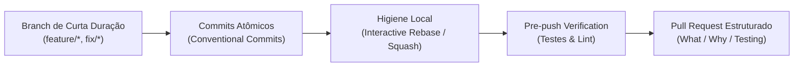
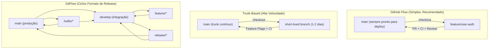
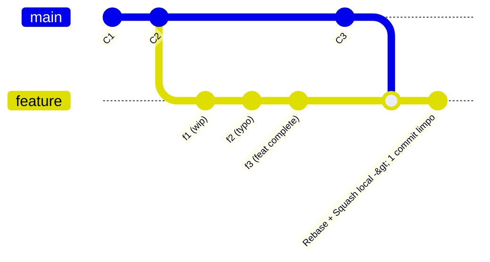

# Git Workflow: Padrões de Versionamento, Higiene e Estratégias de Branching

A skill **`git-workflow`** do ECC (*Everything Claude Code*) estabelece os padrões e as melhores práticas para controle de versão com Git em equipes de engenharia de software e fluxos de trabalho assistidos por IA. 

O foco central desta skill é garantir **rastreabilidade, previsibilidade e higiene do histórico**, cobrindo a escolha da estratégia de ramificação ideal (GitHub Flow, Trunk-Based ou GitFlow), a padronização semântica de commits (*Conventional Commits*), a limpeza do histórico local antes da submissão (*interactive rebase*), a resolução técnica e segura de conflitos e a preparação estruturada de Pull Requests.

---

## 1. Visão Geral e Princípios Fundamentais

No ecossistema do ECC, código gerado ou refatorado por agentes e desenvolvedores humanos deve ser entregue seguindo padrões rígidos de versionamento. Commits caóticos, branches de vida excessivamente longa e mensagens opacas geram atrito desnecessário na revisão e inviabilizam auditorias ou *bisects* no futuro.



### Princípios-Chave:
1. **Histórico Linear e Legível**: Antes de abrir um Pull Request, a ramificação local deve ser sincronizada e limpa para que cada commit conte uma parte compreensível da história.
2. **Atomicidade nos Commits**: Um commit deve fazer apenas uma coisa bem feita. Misturar refatoração de arquitetura com correção de bug pontual é expressamente evitado.
3. **Não Reescrever Histórico Público**: Regra de ouro: jamais faça `git rebase` ou `push --force` em branches compartilhadas (`main`, `develop`, ou branches públicas de release).
4. **Pull Requests Focados (< 500 linhas)**: PRs gigantescos reduzem drasticamente a qualidade da revisão técnica e aumentam a taxa de regressões silenciosas.

---

## 2. Estratégias de Ramificação (*Branching Strategies*)

A skill orienta a escolha do modelo de branches de acordo com o tamanho do time, velocidade de entrega e maturidade do pipeline de CI/CD:



### Matriz de Decisão:

| Estratégia | Tamanho do Time | Cadência de Release | Melhor Para |
| :--- | :--- | :--- | :--- |
| **GitHub Flow** | Qualquer tamanho | Contínua (várias vezes/semana) | SaaS, aplicações web modernas, startups e projetos ECC padrão. |
| **Trunk-Based** | 5+ seniors experientes | Múltiplas vezes ao dia | Equipes com forte automação de testes, CI/CD veloz e Feature Flags. |
| **GitFlow** | 10+ desenvolvedores | Agendada / Sprints formais | Softwares embarcados, sistemas regulados e produtos de ciclo fechado. |

---

## 3. Padronização de Commits (*Conventional Commits*)

A convenção adotada segue a especificação internacional do *Conventional Commits*:

$$\text{<tipo>(<escopo>): <descrição no imperativo>}$$

### Tipos Canônicos:

* `feat`: Adiciona uma nova funcionalidade ao sistema (e.g., `feat(auth): add OAuth2 login via Google`).
* `fix`: Corrige um bug ou comportamento incorreto (e.g., `fix(api): handle null response on customer endpoint`).
* `refactor`: Mudança de código que não altera comportamento nem adiciona funcionalidade (e.g., `refactor(db): extract pool connection into dedicated module`).
* `test`: Adiciona ou corrige testes automatizados (e.g., `test(auth): add unit tests for JWT validation`).
* `docs`: Alterações exclusivas na documentação (e.g., `docs(readme): add installation guide for docker`).
* `style`: Ajustes puramente estéticos ou de formatação que não alteram a execução (e.g., `style: fix whitespace in header`).
* `perf`: Mudança voltada exclusivamente à melhoria de performance (e.g., `perf(query): add index to users.email column`).
* `chore`: Manutenção de dependências, tarefas de build ou tooling interno (e.g., `chore(deps): bump typescript from 5.4 to 5.5`).
* `ci`: Alterações nos arquivos e scripts de CI/CD (e.g., `ci: configure GitHub Actions test runner`).
* `revert`: Reversão de um commit prévio (e.g., `revert: revert "feat(auth): add OAuth2 login"`).

### Comparativo de Mensagens:

```bash
# ❌ RUIM: Vago, genérico, sem contexto
git commit -m "ajustes"
git commit -m "fix bug"
git commit -m "WIP"

# ✅ BOM: Claro, atômico, explica o motivo da alteração
git commit -m "fix(api): retry requests on 503 Service Unavailable

The external billing API occasionally returns 503 during peak hours.
Added exponential backoff retry logic with max 3 attempts.

Closes #142"
```

---

## 4. Higiene Local: Rebase vs. Merge

Manter o histórico limpo e compreensível é um diferencial crucial antes da abertura de Pull Requests.



### Quando Usar Cada Abordagem:

1. **`git rebase origin/main` (Histórico Linear)**:
   * **Quando usar**: Na sua branch de trabalho local, antes de abrir ou publicar o Pull Request. Sincroniza o trabalho mais recente da `main` colocando as suas alterações no topo da pilha, sem criar "merge commits" ruidosos.
   * **Fluxo de Sincronização**:
     ```bash
     git checkout feature/user-auth
     git fetch origin
     git rebase origin/main
     ```
2. **`git merge` (Preserva Histórico Exato)**:
   * **Quando usar**: Ao mesclar uma branch finalizada na `main`, ou quando múltiplos colaboradores estão utilizando ativamente a mesma branch remota.
3. **Squash de Commits Intermediários**:
   * Use o rebase interativo (`git rebase -i HEAD~N`) para agrupar commits como *"ajuste"*, *"teste"*, *"arrumando typo"* em uma única unidade atômica antes de enviar para revisão.

> [!WARNING] Regra Absoluta do Rebase
> **NUNCA** faça rebase em branches compartilhadas que já foram submetidas ao repositório central e nas quais outros desenvolvedores basearam seu trabalho. O rebase reescreve hashes SHA, o que causa divergências graves em branches públicas.

---

## 5. Resolução Estruturada de Conflitos

Conflitos de merge ocorrem quando duas branches alteram o mesmo trecho de um arquivo. A skill detalha o protocolo seguro para identificar e dirimir divergências:

```bash
# 1. Identificar conflito durante o rebase
git rebase origin/main
# CONFLICT (content): Merge conflict in src/auth/service.ts

# 2. Inspecionar status
git status

# 3. Analisar marcadores no código:
# <<<<<<< HEAD (código atual da branch alvo - origin/main)
# const sessionTimeout = 3600;
# =======
# const sessionTimeout = 7200;
# >>>>>>> feature/user-auth (sua alteração)

# 4. Resolver manualmente no editor, mantendo a lógica correta.
# Ou selecionar conscientemente a versão de um dos lados:
git checkout --ours src/auth/service.ts     # Mantém a versão da branch de destino
git checkout --theirs src/auth/service.ts   # Mantém a versão da sua feature

# 5. Adicionar arquivo resolvido e prosseguir
git add src/auth/service.ts
git rebase --continue
```

### Dicas de Prevenção:
* Mantenha branches de curta duração (menos de 2 a 3 dias de vida útil).
* Faça rebase contra a `main` diariamente.
* Comunique alterações em módulos centrais e arquivos compartilhados.

---

## 6. Padrão de Pull Request (PR) e Checklist

O Pull Request formaliza a entrega e aciona os revisores humanos e agentes de IA:

### Formato de Título:
$$\text{<tipo>(<escopo>): <descrição resumida>}$$
*Exemplo:* `feat(billing): integrate stripe webhooks for invoice settlements`

### Template Padrão do PR:
```markdown
## What
Breve resumo do que este PR implementa ou corrige.

## Why
Motivação técnica ou de negócio. Contexto do problema.

## How
Decisões de implementação relevantes e arquitetura adotada.

## Testing
- [ ] Testes unitários adicionados/atualizados
- [ ] Testes de integração cobrindo fluxos felizes e de erro
- [ ] Testes manuais/E2E validados localmente

## Screenshots / Evidências (quando aplicável)
Evidências visuais de telas ou logs de execução.

## Checklist
- [ ] Código segue as convenções e estilo do projeto
- [ ] Auto-revisão (self-review) concluída antes do pedido de revisão
- [ ] Sem novos avisos ou erros de tipagem/linter
- [ ] Histórico de commits limpo e atômico
- [ ] Issues relacionadas vinculadas (e.g., Closes #42)
```

---

## 7. Gerenciamento de Versões (*Semantic Versioning*)

A skill orienta a utilização de **SemVer** (`MAJOR.MINOR.PATCH`):

* **`MAJOR`** (e.g., `1.0.0` $\rightarrow$ `2.0.0`): Quebras de compatibilidade na API pública (*Breaking Changes*).
* **`MINOR`** (e.g., `1.0.0` $\rightarrow$ `1.1.0`): Adição de novas funcionalidades de forma retrocompatível.
* **`PATCH`** (e.g., `1.0.0` $\rightarrow$ `1.0.1`): Correções de bugs sem afetar a assinatura da API.

### Criação de Tags Anotadas de Release:
```bash
git tag -a v1.2.0 -m "Release v1.2.0

Features:
- Implement OAuth2 login flow
- Add automated billing webhook processing

Fixes:
- Handle timeout in external payment gateway"

git push origin v1.2.0
```

---

## 8. Anti-Padrões a Evitar

1. **Commitar Diretamente na `main`**: A branch principal deve ser protegida por regras de repositório (*Branch Protection Rules*), exigindo aprovação e testes verdes de CI.
2. **Commitar Segredos ou `.env`**: Chaves de API, senhas ou certificados nunca devem ser adicionados ao índice do Git. Use `.gitignore` e ferramentas de detecção de segredos.
3. **PRs Gigantescos (> 1000 linhas)**: PRs massivos geram revisões superficiais e mascaram bugs graves. Divida o trabalho em PRs incrementais.
4. **Mensagens de Commit Opacas**: Mensagens como *"wip"*, *"fixes"*, *"updates"* impossibilitam identificar o propósito da alteração no futuro.
5. **Forçar Push Destrutivo (`git push --force`)**: Prefira sempre `git push --force-with-lease`, que garante que você não sobrescreverá alterações enviadas por outros colaboradores sem seu conhecimento.

---

## 9. Integração com a Esteira ECC

A skill `git-workflow` opera na **Fase 7 (PR)** da esteira do ECC, servindo como a base de versionamento que suporta:

1. **Workflow `/pr`**: Prepara a branch, realiza o self-review e gera a descrição do PR automaticamente com base no histórico de commits limpo.
2. **Skill `production-audit`**: Antes de abrir o PR ou mesclar na `main`, a auditoria de prontidão para produção verifica se a branch introduz riscos em produção.
3. **Hooks de Pre-Commit e Pre-Push**: Automações que bloqueiam a submissão de código que falhe em testes, contenha `console.log` esquecidos ou introduza credenciais no histórico.

---

## 10. Referências Internas

* Código-fonte da skill: [`.agents/skills/git-workflow/SKILL.md`](file:///home/willycornelissen/Desktop/Dablio/ecc/.agents/skills/git-workflow/SKILL.md)
* Documento na esteira: [`skills/7. PR/git-workflow.md`](file:///home/willycornelissen/Desktop/Dablio/ecc/skills/7.%20PR/git-workflow.md)
* Auditoria pré-PR: [`skills/7. PR/production-audit.md`](file:///home/willycornelissen/Desktop/Dablio/ecc/skills/7.%20PR/production-audit.md)
* Workflow `/pr`: [`.agents/workflows/pr.md`](file:///home/willycornelissen/Desktop/Dablio/ecc/.agents/workflows/pr.md)
