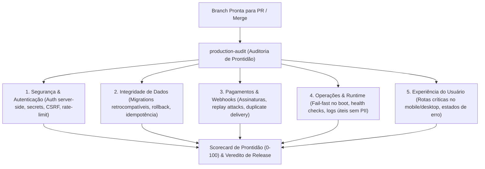

# Skill: Production Audit (`production-audit`)

A skill **Production Audit** é a auditoria preventiva de prontidão operacional do **ECC (Enterprise Custom Configuration)**, posicionada na [Fase 7: Publicação, Pull Request & Produção](file:///home/willycornelissen/Desktop/Dablio/ecc/markdown/Fase%207%20-%20Publicação,%20Pull%20Request%20&%20Produção.md).

Seu lema de engenharia é:
> **"CI verde não é sinônimo de prontidão para produção. O Production Audit responde à pergunta mais crítica antes do merge: 'O que vai quebrar em produção quando os usuários reais começarem a usar?'"**

---

## 🎯 Por que a Skill Existe?

Testes unitários e linters verificam a sintaxe e o comportamento isolado do código. No entanto, a maioria das falhas graves em produção (*outages*) decorre de **pontos cegos operacionais e de infraestrutura**:
- Novas variáveis de ambiente foram introduzidas no código, mas não foram documentadas em `.env.example`, fazendo o contêiner crashar na inicialização (*crash on boot*).
- Webhooks de pagamento (Stripe, Mercado Pago) não possuem tratamento de idempotência, cobrando clientes em duplicidade ou cancelando pedidos em retentativas normais de rede.
- Migrações destrutivas de banco de dados foram adicionadas sem suporte a retrocompatibilidade (*Expand-and-Contract*), derrubando instâncias antigas que ainda estavam atendendo tráfego durante o deploy.
- Chamadas a APIs externas não possuem limites de *timeout*, travando threads do servidor quando um serviço terceiro fica lento.

O `production-audit` inspeciona **evidências locais e reais** do repositório para apontar bloqueadores objetivos antes de qualquer merge ou lançamento público.

---

## 🔒 Princípio de Privacidade: Auditoria Local Baseada em Evidências

O `production-audit` adota estrita disciplina de segurança:
* **Zero Envio de Código para Terceiros**: A auditoria roda 100% localmente. O código-fonte, dados de banco e topologia não são despachados para serviços externos de auditoria sem consentimento explícito.
* **Sem Execução Remota Não Fixada**: Não executa comandos como `npx pacote@latest` que possam introduzir código não auditado.

---

## 🧭 As 5 Lentes de Risco da Auditoria (*Risk Lenses*)



### 1. Segurança e Autenticação
* As rotas públicas, rotas autenticadas e rotas administrativas estão estritamente segregadas?
* A autorização é checada no servidor em todas as mutações e queries sensíveis?
* Nenhum segredo, chave de API ou credencial está exposto no bundle do cliente, nos logs ou em arquivos commitados?
* As superfícies de agentes/IA estão protegidas contra injeção de prompt e abuso de ferramentas?

### 2. Integridade de Dados e Migrações
* As migrations rodam para a frente de forma limpa e possuem script ou plano documentado de reversão (*rollback*)?
* Migrações de schema que removem ou renomeiam colunas adotam o padrão de duas fases (*Expand and Contract*) para não quebrar instâncias simultâneas?
* As gravações em banco e handlers assíncronos são idempotentes contra retentativas?

### 3. Pagamentos e Webhooks
* As assinaturas criptográficas dos webhooks são validadas **antes** de processar qualquer campo do payload?
* Cada webhook de pagamento (ex: `checkout.session.completed`) possui trava de idempotência para evitar entregar o produto duas vezes?
* Replays de requisições de rede e entregas fora de ordem são tratados graciosamente?
* As credenciais de modo teste (*sandbox*) estão estritamente separadas das credenciais de produção?

### 4. Operações e Resiliência
* A aplicação consegue subir a partir de um checkout limpo (`git clone`) usando apenas os comandos documentados no README?
* As variáveis de ambiente obrigatórias possuem validação *fail-fast* no boot (a aplicação recusa subir se faltar uma variável crítica)?
* Existe um endpoint de *health check* que testa a conectividade real com banco de dados e gateways?
* Os logs fornecem contexto diagnóstico suficiente sem vazar dados pessoais (PII) ou senhas?

### 5. Experiência do Usuário Real (UX)
* As jornadas vitais de lançamento foram testadas em dispositivos móveis e desktop?
* Formulários funcionam no celular sem zoom indesejado de inputs ou botões cobertos pelo teclado virtual?
* Estados de carregamento (*loading*), telas vazias (*empty state*), erros de conexão e permissão negada informam claramente ao usuário o que aconteceu?

---

## 📊 Sistema de Pontuação e Tetos Rígidos (*Scoring & Hard Caps*)

O `production-audit` atribui uma nota de 0 a 100 para forçar a priorização das correções:

| Faixa | Pontuação | Significado Operacional |
| :--- | :---: | :--- |
| **Blocked** | `0 - 49` | **Proibido lançar.** Riscos críticos presentes que quebrarão a aplicação. |
| **Risky** | `50 - 69` | **Arriscado.** Lançar apenas em rollout interno muito restrito ou beta fechado. |
| **Launchable with Caveats** | `70 - 84` | **Lançável com ressalvas.** O software pode subir se os donos aceitarem os riscos listados. |
| **Strong** | `85 - 100` | **Sólido.** Sem bloqueadores óbvios com base nas evidências inspecionadas. |

### ⛔ Tetos Rígidos Inegociáveis (*Hard Caps*):
A pontuação é **automaticamente travada em no máximo 69** se qualquer um destes itens for verdadeiro:
1. Autenticação ou autorização ausente em dados sensíveis.
2. Webhooks de pagamento ou atendimento sem idempotência.
3. Migrações de banco que não podem ser executadas com segurança.
4. Segredos expostos em bundles de cliente, logs ou commits.
5. Inexistência de caminho de rollback para um release de alto impacto.

A pontuação é **travada em no máximo 84** se a esteira de CI estiver com falhas ou se a rota crítica não tiver sido testada ponta a ponta.

---

## 📋 Formato de Saída do Relatório

O relatório abre com uma única frase direta e objetiva, seguida dos pontos de ação:

```markdown
## Production Audit: 68/100 (Risky)
> Veredito: O release é arriscado porque os webhooks do Stripe são validados criptograficamente mas não são idempotentes, e não há nota de rollback para a migração pendente.

### 🛑 Blockers (Correções Obrigatórias antes do Deploy):
- Adicionar chave de idempotência para o evento `checkout.session.completed` antes de liberar compras.
- Escrever e testar o script de rollback para a migração `20260511_add_billing_state.sql`.

### 💡 High-Value Fixes (Para Elevar a Nota):
- Adicionar verificação de saúde no endpoint `/api/health` testando o banco e o gateway de pagamento.
- Adicionar um teste E2E cobrindo o fluxo de upgrade de plano e atualização da página de faturamento.

### 🔍 Evidências Inspecionadas:
- `api/stripe/webhook.ts`
- `db/migrations/20260511_add_billing_state.sql`
- Pipeline do GitHub Actions da branch atual

### 🎯 Próxima Ação:
Deseja que eu implemente a trava de idempotência no webhook do Stripe agora?
```

---

## 🔗 Integração na Esteira ECC

* **Atua na [Fase 7 (PR & Produção)](file:///home/willycornelissen/Desktop/Dablio/ecc/markdown/Fase%207%20-%20Publicação,%20Pull%20Request%20&%20Produção.md)**: É a checagem que precede a abertura do Pull Request pelo workflow [`/pr`](file:///home/willycornelissen/Desktop/Dablio/ecc/.agents/workflows/pr.md).
* **Consome as evidências das Fases Anteriores**:
  - Valida os testes unitários da [Fase 4 (TDD)](file:///home/willycornelissen/Desktop/Dablio/ecc/skills/4.%20TDD/tdd-workflow.md).
  - Cruza dados com a auditoria de segurança da [Fase 5 (`security-reviewer`)](file:///home/willycornelissen/Desktop/Dablio/ecc/skills/5.%20Quality%20and%20Security/security-reviewer.md).
  - Confirma os testes visuais e smoke tests da [Fase 6 (`browser-qa`)](file:///home/willycornelissen/Desktop/Dablio/ecc/skills/5.%20UI/browser-qa.md).
