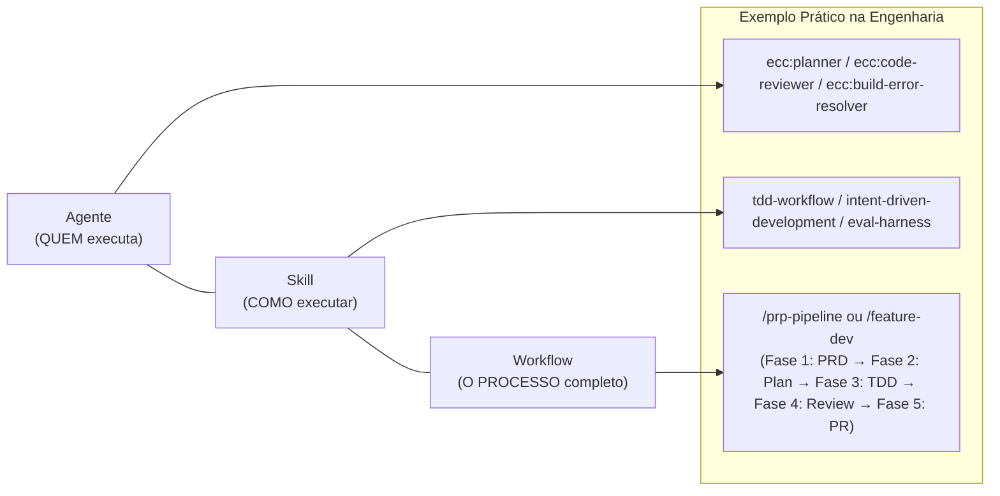

# Guia de Workflows do ECC (Everything Claude Code)

No ecossistema do **ECC (*Everything Claude Code*)**, os **Workflows** são os **roteiros operacionais ponta a ponta (*runbooks* ou pipelines prescritivos)** que dizem ao agente de IA exatamente **qual sequência de passos seguir, quais agentes e ferramentas acionar e qual o critério obrigatório de parada (*stop condition*)**.

Eles residem no repositório em [`.agents/workflows/`](file:///home/willycornelissen/Desktop/Dablio/ecc/.agents/workflows/) e são expostos na interface do usuário primariamente como comandos de barra (*slash commands*).

---

## 1. A Diferença Conceitual: Agente vs. Skill vs. Workflow

A arquitetura do ECC opera com uma clara separação de responsabilidades em três camadas fundamentais:



* **Agente**: É a *persona técnica especializada* com modelo de IA, system prompt e ferramentas estritamente delimitados (e.g., [`planner`](file:///home/willycornelissen/Desktop/Dablio/ecc/.agents/agents/planner.md), [`security-reviewer`](file:///home/willycornelissen/Desktop/Dablio/ecc/.agents/agents/security-reviewer.md)).
* **Skill**: É o *manual de procedimento* de uma técnica ou domínio específico (e.g., [`tdd-workflow`](file:///home/willycornelissen/Desktop/Dablio/ecc/.agents/skills/tdd-workflow/SKILL.md), [`architecture-decision-records`](file:///home/willycornelissen/Desktop/Dablio/ecc/.agents/skills/architecture-decision-records/SKILL.md)).
* **Workflow**: É o *processo orquestrado*. Ele define a linha de montagem determinística, conectando a leitura de arquivos, chamadas de subagentes, execução de testes no terminal e critérios de validação até o commit final.

---

## 2. Para que Servem os Workflows?

1. **Eliminar a Adivinhação e o "Vibe Coding"**:
   Em tarefas complexas, modelos de linguagem tendem a iniciar a escrita de código de forma impulsiva, ignorando arquitetura e testes. Os workflows do ECC forçam a conformidade por meio de fases obrigatórias. Por exemplo, no workflow [`plan.md`](file:///home/willycornelissen/Desktop/Dablio/ecc/.agents/workflows/plan.md), o assistente é **proibido de editar qualquer arquivo** antes de explicitar os riscos, apontar arquivos afetados e obter a confirmação (`CONFIRM`) expressa do operador.

2. **Garantir Critérios de Parada Inegociáveis (*Stop Conditions*)**:
   Workflows impedem que o assistente declare uma tarefa como "concluída" antes que todos os portões de qualidade passem (e.g., testes verdes, ausência de warnings no linter, diff revisado e cobertura mínima de 80%).

3. **Padronizar e Automatizar Tarefas Críticas do Ciclo de Vida**:
   * Abertura automatizada de Pull Requests com análise de commits e templates ([`pr.md`](file:///home/willycornelissen/Desktop/Dablio/ecc/.agents/workflows/pr.md)).
   * Resolução estruturada e reprodução de defeitos ([`orch-fix-defect.md`](file:///home/willycornelissen/Desktop/Dablio/ecc/.agents/workflows/orch-fix-defect.md)).
   * Desenvolvimento de novas funcionalidades completas ([`feature-dev.md`](file:///home/willycornelissen/Desktop/Dablio/ecc/.agents/workflows/feature-dev.md)).
   * Loops adversariais de interface e código ([`gan-build.md`](file:///home/willycornelissen/Desktop/Dablio/ecc/.agents/workflows/gan-build.md) ou [`santa-loop.md`](file:///home/willycornelissen/Desktop/Dablio/ecc/.agents/workflows/santa-loop.md)).

---

## 3. As Principais Famílias de Workflows

O repositório possui quase 100 arquivos de workflows catalogados em [`.agents/workflows/`](file:///home/willycornelissen/Desktop/Dablio/ecc/.agents/workflows/). Eles são organizados em famílias funcionais com base no seu prefixo:

| Família de Workflow | Propósito Central | Sequência e Exemplos Típicos |
| :--- | :--- | :--- |
| **`orch-*`** *(Orquestração de Tarefas)* | Pipelines ponta a ponta que executam Pesquisa, Planejamento, TDD, Revisão e Commit com portões rígidos. | [`orch-build-mvp`](file:///home/willycornelissen/Desktop/Dablio/ecc/.agents/workflows/orch-build-mvp.md), [`orch-add-feature`](file:///home/willycornelissen/Desktop/Dablio/ecc/.agents/workflows/orch-add-feature.md), [`orch-fix-defect`](file:///home/willycornelissen/Desktop/Dablio/ecc/.agents/workflows/orch-fix-defect.md), [`orch-refine-code`](file:///home/willycornelissen/Desktop/Dablio/ecc/.agents/workflows/orch-refine-code.md), [`orch-review`](file:///home/willycornelissen/Desktop/Dablio/ecc/.agents/workflows/orch-review.md). |
| **`prp-*`** *(PRD to PR Pipeline)* | Esteira canônica completa: transforma a dor do usuário em PRD, o PRD em plano técnico, o plano em código com TDD e finaliza no Pull Request. | [`prp-prd`](file:///home/willycornelissen/Desktop/Dablio/ecc/.agents/workflows/prp-prd.md) $\rightarrow$ [`prp-plan`](file:///home/willycornelissen/Desktop/Dablio/ecc/.agents/workflows/prp-plan.md) $\rightarrow$ [`prp-implement`](file:///home/willycornelissen/Desktop/Dablio/ecc/.agents/workflows/prp-implement.md) $\rightarrow$ [`prp-commit`](file:///home/willycornelissen/Desktop/Dablio/ecc/.agents/workflows/prp-commit.md) $\rightarrow$ [`prp-pr`](file:///home/willycornelissen/Desktop/Dablio/ecc/.agents/workflows/prp-pr.md). |
| **`multi-*`** *(Multi-Model Workflows)* | Orquestra múltiplos provedores e modelos de IA (e.g., Claude para planejamento e Codex para execução independente). | [`multi-plan`](file:///home/willycornelissen/Desktop/Dablio/ecc/.agents/workflows/multi-plan.md) $\rightarrow$ [`multi-execute`](file:///home/willycornelissen/Desktop/Dablio/ecc/.agents/workflows/multi-execute.md) $\rightarrow$ [`multi-workflow`](file:///home/willycornelissen/Desktop/Dablio/ecc/.agents/workflows/multi-workflow.md). |
| **`epic-*`** *(Épicos Paralelos)* | Decomposição de grandes demandas corporativas em unidades de trabalho paralelas, rastreadas e sincronizadas. | [`epic-decompose`](file:///home/willycornelissen/Desktop/Dablio/ecc/.agents/workflows/epic-decompose.md) $\rightarrow$ [`epic-claim`](file:///home/willycornelissen/Desktop/Dablio/ecc/.agents/workflows/epic-claim.md) $\rightarrow$ [`epic-validate`](file:///home/willycornelissen/Desktop/Dablio/ecc/.agents/workflows/epic-validate.md) $\rightarrow$ [`epic-review`](file:///home/willycornelissen/Desktop/Dablio/ecc/.agents/workflows/epic-review.md) $\rightarrow$ [`epic-publish`](file:///home/willycornelissen/Desktop/Dablio/ecc/.agents/workflows/epic-publish.md). |
| **`*-build` / `*-test` / `*-review`** | Tríades contínuas especializadas por linguagem e ecossistema tecnológico. | `<stack>-test` (TDD) $\rightarrow$ `<stack>-build` (compilação e tipos) $\rightarrow$ `<stack>-review` (auditoria idiomática). Ex: `go-*`, `react-*`, `python-*`, `rust-*`, `kotlin-*`, `flutter-*`. |
| **`loop-*` & `gan-*`** | Loops autônomos supervisionados com ciclos de feedback adversarial entre agentes geradores e avaliadores. | [`loop-start`](file:///home/willycornelissen/Desktop/Dablio/ecc/.agents/workflows/loop-start.md) $\rightarrow$ [`loop-status`](file:///home/willycornelissen/Desktop/Dablio/ecc/.agents/workflows/loop-status.md); [`gan-build`](file:///home/willycornelissen/Desktop/Dablio/ecc/.agents/workflows/gan-build.md), [`gan-design`](file:///home/willycornelissen/Desktop/Dablio/ecc/.agents/workflows/gan-design.md), [`santa-loop`](file:///home/willycornelissen/Desktop/Dablio/ecc/.agents/workflows/santa-loop.md). |
| **`hookify-*`** | Gestão de guardrails de tempo de execução e interceptação mecânica de ações inseguras. | [`hookify`](file:///home/willycornelissen/Desktop/Dablio/ecc/.agents/workflows/hookify.md), [`hookify-list`](file:///home/willycornelissen/Desktop/Dablio/ecc/.agents/workflows/hookify-list.md), [`hookify-configure`](file:///home/willycornelissen/Desktop/Dablio/ecc/.agents/workflows/hookify-configure.md). |
| **Singletons de Alta Frequência** | Comandos utilitários essenciais que servem como cola e atalhos rápidos do dia a dia. | [`plan`](file:///home/willycornelissen/Desktop/Dablio/ecc/.agents/workflows/plan.md), [`plan-prd`](file:///home/willycornelissen/Desktop/Dablio/ecc/.agents/workflows/plan-prd.md), [`pr`](file:///home/willycornelissen/Desktop/Dablio/ecc/.agents/workflows/pr.md), [`code-review`](file:///home/willycornelissen/Desktop/Dablio/ecc/.agents/workflows/code-review.md), [`checkpoint`](file:///home/willycornelissen/Desktop/Dablio/ecc/.agents/workflows/checkpoint.md), [`save-session`](file:///home/willycornelissen/Desktop/Dablio/ecc/.agents/workflows/save-session.md), [`resume-session`](file:///home/willycornelissen/Desktop/Dablio/ecc/.agents/workflows/resume-session.md). |

---

## 4. Como os Workflows são Invocados?

A invocação de um workflow pode ocorrer por **três mecanismos principais**:

### Modo 1: Via Comandos de Barra (*Slash Commands*) — Método Padrão
Na interface de conversação (Claude Code, Antigravity, Cursor, etc.), você digita o comando precedido de barra (`/`):

* **Planejamento estruturado antes de codificar**:
  ```bash
  /plan "Adicionar autenticação biométrica e login social via Google"
  ```
  *O assistente lê `workflows/plan.md`, investiga a base de código, elenca arquivos e riscos, monta o plano e aguarda seu aceite formal.*

* **Preparação e abertura automatizada de Pull Request**:
  ```bash
  /pr
  ```
  *(Ou especificando a branch de destino: `/pr main`)*
  *O assistente valida se o diretório está limpo, analisa os commits, procura templates em `.github/`, gera o corpo do PR e empurra as alterações.*

* **Auditoria de código e conformidade**:
  ```bash
  /code-review
  ```

* **Criação de snapshot de segurança antes de refatorações críticas**:
  ```bash
  /checkpoint "Antes de migrar o schema do banco para PostgreSQL"
  ```

---

### Modo 2: Por Linguagem Natural ou Instrução Direta
Não é obrigatório memorizar comandos específicos. Basta solicitar a execução do workflow pelo nome ou intenção:

* *"Execute o workflow `feature-dev` para desenvolvermos a tela de checkout."*
* *"Siga as etapas do workflow `orch-fix-defect` para diagnosticar e corrigir o timeout na fila de processamento."*
* *"Rode o pipeline `prp-prd` para gerar o documento de requisitos do novo sistema de notificações."*

O agente orquestrador identifica a referência, carrega as instruções do arquivo markdown em [`.agents/workflows/`](file:///home/willycornelissen/Desktop/Dablio/ecc/.agents/workflows/) e cumpre rigorosamente cada uma das suas etapas.

---

### Modo 3: Descoberta Guiada de Receitas (`/ecc-recipes`)
Quando você tem um objetivo complexo mas não sabe qual combinação de workflows e comandos encadear, o ECC disponibiliza o motor de receitas consultivo:

```bash
/ecc-recipes "Quero planejar um app completo e construí-lo com testes e verificação adversarial"
```
ou em linguagem natural:
```text
"Qual a melhor sequência de workflows para corrigir um bug na minha API Go?"
```

A skill [`ecc-recipes`](file:///home/willycornelissen/Desktop/Dablio/ecc/.agents/skills/ecc-recipes/SKILL.md) consulta em tempo real o catálogo de workflows e devolve:
1. **A melhor família correspondente** (e.g., `orch-fix-defect` ou a tríade `go-test` $\rightarrow$ `go-build` $\rightarrow$ `go-review`);
2. **A ordem exata dos comandos** (`Run-order`);
3. **A condição de parada explícita** (`STOP when: regression test green and review pass`);
4. **Links de documentação** para consulta detalhada.

---

## 5. Resumo Operacional

Graças aos workflows:
1. **O desenvolvedor ganha previsibilidade**: cada comando (`/plan`, `/pr`, `/code-review`) comporta-se sempre da mesma maneira determinística.
2. **O modelo de IA segue limites industriais**: a IA não pula etapas de validação e não tenta encerrar chamadas sem entregar o que o contrato de engenharia exige.
3. **A esteira se torna repetível**: desde a ideação do produto até o deploy em produção, todo o trabalho é regido por manuais testados e comprovados.
